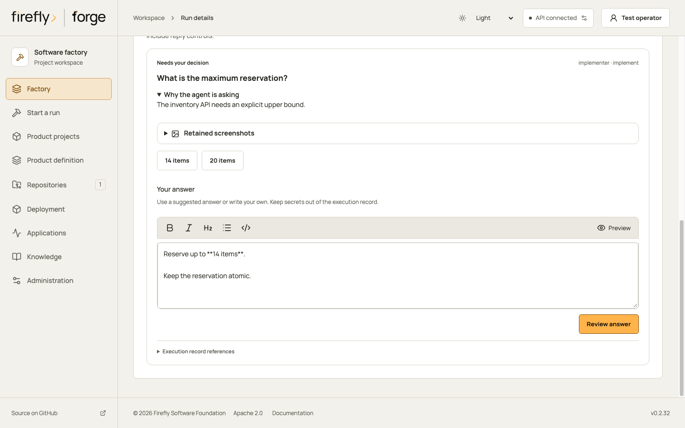
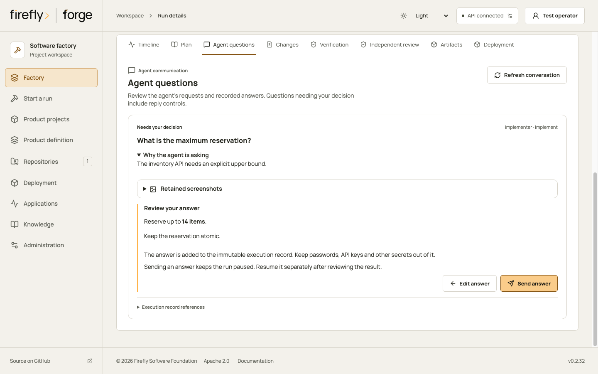
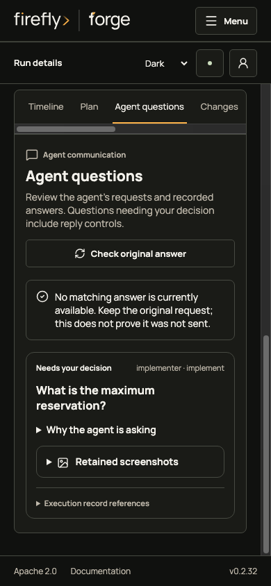
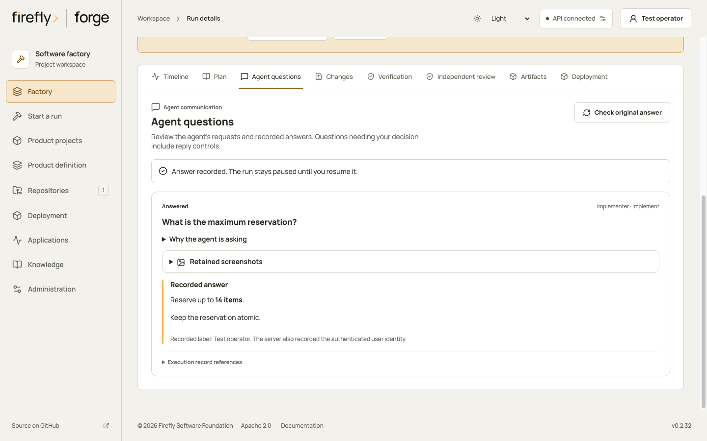
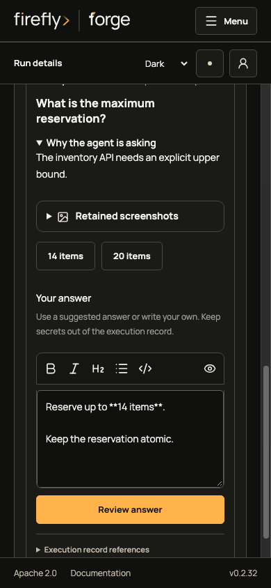
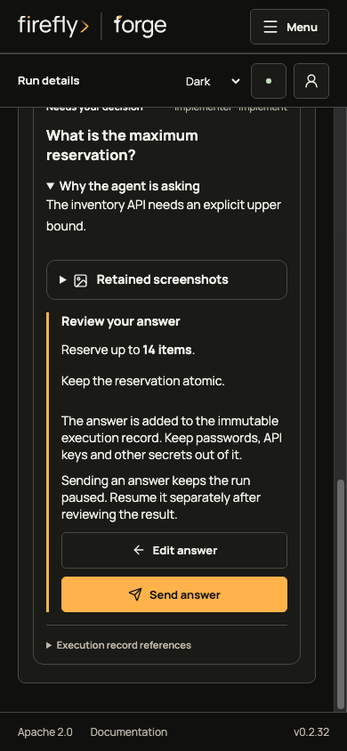
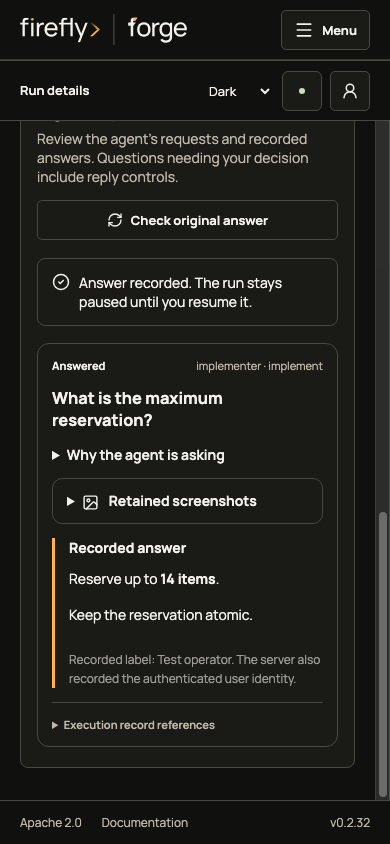

# Agent lifecycle

<!-- Copyright 2026 Firefly Software Foundation. SPDX-License-Identifier: Apache-2.0 -->

Use **Agents & skills** to follow work from a product decision through source delivery and application operation. The lifecycle catalog distinguishes AI dialogue, a run-selected coding provider, and deterministic services. A participant describes an implemented service or instruction binding; it is not evidence that a model session or external action has occurred.

<picture>
  <source media="(max-width: 640px)" srcset="../diagrams/agent-lifecycle-narrow.svg">
  
</picture>

[Open the lifecycle diagram](diagrams/agent-lifecycle.svg) · [Portrait layout](diagrams/agent-lifecycle-narrow.svg)

## Inspect a project's phase configuration

Start with a registered repository you can read. Factory-wide instruction edits require an administrator; project overrides require membership-management permission for that repository.

1. Open **Agents & skills**, select the repository and choose the phase you want to inspect.
2. Read each participant's execution binding. A dialogue participant proposes decisions; the coding provider edits source; a deterministic service performs its configured checks or actions. Optional assurance uses its own selected reviewer.
3. Inspect the applied skills, tool availability and knowledge scope. An injected instruction is prompt context. An executable quality gate runs its declared commands. A configured knowledge connection needs retrieval evidence, and an unverified runner needs a successful runtime check.
4. Use **Edit** on an instruction role to change the permitted instructions, skills or native-tool selections. Save before leaving the project. The next admitted run receives those settings; earlier run and conversation snapshots keep their original revision.
5. Open the actual run or conversation to inspect its frozen inputs and receipts. Use [run evidence](operations.md#inspect-a-run-from-request-to-source) for commands, source and delivery, and [conversation files](assistant-files.md) for the selected model inputs.

The explorer has twelve phase entries and seven editable instruction roles. A role can participate in several phases. Selecting a phase does not start those participants or create twelve model sessions.

API clients can read the same projection at `GET /api/v1/repositories/{id}/agent-roles/lifecycle`. It returns the phase participants, effective role selections, tool catalog, knowledge summary and configuration digests. The factory projection is `GET /api/v1/agent-roles/lifecycle`.

If a requested tool is unavailable, configure its executor and role grant before creating a new run. If knowledge is configured but unverified, perform a [scoped search](knowledge.md#search-and-inspect-citations) and inspect its citations. A denied project view requires current repository access; switching to factory defaults cannot grant it.

## Product decisions

Product dialogue uses the existing `ProductAssistant` task selection. Each admitted turn freezes the selected instructions, their provenance, catalog revision and content digest in its durable context before calling the configured provider. The prompt applies those instructions within a dialogue that has no execution tools. Old turns retain their original snapshot; reusing a request ID returns its existing receipt without another provider call.

| Phase | Participant | Applied instruction skills | Handoff |
| --- | --- | --- | --- |
| Product definition | Product and functions dialogue | Thinking and evidence-first | Customer outcomes, journeys, functional behavior and proposed decisions for owner review |
| Design | Design dialogue | Thinking, frontend design and accessibility | Proposed design guidance; saved reference rendering and owner review remain separate |
| Architecture | Architecture dialogue | Thinking and evidence-first | Proposed component and interface decisions; profile-based architecture previews remain deterministic |

The selected task profile supplies the provider when configured. Otherwise the invocation selects a supported provider explicitly. A profile is configuration, not proof of model access or a successful response. Dialogue proposals cannot assign their own approval, edit source, launch a run, or grant tools.

## Delivery and operation

The canonical phase definitions live in `firefly_forge.agent_lifecycle`. The API projection combines them with the current role registry, repository overrides, policy selection, task bindings and tool catalog.

| Phase | Actual participants | Skills and knowledge | Retained handoff |
| --- | --- | --- | --- |
| Prepare | Product manager, technical lead, architect and security gate bindings | Role skills describe instruction metadata; gates use saved contracts and evidence | Frozen product, architecture, design, source and execution snapshots |
| Implement | One coding provider; optional documentation guidance uses the same worker | Enabled role instructions and selected project policy instructions are injected; project and configured framework knowledge can be retrieved | Source, tests, worker feedback and bounded clarification requests |
| Verify | Technical lead, QA and security gate bindings | Repository checks and selected executable policy gates; frozen source and contract evidence | Actual command outcomes, failures and repair evidence |
| Checkpoint | Technical lead and security gate bindings | Deterministic evidence and source checks | Verified source tree, diff, export and journal checkpoint |
| Assurance | Optional explicitly selected review provider | Review of the immutable verified tree; no separate knowledge retrieval is implied | Findings bound to the reviewed source tree |
| Publication | Security gate binding and source-control publisher | Deterministic source, scope and verification guards | Explicit publication intent and provider review-request receipt |
| Deploy | Deployment manager | Configured target and authorized delivery request; no agent knowledge grant | Deployment receipts, uncertain outcomes and reconciliation status |
| Observe | Application observer | Configured health and metric probes; no model call | Observations, threshold reasons and incident records |
| Maintain | The same coding-provider path with `operation=maintain` | Frozen coding guidance and scoped project/framework retrieval | A maintenance run through implementation, verification and delivery gates |

A `test` operation executes checks on existing source without invoking a coding model. The explorer describes available participants; inspect a run receipt to see which stages actually executed.

An incident can provide context for maintenance; it does not approve deployment or publication. Unknown side-effect outcomes require their existing reconciliation path. The catalog does not execute those actions when an operator selects a phase.

## Skills, tools and knowledge availability

Instruction adaptations retain their source revision, license and adaptation hash. The explorer identifies injected instructions separately from deterministic-role metadata and executable quality gates. Instructions cannot turn an unavailable tool into an available executor.

Scoped runner defaults may expose a configured command, browser or search grant as `worker_unverified`. The execution worker must validate its runtime before using it. Browser and search tools require their configured capability and frozen grants. Official CLI workers follow their native permission controls; Python tool selections do not restrict the CLI's native tools.

Coding and product dialogue retrieval use the selected repository and configured framework workspace. Fresh managed installations include required Flycanon and automatic verified memory; existing connection choices remain preserved. The lifecycle view reports knowledge as configured but unverified, or not configured. It returns no keys, secret references or raw provider settings. Invocation citations and retained receipts establish what was retrieved; configuration alone does not prove access. Deterministic gates use frozen contracts, source and receipts rather than pretending to retrieve framework knowledge.

## Editing and historical evidence

The seven editable instruction roles retain their existing IDs, execution bindings and snapshot digests. Physical participants extend the read projection without expanding the frozen `RoleDocument` contract. Factory role edits and repository skill/tool overrides affect later admitted runs. Assistant task instruction selection is fixed by the implemented task; changing validated catalog instructions affects later turns, never retained turns or a model call already admitted.

Use the lifecycle explorer to inspect current configuration, the run journal for frozen execution evidence, and conversation receipts for assistant history. None of these views substitutes for a live provider response, verified runner receipt, or recorded application observation.

## Knowledge questions and learning feedback

The [learning contracts](learning.md#structure-agent-and-tool-communication) associate each question with its run, task, effective role, actual source, tool result and later verification. A worker can propose a lesson or report a missing reference; native factory services decide eligibility and state changes. Scoped records, policy and projection actions are available through the authenticated API, SDK, CLI and factory MCP. **Knowledge > Learning records** provides read-only inspection in Studio; submission, observation and invalidation use the existing reviewed operator contracts.

The lifecycle projection reports execution bindings and knowledge availability. A recorded citation establishes a particular retrieval result. After actual failed QA, the same-run repair proposal guard can hold another coding dispatch while preserving verification receipts and unresolved effects. Workers cannot change the captured policy or turn a generic failed check into a reusable negative lesson. See [learning decisions](architecture.md#learning-and-structured-knowledge-decisions).

## Factory-owned verification

An implementation worker can return a typed `verification` request when it needs results from the run's approved checks. With a frozen automatic-verification grant, forge runs all explicit `run.commands` through the authorized runner, records their native intents and outcomes, and supplies factory feedback. Request names and question text do not select commands or grant access. Product choices, credentials and approvals still require a person.

New runs default to one verification continuation, with a strict configurable maximum of three. Each completed handoff permits one additional coding task, separately from the frozen repair budget and within the existing four-attempt ceiling. Earlier attempts and failed checks remain recorded. Current authority, source, policy and provider are checked again before effects and the next coding task. [Recovery](recovery.md#inspect-a-factory-verification-handoff) explains holds and explicit adoption for older runs.

The run's verification panel shows command counts and `pending`, `running`, `completed` or `held` state. Completed means every configured command has a known result, including failures. Final acceptance still depends on the run's verification and delivery evidence. An uncertain effect stays held without automatic replay.

**Agent questions** attributes the retained result to factory verification. Its protected version-4 `responding_actor` records `authentication_method: "factory_verification"`, the handoff ID and source, command, policy and provider digests. It is separate from an authenticated human answer; public answer requests cannot supply that provenance. Full bounded results remain in the command receipts, while the recorded answer contains a normalized excerpt of at most 8,000 characters.

For an authorized source-control conversation, the bot reports meaningful changes from native run facts, including system-owned verification, a decision needed from a person, known check results and a recorded review-request link. Central `collaboration/` templates supply the question, controls and recorded evidence. An explicitly selected [communication profile](model-profiles.md#write-project-updates-with-ai) can write a bounded introduction. Feedback still requires current conversation and repository authority. An uncertain remote comment stays held for reconciliation, and a completed implementation does not imply publication.

## Answer an agent's question

When an agent needs a decision, it can pause its current task and record a question. Open the run and select **Agent questions**, or use **Open agent questions** on the **Waiting for your answer** notice. Resume and handoff controls remain unavailable while a human answer is pending. The conversation belongs to that run and its recorded task; answering does not create another run.

1. Read the question and expand **Why the agent is asking**. Suggested answers are starting points; select one or write your own in **Your answer**. The Markdown editor supports formatting and preview. Keep passwords, keys and other secrets out of the answer because it becomes part of the execution record.
2. Select **Review answer**. Check the rendered answer, then use **Edit answer** if it needs correction. No response is sent during editing or review.
3. Select **Send answer** once. Studio retains the original response identity before dispatch and confirms the result through a matching conversation read. Wait for **Answer recorded** before treating the response as retained.

Sending an answer requires a browser with Web Locks support on HTTPS or localhost. This lets Studio keep one original answer request across open tabs. If coordination is unavailable, the form is held and nothing is sent. Use a supported browser and check the original conversation before continuing.

The screenshots below use a fictional inventory question and controlled API responses. They illustrate the editor and recovery controls; they do not establish a live coding-provider conversation, worker execution or a successful resumed run.

<figure class="forge-shot" markdown="1">

<figcaption>Read the recorded question before writing. A suggested answer can be edited; it is not an automatic decision.</figcaption>
</figure>

<figure class="forge-shot" markdown="1">

<figcaption>Review the exact answer, then send it once. Recording the answer keeps the run paused.</figcaption>
</figure>

Sending a human answer records it in the write-ahead log and marks that question answered. The run stays paused. Inspect the retained work before using **Resume run**. Each run allows only one pending question at a time and a bounded number of questions. Factory-owned verification follows its separate grant and continuation limit above.

A service restart does not select an answer or start another coding call for a pending human question. The same question, context and retained evidence remain available when you return. A project viewer may inspect the conversation and screenshots; answering and continuing require current execution permission. Revoked access also blocks image reads and later actions.

The portal retains the API, user, project, repository, run and original response identity before sending. It saves the normalized input digest and question event digest, without saving the answer text or a credential in browser storage. After a connection failure or reload, **Check original answer** reads the existing conversation. A missing response or permission refusal keeps the original identity unresolved. The portal does not resend the answer or create a replacement automatically. Keep browser storage until the original result is reconciled.

If delivery is unconfirmed, use **Check original answer**. A missing result keeps the original request held. Reloading may show the original question without its matching answer; the editor stays unavailable while that response is unresolved. A changed or unreadable stored identity also blocks another answer. Preserve the browser reference and ask an authorized operator to review the retained conversation rather than replacing the request.

### Inspect retained screenshots

Expand **Retained screenshots** when the worker has supplied images with its question. Each entry identifies a recorded file; **View image** reads its protected bytes and verifies their size and SHA-256 before opening the preview. Nothing is fetched from a public image URL. Close the dialog with its close button or Escape to return to the same image control and answer form.

The preview fits the available screen. **View original size** enables scrolling without shrinking small interface details; focus the image region and use the arrow keys. **Fit to screen** restores the overview. The gallery stays collapsed while you write so screenshots do not crowd the answer controls.

forge retains an immutable, re-encoded copy when the question is recorded. Later workspace changes cannot silently replace it. Supported inputs are PNG, JPEG and WebP, with at most six images per question, one megabyte per image and four million decoded pixels. Animated images, SVG, symlinks and files outside the selected component are refused. Current project read permission is checked on every image request. Browser object URLs are revoked when the preview closes or its conversation changes.

These images describe the worker's evidence; they do not approve a design or prove product acceptance. Byte and metadata credential checks are not OCR and cannot remove a password visible in the pixels. Review screenshots before adding them to a question.

### Follow a question from source control

The question card includes recorded context, suggested choices and the next available action. With an enabled answer channel and current consent, it supplies a complete `/forge respond` command. It does not claim that sending an answer resumes execution. Continue separately in forge, or use a continuation command only when that channel explicitly permits it.

When repository replies are unavailable, the card links to the run's **Agent questions** tab using the configured public HTTPS `FORGE_BROWSER_ORIGIN`. Opening the link still requires sign-in and current project access; it performs no execution action. Missing or private browser origins produce an honest run reference and administrator setup guidance. Screenshots stay behind the authenticated API and are never embedded in a GitHub comment through a localhost URL or public access token.

<figure class="forge-shot" markdown="1">

<figcaption>The guide first loses delivery, then observes no matching answer. Checking the original result reads evidence without posting again.</figcaption>
</figure>

<figure class="forge-shot" markdown="1">

<figcaption>A later matching read confirms the original response. The authenticated user is distinct from the displayed operator label.</figcaption>
</figure>

Read and review an answer on a phone

<figure class="forge-shot" markdown="1">

<figcaption>Context, suggested answers and the editor remain in the same run conversation.</figcaption>
</figure>

<figure class="forge-shot" markdown="1">

<figcaption>Scroll the conversation to the actions; sending still requires an explicit review.</figcaption>
</figure>

<figure class="forge-shot" markdown="1">

<figcaption>Use Resume run separately after reviewing the retained work.</figcaption>
</figure>

Reading requires current access to the run's repository and project, when scoped. A reader can inspect the retained conversation without receiving answer controls. New replies require a current authenticated operator with execute access, and release access for a publishing run. The factory checks authority again during admission and before returning the result. It records `responding_actor` separately from the caller-provided `actor` label. Older events remain readable with their original recorded label; that label alone does not prove who authenticated. A refusal after the answer commits does not undo the immutable event, so use readback to establish its outcome.

For integrations, read `GET /api/v1/runs/{run_id}/worker-messages` and send `POST /api/v1/runs/{run_id}/worker-requests/{request_id}/respond` with a stable `id`, an `actor` label and an `answer`. Reusing an ID with changed content is refused. New responses also bind the ID to the authenticated replying user. SDK clients use `worker_messages` and `respond_worker`; MCP clients use `respond_worker_request`. Keep credentials out of all question and answer fields.

**Execution record references** shows the question and answer event digests. The portal checks each displayed event separately. The filtered conversation omits other execution events; inspect the full **Plan > Execution journal** when you need the complete journal verification.
