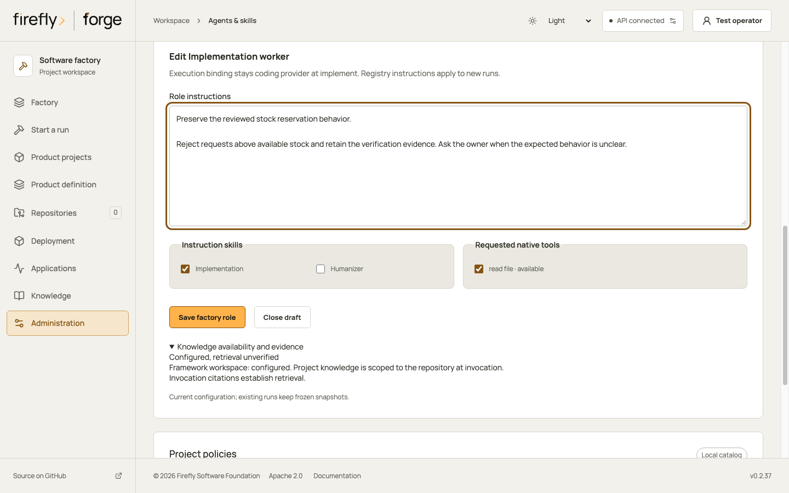
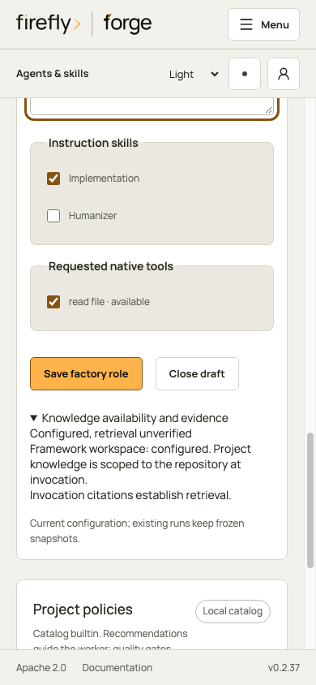

# Factory roles and community skills

<!-- Copyright 2026 Firefly Software Foundation. SPDX-License-Identifier: Apache-2.0 -->

A role assigns responsibility to an actual factory stage. It does not create a separate model session. The default implementation uses one selected coding provider, deterministic planning and source checks, real repository verification, and an optional explicitly configured assurance reviewer.

## Responsibilities and execution

| Role | Execution | Inputs and outputs |
| --- | --- | --- |
| Product manager | Deterministic preparation | Retain customer decisions, journey-to-feature expectations and pending definitions in the frozen handoff. |
| Technical lead | Deterministic preparation, verification and checkpoint | Manage the development plan, bounded repair evidence and delivery checkpoint. |
| Architect | Deterministic preparation | Retain reviewed layers, components, interfaces and knowledge references. No separate architectural model call is implied. |
| Implementer | Run-selected coding provider | Edit the isolated source and tests using frozen product, feature, architecture and design references. |
| QA | Deterministic executable verification | Run configured checks and retain real outcomes. Optional assurance review uses its configured provider independently. |
| Security | Mandatory factory boundary checks | Enforce repository scope, credentials, source integrity and publication checks. This does not claim a penetration test. |
| Docs | Optional guidance to the implementation provider | Write reproducible installation, usage and operational instructions. It uses the same coding session. |

`RoleDefinition` retains responsibilities, provider binding, stages, skills, inputs, outputs, instructions, feedback and escalation guidance. Core execution bindings are fixed to implemented stages. Operators may edit their instructions and skill/tool selections; mandatory factory roles and platform gates cannot be disabled.

## Version and project selection

Authenticated operators read or replace the registry at `GET /api/v1/agent-roles` and `PUT /api/v1/agent-roles`. The replacement is a `RoleDocument` with a version, maximum request budget of 1 to 3, and all seven supported roles. It is stored in private factory configuration.

Project/run role overrides use this shape:

```json
{
  "enabled": ["docs"],
  "disabled": [],
  "skills": {
    "implementer": ["implementation", "test-driven-development", "security", "frontend-design"],
    "docs": ["documentation", "humanizer"]
  },
  "allowed_tools": {
    "implementer": ["list_files", "read_file", "write_file"]
  }
}
```

A new run freezes the registry revision, selected roles, selected instructions, provenance, actual tool availability and a content digest. Later edits do not change that handoff. Product grid, typography and colors belong to the product definition and its brand snapshot, not the role registry. The implementer receives reviewed references; QA compares behavior with the journey-to-feature contract and its acceptance and failure paths.

## Native tools and official CLI tools

Native Firefly Agentic and Bridge inference register only the intersection of requested tools and the available configured executor. The base workspace tools are `list_files`, `read_file`, `write_file`, `search_text`, `edit_lines` and `git_diff`. Commands, browser checks, browser journeys and internet search require their configured executors and explicit frozen grants. An unavailable tool remains unavailable when a role requests it. See [agent tools](agent-tools.md) and [browser journeys](browser-qa.md) for their evidence and limits.

Official Codex and Claude workers use their own native tools and host permissions. The Python native-tool selection is advisory for these CLI workers; it does not establish an equivalent sandbox or restrict their native tool surface. Use the official worker's supported permission controls and a trusted isolated execution host. A role instruction never grants deployment, publication, arbitrary network or credential access.

## Worker feedback and manager requests

Feedback is typed data with a stable ID, role, planned task, attempt 1 to 4, disposition, summary and bounded public workspace evidence paths. Dispositions are `completed`, `failed`, `blocked` or `clarification`. A blocker or clarification must carry exactly one request with an ID, kind, question, context and optional choices.

The manager journals feedback before pausing. Questions survive restarts and do not trigger automatic retries. Replaying the same feedback is idempotent; reusing its ID with different content fails. The frozen request budget limits new questions. A response is evidence of an answer, not deployment or publication approval.

Read the durable conversation at `GET /api/v1/runs/{id}/worker-messages`. An authenticated operator answers through `POST /api/v1/runs/{id}/worker-requests/{request_id}/respond`:

```json
{"id":"response-1","actor":"operator","answer":"Support account owners receive the alerts."}
```

The `actor` field is a caller-supplied label, not authentication. New responses also retain a server-derived `responding_actor` with `version: 1`, the authenticated `user_id`, and `authentication_method` (`oidc_session`, `oidc_bearer`, or `local_bootstrap`). The server requires a matching enabled identity and current project execute permission, plus release permission when the run publishes. Reusing a new response ID requires the same authenticated actor and authentication method as well as the same answer and label. Authorized legacy responses replay unchanged, without fabricated actor metadata.

Response calls must run outside an active caller transaction. Credential admission precedes the server's own transaction; membership, identity, and run locks protect the final authority check through commit. A later permission or credential refusal can prevent returning a response that is already committed. Keep the original response ID and read the conversation after restoring authorized access; an error or missing response is not permission to send another answer. Both conversation and journal reads recheck current read permission and credentials before returning their initial immutable snapshot. Internal reads that started without a principal remain internal, without an authenticated-actor claim. Suspending a caller transaction for read admission does not release its physical locks.

Answering leaves the run paused. Resume explicitly after resolving the question. A pending request must be answered before resuming. Responses remain in the journal alongside prior attempts and their evidence.

An authenticated operator's explicit resume can admit one continuation for an answered implementation question, including when the repair budget is zero. The resume record binds the original question and authenticated answer by their immutable journal digests. Each answer can admit that continuation once, within the run's frozen request bound of at most three and the ordinary maximum of four implementation attempts. Current identity, execute permission and any required release permission are checked before admission. A missing or ambiguous answer, changed question, cancellation or active provider recovery keeps continuation held. Automatic verification retains its separate contract.

The original implementation calls and their usage stay recorded; this does not refund a call or change the repair budget. A question at the fourth attempt cannot create a fifth dispatch. The administrator-reserved final provider allowance remains a separate one-use contract and cannot create a sixth attempt. Answered questions from other factory roles retain their existing resume behavior without adding implementation capacity.

For issue-bound runs, the existing source-control feedback intent records the pending question before posting it. The signed channel parser recognizes an enabled `/forge respond` command in that repository:

```text
/forge respond {"run_id":"0123456789abcdef0123456789abcdef","request_id":"request-1","answer":"Support account owners receive the alerts."}
```

The signed channel receipt supplies a provider actor label and stable response ID, but does not establish an authenticated Forge operator. New replies without that operator context are refused, including internal or channel calls that only supply a label. External actor mapping remains separate work; use the authenticated API or client to answer. The command cannot answer another repository's run, Forge operator credentials are never sent to the provider, and uncertain comment writes require reconciliation rather than blind reposting. `/forge resume` remains a separate enabled action.

## Pinned community instructions

The catalog contains instruction adaptations, not downloaded executable plugins. Each adaptation retains its source commit/file, SHA-256, license text and adaptation hash. Validation detects changed adaptation or license bytes. The original source hash identifies the researched file; it is not a claim that the shortened adaptation is byte-identical to that file.

| Instructions | Source revision | License |
| --- | --- | --- |
| Thinking, TDD, debugging and evidence | [Superpowers bb92a777](https://github.com/obra/superpowers/tree/bb92a77741419a4ab5f06e711a283343f1ada0c3) | MIT; Jesse Vincent |
| Frontend design and browser QA | [Anthropic skills dbd4588f](https://github.com/anthropics/skills/tree/dbd4588f9e1033efb41dad4bef2f7947c8993d44) | Apache 2.0, verified separately for each selected skill |
| Human-readable prose | [Humanizer 225a6f39](https://github.com/blader/humanizer/tree/225a6f39ac85f76ee48dbad772ea4abe4ed6c9d8) | MIT; Siqi Chen |

The adaptations preserve authorized product decisions, factory request/repair budgets and actual tooling. They exclude upstream helper execution, installation commands and automatic commits or publication. Humanizer applies to prose while preserving commands, contracts, code and links; pattern checks do not prove editorial quality. First-party security instructions supplement these sources without claiming a community security certification.

## Lifecycle explorer

The **Agents & skills** workspace starts with the lifecycle explorer. Select factory defaults or a repository, then choose a phase to inspect its participants, execution binding, applied skills, tool availability, knowledge scope and next handoff. Project policies remain below the explorer.

The explorer uses `GET /api/v1/agent-roles/lifecycle` and `GET /api/v1/repositories/{id}/agent-roles/lifecycle`. These read projections describe current configuration. They do not start a conversation, retrieve knowledge, probe a runner, create a run or publish source. The scoped view requires current repository read authority. Global registry edits require a factory administrator; repository role overrides require the existing repository membership-management permission.

Choose **Edit** on an instruction role to change its factory instructions or its project skill and native-tool selections. The execution binding and stages stay fixed. Only documentation guidance can be disabled. A draft survives phase navigation and failed saves; close or save it before changing the project. Saving affects later admitted work and leaves retained run snapshots intact.

Factory instructions open in a full-width writing field with keyboard focus.
Instruction skills and requested native tools have separate labeled groups;
on a narrow screen they stack above the save and close controls. Project role
edits keep the same groups while retaining instructions from the registry.





Product dialogue participants are separate from these seven instruction roles. Their task skills are selected from the current validated catalog and frozen in each admitted turn. They do not reuse the deterministic architect role as a model agent. See the [agent lifecycle guide](agent-lifecycle.md) for the phase, skill and knowledge contracts.
