<!-- Copyright 2026 Firefly Software Foundation. SPDX-License-Identifier: Apache-2.0 -->
# Understand the factory's internals

Follow a run from its authenticated request to its source checkpoint and delivery receipts. The diagrams describe the implemented factory: native pyfly services, a PostgreSQL ledger, retained private storage and one execution leader.

The factory itself uses [pyfly](https://fireflyframework.org/frameworks/python/). A generated project's selected backend can be pyfly, [larafly](https://fireflyframework.org/frameworks/php/) or another supported profile. Product architecture and cloud recipes describe that project's output; they do not establish the factory's own production availability.

## Components and dependency injection

<figure class="forge-shot forge-architecture-diagram" markdown="1">
<picture>
  <source media="(max-width: 640px)" srcset="../diagrams/architecture-components-narrow.svg">
  
</picture>

[Open full diagram](diagrams/architecture-components.svg) · [Portrait layout](diagrams/architecture-components-narrow.svg)

<figcaption>The same services support a combined process and split admission/execution. Read the arrows as responsibility boundaries; coding providers, Git and knowledge services produce effects outside a database transaction.</figcaption>
</figure>

`create_runtime()` constructs the native `PyFlyApplication`, registers `FactoryConfiguration` and the typed controllers/repositories, then resolves their registered dependencies through the container. Domain services also retain explicit collaborators and test seams; this does not establish that every construction path is container-owned. `create_application()` adds the Starlette adapter, request limits, trusted-host middleware and Studio's static build. The worker uses the runtime without an HTTP listener.

| Layer | Concrete implementation | Contract |
| --- | --- | --- |
| Authentication | `OperatorAuth`, `IdentityService`, `AccessRoutes` | Validate identity, protect cookie writes and authorize the requested resource. |
| HTTP | Native `@rest_controller` and typed mappings | Bind actual request models and expose authenticated OpenAPI. |
| Admission | `RunService`, `Store.create_run`, `ProjectCampaigns.launch` | Freeze selected inputs and retain accepted work. |
| Execution | `Engine`, `ExecutionRequests`, `DeploymentManager` | Claim work, check authority and retain observed effects. |
| Context | `RoleRegistry`, `TaskRouting`, `KnowledgeManager`, `SearchTools` | Select instructions, model configuration and scoped cited evidence. |
| Persistence | Native typed `@repository` beans and `SessionProvider.unit()` | Commit records, enforce keys and serialize updates. |

Lifecycle ordering initializes `Store` before topology and execution consumers. The engine acquires ownership before recovering retained work. Worker supervision watches coding, delivery, deployment, campaign, channel and application-observation consumers. A stopped required consumer degrades execution readiness; shutdown closes dispatch and drains effects before releasing ownership. See [runtime roles](runtime-roles.md).

### Native knowledge services

`FactoryConfiguration.knowledge_connection()` injects the private `ConfigurationStore` into `KnowledgeConnection`. `knowledge_manager()` injects `Store`, `Engine`, `Journal`, that connection and `KnowledgeFirst`; it connects the same manager to execution and native knowledge-first tools. `KnowledgeController` uses typed pyfly mappings for configuration, authentication tests, scoped search, source indexing and verified memory. `KnowledgeUploads` has its own injected repository for retained source-upload evidence.

The connection owns authenticated SDK transport and TLS trust. The manager chooses the frozen connection revision, confines repository scope and handles source/canonical receipts. `KnowledgeFirst` combines those cited references with eligible PostgreSQL procedure outcomes before considering configured web search. It cannot treat a search hit as an approved procedure.

Flycanon's server runs in a separate environment, with its own migration and ingestion worker. Installing the Python SDK into forge supplies the client; the managed server image installs the released server independently. The optional flyquery catalog integration has separate connection and project-read services; it does not replace required knowledge or start an analytics worker.

Source: [`api.py`](https://github.com/fireflyframework/firefly-forge/blob/main/src/firefly_forge/api.py) (`FactoryConfiguration`, `create_runtime`, `create_application`), [`worker_runtime.py`](https://github.com/fireflyframework/firefly-forge/blob/main/src/firefly_forge/worker_runtime.py) (`WorkerSupervision`).

### Observed provider activity

`activity_models.py` projects known Codex JSON into small typed summaries; `activity_claude.py` recognizes Claude stream-json content blocks and result messages. Both describe observed output. A requested tool, reported tool result and final provider report remain distinct from the factory's WAL receipts and verification. Claude format recognition supplies no authenticated provider attribution, cross-event tool correlation or inferred exit code.

`Store.event()` retains the sanitized message separately from that bounded projection. Studio renders supported summaries, leaves plain logs readable and offers an explicit verified reader for complete content. Unsupported structured previews receive a generic card. The optional Claude summary fields preserve the existing descriptor version and byte/hash binding; the archive writer, current-authority checks, credential fences and D04 export limits are shared. See [the activity contract](agent-integrations.md#read-complete-retained-provider-activity) and [the operator walkthrough](run-evidence.md#read-complete-provider-activity).

### Durable natural ticket conversations

`SCMNaturalTasks` retains a human message before its configured `communication`
Agentic/Bridge call. Its separate package-owned YAML catalog and the pinned
Humanizer adaptation control the typed reply; the qualified source-edit prompt
manifest is unchanged. `scm_natural_questions.py` projections bind completed typed
product turns or natural replies to confirmed published comments. Worker
questions retain their immutable journal identity. No question is extracted from
untrusted prose.

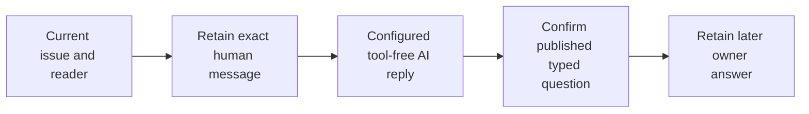

A confirmed pending question allows an unmentioned owner reply in the same thread, including after a restart. Focus and scroll the diagram on a narrow screen.

The `retained_question_reply` source kind records this provenance without
manufacturing a bot mention. Server-owned question references include issue,
repository, actor, binding, producer and exact published text hashes. Parallel
contexts require a readable clarification. Typed product answers and proposals
remain discussion; `NaturalEffects` can project worker answers or continuation
only into the existing current-permission pipelines. Its retained parent/child
cut, answer custody and compare-and-set checks prevent late results from
replacing reconciliation or claiming another channel's answer.

`scm_natural_product.py` hands product requests and exact retained product answers
to `SCMPollFunctionalAuthority`, `ChannelProducts` and the native ProductAssistant.
The separately bounded functional grant owns the architect turn; the communication
classifier cannot spend it implicitly. A new request may create a session or use one
unique issue/account/model-bound session. An answer uses its exact confirmed
question producer. Current authority is rechecked through the existing native
service before effects and after model waits. The original human source, native
request ID, allowance and parent custody are sealed in a separate child receipt.
Completed native replies are quoted directly; no model rewrite is added.

The communication route is resolved once per message. Correction and delivery
checks validate that admitted snapshot against the current profile and routing;
they do not create a new invocation snapshot during each recheck.

One confirmed invalid typed reply may reserve one correction; unknown outcomes
are never replayed. Retained answers survive execution-consent expiry. Applying
one later needs an explicit current review of that same receipt, not another
human comment or silently renewed consent. See [the user journey and exact
qualification scope](scm.md#ask-about-the-current-ticket).

### GitHub polling clarification continuation

`SCMPollResumeGrantInputV3` separates REST-polling continuation consent from status/answer bindings and signed-delivery grants. `SCMPollResumeAuthority` owns current binding, project and native-user checks, immutable consent receipts and bounded history. Its registered pyfly controller, `ForgeClient`, CLI and four MCP tools share the same typed contract. Studio's Mapping, Scope and Review wizard retains one input before submission and reads its exact receipt after an uncertain response.

A natural request to continue the same task is projected server-side to the existing version 2 continuation input under the distinct `github_rest_poll_v1` grant. The explicit `/forge resume` form remains a compatibility reference. `SCMPollResumeAuthority`, extending `SCMResumeAuthority`, rechecks the current account and application outside the database transaction, then native authority and the original clarification cut under the retained locks. Credential admission waits trigger fresh remote and local checks before action and feedback. An unknown intent remains held; queuing the original run records neither provider execution nor final product acceptance.

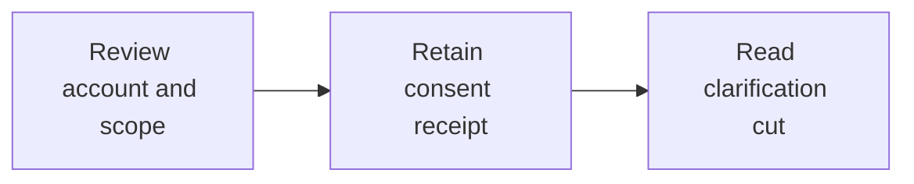

Consent prepares the boundary. A new comment requests the actual continuation:

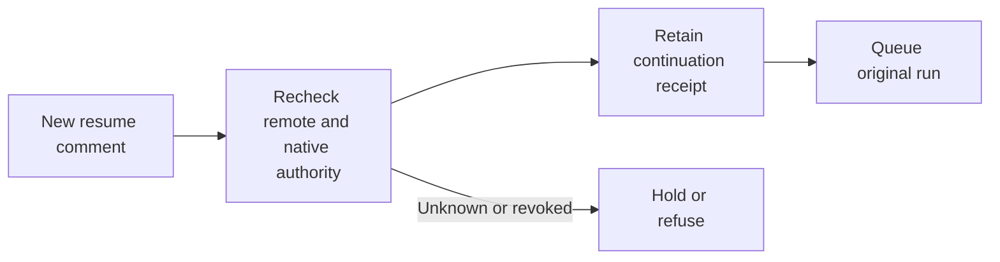

See [polling admission and limits](scm.md#continue-an-answered-clarification-through-polling), the [operator walkthrough](console-tour.md#review-github-continuation-consent) and the native implementation in `scm_poll_resume.py`, `scm_resume_service.py` and `scm_resume_cut.py`.

### Connection OAuth and resource custody

`FactoryConfiguration` registers `OAuthProviderPolicies`, `ConnectionOAuth`, `OAuthResources` and the external MCP registry as separate native beans. Policy admission fixes the issuer, endpoints, resource and scope. The connection service binds client registration and browser attempts to the current actor and immutable revision; it uses public pyfly OAuth client and PKCE APIs. PostgreSQL stores encrypted credentials, grant families, effects and append-only events.

`OAuthResources` signs a project/resource binding and rechecks current policy, registration, grant family/revision, expiry and project authority before dispatch. A schema review and exact repository/tool grant remain mandatory. Current authorization also protects cached broker receipts: a completed result cannot bypass a withdrawn policy or revoked grant.

<figure class="forge-shot forge-architecture-diagram" markdown="1">
<picture>
  <source media="(max-width: 640px)" srcset="../diagrams/architecture-oauth-narrow.svg">
  
</picture>

[Open full diagram](diagrams/architecture-oauth.svg) · [Portrait layout](diagrams/architecture-oauth-narrow.svg)

<figcaption>Consent retains an account grant. Current resource custody, exact schemas and project tool admission remain separate checks.</figcaption>
</figure>

The implemented local service is administrator-only and requires explicit development flags, literal loopback addresses and different factory/provider hosts. The native browser qualification used IPv4 for forge and IPv6 for the owned stock pyfly service. GitHub, Figma, Sentry, Grafana and external Playwright OAuth retain their provider prerequisites. [Connected accounts](connected-accounts.md) explains the actual wizard, typed API and separate MCP admission steps.

Source: [`oauth_provider_policies.py`](https://github.com/fireflyframework/firefly-forge/blob/main/src/firefly_forge/oauth_provider_policies.py), [`connection_oauth.py`](https://github.com/fireflyframework/firefly-forge/blob/main/src/firefly_forge/connection_oauth.py), [`oauth_resources.py`](https://github.com/fireflyframework/firefly-forge/blob/main/src/firefly_forge/oauth_resources.py), [`mcp_registry.py`](https://github.com/fireflyframework/firefly-forge/blob/main/src/firefly_forge/mcp_registry.py).

## PostgreSQL records and transaction boundaries

<figure class="forge-shot forge-architecture-diagram" markdown="1">
<picture>
  <source media="(max-width: 640px)" srcset="../diagrams/architecture-ledger-narrow.svg">
  
</picture>

[Open full diagram](diagrams/architecture-ledger.svg) · [Portrait layout](diagrams/architecture-ledger-narrow.svg)

<figcaption>This is a logical map of retained entities, not an exhaustive schema. Each card names its actual reference or unique key; separate cards do not imply a foreign key between unrelated ledgers.</figcaption>
</figure>

`Store._unit()` uses the injected session provider, sets the selected schema and enables synchronous commit for that database unit. Repository methods use its active session. Row locks protect run/task transitions; request-specific advisory transaction locks serialize campaign or delivery admission. External Git, model, container and knowledge operations happen outside PostgreSQL's atomic commit boundary.

| Record group | Stored relationship or key | What remains separate |
| --- | --- | --- |
| Repository and run | `forge_runs.repository_id` → `forge_repositories.id` | Private credential revisions and the retained Git root are files. |
| Plan and task | Plan `(run_id, revision)`; task `(run_id, task_id)` and `plan_id` | The plan describes work; mutable task state records its attempt and evidence. |
| Journal | Unique `(run_id, sequence)` and `(run_id, idempotency_key, kind)` | A hash-chain record does not make an external effect atomic. |
| Campaign and child | Unique `(project_id, request_id)` and `(campaign_id, component_id, attempt)`; unique child `run_id` | Component source roots and dependency references remain distinct. |
| Delivery requests | Request state plus its own ordered event history | HTTP acceptance precedes the worker's publication/cancellation receipt. |
| Deployment | Run reference, target, status and receipts | Target commands and remote application health need their own evidence. |

PostgreSQL rejects updates to immutable plan/journal history and retained campaign admissions. A completion receipt, task evidence and checkpoint update share one unit; a failed receipt write rolls that unit back. The prior external effect may already have happened, so database rollback alone cannot authorize replay.

Back up the ledger, private revisions, source workspaces, artifacts and retained workspace backups together. See [operations](operations.md) and [factory infrastructure](factory-infrastructure.md).

Source: [`store.py`](https://github.com/fireflyframework/firefly-forge/blob/main/src/firefly_forge/store.py) (`_unit`), [`persistence.py`](https://github.com/fireflyframework/firefly-forge/blob/main/src/firefly_forge/persistence.py), [`project_campaign_persistence.py`](https://github.com/fireflyframework/firefly-forge/blob/main/src/firefly_forge/project_campaign_persistence.py), [`migrations.py`](https://github.com/fireflyframework/firefly-forge/blob/main/src/firefly_forge/migrations.py). Regression evidence: `test_receipt_failure_rolls_back_task_and_checkpoint` and `test_postgresql_refuses_updates_to_immutable_plan_and_journal` in `tests/test_journal.py`.

## Admission, execution and the verified tree

Inspect the admission and execution sequence

<figure class="forge-shot forge-architecture-diagram" markdown="1">
<picture>
  <source media="(max-width: 640px)" srcset="../diagrams/architecture-admission-narrow.svg">
  
</picture>

[Open full diagram](diagrams/architecture-admission.svg) · [Portrait layout](diagrams/architecture-admission-narrow.svg)

<figcaption>The queued response and final source evidence are different events. The leader's self-messages include provider execution and independent checks; a test-only run omits implementation and coding-model selection.</figcaption>
</figure>

`POST /api/v1/runs` captures the selected provider/model revisions, product and component inputs, policies, role instructions, runner capabilities and knowledge/search revisions. Client-supplied product approval must match an existing immutable product revision. A project user's admission requires current project authority and an isolated runner; direct host coding CLIs require administrator authority.

The engine dispatches queued work under a global concurrency budget and one active coding run per repository. It prepares an isolated Git root and records its authorized origin and baseline. The selected coding provider receives the frozen handoff. Factory verification executes commands independently; failed checks return to that provider within the frozen repair budget.

On POSIX, the trusted Codex and Claude CLI launcher preserves inherited ignored signals when its parent already ignores `SIGXFSZ` and has a finite soft file-size limit. This prevents Python's default subprocess signal restoration from converting a rejected oversized write into immediate signal termination. The kernel's file-size limit remains unchanged: a native fixture confirms that the write returns `EFBIG` and leaves the file intact. Python exposes one restoration switch, so this branch also inherits other ignored signals, including `SIGPIPE`; it does not install a signal handler or use `preexec_fn`. Unlimited parents, parents using the default `SIGXFSZ` disposition and the separate untrusted command executor retain subprocess defaults. Process-group cleanup, stream draining and typed outcome checks are unchanged.

| Boundary | Accepted evidence | Failure behavior |
| --- | --- | --- |
| Admission | Retained queued run and selected snapshots | Invalid authority, conflicting inputs or unavailable capabilities refuse admission. |
| Implementation | Actual source writes and a returned provider report | A report without required source writes is failed generation. |
| Verification | Executable commands, real exit codes and the verified source tree | Failed checks remain recorded; a source change invalidates that attempt. |
| Requested review | Approved independent verdict matching the source tree | A missing or mismatched review cannot support delivery. |
| Checkpoint | Actual local commit and matching verified tree | Changed source requires fresh evidence before publication or deployment. |

Inspect `GET /api/v1/runs/{id}`, `/plan` and `/journal`; [the HTTP guide](api.md#follow-evidence-and-errors) explains the returned evidence. The [Studio tour](console-tour.md#4-inspect-the-run-before-continuing) shows readable code, commands and journal fields using explicitly labeled fixtures.

Source: [`store.py`](https://github.com/fireflyframework/firefly-forge/blob/main/src/firefly_forge/store.py) (`create_run`, `claim`), [`engine.py`](https://github.com/fireflyframework/firefly-forge/blob/main/src/firefly_forge/engine.py) (`dispatch_queued`, `execute_run`, `_checkpoint_commit`, `validated_workspace`).

## Development checkpoints and draft reviews

A run can save intermediate Git commits after a completed implementation unit or a safe pause. The project records this workflow as a versioned policy, and admission copies it into each new run. The policy starts disabled. Schedule and delivery-mode changes apply to future snapshots. Disabling the project policy also prevents further checkpoints in existing opted-in runs; their saved commits and frozen policy remain intact. Its schedule counts completed implementation attempts, with a limit of 1 to 20 between checkpoints. It can retain up to 50 checkpoints, including a reserved final checkpoint; a limit of 1 therefore saves only the final verified result. [Save development progress](development-workflow.md) explains the Studio controls.

The factory owns these Git operations. A checkpoint waits for the provider invocation to end, the implementation task to close and all tool outcomes to settle. A typed pending worker question can establish a safe pause. An active coding worker, unresolved tool, unknown provider result, draining owner or revoked permission prevents the operation. The coding model cannot authorize a push by mentioning one in its output.

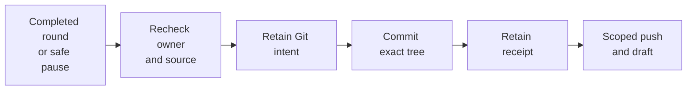

Each checkpoint retains its intent before Git runs. A remote update has a separate intent and receipt. Focus and scroll the diagram on a narrow screen.

### Baseline, checkpoint head and verified tree

| Reference | Purpose | Changes when |
| --- | --- | --- |
| Original base revision | Defines the complete application diff and preserved repository baseline. | It remains fixed for the run. |
| Latest factory checkpoint | Identifies the head accepted by the next coding unit. | A new commit and its matching receipt are retained. |
| Verified source tree | Binds executable checks and any required review to the final source. | Fresh verification accepts a changed tree. |

`GitDeliveries` serializes checkpoint operations for a run. It checks that HEAD equals the original base or the last factory-owned checkpoint, snapshots the source and stages its exact tree. The commit receipt retains the parent revision, new revision, tree, changed paths, patch digest, task and attempt. A foreign HEAD or changed source cut fails admission. Subsequent implementation units use the retained checkpoint head while their full diff continues to use the original base.

`GitDeliveryPolicies` owns project configuration through native pyfly services. The project administrator must have current membership-management authority. Remote delivery also requires release permission and a connected repository whose adapter supports draft updates. GitHub and GitLab have explicit draft lifecycles; an unsupported provider is refused before a remote checkpoint push. Local checkpoints remain available where that remote capability is absent.

### Remote delivery and uncertainty

The remote path obtains scoped credentials from the selected SCM connection, checks the exact repository and branch, and records a separate publication intent. Its Git push binds the expected remote revision with an exact ref lease, and the service independently requires the previous revision to be an ancestor of the new commit. A branch created or reset by another writer is refused; callers cannot opt into history rewrites. The configured communication model drafts the update from typed checkpoint facts. A held communication result produces no remote write. The first successful update creates a draft review; later updates retain that same review identity. Final publication updates and marks that review ready after the ordinary verification and review gates pass.

A local development commit establishes saved progress. Final verification and any required independent review must still match the delivered tree. Marking a review ready does not establish that it has merged, deployed or passed remote CI.

If an owner stops after a local or remote intent, the result stays uncertain until its retained identity and observed repository state can be inspected. A new request ID cannot bypass an unfinished intent. The observation route reads the local and remote state without retrying the effect. This preserves the distinction between an observed branch or review and an authorized recovery action.

### API and worker ownership

| Endpoint | Responsibility |
| --- | --- |
| `GET/PUT /api/v1/projects/{project_id}/git-delivery-policy` | Read or conditionally save the default for future runs. |
| `GET /api/v1/runs/{run_id}/git-deliveries` | Read typed checkpoint history and remote status. |
| `POST /api/v1/runs/{run_id}/git-deliveries` | Queue a bounded request against an exact expected head and source tree. |
| `GET /api/v1/runs/{run_id}/git-deliveries/requests/{request_id}` | Read the request and its ordered event receipts. |

The API records a durable execution request and returns acceptance before Git executes. The owning worker claims the ticket and rechecks authority and source custody. A restart leaves an executing ticket in reconciliation; it is not queued again automatically. Automatic checkpoints use the same factory-owned service at closed implementation boundaries. Studio exposes configuration and receipt inspection without interrupting an active model call.

Source: `git_delivery_models.py`, `git_delivery_policy.py`, `git_delivery_requests.py`, `git_deliveries.py`, `git_delivery_remote.py`, `git_delivery_controllers.py`, `engine.py` and `journal.py`.

## Retained worker context across handoffs

Each later implementation turn receives the authenticated question-and-answer history from its run's WAL, alongside the current response. `Journal.implementation_context()` reads message payloads together with the complete ordered journal headers, checks their hashes and pairs each answer with its unique earlier typed question. A diagnostic therefore survives a later answer about a different blocker. The projection retains the request and task, attempt, actor-provenance digest, journal sequences and timestamps.

The projection permits at most 64 messages and 256 KiB of retained message data, with at most 10,000 journal headers. An oversized or inconsistent history refuses the dispatch. Current project and execution authority are checked before reading and after credential admission; the run scope, current answer and projected history must still match. A cancellation or credential disclosure also prevents use of the context.

These records are marked historical and carry no execution authority. A previous check result describes the source and conditions recorded at that time. It cannot approve changed source, add a command, replenish a budget or authorize a provider retry. The latest answer remains separately identified so the implementer can distinguish a current decision from earlier evidence.

The generated worker-feedback schema includes the same disposition/request condition as the runtime validator: `blocked` and `clarification` require one typed request; `completed` and `failed` require a null or omitted request. A malformed report remains a failed result with its original activity retained. It does not create a synthetic question or an automatic replacement model call.

Source: `worker_context.py`, `Journal.implementation_context()`, `ForgeJournalRepository.find_implementation_context()` and `WorkerFeedback` in `agent_roles.py`.

### Continue after an invalid completed report

A completed native turn can still return an invalid implementation report. The failed activation, archived message, usage and tool receipts remain recorded. An administrator can review a new `known_completed_output` source-budget candidate; the system does not invent a question or reinterpret that output as success.

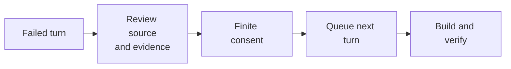

Continuation preserves the failed turn and requires a new source review. Focus and scroll the diagram on a narrow screen.

The candidate binds the exact parent receipt, canonical dispatch, raw Git index, current source manifest and remaining tool budget. Credential admission includes newly created public UTF-8 files without staging them. Submission records the reviewed source and patch digests, a finite expiry and explicit acknowledgments that completed output establishes neither implementation success nor process exit.

Consent, queue state and receipt commit through the physical execution-lease connection. A changed source, revoked administrator, lost owner or failed receipt rolls back admission. The next activation uses ordinary dispatch with its original commands and final-check reserve; an unknown admission is inspected through the retained request rather than resubmitted. A current measured native profile must independently cover the loader and limits. Historical v5/v6 evidence cannot authorize the v7 loader's additional module. The [recovery contract](recovery.md) describes the API, SDK and CLI inputs.

Source: `source_budget_output.py`, `source_budget_allowances.py`, `source_result_readmission.py` and `source_edit_qualification.py`.

## Factory-owned verification handoffs

A coding agent may need checks that its own sandbox cannot perform, such as connecting to the project's dedicated test database. It returns a typed `verification` request. forge executes the run's already approved commands in the configured runner and sends the recorded results back to the coding agent. A product decision, missing credential or unknown side effect is not permission to invent a command or expand access.

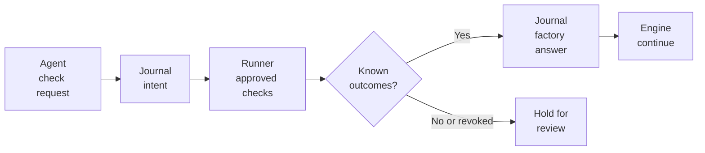

Read from left to right. The journal records intent before execution and results before continuation. On a narrow screen, scroll horizontally or focus the diagram and use the arrow keys.

`VerificationHandoffs` is a native pyfly service registered through the runtime's configuration bean. It uses the same `Store`, `Journal`, `Engine` and `SandboxExecutor` as ordinary execution. The dispatcher applies the existing concurrency and repository ownership limits; a paused verification does not create a second coding run.

The immutable handoff binds the run, pending request, source manifest, approved commands, current policy, provider configuration, implementation attempt and command ordinals. Authority, cancellation, campaign controls and those bindings are checked again before each effect and before continuation. Command output is untrusted data. Its bounded answer excerpt does not replace the original runner receipts.

| Recorded state | Meaning | User action |
| --- | --- | --- |
| Pending or running | forge owns the approved verification step. | Follow progress; no manual answer is needed. |
| Completed | Every command has a known exit code, including any failures. | Inspect the results while the authorized continuation proceeds. |
| Held or refused | Admission failed, authority changed or an outcome cannot be established. | Review the run before authorizing another action. |

The tool policy enables one automatic continuation by default; administrators can disable it or set a finite limit from one to three. Each admitted run captures that policy. The continuation allowance is separate from the repair budget: it does not reset prior implementation rounds or create unlimited repair attempts. The coding attempt limit remains bounded. Failed commands remain failed evidence even when they provide enough information for coding to continue.

A completed handoff writes a version-4 factory-attributed `worker_response`, followed by its automatic resume receipt. Studio presents that response as work handled by forge, rather than attributing it to a person. The same run and workspace continue. A restart can reuse known command receipts, but an unfinished command or provider admission cannot be replayed blindly.

Older runs without an automatic-verification grant stay manual until an authenticated native operator explicitly adopts the exact pending request, retained source and current policy/provider cut. The typed adoption API provides candidate inspection, one retained request identity and exact readback; it does not execute commands inside the HTTP request. See [the API guide](api.md) for the contract.

Progress in the [repository workflow](repository-workflow.md) comes from durable run states. The bot reports starts, checks, questions and delivery outcomes through centralized Agentic templates. A confirmed GitHub comment and a successful product delivery remain separate records.

### Persistent human decisions and image evidence

A pending human `worker_request` keeps its run paused. A normal worker restart reads that retained state without selecting an answer or invoking another coding task. An authenticated `worker_response` records the actor and exact answer once; resumption remains a separate authorized action. Studio hides execution and handoff controls until the human question is answered. Factory-owned verification retains its separate system-response path.

`FactoryConfiguration` injects `WorkerEvidence` into the Engine and its typed controller through pyfly. Before the native question is recorded, the service reads only admitted raster files inside the selected component, decodes them in the existing bounded subprocess and retains private immutable copies. `Journal.worker_feedback()` commits the question and `worker_evidence` manifest in the same PostgreSQL unit. The manifest binds the run, task, question, feedback identity, original evidence path, opaque image ID and canonical image SHA-256. A file without that valid native journal link cannot be served.

Image reads check current native project and repository access, the complete bounded journal chain, manifest bindings and actual private file bytes. The API accepts opaque IDs rather than filesystem paths and returns private, non-cacheable raster responses. Studio verifies size, MIME and hash before creating an object URL, and revokes that URL when its preview closes or changes scope. Byte and metadata credential screening does not inspect text embedded in pixels; image review remains necessary. [The question walkthrough](agent-lifecycle.md#inspect-retained-screenshots) and [API contract](api.md#read-a-human-questions-screenshots) describe the user and client paths.

Source: [`verification_handoffs.py`](https://github.com/fireflyframework/firefly-forge/blob/main/src/firefly_forge/verification_handoffs.py), [`verification_models.py`](https://github.com/fireflyframework/firefly-forge/blob/main/src/firefly_forge/verification_models.py), [`verification_controllers.py`](https://github.com/fireflyframework/firefly-forge/blob/main/src/firefly_forge/verification_controllers.py), [`journal.py`](https://github.com/fireflyframework/firefly-forge/blob/main/src/firefly_forge/journal.py).

## Write-ahead intents, receipts and uncertain effects

Inspect effect ordering and the reconciliation path

<figure class="forge-shot forge-architecture-diagram" markdown="1">
<picture>
  <source media="(max-width: 640px)" srcset="../diagrams/architecture-wal-narrow.svg">
  
</picture>

[Open full diagram](diagrams/architecture-wal.svg) · [Portrait layout](diagrams/architecture-wal-narrow.svg)

<figcaption>A missing receipt holds continuation until actual evidence settles the effect. Reconciliation records what was observed; it does not retroactively make a failed command successful.</figcaption>
</figure>

`Journal.ensure_plan()` creates prepare, implement, verify and checkpoint tasks; test-only plans omit implementation, and requested independent review adds a review task. Later publication, deployment, rollback and memory effects receive their own planned tasks. The plan digest covers its definition and frozen references.

`Journal.intent()` derives a stable UUID5 key from the run, task and attempt. It locks the run before marking the task active and appending the intent. Reusing the key with an existing completion returns a completed disposition; reusing an unfinished intent requires reconciliation. `Journal.receipt()` accepts an active intent and retains the actual result alongside task evidence and the checkpoint.

Each record retains `sequence`, `task_id`, `idempotency_key`, `kind`, payload, timestamp, `previous_hash` and SHA-256 `digest`. `verify_chain()` checks contiguous sequence, the prior digest and canonical JSON content. The first previous hash is 64 zeroes. This detects inconsistent retained history; a database owner who can replace the entire chain can recompute its hashes. No independent notarization is claimed.

An unknown remote publication, deployment or memory write cannot be generically retried. Observe the actual service result and its identity first. Local repair requires recorded failed verification; late errors cannot overwrite a completed effect. Resume retains the run and available session, handoff freezes a new configured provider snapshot, and retry creates a separate attempt. Campaign children must also pass their current campaign control boundary. See [recovery](recovery.md).

Known official-CLI process failures have a separate same-run recovery admission. Its candidate binds current administrator authority, source, Git identity, provider settings and the original failed task. An optional executable adoption adds a server-derived file identity and SHA-256 to that cut. The admission, reservation and dispatch WAL retain the reviewed descriptor; each execution boundary rechecks it. The Engine builds a separate provider for that task with only the executable setting overlaid, so later normal repairs retain the original model configuration and CLI. See [updated CLI recovery](recovery.md#adopt-an-updated-cli-for-one-recovery) for the HTTP contract and installation limits.

The final provider allowance is a separate administrator reservation after a known native fourth-attempt failure. Under the existing PostgreSQL identity, membership and run locks, it appends `provider_recovery_allowance`, its linked version-2 admission, the closed failure and one fifth implementation intent. The allowance is spent at reservation, including an unlaunched or failed dispatch. Candidate review binds the existing source/configuration cut and explicitly adopted CLI identity; no repair or verification grant is reset. The Engine and native feedback writer require the same sealed WAL link and current authority. The legacy recovery and worker-feedback contracts keep their four-attempt bound. See [the final allowance contract](api.md#final-native-recovery-allowance).

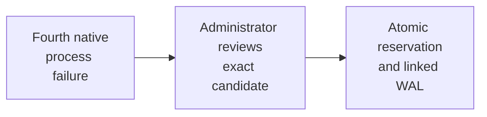

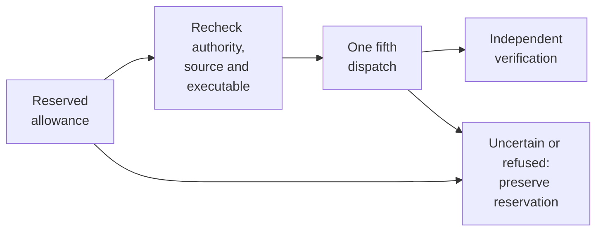

The first row commits the one-use reservation. The second follows execution under renewed checks; an uncertain or refused outcome keeps that reservation spent. Verification remains a separate stage. On a narrow screen, scroll horizontally or focus the diagram and use the arrow keys.

### Scoped configured-check execution

An official coding CLI can receive a separate, explicitly granted `run_configured_check(command_index, request_id)` tool for one final recovery. `CodingCheckGrants` binds the current administrator, future recovery identity, retained commands and runner, source/authority cut, call cap and expiry. Grant admission advances the WAL but consumes no provider dispatch. The final allowance must then name that grant and the same preallocated recovery request.

The parent provider opens an invocation-scoped MCP endpoint on literal loopback. Its closure owns run, task, actor and lease identity; the model supplies only a retained command index and a request ID. `CodingCheckRuntime` checks current authority and budget around credential admission, resolves arguments internally, and calls the existing `SandboxExecutor`. Known results retain their observed source and receipt. A legitimate implementation edit can be checked again within the cap, while an unknown effect holds the invocation rather than allowing another identity to replay it.

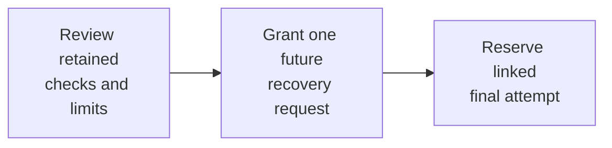

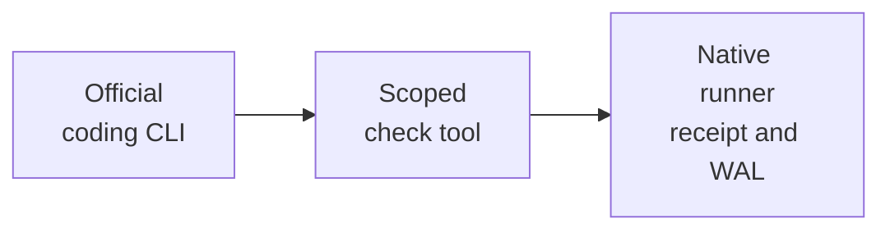

Review and grant before reserving the linked attempt. Each interactive call repeats current authority, source and budget checks; independent final verification follows separately. On a narrow screen, scroll horizontally or focus a diagram and use the arrow keys.

The coding channel is separate from the 188-tool operator MCP server. Its token is invocation-scoped, expires no later than the provider deadline, and is removed from streams and retained activity before storage. Accepted effects drain before teardown. Codex retains `workspace-write`; Claude uses an explicit private MCP configuration with strict server/tool selection. These adapters do not make general role-tool declarations enforceable inside an official CLI. A host runner retains service-account execution with timeout/output controls, without filesystem or network isolation. The grant changes no original snapshot, repair allowance or shared runner budget. See [the recovery journey](recovery.md#grant-configured-checks-for-the-final-recovery) and [native API contract](api.md#scoped-coding-check-grants).

Bridge completion requests follow the same uncertainty rule. A transport failure, unusable completion or cancellation during an unfinished submission retains the original intent and workspace for reconciliation. Local cancellation stops scheduling but cannot establish the remote result. The hold survives cancelled, interrupted or failed run status; resume, handoff and replacement retry check it before dispatch. Recovery of the original Bridge job is not automated. See [provider failure handling](agents.md).

Opt-in implementation checkpoints support explicit continuation at the original model boundary. The checkpoint and Bridge intent commit together before the completion POST. A bounded, read-only candidate projection verifies the retained journal, current authority and original ticket bindings before Studio offers a review. The projection makes no Bridge call and writes no ticket or consume receipt.

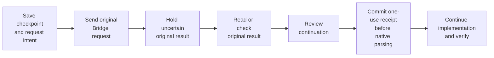

Save the original checkpoint and intent before submitting to Bridge. If the result is uncertain, retain its identity, read or check the original result, then review one continuation. Continuing commits the one-use consume receipt before native parsing, followed by implementation and verification. On a narrow screen, scroll horizontally or focus the diagram and use the arrow keys.

The restore ticket binds the original checkpoint, intent and selected result record. The execution owner repeats authority, source, configuration and deadline checks before restoring native Agentic history with `prompt=None`. The selected response is consumed once before the SDK parser receives it. A failure after that commit cannot authorize replay. A later repair keeps its own task identity; its mutable task key cannot replace the original implementation receipt. Owner recovery retains a committed consume boundary and holds unfinished tickets for reconciliation. Static command, knowledge and evidence tools retain explicit grants. Command-enabled restoration verifies bounded native WAL against canonical, fully completed durable command records. Prior effects must precede the selected checkpoint; later command creation must follow the matching restore consume. Unknown, interrupted, orphaned or altered effects refuse. Fresh commands use the next durable ordinal and preserve lifetime budgets. The checkpoint runtime contract binds the restore implementation, preventing an older contract from silently gaining this behavior. See the [operator recovery journey](recovery.md#review-a-held-result-in-studio) for supported tools and current limits.

Boundary snapshots retain lossless canonical native history within an explicit 8 MiB raw bound. New records above 64 KiB use the version-3 shared-history zlib/base64 codec within the existing 192 KiB snapshot, 256 KiB WAL and 4 MiB per-run retention limits. Equal native history arrays are stored once and reconstructed losslessly; the expanded canonical record keeps its full size/hash binding. This reduces duplication without promising unbounded history or chunked overflow storage. Canonical envelope/base64, raw SHA-256, size, end-of-stream and trailing-data checks precede restoration. Current credential admission scans decoded records at capture, consume, restore and generic journal read without exposing raw history in returned WAL or logs. Generic journal reads suspend ambient unit bindings and inspect one bounded record at a time under current reader/configuration guards. Historical source admission V11 added the decoder to its explicit closure; the checkpoint runtime contract binds custody producer and consumer. The changed version-3 boundary needs fresh source qualification before adoption.

Same-attempt [invalid-read continuity](invalid-read-continuity.md) has a separate registered historical-SDK adapter. It verifies immutable native custody, public history and budget round trips, then derives new checkpoint bytes for the exact supported SDK pair. Its witness binds the original checkpoint, both full contracts, the exact null-or-empty telemetry provenance and the named projection. The original wire must match before a sealed parser receives the already consumed response. The subsequent evidence-tool migration permits only its strict schema and description change. Original actor, source, configuration, unknown-effect custody and execution limits remain checked through current finite-lease admission.

Unavailable pure source observations use a separate version-2 proof, request and settlement. A default-off administrator policy and per-request acknowledgement permit only pinned, granted `list_files` siblings. Sealed adapters return `observation_unavailable` without invoking the original reader or inferring its result. Original response bytes, call IDs, arguments and source custody stay bound. SDK usage advances once for the consumed response and once per original tool call. Singleton continuity and ordinary restore keep their existing contracts.

Credential inspection has no restore authority. For the known SDK epochs, generic journal reads verify native row and chain custody and pass the original bounded canonical JSON to current credential screening. They retain all telemetry and usage fields. Ordinary checkpoint decode and restore remain version-strict; neither credential inspection nor SDK recognition grants another consumption or execution claim. Inclusive reasoning and one-hour cache counters remain preserved without increasing their parent token totals.

Known-worker output settlement is a separate operator-owned native transaction. A complete current-contract HTTP/checkpoint/consume closure must match its declared final output and exact stored typed worker feedback. A hash-only reviewed candidate binds the current operator, task, source/configuration and journal cut. Its immutable receipt retains the original observed hold; the receipt and only its resolved hold projection commit together. No model replay, source adoption, verification, resume or new execution grant is performed. Unknown custody and normal reports without worker feedback remain ineligible for this first path. Whole-journal reads retain inherited capacity boundaries; this is not an elastic-storage claim. See [known-output settlement](checkpoint-verification.md#settle-a-known-worker-output-without-replay).

`BridgeProvider.execute()` creates a separate pending-request set for each invocation. Agentic task-graph children inherit that shared object through a context variable. Each completion tracks its own attempt before transport and clears it after a validated response, an exhausted stream or a known quota/pause response. Completing one request cannot clear another pending request. If the task graph unwraps a cancellation exception, the outer provider checks its own set before returning cancellation to the Engine. Both context tokens are reset when their scopes end. The Engine then records an unresolved submission against the original journal intent before finishing local cancellation. Regression controls cover the real `FireflyAgent` path, concurrent invocations on a shared provider, successive completions and restart through the native Store.

Explicit manual continuation preserves the run's existing retry counter, including an absent field. Automatic retries increment it. Source-control consent can therefore compare the same frozen run fields before and after an authorized manual resume. The run identity, plan and execution actor remain subject to their existing checks.

Source: [`journal.py`](https://github.com/fireflyframework/firefly-forge/blob/main/src/firefly_forge/journal.py) (`ensure_plan`, `intent`, `receipt`, `verify_chain`, `reconcile`, `resume`). Regression evidence: concurrent intent, restart reconciliation, late-error rejection and local-repair tests in `tests/test_journal.py`.

## Deterministic campaigns across components

Inspect atomic admission and dependency release

<figure class="forge-shot forge-architecture-diagram" markdown="1">
<picture>
  <source media="(max-width: 640px)" srcset="../diagrams/architecture-campaign-narrow.svg">
  
</picture>

[Open full diagram](diagrams/architecture-campaign.svg) · [Portrait layout](diagrams/architecture-campaign-narrow.svg)

<figcaption>A campaign coordinates child runs with a frozen graph and retained evidence. It does not start a model-based manager or automatically assemble and test the product.</figcaption>
</figure>

`POST /api/v1/projects/{project_id}/campaigns` takes a fresh `request_id`, a brief, selected coding/review configuration and a dependency gate. Repeating an identical request returns its campaign; reusing the identity for different content is rejected. Selecting components includes their upstream dependencies.

Source commits and runner capabilities are resolved before admission locks. Inside one database unit, launch locks its request, project and repository rows, rechecks the project/configuration vector, and retains all selected child admissions and source bases. A settings change refuses admission instead of mixing revisions. Child runs start as `campaign_blocked`; the coordinator releases ready components into the normal queue.

| Gate or control | Required evidence | What it cannot establish |
| --- | --- | --- |
| `verified` | Nonempty passing executable checks; matching tree/checkpoint journal receipts; matching approved review when requested | A successful status alone is insufficient. |
| `published` | The verified gate plus an actual matching branch/PR publication receipt | Publication does not prove merge, deployment or product integration. |
| Upstream context | Run/source/tree/branch/artifact/publication references | References do not merge upstream code into the downstream repository. |
| Unknown effect | Reconciliation of the child intent or pending control | The coordinator stops release rather than replaying it. |
| Cancel, resume, retry | Explicit campaign request identity and eligible current attempts | Individual run controls cannot bypass the campaign's cancelled or frozen admission state. |

Retry preserves the graph, admitted source base and configuration, and retains earlier attempts. Each component allows three explicit retries. An active downstream component must stop before retrying its upstream dependency. Configure whole-product integration verification separately. [Campaign operations](project-campaigns.md) lists the exact action endpoints and control semantics.

Source: [`project_campaigns.py`](https://github.com/fireflyframework/firefly-forge/blob/main/src/firefly_forge/project_campaigns.py) (`launch`, `_gate`, `_release`, `cancel`, `resume`, `retry`), [`store.py`](https://github.com/fireflyframework/firefly-forge/blob/main/src/firefly_forge/store.py) (`assert_campaign_current`). Regression evidence: `tests/test_project_campaigns.py` and `tests/test_campaign_boundaries.py`.

## Identity, SCM grants and delivery authority

Inspect current authority and repository grants

<figure class="forge-shot forge-architecture-diagram" markdown="1">
<picture>
  <source media="(max-width: 640px)" srcset="../diagrams/architecture-authority-narrow.svg">
  
</picture>

[Open full diagram](diagrams/architecture-authority.svg) · [Portrait layout](diagrams/architecture-authority-narrow.svg)

<figcaption>Admission records who requested work. Execution checks whether that identity and repository grant still permit the effect. Secrets stay in owner-protected server configuration and ephemeral Git environments.</figcaption>
</figure>

Hosted API clients use a validated OIDC token for the configured audience. Studio uses durable server sessions and protected cookie writes. Explicit local bootstrap is limited to its configured loopback mode. Typed inputs, an acknowledgement checkbox or a retained administrator flag cannot replace current server authorization.

`ProjectAccess.authorize_actor()` rechecks the retained actor against current identity and membership. OIDC host administrator authority needs a current, unexpired API-role grant matching the admitted audience. Revoked membership or expired administrator access is honored before effects; admission does not renew sign-in.

`SCMConnections` retains the application's identity separately from its live permissions. Clone, reference and publication operations check the selected repository against current grants. GitHub App tokens are narrowed to the repository; OAuth refresh stays server-side. Git receives short-lived credentials through a scoped environment. Publication also verifies the retained Git root, authorized origin, source tree and checkpoint before recording the actual PR URL.

A signed functional-product change uses a separately approved whole-product capability. It binds the existing project's full component graph, mapped native user, product repository and expected product revision/digest. Provider and credential admission finish before native transaction locks. The transaction repeats current authority checks and stores the immutable product revision and delegated action result together. Exact recovery reads retain the original source and result; they do not authorize another edit or start execution. See [functional product changes from SCM](scm.md#change-an-existing-functional-product).

API replicas retain publication/cancellation requests and deployment operations; the leader dispatches them. HTTP acceptance precedes the effect receipt. See [identity](identity.md), [SCM connections](scm.md) and [worker delivery requests](recovery.md#reconcile-worker-delivery-requests).

Source: [`api.py`](https://github.com/fireflyframework/firefly-forge/blob/main/src/firefly_forge/api.py) (`OperatorAuth`), [`project_access.py`](https://github.com/fireflyframework/firefly-forge/blob/main/src/firefly_forge/project_access.py), [`scm_connections.py`](https://github.com/fireflyframework/firefly-forge/blob/main/src/firefly_forge/scm_connections.py), [`execution_requests.py`](https://github.com/fireflyframework/firefly-forge/blob/main/src/firefly_forge/execution_requests.py).

## Agent roles, native tools and cited context

Product branding enters implementation through a compact file manifest. Engine validates the frozen kit's digest and admits the complete assets against current credentials, then materializes them under `docs/brand/<digest>/` inside the selected component. Each manifest entry carries the component-relative path, UTF-8 byte count and SHA-256. Complete tokens, logos, styles and font-license text stay available through the governed file tools. Existing conflicting content refuses materialization; the file writer also checks the empty-file hash before creating a missing asset. Cancellation, ownership and current project authority are checked around effects.

The manifest passes through the existing brand-instruction template. The complete assembled development brief appears once in the native user prompt; backend/frontend instructions, tool rules and frozen QA descriptors remain separate instructions. Embedded SVG and font CSS therefore stay in source files, while requirements and knowledge remain complete in the brief. This changes context representation without increasing checkpoint limits or silently cutting content. Engine and runtime changes require a newly measured source capability profile before native admission.

Inspect instructions, tool authority and knowledge scope

<figure class="forge-shot forge-architecture-diagram" markdown="1">
<picture>
  <source media="(max-width: 640px)" srcset="../diagrams/architecture-agent-context-narrow.svg">
  
</picture>

[Open full diagram](diagrams/architecture-agent-context.svg) · [Portrait layout](diagrams/architecture-agent-context-narrow.svg)

<figcaption>These are separate contracts, not six independent agents. The implementation provider receives instructions and untrusted cited context; configured executors enforce native tool access.</figcaption>
</figure>

The seven instruction roles bind to implemented stages. Product manager, architect and technical lead preparation are deterministic. The implementer uses the run's selected coding provider. QA runs actual checks, security enforces mandatory factory boundaries, and documentation guidance uses the implementation session. An optional assurance reviewer uses its separately selected provider. Product dialogue participants and task-specific model profiles have their own contracts; instruction roles do not create separate model sessions.

Pinned community skills are instruction adaptations with retained source, hash and license provenance. They do not download or run upstream helpers or authorize publication. Role and policy changes affect later admissions; existing runs retain their selected instruction revision and digest. [Roles and skills](agent-roles.md) and [lifecycle phases](agent-lifecycle.md) explain the projections and feedback handoffs.

Built-in model instructions are versioned YAML resources loaded and rendered by native Firefly Agentic templates. A bounded ID/version/SHA256 manifest validates packaged resources; existing call sites preserve message roles and ordering. Retained role and task instructions keep their original text and digests. The catalog identifies package content, not historical model invocations. See [maintain model instructions](prompt-templates.md) for the resource layout, variable contract and editing checks.

| Runtime | Tool authority | Evidence boundary |
| --- | --- | --- |
| Native Agentic / bridge inference | Requested tools intersected with actual configured capabilities | File scope, credentials and executor grants are enforced by Python. |
| Official Codex / Claude Code | The official CLI's native tools and permission controls | A Python role tool list is advisory; it is not the CLI sandbox. |
| Native browser QA | Fresh Docker context, declared local origin and bounded actions | Layout diagnostics and screenshots require actual visual/interaction review. |
| Native PHP diagnostics | Explicit `profile_php` plus command grant, frozen Docker/archive/network-`none` runner | Runtime metrics or preinstalled Xdebug observations retain command receipts; they do not authorize or approve work. |
| Internet search | Explicit Brave or Tavily selection, retained credential revision and domain restrictions | Bounded cited results are untrusted references; no key goes to the model. |
| Factory MCP | 188 authenticated operator tools in `mcp_server.py` | These API tools are distinct from a coding model's workspace tools. |

Flycanon retrieves `forge-<repository_id>` project context and shared framework references. Required retrieval failure prevents coding continuation. The retained citations/context digest support recovery. A ProductProject does not automatically create an aggregated memory workspace across its repositories.

Automatic memory follows final verification and validated source, retaining source/version provenance in the repository scope. Explicit indexing admits selected verified files. An uncertain memory write must be reconciled in Flycanon before retry. The managed installation includes Flycanon's separate pgvector database, object storage and local embeddings; [knowledge](knowledge.md) and [search providers](search-providers.md) describe configuration and actual readiness checks.

Source: [`agent_roles.py`](https://github.com/fireflyframework/firefly-forge/blob/main/src/firefly_forge/agent_roles.py), [`agentic_runtime.py`](https://github.com/fireflyframework/firefly-forge/blob/main/src/firefly_forge/agentic_runtime.py), [`workspace_tools.py`](https://github.com/fireflyframework/firefly-forge/blob/main/src/firefly_forge/workspace_tools.py), [`knowledge.py`](https://github.com/fireflyframework/firefly-forge/blob/main/src/firefly_forge/knowledge.py), [`search_tools.py`](https://github.com/fireflyframework/firefly-forge/blob/main/src/firefly_forge/search_tools.py), [`mcp_server.py`](https://github.com/fireflyframework/firefly-forge/blob/main/src/firefly_forge/mcp_server.py).

## Learning and structured knowledge decisions

The [learning architecture](learning.md) binds a question to its source, scope and native verification receipts. PostgreSQL decides whether an exact local outcome may be reused; flycanon supplies the cited projection. A run must explicitly permit projected retrieval, and the factory checks current authority, versions and freshness before returning a new or cached result. Studio exposes saved records and projection status through authorized reads. Saved verification is visible history; current eligibility is decided during lookup.

Verified local outcome capture starts outside a caller transaction. A short unit reads the verified run and its receipts; Git inspection, source scanning, declaration observation and credential admission then finish outside the writer unit. The final run lock rechecks the actor, execution permission, run, receipts, configuration and ownership before atomically storing the learning record, both events and its projection. A refusal, cancellation or failed write leaves no partial record.

An invalidation receipt read resolves only the exact committed record/request pair under current review authority. It retains the original event digest and distinguishes the historical decision from the record's current state. New events retain their actor; legacy attribution remains unknown. A missing receipt cannot authorize replay, and the read performs no learning or remote knowledge write. Studio retains each reviewed invalidation in tab storage before sending it once. Recovery requires the exact authorized receipt, including the original actor and reason; current record state or a missing receipt cannot unlock another submission. Actor and factory changes preserve the original marker without exposing its details in another context.

After failed QA, `Engine._repair_proposal` inspects the owned workspace and checks current authority and unresolved effects before another coding dispatch. `repair_proposals.py` takes the native run lock, checks the frozen plan and policy against the intact journal, and counts distinct completed verification rounds with the same source, context and failed-command fingerprint. A stable receipt-bound key retains the decision across interruption. The effective cap is the lower of two and the captured repeated-attempt limit; disabling learning preserves the existing no-progress stop. An unknown effect requires reconciliation before that decision.

| Native component | Decision it owns | Evidence retained |
| --- | --- | --- |
| `LearningLedger` | Capture verified outcomes and evaluate exact local reuse | Question, scope, source, versions, checks and review receipts |
| `LearningProjection` | Submit or observe a separate flycanon projection; read an exact eligible citation | Captured target, source identity, content digest and citation |
| `LearningObservationAttempts` | Admit one existing-source verification and distinguish a local refusal from uncertainty | Original actor and target, input/source fingerprints, dispatch state and exact observation event |
| Repair proposal admission | Permit or hold the next same-run coding proposal after actual QA | Native verification receipt, matching round count, policy digest and decision |

The proposal cap leaves verification commands, diagnostic checks, intentional RED tests and test-only runs available. It does not classify an approach as invalid across runs. Cross-run negative learning, reviewed sharing between projects, Studio source submission and ingestion reconciliation remain separate work.

### Existing-source verification transactions

`LearningObservationAttempts` is a native pyfly `@service`, explicitly registered by `create_runtime`. `LearningController` receives that same service through constructor injection, sharing the runtime's projection, store and learning ledger.

Each v2 attempt has a separate `obs2_` identity and a PostgreSQL row unique to its record and request. Admission locks the run, record and existing attempt in that order. A fresh identity is refused unless every earlier v2 attempt for the record has an intact `not_dispatched` receipt. A duplicate identity returns its retained outcome without another remote read.

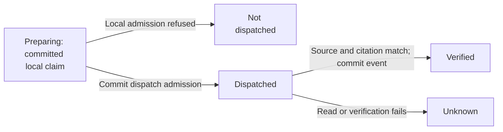

Follow each committed state from left to right. On a small screen, scroll horizontally or focus the diagram and use the arrow keys. A new reviewed request has a different identity; terminal receipts stay unchanged.

The claim commits before local preflight. Dispatch admission commits before the flycanon client opens; no database lock is held across the remote source and citation reads. Verification then locks and checks current authority and the original projection again, committing the observation event, projection update and terminal receipt together. Remote reads and the local commit are separate boundaries. Cancellation or an interrupted acknowledgement can leave `preparing` or `dispatched` unresolved; neither state authorizes another request.

Native PostgreSQL guards preserve the attempt's origin and terminal outcome. An exact receipt read checks the current actor and scope, credential admission, retained digest and, for a verified attempt, the original observation event. It does not contact flycanon. Only a confirmed `not_dispatched` outcome can enter Studio's explicit correction flow; that flow preserves the old receipt and reviews a different request identity. The [operator contract](agent-integrations.md#exact-observation-attempts) defines its fields, digest encoding and recovery limits.

Source: [`learning.py`](https://github.com/fireflyframework/firefly-forge/blob/main/src/firefly_forge/learning.py), [`learning_projection.py`](https://github.com/fireflyframework/firefly-forge/blob/main/src/firefly_forge/learning_projection.py), [`learning_observation_attempts.py`](https://github.com/fireflyframework/firefly-forge/blob/main/src/firefly_forge/learning_observation_attempts.py), [`repair_proposals.py`](https://github.com/fireflyframework/firefly-forge/blob/main/src/firefly_forge/repair_proposals.py). The [learning guide](learning.md#review-saved-records-in-studio) explains record inspection, guarded invalidation and exact-request recovery.

### Structured analytics boundary

`FactoryConfiguration.analytics_connection()` injects the private configuration store into `AnalyticsConnection`. `project_analytics()` injects that connection, `Store`, `ProjectAccess` and `ForgeAnalyticsBindingRepository` into `ProjectAnalytics`. The registered `ProjectAnalyticsController` provides typed configuration and read mappings. The optional `analytics` dependency group supplies flyquery SDK 26.10.4; a missing SDK prevents remote reads and does not prevent a locally authorized disable.

Configuration admission compares the expected revision under the project lock and native transaction. Schema 29 adds the project binding head and append-only configuration receipts; database triggers reject receipt updates and deletes. Private token files are retained separately from public settings and receipts. There are 32 ordinary revisions, with one unchanged-scope terminal disable from enabled revision 32 to disabled revision 33. A terminal binding cannot be edited or re-enabled.

Before a remote read, the service captures the current native actor, project authority, binding and credential revision. The SDK GET executes outside the database unit of work. The service then rechecks that cut and refuses changed identity, authorization, configuration or credentials before returning the result. Responses are bounded to 256 KiB, with a ten-second remote deadline and three-second connection limit. One read per project/actor is active in each API worker. This is a worker-local bound, not a distributed semaphore.

Catalog access returns at most 50 tables in one complete page. A table or exact schema object must match the saved tenant, workspace and dataset; an object also matches its parent table's reported current snapshot. The observation retains a response digest and timestamp. Remote snapshot identity does not establish content integrity or an atomic data cut. The adapter does not execute SQL, call a model, export the factory ledger, publish memory or use user-tier query routes as an agent-token fallback.

The [structured analytics guide](structured-knowledge.md) covers the actual Studio wizard and reader. Its later sections describe future snapshot export and query execution, including isolation and write-ahead admission requirements. No managed flyquery server or query worker is provisioned by the current adapter.

## Runner ownership, collection and takeover

Inspect fences, executor results and takeover

<figure class="forge-shot forge-architecture-diagram" markdown="1">
<picture>
  <source media="(max-width: 640px)" srcset="../diagrams/architecture-runners-narrow.svg">
  
</picture>

[Open full diagram](diagrams/architecture-runners.svg) · [Portrait layout](diagrams/architecture-runners-narrow.svg)

<figcaption>The API can retain work while a worker is unavailable. A standby begins recovery only after both fences are available, and it does not repeat an effect whose outcome remains unknown.</figcaption>
</figure>

The leader holds a private-storage lock and a PostgreSQL schema advisory lease. The topology also binds the resolved storage path, owner and protected storage-identity marker. Split replicas need the same durable storage at the retained paths. A copied marker or same-host Compose volume does not establish working multi-host storage.

The legacy `RunnerBackends` selects host or Docker and rejects a future `pool_binding` rather than falling back to either transport. Administrator opt-in command pools use the separate Factory worker and controller contract described in [execution runners](sandbox.md#administrator-opt-in-local-command-pools). Host commands run as the worker identity. Docker uses the explicit context, frozen image/resource/network policy and confined workspace; browser execution has its separate no-network local-origin profile.

Docker result collection prepares a complete replacement tree, retains the returned archive, and uses an atomic directory exchange. It checks both directory identities and preserves local Git/credential metadata. Failed or uncertain collection retains its archive, original tree or containers for reconciliation; repeating the invocation does not rerun the command. Source replacement is a filesystem effect with its own receipt, not a PostgreSQL transaction. See [runners and source collection](sandbox.md).

Lease loss closes dispatch and stops consumers. If old effects cannot drain, the storage fence remains held even when the database connection closes. A standby waits until the old process actually exits or all retained effects stop. Timeout alone does not prove safe takeover. Standbys add availability, not active capacity; API health reports remote worker availability as unknown.

| Surface | Current implementation | Separate boundary |
| --- | --- | --- |
| Split runtime | API replicas, one leader, waiting workers and administrator opt-in local command pools | Complete provider/browser placement, Kubernetes and shared multi-host storage require separate qualification. |
| Host, Docker and command-pool executors | Frozen supported transports and retained invocation evidence | A legacy `pool_binding` cannot activate a command pool or select another transport. |
| Native tool registry | Built-in workspace/browser/search tools and reviewed text-only GitHub MCP tools | External tools need exact schema review and current project grants; other catalog templates remain prerequisites. |
| Product cloud recipes | Generate repository-bound infrastructure/deployment inputs | They do not demonstrate the factory's production availability or a live target. |
| External design services | Reviewed retained design/reference inputs | No general Figma account access or connector entitlement is established. |

Source: [`runtime_roles.py`](https://github.com/fireflyframework/firefly-forge/blob/main/src/firefly_forge/runtime_roles.py), [`engine.py`](https://github.com/fireflyframework/firefly-forge/blob/main/src/firefly_forge/engine.py) (`start`, `prepare_shutdown`, `stop`), [`runner_backends.py`](https://github.com/fireflyframework/firefly-forge/blob/main/src/firefly_forge/runner_backends.py), [`sandbox.py`](https://github.com/fireflyframework/firefly-forge/blob/main/src/firefly_forge/sandbox.py), [`git_workspace.py`](https://github.com/fireflyframework/firefly-forge/blob/main/src/firefly_forge/git_workspace.py). [Runtime roles](runtime-roles.md) describes readiness and shutdown contracts.

## Read the Studio floor as a projection

Stage labels and the floor scene follow returned plans and jobs. Failed or paused work stays at its recorded stage; hidden, stale, offscreen or reduced-motion scenes suspend motion. Motion and timestamps do not establish completed tasks or percentage progress. Inspect the actual [run evidence](console-tour.md#4-inspect-the-run-before-continuing) and [recovery controls](recovery.md) before accepting or continuing work.

## Outbound communication wording

`Collaboration.feedback` captures the current native run and prepares its deterministic card. `CommunicationWriter` resolves only the explicit `communication` task, validates the frozen model profile, and invokes the bounded drafting/classification flow. Bridge uses prompted structured JSON through the existing OpenAI-compatible adapter; API profiles use the existing native model adapter. Central YAML/Jinja templates own the instructions and composition.

The draft references recorded run facts and selected check excerpts. The current human question reaches both writer and reviewer as a digest-bound quotation; it helps answer the request but grants no execution authority. Request template `collaboration/communication-request` version `1.0.3` supplies the exact allowed paragraph citation IDs from that packet. Citations name top-level groups such as `state`, rather than a JSON path such as `state.status`; unknown IDs remain invalid. The earlier template is retained for provenance. After validation, the service reads the run again. A changed milestone or fact-packet digest discards the draft and holds configured AI delivery without a substitute card. The retained intent contains the exact body, body hash, fact hash, prompt hash and profile revision before the existing remote-write boundary. Current actor, credentials and selected model routing are checked again there. Existing fingerprints and remote-outcome reconciliation continue to prevent automatic duplicate comments.

System template `collaboration/communication-system` version `1.0.8` asks the agent to write the complete card: a specific title, useful paragraphs and, when needed, the exact human question and choices. The existing skill injector includes the pinned Humanizer adaptation in the real instructions. Its revision and adaptation digest are retained; no upstream script or installation is executed. The fact packet includes internally consistent saved check totals, native acceptance/review-link state and an allowlisted source-safety blocker. That blocker comes from the recorded error; it is not an independent security diagnosis. Arbitrary raw errors and provider summaries remain withheld. Known guard refusals have display-only reason codes; they do not establish a root cause or permit recovery. Final-check commands can supply separately identified diagnostic excerpts after privacy filtering. Output excerpts are offered only for nonzero exit codes; successful output stays in the complete activity history. The title and paragraphs cite exact fact groups, including the offered blocker and check context. A separate AI reviewer evaluates claims against those same facts; word matching does not decide whether a negation is a positive claim.

`CommunicationCard` is a strict structured output with a cited title, cited paragraphs, optional section headings or bullet items, and an optional decision quotation. The AI chooses the useful structure for the current question. An optional `diagnostic_id` selects an existing final-check command or output excerpt; the model cannot supply replacement code or log bytes. `communication_diagnostics.py` preserves line breaks, marks current/retained/unknown provenance, withholds sensitive-looking assignments or private-key material, removes local paths and destinations, and retains the truncation flag. Known-credential rejection and the existing current-facts check still apply. Adaptive code fences prevent a log fragment from escaping into mentions or links. Central `collaboration/communication-card` and `collaboration/communication-decision` templates apply Markdown formatting to that output. They do not append a generic status card. The original templates remain available for provenance. A human decision must retain the complete bounded public question, context and ordered choices; oversized quotations hold configured AI delivery. No generated answer can resume work or grant permissions. Drafting uses one tool-free request with a 1,400-token output ceiling. A separate tool-free `CommunicationReview` request has a 700-token ceiling. A factual refusal, uncertainty or failed reader check triggers one final AI correction, after which forge responds without another semantic veto. SDK retries are disabled and all calls share one selected-profile deadline capped at 120 seconds, including bridge queue time. The underlying run, WAL and native receipt remain authoritative.

After any generation outcome, the service checks the current milestone and fact digest again. If either changed during configured AI wording, it holds delivery without posting stale prose or substituting a generic card. Delivery testing includes direct review of the actual published wording: an AI-mode receipt alone does not establish that the update is useful.

Generation is optional presentation work with one total deadline and bounded per-request tokens. It cannot resume execution, increase a repair budget, approve a review or answer for a person. Held-delivery reasons remain in the native receipt; actual delivery and product acceptance require their own evidence.

### Semantic review of source-control messages

The writer and reviewer are separate `FireflyAgent` invocations using the same selected communication profile. The reviewer sees only the exact structured candidate and bounded recorded facts. The candidate is quoted data, not instructions. Its strict result contains a factual verdict, five required reader checks, issue categories, fact references and a short rationale. Review template `collaboration/communication-review-system` version `1.0.5` checks claims, check provenance, pending human decisions and exact diagnostic choices. The model separately supplies strict booleans for `answers_question`, `relevant_detail`, `no_redundancy`, `plain_language` and `useful_excerpts`. Any false check triggers the existing single correction, even when the factual verdict is supported. Editorial issues can explain that failed check without changing the factual verdict. Missing, extra or non-boolean reader fields hold delivery rather than becoming an assumed pass. It evaluates meaning instead of enforcing a fixed set of headings or a banned-word list. It neither rewrites the candidate nor uses tools.

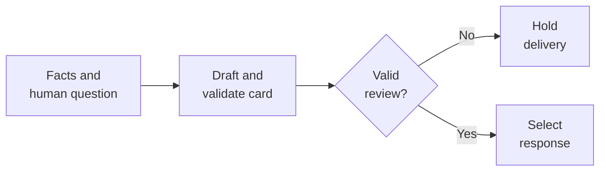

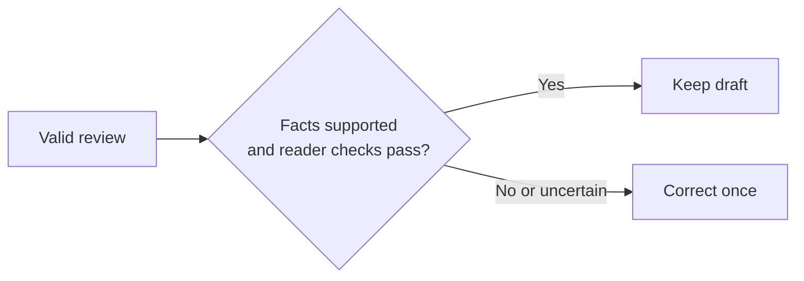

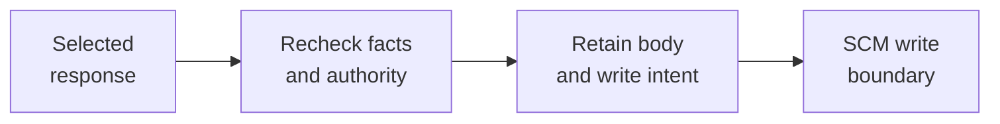

Read the three stages from top to bottom: validate the review, select or correct the response, then recheck authority and retain the write intent. Focus and scroll each stage on a narrow screen.

A supported verdict cannot grant permissions, change the execution plan, answer a pending question or bypass source freshness. Native validation requires known, nonduplicate review references covering every candidate citation. A supported factual verdict proceeds directly only when every reader check passes and there are no issues. Supported facts with a false reader check may carry editorial issues and trigger one correction; contradictory factual issues remain invalid. Unsupported claims or uncertainty also trigger that correction. There is no second semantic veto. The retained review applies to the original candidate; the corrected candidate has its own digest. Malformed reviews, timeout and provider failure hold delivery with a reason and no substitute template or automatic repeated calls. The candidate and review prompt digests bind the classification to the reviewed text. An AI verdict can still be wrong; direct review of real published messages remains an acceptance step.

Publication drafts use the same strict reader-check model and single-correction path. Both `collaboration/publication-system` and `collaboration/publication-review-system` are pinned to version `1.0.1`. Their editorial contract asks whether the proposed PR explains its objective, change and verification in professional American English. Selected excerpts must come from supplied diagnostics; a reported change or source hash still supplies no remote publication authority.

### Native Agentic tool custody

`AgenticToolCustody` is scoped to one native implementation invocation. The factory installs `AgenticToolCapability` on the actual `FireflyAgent`, using its public `AbstractCapability.wrap_tool_execute` hook. Exact model-facing call IDs, raw argument encodings and SDK-validated arguments are retained together with task attempt, invocation/checkpoint/request-history digests, current authority binding, and before/after workspace identities. Checkpoint-enabled execution uses the retained invocation identity; other native invocations receive a fresh identity and refuse reuse from a different scope.

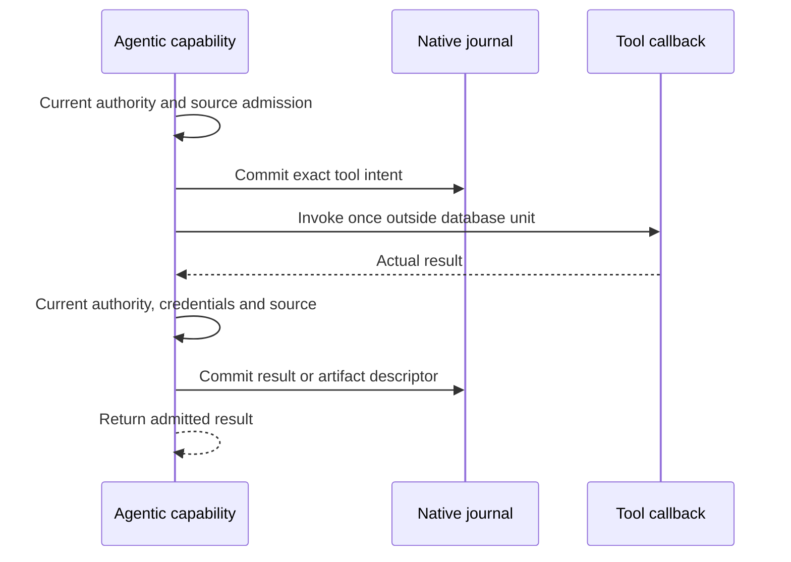

The intent is committed before the callback. Current authority, credentials and source are checked again before the result is retained and returned. Focus and scroll the diagram on a narrow screen.

The append-only `agentic_tool_*` journal domain is independent of broker invocation rows and command budgets. Native run locks serialize intent/result writes, while callbacks, source inspection and artifact IO occur outside database units. Separate effect-link rows are appended in the nested effect's transaction and leave its original row/WAL payload unchanged. The result contains exact references to those links. Reuse verifies the full journal chain and scalar envelopes before current credential and source admission. An uncertain callback never becomes eligible for automatic reexecution.

Small JSON values remain inline. Larger values are retained as owned, private, single-link regular JSON artifacts with content-addressed names, durable file/directory synchronization and verified readback. Journal descriptors retain their encoding, size and SHA-256. Missing native capture context and tools outside the initial nine text handlers are explicit usage metadata, not an implied durability guarantee. See [agent lifecycle](agent-lifecycle.md#durable-native-tool-observations) for coverage and recovery boundaries.
