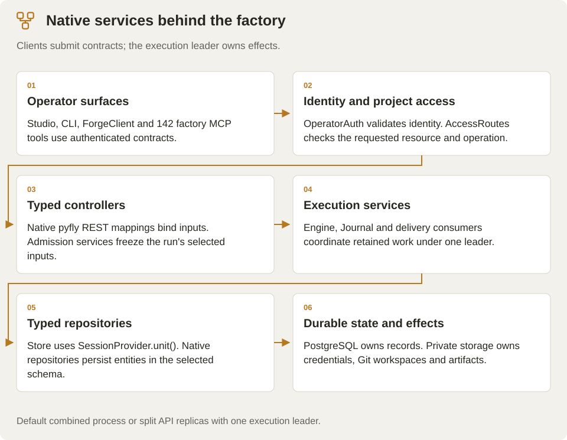

<!-- Copyright 2026 Firefly Software Foundation. SPDX-License-Identifier: Apache-2.0 -->
# Understand the factory

firefly forge uses native PyFly dependency injection, REST controllers and relational data repositories. PostgreSQL owns the durable ledger. A local run engine executes isolated Git workspaces; official coding providers and Firefly Agentic implement source changes. Studio, the CLI and MCP operate the same authenticated API.

## Native application layers

| Layer | Implementation | Responsibility |
| --- | --- | --- |
| HTTP | `@rest_controller`, method mappings, typed body/path binding and native OpenAPI generation | Validate requests and expose the real application contract |
| Operator access | Native PyFly `OncePerRequestFilter` | Protect API routes and retain safe response headers |
| Services | Constructor-injected run, provider, policy, source-control, knowledge, journal and deployment services | Coordinate actual operations |
| Data | Native PyFly typed `@repository` beans, ORM entities and `SessionProvider.unit()` | PostgreSQL transactions, claims and durable evidence |
| Lifecycle | PyFly service phases | Initialize persistence before pollers and stop consumers before releasing resources |

Private credentials use owner-protected files outside source workspaces. Public records contain configuration revision IDs and secret-presence flags. Queued runs freeze provider and policy inputs; retrieved knowledge is retained with citation IDs and a context digest for continuation.

## One project, one active coding run

The engine clones the registered branch into a run-owned workspace and records its original revision. It limits active work globally and permits one active coding run per repository. Round-robin project selection prevents one project's backlog from filling the local worker slots.

The selected worker receives the brief, mandatory framework contract, selected policy instructions and available cited knowledge. The verifier runs real commands independently. Failed checks return to the same worker within a bounded repair budget. Source changes caused by verification invalidate that attempt.

A successful build or maintenance run records the passing tree and creates a local factory checkpoint commit. The consumer checkout remains untouched. The diff and changed-source archive use the original baseline, while publication and deployment require the recorded checkpoint and verified tree to match the retained workspace.

## Plans and write-ahead evidence

A durable plan contains prepare, implement, verify and checkpoint tasks. Test-only plans omit implementation. Intents are recorded before effects; completion receipts record observed outcomes. The journal forms a hash chain and preserves earlier attempts and explicit handoffs.

An interruption leaves an unacknowledged effect requiring reconciliation. Resume inspects the retained Git root, authorized origin, HEAD and source tree. Publication, deployment and memory writes with unknown remote outcomes are not silently repeated. [Recovery](recovery.md) describes the controls and their limits.

## Knowledge and source control

[flycanon](knowledge.md) supplies project-scoped retrieval and optional framework context. Explicit indexing sends selected verified source files. Verified project memory is opt-in and is stored with actual provenance; retrieval remains distinct from model generation.

Provider-owned [SCM applications](scm.md) manage repository grants externally. GitHub App installation tokens are narrowed to the selected repository. OAuth credentials and token refresh stay server-side. Git operations receive ephemeral credentials through a scoped environment, and publication rechecks repository authorization.

## Read the Studio floor

The factory floor groups actual plans and jobs by project and stage. Its active animation follows running work; reduced-motion preferences suppress animation. Completed work has durable receipts and verified outcomes. Neither timestamps nor decorative machine motion estimate completion percentages.

The service is a local execution control plane for trusted operators. Its workspaces protect consumer checkouts, while commands and generated code still run with the server identity. [Security](security.md) describes that boundary.
