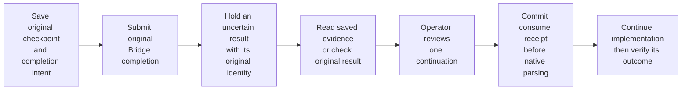
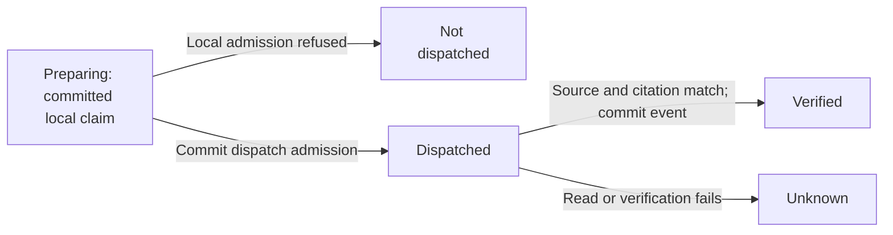

<!-- Copyright 2026 Firefly Software Foundation. SPDX-License-Identifier: Apache-2.0 -->
# Understand the factory's internals

Follow a run from its authenticated request to its source checkpoint and delivery receipts. The diagrams describe the implemented factory: native pyfly services, a PostgreSQL ledger, retained private storage and one execution leader.

The factory itself uses [pyfly](https://fireflyframework.org/frameworks/python/). A generated project's selected backend can be pyfly, [larafly](https://fireflyframework.org/frameworks/php/) or another supported profile. Product architecture and cloud recipes describe that project's output; they do not establish the factory's own production availability.

## Components and dependency injection

<figure class="forge-shot forge-architecture-diagram" markdown="1">
<picture>
  <source media="(max-width: 640px)" srcset="../diagrams/architecture-components-narrow.svg">
  
</picture>

[Open full diagram](diagrams/architecture-components.svg) · [Portrait layout](diagrams/architecture-components-narrow.svg)

<figcaption>The same services support a combined process and split admission/execution. Read the arrows as responsibility boundaries; coding providers, Git and knowledge services produce effects outside a database transaction.</figcaption>
</figure>

`create_runtime()` constructs the native `PyFlyApplication`, registers `FactoryConfiguration` and the typed controllers/repositories, then resolves their registered dependencies through the container. Domain services also retain explicit collaborators and test seams; this does not establish that every construction path is container-owned. `create_application()` adds the Starlette adapter, request limits, trusted-host middleware and Studio's static build. The worker uses the runtime without an HTTP listener.

| Layer | Concrete implementation | Contract |
| --- | --- | --- |
| Authentication | `OperatorAuth`, `IdentityService`, `AccessRoutes` | Validate identity, protect cookie writes and authorize the requested resource. |
| HTTP | Native `@rest_controller` and typed mappings | Bind actual request models and expose authenticated OpenAPI. |
| Admission | `RunService`, `Store.create_run`, `ProjectCampaigns.launch` | Freeze selected inputs and retain accepted work. |
| Execution | `Engine`, `ExecutionRequests`, `DeploymentManager` | Claim work, check authority and retain observed effects. |
| Context | `RoleRegistry`, `TaskRouting`, `KnowledgeManager`, `SearchTools` | Select instructions, model configuration and scoped cited evidence. |
| Persistence | Native typed `@repository` beans and `SessionProvider.unit()` | Commit records, enforce keys and serialize updates. |

Lifecycle ordering initializes `Store` before topology and execution consumers. The engine acquires ownership before recovering retained work. Worker supervision watches coding, delivery, deployment, campaign, channel and application-observation consumers. A stopped required consumer degrades execution readiness; shutdown closes dispatch and drains effects before releasing ownership. See [runtime roles](runtime-roles.md).

### Native knowledge services

`FactoryConfiguration.knowledge_connection()` injects the private `ConfigurationStore` into `KnowledgeConnection`. `knowledge_manager()` injects `Store`, `Engine`, `Journal`, that connection and `KnowledgeFirst`; it connects the same manager to execution and native knowledge-first tools. `KnowledgeController` uses typed pyfly mappings for configuration, authentication tests, scoped search, source indexing and verified memory. `KnowledgeUploads` has its own injected repository for retained source-upload evidence.

The connection owns authenticated SDK transport and TLS trust. The manager chooses the frozen connection revision, confines repository scope and handles source/canonical receipts. `KnowledgeFirst` combines those cited references with eligible PostgreSQL procedure outcomes before considering configured web search. It cannot treat a search hit as an approved procedure.

Flycanon's server runs in a separate environment, with its own migration and ingestion worker. Installing the Python SDK into forge supplies the client; the managed server image installs the released server independently. No flyquery bean, controller, client dependency or analytics worker is registered in this runtime.

Source: [`api.py`](https://github.com/fireflyframework/firefly-forge/blob/main/src/firefly_forge/api.py) (`FactoryConfiguration`, `create_runtime`, `create_application`), [`worker_runtime.py`](https://github.com/fireflyframework/firefly-forge/blob/main/src/firefly_forge/worker_runtime.py) (`WorkerSupervision`).

### Connection OAuth and resource custody

`FactoryConfiguration` registers `OAuthProviderPolicies`, `ConnectionOAuth`, `OAuthResources` and the external MCP registry as separate native beans. Policy admission fixes the issuer, endpoints, resource and scope. The connection service binds client registration and browser attempts to the current actor and immutable revision; it uses public pyfly OAuth client and PKCE APIs. PostgreSQL stores encrypted credentials, grant families, effects and append-only events.

`OAuthResources` signs a project/resource binding and rechecks current policy, registration, grant family/revision, expiry and project authority before dispatch. A schema review and exact repository/tool grant remain mandatory. Current authorization also protects cached broker receipts: a completed result cannot bypass a withdrawn policy or revoked grant.

<figure class="forge-shot forge-architecture-diagram" markdown="1">
<picture>
  <source media="(max-width: 640px)" srcset="../diagrams/architecture-oauth-narrow.svg">
  
</picture>

[Open full diagram](diagrams/architecture-oauth.svg) · [Portrait layout](diagrams/architecture-oauth-narrow.svg)

<figcaption>Consent retains an account grant. Current resource custody, exact schemas and project tool admission remain separate checks.</figcaption>
</figure>

The implemented local service is administrator-only and requires explicit development flags, literal loopback addresses and different factory/provider hosts. The native browser qualification used IPv4 for forge and IPv6 for the owned stock pyfly service. GitHub, Figma, Sentry, Grafana and external Playwright OAuth retain their provider prerequisites. [Connected accounts](connected-accounts.md) explains the actual wizard, typed API and separate MCP admission steps.

Source: [`oauth_provider_policies.py`](https://github.com/fireflyframework/firefly-forge/blob/main/src/firefly_forge/oauth_provider_policies.py), [`connection_oauth.py`](https://github.com/fireflyframework/firefly-forge/blob/main/src/firefly_forge/connection_oauth.py), [`oauth_resources.py`](https://github.com/fireflyframework/firefly-forge/blob/main/src/firefly_forge/oauth_resources.py), [`mcp_registry.py`](https://github.com/fireflyframework/firefly-forge/blob/main/src/firefly_forge/mcp_registry.py).

## PostgreSQL records and transaction boundaries

<figure class="forge-shot forge-architecture-diagram" markdown="1">
<picture>
  <source media="(max-width: 640px)" srcset="../diagrams/architecture-ledger-narrow.svg">
  
</picture>

[Open full diagram](diagrams/architecture-ledger.svg) · [Portrait layout](diagrams/architecture-ledger-narrow.svg)

<figcaption>This is a logical map of retained entities, not an exhaustive schema. Each card names its actual reference or unique key; separate cards do not imply a foreign key between unrelated ledgers.</figcaption>
</figure>

`Store._unit()` uses the injected session provider, sets the selected schema and enables synchronous commit for that database unit. Repository methods use its active session. Row locks protect run/task transitions; request-specific advisory transaction locks serialize campaign or delivery admission. External Git, model, container and knowledge operations happen outside PostgreSQL's atomic commit boundary.

| Record group | Stored relationship or key | What remains separate |
| --- | --- | --- |
| Repository and run | `forge_runs.repository_id` → `forge_repositories.id` | Private credential revisions and the retained Git root are files. |
| Plan and task | Plan `(run_id, revision)`; task `(run_id, task_id)` and `plan_id` | The plan describes work; mutable task state records its attempt and evidence. |
| Journal | Unique `(run_id, sequence)` and `(run_id, idempotency_key, kind)` | A hash-chain record does not make an external effect atomic. |
| Campaign and child | Unique `(project_id, request_id)` and `(campaign_id, component_id, attempt)`; unique child `run_id` | Component source roots and dependency references remain distinct. |
| Delivery requests | Request state plus its own ordered event history | HTTP acceptance precedes the worker's publication/cancellation receipt. |
| Deployment | Run reference, target, status and receipts | Target commands and remote application health need their own evidence. |

PostgreSQL rejects updates to immutable plan/journal history and retained campaign admissions. A completion receipt, task evidence and checkpoint update share one unit; a failed receipt write rolls that unit back. The prior external effect may already have happened, so database rollback alone cannot authorize replay.

Back up the ledger, private revisions, source workspaces, artifacts and retained workspace backups together. See [operations](operations.md) and [factory infrastructure](factory-infrastructure.md).

Source: [`store.py`](https://github.com/fireflyframework/firefly-forge/blob/main/src/firefly_forge/store.py) (`_unit`), [`persistence.py`](https://github.com/fireflyframework/firefly-forge/blob/main/src/firefly_forge/persistence.py), [`project_campaign_persistence.py`](https://github.com/fireflyframework/firefly-forge/blob/main/src/firefly_forge/project_campaign_persistence.py), [`migrations.py`](https://github.com/fireflyframework/firefly-forge/blob/main/src/firefly_forge/migrations.py). Regression evidence: `test_receipt_failure_rolls_back_task_and_checkpoint` and `test_postgresql_refuses_updates_to_immutable_plan_and_journal` in `tests/test_journal.py`.

## Admission, execution and the verified tree

Inspect the admission and execution sequence

<figure class="forge-shot forge-architecture-diagram" markdown="1">
<picture>
  <source media="(max-width: 640px)" srcset="../diagrams/architecture-admission-narrow.svg">
  
</picture>

[Open full diagram](diagrams/architecture-admission.svg) · [Portrait layout](diagrams/architecture-admission-narrow.svg)

<figcaption>The queued response and final source evidence are different events. The leader's self-messages include provider execution and independent checks; a test-only run omits implementation and coding-model selection.</figcaption>
</figure>

`POST /api/v1/runs` captures the selected provider/model revisions, product and component inputs, policies, role instructions, runner capabilities and knowledge/search revisions. Client-supplied product approval must match an existing immutable product revision. A project user's admission requires current project authority and an isolated runner; direct host coding CLIs require administrator authority.

The engine dispatches queued work under a global concurrency budget and one active coding run per repository. It prepares an isolated Git root and records its authorized origin and baseline. The selected coding provider receives the frozen handoff. Factory verification executes commands independently; failed checks return to that provider within the frozen repair budget.

| Boundary | Accepted evidence | Failure behavior |
| --- | --- | --- |
| Admission | Retained queued run and selected snapshots | Invalid authority, conflicting inputs or unavailable capabilities refuse admission. |
| Implementation | Actual source writes and a returned provider report | A report without required source writes is failed generation. |
| Verification | Executable commands, real exit codes and the verified source tree | Failed checks remain recorded; a source change invalidates that attempt. |
| Requested review | Approved independent verdict matching the source tree | A missing or mismatched review cannot support delivery. |
| Checkpoint | Actual local commit and matching verified tree | Changed source requires fresh evidence before publication or deployment. |

Inspect `GET /api/v1/runs/{id}`, `/plan` and `/journal`; [the HTTP guide](api.md#follow-evidence-and-errors) explains the returned evidence. The [Studio tour](console-tour.md#4-inspect-the-run-before-continuing) shows readable code, commands and journal fields using explicitly labeled fixtures.

Source: [`store.py`](https://github.com/fireflyframework/firefly-forge/blob/main/src/firefly_forge/store.py) (`create_run`, `claim`), [`engine.py`](https://github.com/fireflyframework/firefly-forge/blob/main/src/firefly_forge/engine.py) (`dispatch_queued`, `execute_run`, `_checkpoint_commit`, `validated_workspace`).

## Write-ahead intents, receipts and uncertain effects

Inspect effect ordering and the reconciliation path

<figure class="forge-shot forge-architecture-diagram" markdown="1">
<picture>
  <source media="(max-width: 640px)" srcset="../diagrams/architecture-wal-narrow.svg">
  
</picture>

[Open full diagram](diagrams/architecture-wal.svg) · [Portrait layout](diagrams/architecture-wal-narrow.svg)

<figcaption>A missing receipt holds continuation until actual evidence settles the effect. Reconciliation records what was observed; it does not retroactively make a failed command successful.</figcaption>
</figure>

`Journal.ensure_plan()` creates prepare, implement, verify and checkpoint tasks; test-only plans omit implementation, and requested independent review adds a review task. Later publication, deployment, rollback and memory effects receive their own planned tasks. The plan digest covers its definition and frozen references.

`Journal.intent()` derives a stable UUID5 key from the run, task and attempt. It locks the run before marking the task active and appending the intent. Reusing the key with an existing completion returns a completed disposition; reusing an unfinished intent requires reconciliation. `Journal.receipt()` accepts an active intent and retains the actual result alongside task evidence and the checkpoint.

Each record retains `sequence`, `task_id`, `idempotency_key`, `kind`, payload, timestamp, `previous_hash` and SHA-256 `digest`. `verify_chain()` checks contiguous sequence, the prior digest and canonical JSON content. The first previous hash is 64 zeroes. This detects inconsistent retained history; a database owner who can replace the entire chain can recompute its hashes. No independent notarization is claimed.

An unknown remote publication, deployment or memory write cannot be generically retried. Observe the actual service result and its identity first. Local repair requires recorded failed verification; late errors cannot overwrite a completed effect. Resume retains the run and available session, handoff freezes a new configured provider snapshot, and retry creates a separate attempt. Campaign children must also pass their current campaign control boundary. See [recovery](recovery.md).

Bridge completion requests follow the same uncertainty rule. A transport failure, unusable completion or cancellation during an unfinished submission retains the original intent and workspace for reconciliation. Local cancellation stops scheduling but cannot establish the remote result. The hold survives cancelled, interrupted or failed run status; resume, handoff and replacement retry check it before dispatch. Recovery of the original Bridge job is not automated. See [provider failure handling](agents.md).

Opt-in implementation checkpoints support explicit continuation at the original model boundary. The checkpoint and Bridge intent commit together before the completion POST. A bounded, read-only candidate projection verifies the retained journal, current authority and original ticket bindings before Studio offers a review. The projection makes no Bridge call and writes no ticket or consume receipt.

Save the original checkpoint and intent before submitting to Bridge. If the result is uncertain, retain its identity, read or check the original result, then review one continuation. Continuing commits the one-use consume receipt before native parsing, followed by implementation and verification. On a narrow screen, scroll horizontally or focus the diagram and use the arrow keys.

The restore ticket binds the original checkpoint, intent and selected result record. The execution owner repeats authority, source, configuration and deadline checks before restoring native Agentic history with `prompt=None`. The selected response is consumed once before the SDK parser receives it. A failure after that commit cannot authorize replay. A later repair keeps its own task identity; its mutable task key cannot replace the original implementation receipt. Owner recovery retains a committed consume boundary and holds unfinished tickets for reconciliation. See the [operator recovery journey](recovery.md#review-a-held-result-in-studio) for supported file tools and current limits.

`BridgeProvider.execute()` creates a separate pending-request set for each invocation. Agentic task-graph children inherit that shared object through a context variable. Each completion tracks its own attempt before transport and clears it after a validated response, an exhausted stream or a known quota/pause response. Completing one request cannot clear another pending request. If the task graph unwraps a cancellation exception, the outer provider checks its own set before returning cancellation to the Engine. Both context tokens are reset when their scopes end. The Engine then records an unresolved submission against the original journal intent before finishing local cancellation. Regression controls cover the real `FireflyAgent` path, concurrent invocations on a shared provider, successive completions and restart through the native Store.

Explicit manual continuation preserves the run's existing retry counter, including an absent field. Automatic retries increment it. Source-control consent can therefore compare the same frozen run fields before and after an authorized manual resume. The run identity, plan and execution actor remain subject to their existing checks.

Source: [`journal.py`](https://github.com/fireflyframework/firefly-forge/blob/main/src/firefly_forge/journal.py) (`ensure_plan`, `intent`, `receipt`, `verify_chain`, `reconcile`, `resume`). Regression evidence: concurrent intent, restart reconciliation, late-error rejection and local-repair tests in `tests/test_journal.py`.

## Deterministic campaigns across components

Inspect atomic admission and dependency release

<figure class="forge-shot forge-architecture-diagram" markdown="1">
<picture>
  <source media="(max-width: 640px)" srcset="../diagrams/architecture-campaign-narrow.svg">
  
</picture>

[Open full diagram](diagrams/architecture-campaign.svg) · [Portrait layout](diagrams/architecture-campaign-narrow.svg)

<figcaption>A campaign coordinates child runs with a frozen graph and retained evidence. It does not start a model-based manager or automatically assemble and test the product.</figcaption>
</figure>

`POST /api/v1/projects/{project_id}/campaigns` takes a fresh `request_id`, a brief, selected coding/review configuration and a dependency gate. Repeating an identical request returns its campaign; reusing the identity for different content is rejected. Selecting components includes their upstream dependencies.

Source commits and runner capabilities are resolved before admission locks. Inside one database unit, launch locks its request, project and repository rows, rechecks the project/configuration vector, and retains all selected child admissions and source bases. A settings change refuses admission instead of mixing revisions. Child runs start as `campaign_blocked`; the coordinator releases ready components into the normal queue.

| Gate or control | Required evidence | What it cannot establish |
| --- | --- | --- |
| `verified` | Nonempty passing executable checks; matching tree/checkpoint journal receipts; matching approved review when requested | A successful status alone is insufficient. |
| `published` | The verified gate plus an actual matching branch/PR publication receipt | Publication does not prove merge, deployment or product integration. |
| Upstream context | Run/source/tree/branch/artifact/publication references | References do not merge upstream code into the downstream repository. |
| Unknown effect | Reconciliation of the child intent or pending control | The coordinator stops release rather than replaying it. |
| Cancel, resume, retry | Explicit campaign request identity and eligible current attempts | Individual run controls cannot bypass the campaign's cancelled or frozen admission state. |

Retry preserves the graph, admitted source base and configuration, and retains earlier attempts. Each component allows three explicit retries. An active downstream component must stop before retrying its upstream dependency. Configure whole-product integration verification separately. [Campaign operations](project-campaigns.md) lists the exact action endpoints and control semantics.

Source: [`project_campaigns.py`](https://github.com/fireflyframework/firefly-forge/blob/main/src/firefly_forge/project_campaigns.py) (`launch`, `_gate`, `_release`, `cancel`, `resume`, `retry`), [`store.py`](https://github.com/fireflyframework/firefly-forge/blob/main/src/firefly_forge/store.py) (`assert_campaign_current`). Regression evidence: `tests/test_project_campaigns.py` and `tests/test_campaign_boundaries.py`.

## Identity, SCM grants and delivery authority

Inspect current authority and repository grants

<figure class="forge-shot forge-architecture-diagram" markdown="1">
<picture>
  <source media="(max-width: 640px)" srcset="../diagrams/architecture-authority-narrow.svg">
  
</picture>

[Open full diagram](diagrams/architecture-authority.svg) · [Portrait layout](diagrams/architecture-authority-narrow.svg)

<figcaption>Admission records who requested work. Execution checks whether that identity and repository grant still permit the effect. Secrets stay in owner-protected server configuration and ephemeral Git environments.</figcaption>
</figure>

Hosted API clients use a validated OIDC token for the configured audience. Studio uses durable server sessions and protected cookie writes. Explicit local bootstrap is limited to its configured loopback mode. Typed inputs, an acknowledgement checkbox or a retained administrator flag cannot replace current server authorization.

`ProjectAccess.authorize_actor()` rechecks the retained actor against current identity and membership. OIDC host administrator authority needs a current, unexpired API-role grant matching the admitted audience. Revoked membership or expired administrator access is honored before effects; admission does not renew sign-in.

`SCMConnections` retains the application's identity separately from its live permissions. Clone, reference and publication operations check the selected repository against current grants. GitHub App tokens are narrowed to the repository; OAuth refresh stays server-side. Git receives short-lived credentials through a scoped environment. Publication also verifies the retained Git root, authorized origin, source tree and checkpoint before recording the actual PR URL.

A signed functional-product change uses a separately approved whole-product capability. It binds the existing project's full component graph, mapped native user, product repository and expected product revision/digest. Provider and credential admission finish before native transaction locks. The transaction repeats current authority checks and stores the immutable product revision and delegated action result together. Exact recovery reads retain the original source and result; they do not authorize another edit or start execution. See [functional product changes from SCM](scm.md#change-an-existing-functional-product).

API replicas retain publication/cancellation requests and deployment operations; the leader dispatches them. HTTP acceptance precedes the effect receipt. See [identity](identity.md), [SCM connections](scm.md) and [worker delivery requests](recovery.md#reconcile-worker-delivery-requests).

Source: [`api.py`](https://github.com/fireflyframework/firefly-forge/blob/main/src/firefly_forge/api.py) (`OperatorAuth`), [`project_access.py`](https://github.com/fireflyframework/firefly-forge/blob/main/src/firefly_forge/project_access.py), [`scm_connections.py`](https://github.com/fireflyframework/firefly-forge/blob/main/src/firefly_forge/scm_connections.py), [`execution_requests.py`](https://github.com/fireflyframework/firefly-forge/blob/main/src/firefly_forge/execution_requests.py).

## Agent roles, native tools and cited context

Inspect instructions, tool authority and knowledge scope

<figure class="forge-shot forge-architecture-diagram" markdown="1">
<picture>
  <source media="(max-width: 640px)" srcset="../diagrams/architecture-agent-context-narrow.svg">
  
</picture>

[Open full diagram](diagrams/architecture-agent-context.svg) · [Portrait layout](diagrams/architecture-agent-context-narrow.svg)

<figcaption>These are separate contracts, not six independent agents. The implementation provider receives instructions and untrusted cited context; configured executors enforce native tool access.</figcaption>
</figure>

The seven instruction roles bind to implemented stages. Product manager, architect and technical lead preparation are deterministic. The implementer uses the run's selected coding provider. QA runs actual checks, security enforces mandatory factory boundaries, and documentation guidance uses the implementation session. An optional assurance reviewer uses its separately selected provider. Product dialogue participants and task-specific model profiles have their own contracts; instruction roles do not create separate model sessions.

Pinned community skills are instruction adaptations with retained source, hash and license provenance. They do not download or run upstream helpers or authorize publication. Role and policy changes affect later admissions; existing runs retain their selected instruction revision and digest. [Roles and skills](agent-roles.md) and [lifecycle phases](agent-lifecycle.md) explain the projections and feedback handoffs.

Built-in model instructions are versioned YAML resources loaded and rendered by native Firefly Agentic templates. A bounded ID/version/SHA256 manifest validates packaged resources; existing call sites preserve message roles and ordering. Retained role and task instructions keep their original text and digests. The catalog identifies package content, not historical model invocations. See [maintain model instructions](prompt-templates.md) for the resource layout, variable contract and editing checks.

| Runtime | Tool authority | Evidence boundary |
| --- | --- | --- |
| Native Agentic / bridge inference | Requested tools intersected with actual configured capabilities | File scope, credentials and executor grants are enforced by Python. |
| Official Codex / Claude Code | The official CLI's native tools and permission controls | A Python role tool list is advisory; it is not the CLI sandbox. |
| Native browser QA | Fresh Docker context, declared local origin and bounded actions | Layout diagnostics and screenshots require actual visual/interaction review. |
| Native PHP diagnostics | Explicit `profile_php` plus command grant, frozen Docker/archive/network-`none` runner | Runtime metrics or preinstalled Xdebug observations retain command receipts; they do not authorize or approve work. |
| Internet search | Explicit Brave or Tavily selection, retained credential revision and domain restrictions | Bounded cited results are untrusted references; no key goes to the model. |
| Factory MCP | 150 authenticated operator tools in `mcp_server.py` | These API tools are distinct from a coding model's workspace tools. |

Flycanon retrieves `forge-<repository_id>` project context and shared framework references. Required retrieval failure prevents coding continuation. The retained citations/context digest support recovery. A ProductProject does not automatically create an aggregated memory workspace across its repositories.

Automatic memory follows final verification and validated source, retaining source/version provenance in the repository scope. Explicit indexing admits selected verified files. An uncertain memory write must be reconciled in Flycanon before retry. The managed installation includes Flycanon's separate pgvector database, object storage and local embeddings; [knowledge](knowledge.md) and [search providers](search-providers.md) describe configuration and actual readiness checks.

Source: [`agent_roles.py`](https://github.com/fireflyframework/firefly-forge/blob/main/src/firefly_forge/agent_roles.py), [`agentic_runtime.py`](https://github.com/fireflyframework/firefly-forge/blob/main/src/firefly_forge/agentic_runtime.py), [`workspace_tools.py`](https://github.com/fireflyframework/firefly-forge/blob/main/src/firefly_forge/workspace_tools.py), [`knowledge.py`](https://github.com/fireflyframework/firefly-forge/blob/main/src/firefly_forge/knowledge.py), [`search_tools.py`](https://github.com/fireflyframework/firefly-forge/blob/main/src/firefly_forge/search_tools.py), [`mcp_server.py`](https://github.com/fireflyframework/firefly-forge/blob/main/src/firefly_forge/mcp_server.py).

## Learning and structured knowledge decisions

The [learning architecture](learning.md) binds a question to its source, scope and native verification receipts. PostgreSQL decides whether an exact local outcome may be reused; flycanon supplies the cited projection. A run must explicitly permit projected retrieval, and the factory checks current authority, versions and freshness before returning a new or cached result. Studio exposes saved records and projection status through authorized reads. Saved verification is visible history; current eligibility is decided during lookup.

An invalidation receipt read resolves only the exact committed record/request pair under current review authority. It retains the original event digest and distinguishes the historical decision from the record's current state. New events retain their actor; legacy attribution remains unknown. A missing receipt cannot authorize replay, and the read performs no learning or remote knowledge write. Studio retains each reviewed invalidation in tab storage before sending it once. Recovery requires the exact authorized receipt, including the original actor and reason; current record state or a missing receipt cannot unlock another submission. Actor and factory changes preserve the original marker without exposing its details in another context.

After failed QA, `Engine._repair_proposal` inspects the owned workspace and checks current authority and unresolved effects before another coding dispatch. `repair_proposals.py` takes the native run lock, checks the frozen plan and policy against the intact journal, and counts distinct completed verification rounds with the same source, context and failed-command fingerprint. A stable receipt-bound key retains the decision across interruption. The effective cap is the lower of two and the captured repeated-attempt limit; disabling learning preserves the existing no-progress stop. An unknown effect requires reconciliation before that decision.

| Native component | Decision it owns | Evidence retained |
| --- | --- | --- |
| `LearningLedger` | Capture verified outcomes and evaluate exact local reuse | Question, scope, source, versions, checks and review receipts |
| `LearningProjection` | Submit or observe a separate flycanon projection; read an exact eligible citation | Captured target, source identity, content digest and citation |
| `LearningObservationAttempts` | Admit one existing-source verification and distinguish a local refusal from uncertainty | Original actor and target, input/source fingerprints, dispatch state and exact observation event |
| Repair proposal admission | Permit or hold the next same-run coding proposal after actual QA | Native verification receipt, matching round count, policy digest and decision |

The proposal cap leaves verification commands, diagnostic checks, intentional RED tests and test-only runs available. It does not classify an approach as invalid across runs. Cross-run negative learning, reviewed sharing between projects, Studio source submission and ingestion reconciliation remain separate work.

### Existing-source verification transactions

`LearningObservationAttempts` is a native pyfly `@service`, explicitly registered by `create_runtime`. `LearningController` receives that same service through constructor injection, sharing the runtime's projection, store and learning ledger.

Each v2 attempt has a separate `obs2_` identity and a PostgreSQL row unique to its record and request. Admission locks the run, record and existing attempt in that order. A fresh identity is refused unless every earlier v2 attempt for the record has an intact `not_dispatched` receipt. A duplicate identity returns its retained outcome without another remote read.

Follow each committed state from left to right. On a small screen, scroll horizontally or focus the diagram and use the arrow keys. A new reviewed request has a different identity; terminal receipts stay unchanged.

The claim commits before local preflight. Dispatch admission commits before the flycanon client opens; no database lock is held across the remote source and citation reads. Verification then locks and checks current authority and the original projection again, committing the observation event, projection update and terminal receipt together. Remote reads and the local commit are separate boundaries. Cancellation or an interrupted acknowledgement can leave `preparing` or `dispatched` unresolved; neither state authorizes another request.

Native PostgreSQL guards preserve the attempt's origin and terminal outcome. An exact receipt read checks the current actor and scope, credential admission, retained digest and, for a verified attempt, the original observation event. It does not contact flycanon. Only a confirmed `not_dispatched` outcome can enter Studio's explicit correction flow; that flow preserves the old receipt and reviews a different request identity. The [operator contract](agent-integrations.md#exact-observation-attempts) defines its fields, digest encoding and recovery limits.

Source: [`learning.py`](https://github.com/fireflyframework/firefly-forge/blob/main/src/firefly_forge/learning.py), [`learning_projection.py`](https://github.com/fireflyframework/firefly-forge/blob/main/src/firefly_forge/learning_projection.py), [`learning_observation_attempts.py`](https://github.com/fireflyframework/firefly-forge/blob/main/src/firefly_forge/learning_observation_attempts.py), [`repair_proposals.py`](https://github.com/fireflyframework/firefly-forge/blob/main/src/firefly_forge/repair_proposals.py). The [learning guide](learning.md#review-saved-records-in-studio) explains record inspection, guarded invalidation and exact-request recovery.

### Structured analytics boundary

The optional [flyquery](https://github.com/fireflyframework/flyquery) architecture would query explicit, versioned project snapshots through an independently authorized service. It would never receive a direct connection to the factory ledger, retained private directory or flycanon database. Query results remain untrusted analytical evidence; factory records and cited canonical memory retain their existing authority.

The [structured analytics design](structured-knowledge.md) records the assessed pipeline, known execution gaps, proposed native service boundaries and required authorization, snapshot and write-ahead checks. This release has no forge adapter or managed flyquery deployment.

## Runner ownership, collection and takeover

Inspect fences, executor results and takeover

<figure class="forge-shot forge-architecture-diagram" markdown="1">
<picture>
  <source media="(max-width: 640px)" srcset="../diagrams/architecture-runners-narrow.svg">
  
</picture>

[Open full diagram](diagrams/architecture-runners.svg) · [Portrait layout](diagrams/architecture-runners-narrow.svg)

<figcaption>The API can retain work while a worker is unavailable. A standby begins recovery only after both fences are available, and it does not repeat an effect whose outcome remains unknown.</figcaption>
</figure>

The leader holds a private-storage lock and a PostgreSQL schema advisory lease. The topology also binds the resolved storage path, owner and protected storage-identity marker. Split replicas need the same durable storage at the retained paths. A copied marker or same-host Compose volume does not establish working multi-host storage.

The legacy `RunnerBackends` selects host or Docker and rejects a future `pool_binding` rather than falling back to either transport. Administrator opt-in command pools use the separate Factory worker and controller contract described in [execution runners](sandbox.md#administrator-opt-in-local-command-pools). Host commands run as the worker identity. Docker uses the explicit context, frozen image/resource/network policy and confined workspace; browser execution has its separate no-network local-origin profile.

Docker result collection prepares a complete replacement tree, retains the returned archive, and uses an atomic directory exchange. It checks both directory identities and preserves local Git/credential metadata. Failed or uncertain collection retains its archive, original tree or containers for reconciliation; repeating the invocation does not rerun the command. Source replacement is a filesystem effect with its own receipt, not a PostgreSQL transaction. See [runners and source collection](sandbox.md).

Lease loss closes dispatch and stops consumers. If old effects cannot drain, the storage fence remains held even when the database connection closes. A standby waits until the old process actually exits or all retained effects stop. Timeout alone does not prove safe takeover. Standbys add availability, not active capacity; API health reports remote worker availability as unknown.

| Surface | Current implementation | Separate boundary |
| --- | --- | --- |
| Split runtime | API replicas, one leader, waiting workers and administrator opt-in local command pools | Complete provider/browser placement, Kubernetes and shared multi-host storage require separate qualification. |
| Host, Docker and command-pool executors | Frozen supported transports and retained invocation evidence | A legacy `pool_binding` cannot activate a command pool or select another transport. |
| Native tool registry | Built-in workspace/browser/search tools and reviewed text-only GitHub MCP tools | External tools need exact schema review and current project grants; other catalog templates remain prerequisites. |
| Product cloud recipes | Generate repository-bound infrastructure/deployment inputs | They do not demonstrate the factory's production availability or a live target. |
| External design services | Reviewed retained design/reference inputs | No general Figma account access or connector entitlement is established. |

Source: [`runtime_roles.py`](https://github.com/fireflyframework/firefly-forge/blob/main/src/firefly_forge/runtime_roles.py), [`engine.py`](https://github.com/fireflyframework/firefly-forge/blob/main/src/firefly_forge/engine.py) (`start`, `prepare_shutdown`, `stop`), [`runner_backends.py`](https://github.com/fireflyframework/firefly-forge/blob/main/src/firefly_forge/runner_backends.py), [`sandbox.py`](https://github.com/fireflyframework/firefly-forge/blob/main/src/firefly_forge/sandbox.py), [`git_workspace.py`](https://github.com/fireflyframework/firefly-forge/blob/main/src/firefly_forge/git_workspace.py). [Runtime roles](runtime-roles.md) describes readiness and shutdown contracts.

## Read the Studio floor as a projection

Stage labels and the floor scene follow returned plans and jobs. Failed or paused work stays at its recorded stage; hidden, stale, offscreen or reduced-motion scenes suspend motion. Motion and timestamps do not establish completed tasks or percentage progress. Inspect the actual [run evidence](console-tour.md#4-inspect-the-run-before-continuing) and [recovery controls](recovery.md) before accepting or continuing work.
