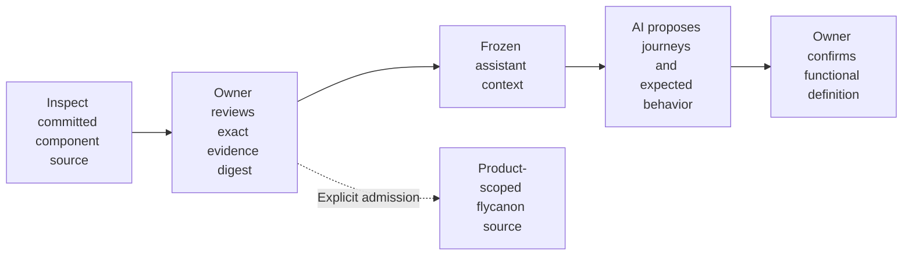
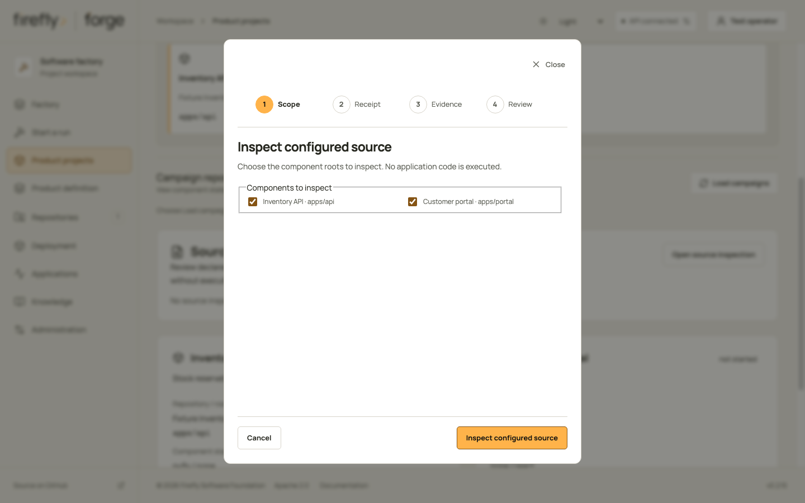
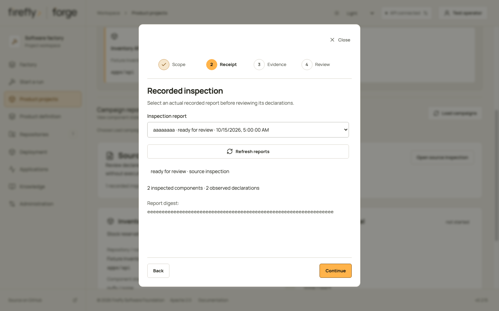
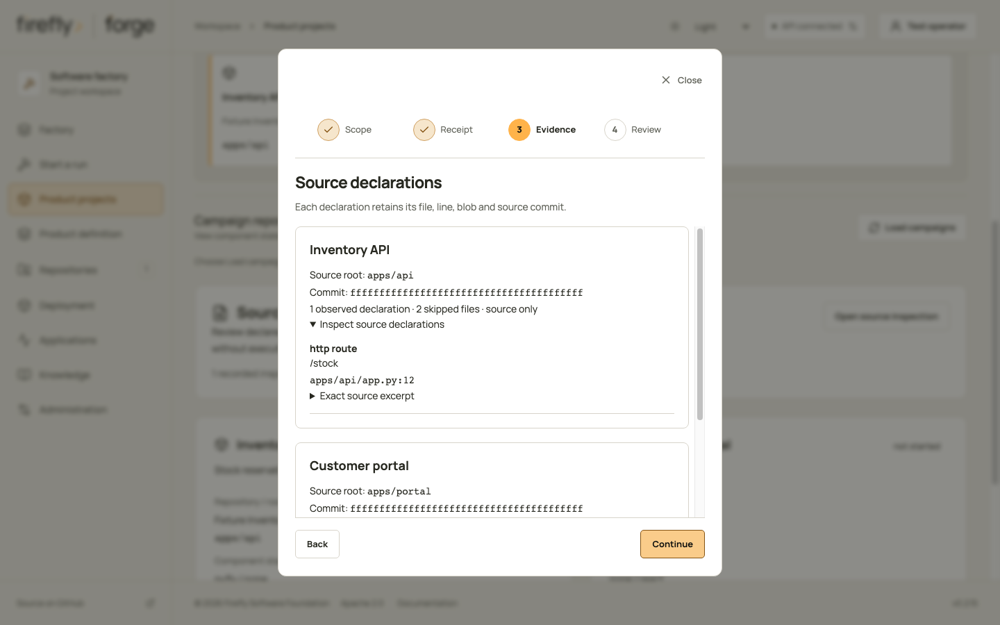
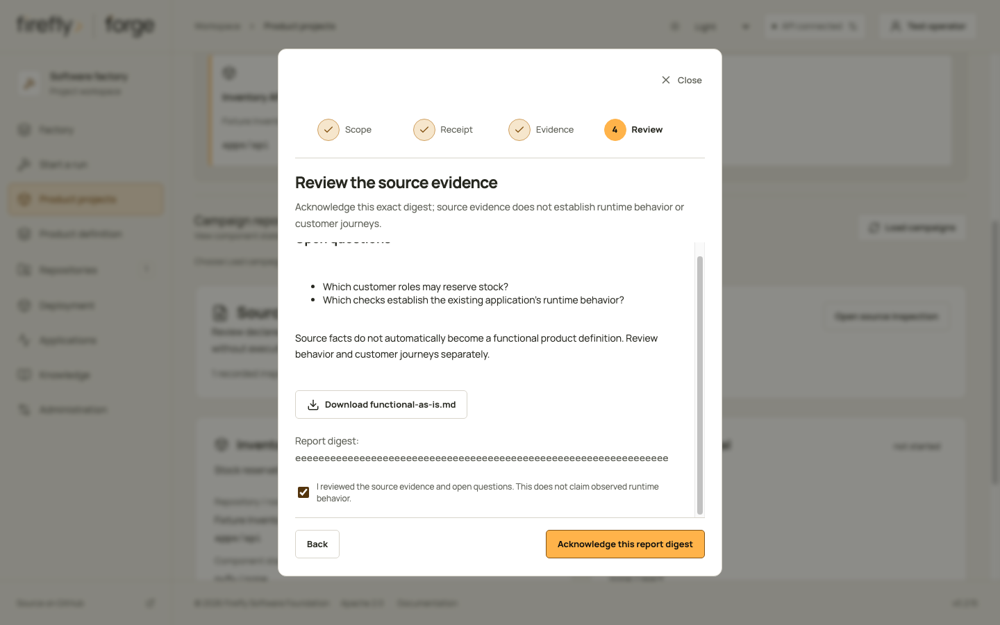
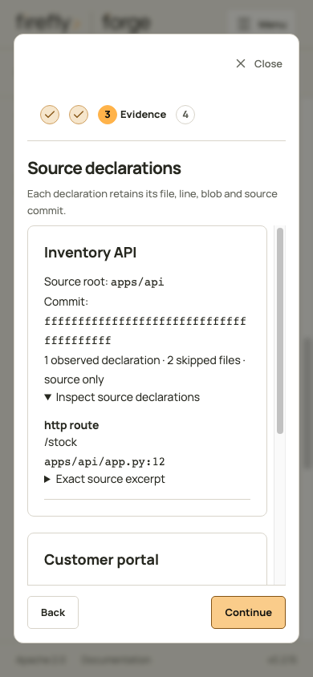
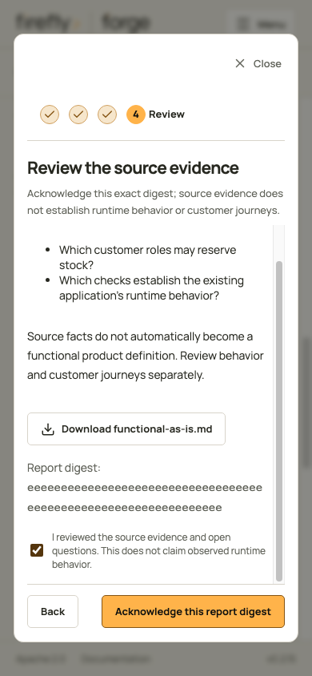

<!-- Copyright 2026 Firefly Software Foundation. SPDX-License-Identifier: Apache-2.0 -->
# Use reviewed source facts to define an existing product

Inspect the existing repositories before proposing changes. firefly forge reads committed source without running it and records declarations with their commit, blob, file and line. A route declaration is evidence of code in that commit; it does not confirm the customer journey or prove that a deployed service behaves correctly.

Use the logical project's component graph to select the repositories and paths to inspect. The project's `product_repository_id` owns the product definition and assistant conversation. Component repositories remain separate scopes.

<div class="forge-flow forge-flow--dependencies" role="region" aria-label="Existing-product review and definition diagram" aria-describedby="asis-flow-guide" tabindex="0" markdown="1">



</div>

<p class="forge-flow-caption" id="asis-flow-guide">Follow the reviewed source from left to right. Scroll horizontally on small screens; keyboard users can focus the diagram and use the arrow keys.</p>

The exact owner-reviewed evidence becomes frozen assistant context. The dashed flycanon branch is optional and requires explicit admission; reviewed context can be used without uploading it.

## Follow source inspection in Studio

Select the product in **Product projects**, then choose **Open source inspection**. Its wizard has four steps. This walkthrough uses controlled responses for a monorepo with two distinct component roots, the same source commit and numeric skipped-file counts. It demonstrates presentation and explicit review; it runs no source inspection, model, provider or test command.

1. In **Scope**, select the configured roots to inspect, then choose **Inspect configured source**. On your factory this starts source inspection; simply opening the wizard does not.
2. In **Receipt**, select the returned report and inspect its recorded state, component/declaration counts and digest. **Refresh reports** reads retained reports. Continue to its evidence.
3. In **Evidence**, check each component's root, source commit, declarations and skipped-file count. Expand **Exact source excerpt** to inspect a declaration's line and blob reference. Missing declarations require a coverage check before you infer anything about the product.
4. In **Review**, read the open questions and download the source documents if needed. Acknowledge the source evidence explicitly, then choose **Acknowledge this report digest**. This confirms that report's source review; it leaves customer journeys and runtime behavior unconfirmed. **Done** closes the wizard.

<figure class="forge-shot" markdown="1">



<figcaption>Scope: choose the configured components before inspecting. Both fixture roots belong to one repository; a multi-repository product retains each member's own repository and commit.</figcaption>
</figure>

<figure class="forge-shot" markdown="1">



<figcaption>Receipt: the controlled report is ready for review. Its identity and digest remain separate from an approved product definition.</figcaption>
</figure>

<figure class="forge-shot" markdown="1">



<figcaption>Evidence: inspect the source boundary and omitted-file count for each component. The fixture uses the same commit for both monorepo roots; it does not prove that their services integrate correctly.</figcaption>
</figure>

<figure class="forge-shot" markdown="1">



<figcaption>Review: the acknowledgment applies to source evidence. Confirm the proposed behavior separately with the product owner before requesting implementation.</figcaption>
</figure>

<details class="forge-gallery" markdown="1">
<summary>Inspect source evidence and review on a phone</summary>

<figure class="forge-shot forge-shot--phone" markdown="1">



<figcaption>Evidence: scroll the declaration content while retaining the wizard controls. Expand the exact source excerpt when checking a citation.</figcaption>
</figure>

<figure class="forge-shot forge-shot--phone" markdown="1">



<figcaption>Review: read the questions and acknowledgment before confirming. These controlled captures follow the same current-source inventory and maintenance procedure as the <a href="../console-tour/#keep-captures-current">Studio tour</a>.</figcaption>
</figure>

</details>

## Choose the product scope before inspection

Create or select the [product project](factory-journeys.md#2-configure-the-product-project) before opening source inspection. For a monorepo, configure distinct, nonoverlapping component roots in one registered repository. For a multi-repository product, configure each member repository, its component roots and the intended dependencies. Select all components for a product overview, or an explicit subset for a focused question.

Within one analysis, components in the same repository use the same cloned default-branch commit. Separate repositories retain their own observed commits. Those commits are not an atomic release across repositories; review the recorded set and any integration versions you need to reproduce the product. Configured dependencies describe the intended topology and do not establish observed runtime calls.

The existing source can predate Firefly adoption. Keep its observed technology separate from the implementation target. Ask the product owner whether to reimplement the agreed behavior as a new supported product, or preserve the existing system and add supported components or features at an explicit boundary. Record that decision, compatibility requirements and rollout constraints in the product definition before requesting development. Source review alone authorizes neither a rewrite nor a framework migration.

The current inspector does not discover arbitrary legacy frameworks or choose an adoption strategy automatically. Configure component execution with the supported [framework profiles](profiles.md); inspect a legacy declaration as evidence without treating it as a supported coding target. Framework adoption decisions and source-only observations are different contracts.

## Understand the current inspection coverage

Inspection reads committed blobs from a bare clone. It does not import the application, install dependencies, run tests, execute a build, follow symbolic links or call a deployed service. Known credential content is excluded through the configured redaction checks. This is a bounded source review, so an absent declaration does not prove a feature or dependency is absent.

| Observed declaration | Current extractor | What still needs review |
| --- | --- | --- |
| Python HTTP mapping | Direct named pyfly-style mapping decorators with a literal first path argument. | Class prefixes, dynamic routing, aliases, other frameworks and runtime composition. |
| Python test | Functions whose names start with `test_`. | Whether the test runs, what behavior it proves and its latest result. |
| PHP HTTP route | Supported single-line literal `Route::get/post/put/patch/delete` declarations. | Groups, computed paths, controllers and the effective deployed route table. |
| Framework dependency | Matching framework lines in `pyproject.toml`, `composer.json` and `package.json`. | Resolved versions, the complete dependency graph and actual runtime use. |

One analysis shares a budget of 200 readable files and 2,000,000 source bytes across its selected components. A file must be at most 65,536 bytes. Each component retains at most 200 facts. The inspected extensions are `.py`, `.php`, `.json`, `.toml`, `.md`, `.yml`, `.yaml`, `.js`, `.ts` and `.tsx`; an accepted extension does not imply a semantic extractor for that language.

`skipped_files` counts files refused by the size/shared budget or redaction checks. It is not a complete count of unsupported, private, symbolic-link or unparsable source. Earlier components can consume the shared budget. For a large product, inspect smaller component selections and retain their separate reports. Review file and language coverage before treating a source report as a product inventory.

The assistant receives at most 40 KB of reviewed source context. Its `included_facts`, `omitted_facts` and `truncated` fields disclose that later handoff's coverage; they do not measure the entire codebase. A generated AS-IS narrative needs owner confirmation and executable acceptance checks for the proposed behavior.

## Inspect and review the source

Create an inspection through `POST /api/v1/projects/{project_id}/analyses`. An empty body selects the project's configured components; `component_ids` narrows the selection. Inspect the returned source observations, skipped-file counts and open questions.

A ready analysis has status `ready_for_review`. Review that exact result through:

```http
POST /api/v1/projects/{project_id}/analyses/{analysis_id}/review
Content-Type: application/json
```

```json
{"digest": "THE_EXACT_RETURNED_64_CHARACTER_DIGEST", "reviewed": true}
```

Review confirms the source evidence. It leaves business journeys, expected behavior and live operation unconfirmed. If the logical project's definition changes, inspect and review its current scope before starting a new conversation.

## Start a conversation with the reviewed facts

Create a conversation on the logical project's product repository:

```http
POST /api/v1/repositories/{product_repository_id}/assistant/conversations
Content-Type: application/json
```

```json
{
  "agent": "bridge",
  "project_id": "THE_PROJECT_ID",
  "analysis_id": "THE_REVIEWED_ANALYSIS_ID",
  "analysis_digest": "THE_EXACT_REVIEWED_DIGEST",
  "analysis_component_ids": ["stock-api"]
}
```

Use the actual IDs and digest returned by the API. Omit `analysis_component_ids` to select all components in that reviewed analysis. Existing conversations without source context remain supported.

The server verifies the review state, complete source digest, project membership and component repository/path bindings. It freezes an `analysis_snapshot` with the exact source facts and server-derived citation IDs. The snapshot stays within 40 KB; `included_facts`, `omitted_facts` and `truncated` disclose its coverage. Omitted facts are not rewritten into an unsupported summary.

Every turn uses that frozen snapshot. Later branch changes or another analysis do not silently replace it. The conversation's integrity receipt binds its analysis and context digests; changed facts are rejected before calling the model. The assistant can cite only supplied source or retrieved knowledge IDs.

Ask the assistant to clarify who uses the product, the business goal, successful and failed journeys, acceptance checks and remaining assumptions. Its proposal remains unreviewed until the owner confirms it. It has no tools to execute source, edit files, create runs or publish changes.

## Admit the reviewed evidence to flycanon explicitly

Source review and conversation creation do not upload documents. To admit selected reviewed observations, call:

```http
POST /api/v1/projects/{project_id}/analyses/{analysis_id}/knowledge
Content-Type: application/json
```

```json
{
  "digest": "THE_EXACT_REVIEWED_DIGEST",
  "component_ids": ["stock-api"]
}
```

The server exports the selected source facts as bounded JSON, retaining analysis/project digests, commits, blobs, paths, lines and excerpts. This document contains observations, not a full repository archive. Selected exports must fit within 1 MB; narrow the component selection if they exceed that bound.

Admission uses the configured [flycanon connection](knowledge.md) and the existing durable upload ledger. The destination is the logical project's product-repository workspace, `forge-{product_repository_id}`. Component IDs and origins remain in the document and source metadata. The server does not copy the document into other component or framework workspaces automatically.

The upload intent is retained before the remote request. An identical admission reuses its receipt. If the remote outcome is uncertain, status becomes `needs_reconciliation` and another request does not quietly submit it again. Inspect or reconcile the retained upload through the knowledge upload routes. `submitted` and the actual source ingestion status remain separate: wait for real ingestion and retrieval evidence before relying on the source in a conversation.

Known registered credentials are rejected in document content, filenames, titles and provenance before admission. This guard checks known values; it does not certify that a source repository contains no secrets.
