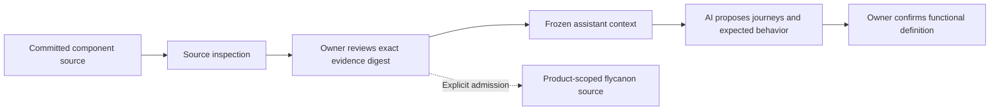

<!-- Copyright 2026 Firefly Software Foundation. SPDX-License-Identifier: Apache-2.0 -->
# Use reviewed source facts to define an existing product

Inspect the existing repositories before proposing changes. firefly forge reads committed source without running it and records declarations with their commit, blob, file and line. A route declaration is evidence of code in that commit; it does not confirm the customer journey or prove that a deployed service behaves correctly.

Use the logical project's component graph to select the repositories and paths to inspect. The project's `product_repository_id` owns the product definition and assistant conversation. Component repositories remain separate scopes.



## Inspect and review the source

Create an inspection through `POST /api/v1/projects/{project_id}/analyses`. An empty body selects the project's configured components; `component_ids` narrows the selection. Inspect the returned source observations, skipped-file counts and open questions.

A ready analysis has status `ready_for_review`. Review that exact result through:

```http
POST /api/v1/projects/{project_id}/analyses/{analysis_id}/review
Content-Type: application/json
```

```json
{"digest": "THE_EXACT_RETURNED_64_CHARACTER_DIGEST", "reviewed": true}
```

Review confirms the source evidence. It leaves business journeys, expected behavior and live operation unconfirmed. If the logical project's definition changes, inspect and review its current scope before starting a new conversation.

## Start a conversation with the reviewed facts

Create a conversation on the logical project's product repository:

```http
POST /api/v1/repositories/{product_repository_id}/assistant/conversations
Content-Type: application/json
```

```json
{
  "agent": "bridge",
  "project_id": "THE_PROJECT_ID",
  "analysis_id": "THE_REVIEWED_ANALYSIS_ID",
  "analysis_digest": "THE_EXACT_REVIEWED_DIGEST",
  "analysis_component_ids": ["stock-api"]
}
```

Use the actual IDs and digest returned by the API. Omit `analysis_component_ids` to select all components in that reviewed analysis. Existing conversations without source context remain supported.

The server verifies the review state, complete source digest, project membership and component repository/path bindings. It freezes an `analysis_snapshot` with the exact source facts and server-derived citation IDs. The snapshot stays within 40 KB; `included_facts`, `omitted_facts` and `truncated` disclose its coverage. Omitted facts are not rewritten into an unsupported summary.

Every turn uses that frozen snapshot. Later branch changes or another analysis do not silently replace it. The conversation's integrity receipt binds its analysis and context digests; changed facts are rejected before calling the model. The assistant can cite only supplied source or retrieved knowledge IDs.

Ask the assistant to clarify who uses the product, the business goal, successful and failed journeys, acceptance checks and remaining assumptions. Its proposal remains unreviewed until the owner confirms it. It has no tools to execute source, edit files, create runs or publish changes.

## Admit the reviewed evidence to flycanon explicitly

Source review and conversation creation do not upload documents. To admit selected reviewed observations, call:

```http
POST /api/v1/projects/{project_id}/analyses/{analysis_id}/knowledge
Content-Type: application/json
```

```json
{
  "digest": "THE_EXACT_REVIEWED_DIGEST",
  "component_ids": ["stock-api"]
}
```

The server exports the selected source facts as bounded JSON, retaining analysis/project digests, commits, blobs, paths, lines and excerpts. This document contains observations, not a full repository archive. Selected exports must fit within 1 MB; narrow the component selection if they exceed that bound.

Admission uses the configured [flycanon connection](knowledge.md) and the existing durable upload ledger. The destination is the logical project's product-repository workspace, `forge-{product_repository_id}`. Component IDs and origins remain in the document and source metadata. The server does not copy the document into other component or framework workspaces automatically.

The upload intent is retained before the remote request. An identical admission reuses its receipt. If the remote outcome is uncertain, status becomes `needs_reconciliation` and another request does not quietly submit it again. Inspect or reconcile the retained upload through the knowledge upload routes. `submitted` and the actual source ingestion status remain separate: wait for real ingestion and retrieval evidence before relying on the source in a conversation.

Known registered credentials are rejected in document content, filenames, titles and provenance before admission. This guard checks known values; it does not certify that a source repository contains no secrets.
