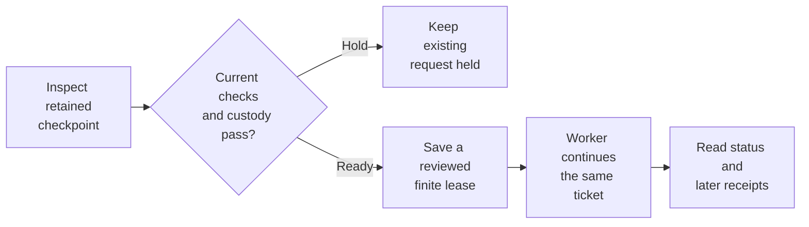
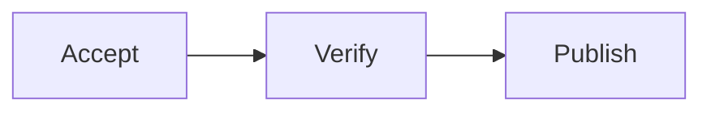

<!-- Copyright 2026 Firefly Software Foundation. SPDX-License-Identifier: Apache-2.0 -->
# Continue from a retained checkpoint

A continuation can complete work and then stop at a later checkpoint when its ownership lease expires. Checkpoint continuation gives the same execution request a reviewed, finite window to proceed. The task attempt, full history, completed source edits and previously charged consumption remain attached to that request.

This feature requires a qualified and registered source profile covering its complete implementation. The factory policy setting `allow_checkpoint_continuation` is off by default. Enabling it permits candidate review and explicit admission under the existing finite-lease policy; it does not queue work by itself.

## Review in Studio

In **Connections**, find **Saved-work recovery** and select **Review continuation settings**. A current factory administrator can enable **Allow reviewed checkpoint continuations** and choose a maximum time window. Save the settings before reviewing an individual task. Other recovery options and queue limits keep their saved values.

These screenshots use controlled API fixtures.

<figure class="forge-shot">
<picture class="forge-shot__link theme-light">
  <source media="(max-width: 640px)" srcset="../assets/screenshots/checkpoint-continuation-policy-mobile-light.png">
  
</picture>
<picture class="forge-shot__link theme-dark">
  <source media="(max-width: 640px)" srcset="../assets/screenshots/checkpoint-continuation-policy-mobile-dark.png">
  
</picture>
<figcaption>Review the policy and time window before saving. Each task still needs its own continuation review.</figcaption>
</figure>

Open the existing run's **Plan** tab. In **Saved continuation**, select **Check current admission**. If the current checks pass, choose **Review saved continuation**. Review the retained work and existing limits, choose a time window, and confirm all four acknowledgements before selecting **Continue saved task**.

<figure class="forge-shot">
<picture class="forge-shot__link theme-light">
  <source media="(max-width: 640px)" srcset="../assets/screenshots/checkpoint-continuation-review-mobile-light.png">
  
</picture>
<picture class="forge-shot__link theme-dark">
  <source media="(max-width: 640px)" srcset="../assets/screenshots/checkpoint-continuation-review-mobile-dark.png">
  
</picture>
<figcaption>The reviewed window stays within the saved policy. Completed changes, the original attempt and charged usage remain attached to the existing request.</figcaption>
</figure>

After saving, **Check saved continuation** reads the action's current status. If submission loses its response, keep the saved decision and use this readback control. A queued action is waiting for a worker; inspect later records to see what ran.

<figure class="forge-shot">
<picture class="forge-shot__link theme-light">
  <source media="(max-width: 640px)" srcset="../assets/screenshots/checkpoint-continuation-status-mobile-light.png">
  
</picture>
<picture class="forge-shot__link theme-dark">
  <source media="(max-width: 640px)" srcset="../assets/screenshots/checkpoint-continuation-status-mobile-dark.png">
  
</picture>
<figcaption>The saved action exposes status readback. Its queued receipt establishes admission; later worker records describe execution.</figcaption>
</figure>

## What the candidate verifies

The candidate checks the complete native journal, task and original execution request. It binds the retained checkpoint and response to their original identities, along with the current source, configuration, authority and remaining limits. A known source edit must have its exact durable effect receipt and match the retained source cut. An unknown tool or command outcome keeps its existing reconciliation requirements.

An already consumed response retains its original consumption record. A retained response that has not yet been consumed can be consumed once during continuation. Reconstruction reuses completed tool results and preserves their charges. It never sends the original completion request to the provider again or repeats a completed effect.

A held candidate gives no execution claim. Changed source, missing custody, revoked access, incompatible qualification and exhausted limits remain holds. The continuation adds no coding grant, replacement ticket, new attempt or budget reset.

<div class="forge-flow forge-flow--dependencies" role="region" aria-label="Retained checkpoint continuation diagram" tabindex="0" markdown="1">



</div>
<p class="forge-flow-caption">Candidate inspection starts no work. Admission queues the existing ticket; later worker receipts describe what actually ran. Scroll horizontally on smaller screens.</p>

## Review and admit one action

1. As a current factory administrator, read `GET /api/v1/invalid-read-continuity/policy`. Preserve the other settings when explicitly saving `enabled: true` and `allow_checkpoint_continuation: true` through `PUT` on the same route. The configured window and frozen execution limits still apply.
2. Keep the existing run and execution-request identities. Read its candidate and review `admission`, `holds`, `attempt`, `usage`, `limits` and `maximum_window_seconds`. Proceed only with a current `READY` candidate.
3. Save one caller-owned action ID before submission. Run, request and action IDs are exactly 32 lowercase hexadecimal characters. Submit the candidate digest, a reviewed time window and the four explicit acknowledgements below.
4. Read the status after submission or an uncertain response. Match its `action_id` to the saved action. A missing receipt, access refusal or different action leaves the outcome unresolved; keep the original identity and input.

All routes below begin with `/api/v1/runs/{run_id}/checkpoint-continuations/requests/{request_id}`.

| Method | Suffix | Purpose |
| --- | --- | --- |
| GET | `/candidate` | Inspect current custody and eligibility without admitting work |
| POST | `/actions/{action_id}` | Save one reviewed continuation on the existing ticket; returns HTTP201 |
| GET | `/status` | Read the saved action and worker status without another submission |

The strict version-1 body contains only these fields:

| Field | Required value |
| --- | --- |
| `version` | Integer `1` |
| `candidate_digest` | The exact current candidate's 64-character digest |
| `valid_for_seconds` | An integer from 1 to the candidate's permitted maximum, bounded above by 7,200 |
| `acknowledge_retained_response_consumed_once` | Boolean `true` |
| `acknowledge_no_completed_effect_replay` | Boolean `true` |
| `acknowledge_same_request_attempt_and_budgets` | Boolean `true` |
| `acknowledge_finite_ownership_lease` | Boolean `true` |

The API rejects extra fields and coerced acknowledgements such as `1` or `"true"`. Repeating the same action ID and identical input admits no additional continuation. Read the current status and verify its action ID against the saved one. Another action cannot replace the saved decision for the same checkpoint.

## Python client

`ForgeClient` provides `checkpoint_continuation_candidate(run_id, request_id)`, `request_checkpoint_continuation(run_id, request_id, action_id, request)` and `checkpoint_continuation_status(run_id, request_id)`. The write accepts either `CheckpointContinuationInputV1` from `firefly_forge.checkpoint_continuation_models` or the equivalent dictionary and validates it before transport.

Build the typed body from the reviewed candidate and window. Persist the action ID and exact body before one POST. After a timeout, use `checkpoint_continuation_status` to read the saved action. The client never generates another identity, retries the POST or changes execution budgets automatically.

## Read the outcome

A candidate has kind `checkpoint_continuation_candidate`. A status response has kind `checkpoint_continuation_status` and identifies the run, original request, saved `action_id`, `witness_digest`, original admission seal and finite lease.

| Status | Meaning |
| --- | --- |
| `not_recovered` | No saved checkpoint-continuation action is available |
| `queued` | The existing request is queued; a worker has not yet claimed this continuation |
| `executing` | A worker has claimed the continuation |
| `completed` | The worker reported completion; inspect its retained results |
| `failed` | The worker reported a failure; preserve that receipt before reviewing next steps |
| `needs_reconciliation` | Execution requires review of its retained outcome |

The generic `execution_requests(run_id)` list covers publication and cancellation. Checkpoint-continuation status has its own route and client method. Use the durable journal and later worker receipts to assess progress; a saved lease alone establishes no model, tool or command result.

## Accept an already-consumed final result

A worker can finish its response and charge its usage, then lose authority before saving the native implementation receipt or worker feedback. **Saved agent result** reviews that boundary on the existing execution request. The worker reads the retained response through its captured output schema and saves the ordinary native acceptance. It does not call the model again, consume the response again or repeat a completed tool or command.

Enable `allow_final_outcome_continuation` explicitly in the saved-work recovery policy. It is off by default; saving other settings preserves its absence in older policies. Candidate review requires the original authenticated operator, current administrator access, an idle request that needs reconciliation, complete response and consume custody, unchanged source, and a qualified current implementation. Unknown effects, nonfinal responses, refusals, altered usage and missing custody remain unavailable.

A candidate identifies its retained outcome as `complete`, `blocked`, `clarification` or `failed`, with `followup_kind` when the typed report requests one. Review those fields alongside the exact attempt, charged usage and existing limits. Accepting a blocked report preserves its question or verification request. A completed recovery action means the final report was accepted; it does not mean the run succeeded. An approved verification request proceeds through the existing verification handoff and its frozen commands and budgets. After those checks pass, the next normally authorized worker can finish against the unchanged verified source without making an unnecessary source edit. Its usage records an explicit `retained_source` proof and keeps `files_written` empty for that new invocation. Native terminal acceptance checks the original final-result receipt, the passed command receipts, current authority and the exact source again. Changed source, failed checks or missing custody keep this path closed. This action cannot authorize another coding attempt after failed verification.

The time window is for **claiming this saved decision**. Its wire label is `admission_window_purpose: "claim_only"`. Once claimed, that window does not become a new job or QA deadline. An explicitly captured work deadline and all original execution limits still apply.

### Continue verification after recovery

When an accepted report asks for verification, forge keeps the pending question on the same run. Review the current verification policy and adopt the exact command set for that request. The adoption records the current source and provider settings. Previously spent commands and continuations remain charged.



The completion receipt lets forge check the report's original authorization when later stages run. It still checks the current operator, project access and supported runtime. A missing or altered receipt keeps those stages unavailable. Accepting a report does not clear a Git delivery hold or turn an unknown command result into a successful one.

A changed verification environment can require fresh checks even when the source is unchanged. Select only the reusable results offered by the current candidate. Frontend builds and database checks keep their own execution requirements. Read the resulting command receipts before requesting publication.

### Review in Studio

In **Connections → Saved-work recovery**, a current factory administrator enables **Allow reviewed final-result continuations**. Open the original run's **Plan** tab and find **Saved agent result**. Select **Check saved result** to read the current candidate. Review the report's next step, original attempt and charged usage. A held candidate explains why the request cannot proceed.

Review the configured claim window and confirm the acknowledgement before selecting **Accept saved result**. Studio saves the action identity and exact input before submission. These screenshots use controlled API fixtures; they show the review flow rather than a recovered customer run.

<figure class="forge-shot">
<picture class="forge-shot__link theme-light">
  <source media="(max-width: 640px)" srcset="../assets/screenshots/final-outcome-review-mobile-light.png">
  
</picture>
<picture class="forge-shot__link theme-dark">
  <source media="(max-width: 640px)" srcset="../assets/screenshots/final-outcome-review-mobile-dark.png">
  
</picture>
<figcaption>The claim window gives a worker time to take the saved decision. It does not impose a new deadline on the project or its QA.</figcaption>
</figure>

After acceptance, **Read saved action** reads its status without submitting again. Keep that saved identity if a submission loses its response or the page reloads. **Saved result accepted** means the native report was recorded. A run paused for verification still needs that verification and its later results.

<figure class="forge-shot">
<picture class="forge-shot__link theme-light">
  <source media="(max-width: 640px)" srcset="../assets/screenshots/final-outcome-status-mobile-light.png">
  
</picture>
<picture class="forge-shot__link theme-dark">
  <source media="(max-width: 640px)" srcset="../assets/screenshots/final-outcome-status-mobile-dark.png">
  
</picture>
<figcaption>Read the run's next handoff and later QA receipts. Report acceptance alone establishes no successful test, commit or pull request.</figcaption>
</figure>

### Read reused verification results

The **Verification** tab distinguishes a new command from a reused result. A reused check retains its original output and execution time and displays **Reused prior verified result**. It does not count as another command execution. The factory records which prior execution supplied the result and which native receipt accepted it; those references are available in the advanced record.

Reuse requires the same source and recorded execution conditions. Source checks need evidence captured before the handoff, including their dependencies and enforced network restrictions. Checks that depend on changing services, such as a PostgreSQL integration suite, need a fresh execution unless that service state has its own accepted freshness evidence. Changed source, incomplete custody or an unknown outcome cannot establish a passed check.

A frontend build also runs fresh when it needs to inspect generated output directories. The scoped `npm --prefix <directory> run build` command can copy files and inspect output metadata, but it cannot read stale output contents, private configuration or files outside its admitted roots. It is excluded from reusable-check candidates, and an explicit declaration cannot make it reusable. Other reusable checks retain the stricter profile that also denies output metadata. Each fresh build consumes its normal command allowance.

<figure class="forge-shot">
<picture class="forge-shot__link theme-light">
  <source media="(max-width: 640px)" srcset="../assets/screenshots/verification-reuse-checks-mobile-light.png">
  
</picture>
<picture class="forge-shot__link theme-dark">
  <source media="(max-width: 640px)" srcset="../assets/screenshots/verification-reuse-checks-mobile-dark.png">
  
</picture>
<figcaption>Controlled API fixture: the notice identifies a saved result. It is not evidence that a customer run has recovered or passed QA.</figcaption>
</figure>

In **Plan**, the journal records a reuse intent and its later acceptance receipt. **New executions for referenced checks: 0** applies only to the checks listed in that receipt. Other checks may have run again; inspect their individual results in **Verification**. Neither the reuse request nor its receipt establishes a successful run, commit or pull request on its own.

<figure class="forge-shot">
<picture class="forge-shot__link theme-light">
  <source media="(max-width: 640px)" srcset="../assets/screenshots/verification-reuse-journal-mobile-light.png">
  
</picture>
<picture class="forge-shot__link theme-dark">
  <source media="(max-width: 640px)" srcset="../assets/screenshots/verification-reuse-journal-mobile-dark.png">
  
</picture>
<figcaption>Controlled API fixture: read the referenced subset separately from fresh final checks and the run's eventual delivery result.</figcaption>
</figure>

### API and operator tools

All three routes begin with `/api/v1/runs/{run_id}/final-outcome-continuations/requests/{request_id}`:

| Method | Suffix | Purpose |
| --- | --- | --- |
| GET | `/candidate` | Review the consumed final response and current eligibility without changing the request |
| POST | `/actions/{action_id}` | Save one reviewed action on the same ticket; returns HTTP201 |
| GET | `/status` | Read the saved action and its worker outcome |

Use the strict `FinalOutcomeContinuationInputV1` body:

```json
{
  "version": 1,
  "candidate_digest": "<current candidate digest>",
  "valid_for_seconds": 60,
  "acknowledge_already_consumed_final_output": true,
  "acknowledge_no_completed_effect_replay": true,
  "acknowledge_same_request_attempt_and_budgets": true,
  "acknowledge_finite_ownership_lease": true
}
```

Choose a claim window within `maximum_window_seconds`. Persist the caller-owned action ID and exact input before submitting once. After an uncertain response, read status and match the saved action ID; do not generate a replacement action. Identical repeats read the same receipt. A reused identity with changed input is rejected.

The Python client provides `final_outcome_continuation_candidate`, `request_final_outcome_continuation` and `final_outcome_continuation_status`. The CLI exposes `forge final-outcome-continuations candidate RUN REQUEST`, `request RUN REQUEST ACTION DOCUMENT` and `status RUN REQUEST`. MCP exposes `get_final_outcome_candidate`, `request_final_outcome_continuation` and `get_final_outcome_status`. These adapters validate input before transport, submit once and leave execution to the worker role.

## Reuse passed source checks

After a saved final result requests verification, the next worker may need to finish its report and enter normal QA. Some source checks can use their earlier passed results. Their original executions remain charged to the same command budget. Database integration tests and checks of a deployment or external service still need a current execution.

Review the pending verification handoff before its commands start. The candidate's `reusable_build_candidates` lists checks supported by the current runner, with their original command index, arguments and command digest. Selecting a check is an explicit declaration that it tests the retained source and build inputs independently of time or external state. A recognized command name alone does not establish that property.

### Approve verification in Studio

Open the paused run's **Agent questions** tab and find **Approve factory verification**. Choose the configured coding provider, then select **Read approved checks**. Approval requires current execute access and release access when publishing. Codex CLI and Claude Code CLI also require factory administrator access.

In **Choose reuse**, select only eligible source and build checks whose result is independent of time, changing data and external services. Check numbers follow the frozen command list, starting at 1. All frozen checks run during this handoff; the selection permits possible reuse in later final QA when the source and execution conditions still match. Leave every check unselected when it needs a fresh result.

<figure class="forge-shot">
<picture class="forge-shot__link theme-light">
  <source media="(max-width: 640px)" srcset="../assets/screenshots/verification-approval-choose-mobile-light.png">
  
</picture>
<picture class="forge-shot__link theme-dark">
  <source media="(max-width: 640px)" srcset="../assets/screenshots/verification-approval-choose-mobile-dark.png">
  
</picture>
<figcaption>Controlled API fixture: choose from the backend's eligible commands. This selection does not establish a passed check.</figcaption>
</figure>

Select **Review verification approval**, review the number of selected checks and confirm the acknowledgement. **Save verification approval** sends the frozen request and any selected declarations once. Studio first saves its request identity and exact input in browser storage. If storage cannot retain them, the approval stays blocked and no submission is sent. Earlier results cannot gain reusable-check evidence through this approval.

<figure class="forge-shot">
<picture class="forge-shot__link theme-light">
  <source media="(max-width: 640px)" srcset="../assets/screenshots/verification-approval-review-mobile-light.png">
  
</picture>
<picture class="forge-shot__link theme-dark">
  <source media="(max-width: 640px)" srcset="../assets/screenshots/verification-approval-review-mobile-dark.png">
  
</picture>
<figcaption>Controlled API fixture: the acknowledgement approves the frozen checks and declares the selected checks' independence from time and external state.</figcaption>
</figure>

After an uncertain response or reload, use **Read saved verification approval**. Keep the original identity; Studio never retries the submission automatically. It confirms the receipt only when its request digest, operator and policy match the saved input. An access refusal clears the private review and preserves any saved submission. **Verification approval recorded** confirms the native approval receipt. Follow **Verification** and the journal for execution results.

<figure class="forge-shot">
<picture class="forge-shot__link theme-light">
  <source media="(max-width: 640px)" srcset="../assets/screenshots/verification-approval-recorded-mobile-light.png">
  
</picture>
<picture class="forge-shot__link theme-dark">
  <source media="(max-width: 640px)" srcset="../assets/screenshots/verification-approval-recorded-mobile-dark.png">
  
</picture>
<figcaption>Controlled API fixture: a saved approval is not evidence that an original customer run recovered, passed QA or delivered a commit or pull request.</figcaption>
</figure>

### Declare reuse through the API

Read `GET /api/v1/runs/{run_id}/verification-handoffs/candidates?agent={agent}` for the selected `agentic`, `bridge`, `codex` or `claude` provider. Copy the candidate's exact `pending_request_digest`, `source_digest`, `commands_digest`, `policy_digest` and `provider_digest`, along with its `agent`. Save that input and a new 32-character lowercase hexadecimal `request_id` before one `POST /api/v1/runs/{run_id}/verification-handoffs/adoptions`. After an uncertain response, read `GET /api/v1/runs/{run_id}/verification-handoffs/adoptions/{request_id}` and verify the saved request, actor and policy before proceeding.

The existing `VerificationAdoption` input accepts an optional `reusable_build_checks` list. Each selected entry has this shape:

```json
{
  "command_digest": "<digest from the current handoff candidate>",
  "purpose": "source_build",
  "independent_of_time_and_external_state": true
}
```

Keep the other adoption fields and submit the saved request once through `adopt_verification_handoff` or the existing HTTP adoption route. An omitted or empty list preserves the earlier behavior. A changed command, duplicate selection or coerced acknowledgement is rejected.

The current confined transport supports Darwin host runners. Before the new handoff runs, Forge records a `verification_build_scope` witness. The actual command runs through `sandbox-exec` with network access denied, restricted filesystem inputs and private scratch directories. Descendants inherit those restrictions. Dependency bytes, the effective environment, private prerequisite and credential identities, runner configuration and current runtime are bound to that witness. Private file contents stay out of the journal. The restrictions also deny metadata queries for unrelated files. Narrow traversal metadata remains available for the declared runtime paths. Missing dependencies and dataless files keep the check held; preparation does not hydrate unavailable inputs. Private configuration references are bound without granting reusable checks access to their contents.

Runtime roots cannot encompass the owner's home or the whole public workspace. Private application state is excluded; the selected public workspace may sit beneath it. Recognized private configuration files and owner aliases are refused before measurement and command access. Declared package data remains part of the captured input identity.

Current source and authority are checked again before accepting the results. Source, dependency and prerequisite metadata, the environment and credential identities are fenced inside the native completion transaction. A late change rolls back QA completion and its reuse receipt while retaining every already charged command. This path relies on the declared source-check purpose and the trusted platform runtime; it does not certify arbitrary tests as independent of external state.

A later QA task can reuse only successful, completed commands that actually ran under that matching scope. Earlier unrestricted receipts cannot acquire this evidence afterward. Changed source or inputs, failed checks and uncertain effects prevent reuse. Any required new commands must fit within the original remaining budget.

The new verify task records `verification_reuse_intent` and `verification_reuse_receipt`, linked to its own native completion receipt. Each reused check preserves its original arguments, output, timestamp, attempt and source execution references. Studio labels those results as reused. The reuse receipt's `new_execution_count: 0` applies to its referenced checks; other checks in the same QA task can execute normally and keep their own receipts.
