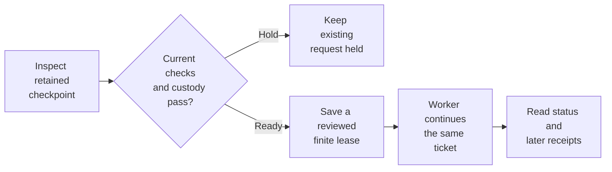

<!-- Copyright 2026 Firefly Software Foundation. SPDX-License-Identifier: Apache-2.0 -->
# Continue from a retained checkpoint

A continuation can complete work and then stop at a later checkpoint when its ownership lease expires. Checkpoint continuation gives the same execution request a reviewed, finite window to proceed. The task attempt, full history, completed source edits and previously charged consumption remain attached to that request.

This feature requires a qualified and registered source profile covering its complete implementation. The factory policy setting `allow_checkpoint_continuation` is off by default. Enabling it permits candidate review and explicit admission under the existing finite-lease policy; it does not queue work by itself.

## Review in Studio

In **Connections**, find **Saved-work recovery** and select **Review continuation settings**. A current factory administrator can enable **Allow reviewed checkpoint continuations** and choose a maximum time window. Save the settings before reviewing an individual task. Other recovery options and queue limits keep their saved values.

These screenshots use controlled API fixtures.

<figure class="forge-shot">
<picture class="forge-shot__link theme-light">
  <source media="(max-width: 640px)" srcset="../assets/screenshots/checkpoint-continuation-policy-mobile-light.png">
  
</picture>
<picture class="forge-shot__link theme-dark">
  <source media="(max-width: 640px)" srcset="../assets/screenshots/checkpoint-continuation-policy-mobile-dark.png">
  
</picture>
<figcaption>Review the policy and time window before saving. Each task still needs its own continuation review.</figcaption>
</figure>

Open the existing run's **Plan** tab. In **Saved continuation**, select **Check current admission**. If the current checks pass, choose **Review saved continuation**. Review the retained work and existing limits, choose a time window, and confirm all four acknowledgements before selecting **Continue saved task**.

<figure class="forge-shot">
<picture class="forge-shot__link theme-light">
  <source media="(max-width: 640px)" srcset="../assets/screenshots/checkpoint-continuation-review-mobile-light.png">
  
</picture>
<picture class="forge-shot__link theme-dark">
  <source media="(max-width: 640px)" srcset="../assets/screenshots/checkpoint-continuation-review-mobile-dark.png">
  
</picture>
<figcaption>The reviewed window stays within the saved policy. Completed changes, the original attempt and charged usage remain attached to the existing request.</figcaption>
</figure>

After saving, **Check saved continuation** reads the action's current status. If submission loses its response, keep the saved decision and use this readback control. A queued action is waiting for a worker; inspect later records to see what ran.

<figure class="forge-shot">
<picture class="forge-shot__link theme-light">
  <source media="(max-width: 640px)" srcset="../assets/screenshots/checkpoint-continuation-status-mobile-light.png">
  
</picture>
<picture class="forge-shot__link theme-dark">
  <source media="(max-width: 640px)" srcset="../assets/screenshots/checkpoint-continuation-status-mobile-dark.png">
  
</picture>
<figcaption>The saved action exposes status readback. Its queued receipt establishes admission; later worker records describe execution.</figcaption>
</figure>

## What the candidate verifies

The candidate checks the complete native journal, task and original execution request. It binds the retained checkpoint and response to their original identities, along with the current source, configuration, authority and remaining limits. A known source edit must have its exact durable effect receipt and match the retained source cut. An unknown tool or command outcome keeps its existing reconciliation requirements.

An already consumed response retains its original consumption record. A retained response that has not yet been consumed can be consumed once during continuation. Reconstruction reuses completed tool results and preserves their charges. It never sends the original completion request to the provider again or repeats a completed effect.

A held candidate gives no execution claim. Changed source, missing custody, revoked access, incompatible qualification and exhausted limits remain holds. The continuation adds no coding grant, replacement ticket, new attempt or budget reset.

Candidate inspection starts no work. Admission queues the existing ticket; later worker receipts describe what actually ran. Scroll horizontally on smaller screens.

## Review and admit one action

1. As a current factory administrator, read `GET /api/v1/invalid-read-continuity/policy`. Preserve the other settings when explicitly saving `enabled: true` and `allow_checkpoint_continuation: true` through `PUT` on the same route. The configured window and frozen execution limits still apply.
2. Keep the existing run and execution-request identities. Read its candidate and review `admission`, `holds`, `attempt`, `usage`, `limits` and `maximum_window_seconds`. Proceed only with a current `READY` candidate.
3. Save one caller-owned action ID before submission. Run, request and action IDs are exactly 32 lowercase hexadecimal characters. Submit the candidate digest, a reviewed time window and the four explicit acknowledgements below.
4. Read the status after submission or an uncertain response. Match its `action_id` to the saved action. A missing receipt, access refusal or different action leaves the outcome unresolved; keep the original identity and input.

All routes below begin with `/api/v1/runs/{run_id}/checkpoint-continuations/requests/{request_id}`.

| Method | Suffix | Purpose |
| --- | --- | --- |
| GET | `/candidate` | Inspect current custody and eligibility without admitting work |
| POST | `/actions/{action_id}` | Save one reviewed continuation on the existing ticket; returns HTTP201 |
| GET | `/status` | Read the saved action and worker status without another submission |

The strict version-1 body contains only these fields:

| Field | Required value |
| --- | --- |
| `version` | Integer `1` |
| `candidate_digest` | The exact current candidate's 64-character digest |
| `valid_for_seconds` | An integer from 1 to the candidate's permitted maximum, bounded above by 7,200 |
| `acknowledge_retained_response_consumed_once` | Boolean `true` |
| `acknowledge_no_completed_effect_replay` | Boolean `true` |
| `acknowledge_same_request_attempt_and_budgets` | Boolean `true` |
| `acknowledge_finite_ownership_lease` | Boolean `true` |

The API rejects extra fields and coerced acknowledgements such as `1` or `"true"`. Repeating the same action ID and identical input admits no additional continuation. Read the current status and verify its action ID against the saved one. Another action cannot replace the saved decision for the same checkpoint.

## Python client

`ForgeClient` provides `checkpoint_continuation_candidate(run_id, request_id)`, `request_checkpoint_continuation(run_id, request_id, action_id, request)` and `checkpoint_continuation_status(run_id, request_id)`. The write accepts either `CheckpointContinuationInputV1` from `firefly_forge.checkpoint_continuation_models` or the equivalent dictionary and validates it before transport.

Build the typed body from the reviewed candidate and window. Persist the action ID and exact body before one POST. After a timeout, use `checkpoint_continuation_status` to read the saved action. The client never generates another identity, retries the POST or changes execution budgets automatically.

## Read the outcome

A candidate has kind `checkpoint_continuation_candidate`. A status response has kind `checkpoint_continuation_status` and identifies the run, original request, saved `action_id`, `witness_digest`, original admission seal and finite lease.

| Status | Meaning |
| --- | --- |
| `not_recovered` | No saved checkpoint-continuation action is available |
| `queued` | The existing request is queued; a worker has not yet claimed this continuation |
| `executing` | A worker has claimed the continuation |
| `completed` | The worker reported completion; inspect its retained results |
| `failed` | The worker reported a failure; preserve that receipt before reviewing next steps |
| `needs_reconciliation` | Execution requires review of its retained outcome |

The generic `execution_requests(run_id)` list covers publication and cancellation. Checkpoint-continuation status has its own route and client method. Use the durable journal and later worker receipts to assess progress; a saved lease alone establishes no model, tool or command result.
