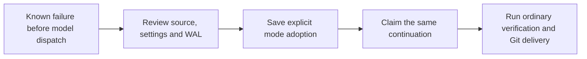

<!-- Copyright 2026 Firefly Software Foundation. SPDX-License-Identifier: Apache-2.0 -->
# Enable durable recovery for an older Bridge run

An older run can retain a provider snapshot without the optional checkpoint settings. Saving new provider settings applies to later snapshots. The original run keeps its saved configuration.

Checkpoint mode adoption handles one specific failure: a Bridge implementation stopped at a missing-mode guard before submitting its next model request. A current factory administrator can review that failure and explicitly enable stronger recovery modes for the same retained continuation. forge records the transition in the WAL and keeps the original configuration revision.

Use [original model result recovery](recovery.md#explicit-closed-text-implementation-continuation) when a model request already has a retained result. A missing HTTP response or an uncertain external outcome needs its own reconciliation.

## Check whether the run is eligible

The run must have a completed factory verification handoff followed by its unfinished implementation intent and continuation intent. No later model or tool dispatch may follow that boundary. A native startup recovery annotation can describe the same unfinished task; it cannot establish a provider outcome.

The saved provider is Bridge, with a legacy provider snapshot. Named implementation profiles use a different configuration path and are outside this adoption contract. Earlier Bridge requests must already have their response and consumption evidence. Cancellation, an unresolved Bridge result, changed source or lost project authority prevents adoption.

An operator must also establish that the failure occurred before external model dispatch. The admission includes the digest of that observation and identifies it as an operator observation. The digest refers to the retained statement; it does not turn the statement into a provider receipt.

An acknowledged command with an unknown result keeps that result. Adoption preserves its recorded risk and its spent command slot. Such a command can still prevent a later graph restoration that requires fully settled command history.

## Configure future snapshots

In Studio, open **Connections → Coding AI → Bridge → Configure**. Under **Original model results**, select **Required: retain the original result** and **Required: save implementation checkpoints**. Save the configuration. Existing runs retain their original snapshots.

The equivalent request is:

```http
PUT /api/v1/providers/bridge/configuration
Content-Type: application/json

{
  "values": {
    "completion_recovery": "required",
    "checkpoints": "required"
  }
}
```

Keep the existing model, endpoint and credentials. The adoption permits only these two stronger mode settings. It does not change providers, grant tools or add an implementation attempt.

## Review and admit the retained continuation

These routes require authenticated native administrator access and current execution access to the run's project. The recovery action is available through the API and Python SDK. The Studio configuration form above changes provider settings; it does not submit this run-specific adoption.

| Route | Effect |
| --- | --- |
| `GET /api/v1/runs/{run_id}/checkpoint-mode-adoptions/candidate` | Reviews the current failure, task, source, configuration and WAL. It starts no work. |
| `POST /api/v1/runs/{run_id}/checkpoint-mode-adoptions/{request_id}` | Admits the exact reviewed transition under a retained caller-generated request ID. |
| `GET /api/v1/runs/{run_id}/checkpoint-mode-adoptions/{request_id}` | Reads the original admission record without starting another continuation. |

Retain a new 32-character hexadecimal request ID before POST. Read the candidate, check the original failure and preserve the operator observation before acknowledging the transition. The candidate's digests bind the current review. Any change requires another review.

Before using the SDK, save the observed guard failure and the exact run, task, and WAL references in a private evidence file. Exclude credentials, tokens, request bodies, and raw configuration. Compute the SHA-256 digest of that file's bytes and set `FORGE_RECOVERY_OBSERVATION_SHA256` to the resulting hexadecimal value. The server retains this digest as an operator assertion; it is not provider evidence that no request ran.

```python
import os

from firefly_forge.client import ForgeClient
from firefly_forge.checkpoint_mode_models import CheckpointModeAdoptionInput

run_id = os.environ["FORGE_RECOVERY_RUN_ID"]
request_id = os.environ["FORGE_RECOVERY_REQUEST_ID"]  # Retain before POST.

with ForgeClient(os.environ["FORGE_URL"], os.environ["FORGE_API_TOKEN"]) as factory:
    candidate = factory.checkpoint_mode_candidate(run_id)
    request = CheckpointModeAdoptionInput(
        version=1,
        candidate_digest=candidate["digest"],
        policy_digest=candidate["policy_digest"],
        operator_observation_digest=os.environ["FORGE_RECOVERY_OBSERVATION_SHA256"],
        observation_provenance="native_operator_pre_dispatch_observation",
        acknowledge_known_pre_dispatch_failure=True,
        acknowledge_no_external_model_dispatch=True,
        acknowledge_original_intents_not_completed=True,
        acknowledge_only_stronger_modes=True,
        acknowledge_spent_history_and_budgets_preserved=True,
        acknowledge_same_native_continuation=True,
        acknowledge_existing_unknown_command_risk=True,
    )
    record = factory.request_checkpoint_mode_adoption(run_id, request_id, request)
```

The observation digest must identify the operator's actual retained evidence. Review each acknowledgment before submitting it. Do not copy the example into an unattended retry loop.

If the POST response is lost, keep the same request ID and read its record:

```python
with ForgeClient(os.environ["FORGE_URL"], os.environ["FORGE_API_TOKEN"]) as factory:
    record = factory.get_checkpoint_mode_adoption(run_id, request_id)
```

A read does not issue another POST. If the original record is unavailable or the request is refused, retain the unresolved identity and inspect the failure before taking another action.

## Follow the transition in the WAL

<div class="forge-flow forge-flow--dependencies" role="region" aria-label="Checkpoint mode adoption" aria-describedby="checkpoint-mode-flow-guide" tabindex="0" markdown="1">



</div>

<p class="forge-flow-caption" id="checkpoint-mode-flow-guide">Follow the transition from left to right. On a narrow screen, focus the diagram and scroll horizontally to read each stage.</p>

The adoption record binds the original implementation and continuation intents, the operator and the stronger configuration revision. The execution owner checks those bindings before it claims the continuation. Adoption retains the earlier intents without inventing their completion. A later native receipt describes the actual forward execution under the admitted modes.

Spent tool calls, commands and repair allowances remain spent. The original provider grant, command-risk acknowledgment and source evidence stay in the history. A changed model, credential, scope, policy or unsupported state prevents continuation.

An adoption receipt establishes the configuration transition. Product acceptance still requires the ordinary implementation result, verification evidence and Git delivery records. Read those records before treating the application as delivered.
