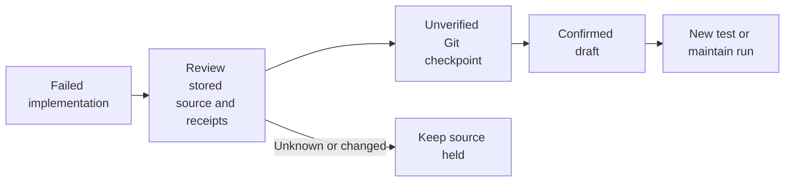

<!-- Copyright 2026 Firefly Software Foundation. SPDX-License-Identifier: Apache-2.0 -->

# Start a fresh unit from a saved checkpoint

A fresh `test` or `maintain` run can use a saved checkpoint while the original implementation remains paused or failed. It uses the same repository, product project, and component. The repository’s default branch stays unchanged. Source selection requires `publish: false` in both modes.

Choose a checkpoint from `GET /api/v1/runs/{run_id}/git-deliveries`. Its remote status must be `draft` or `ready`, backed by a confirmed publication receipt. A draft is unverified work; choosing it for testing does not approve the original implementation or mark its pull request ready.

## Create a test run

Submit the normal creation envelope to `POST /api/v1/run-creation-requests/{new_request_id}`. Choose a fresh request ID and include the checkpoint’s original run ID, delivery request ID, checkpoint digest, and commit revision:

```json
{
  "version": 1,
  "input": {
    "repository_id": "aaaaaaaaaaaaaaaaaaaaaaaaaaaaaaaa",
    "project_id": "bbbbbbbbbbbbbbbbbbbbbbbbbbbbbbbb",
    "component_id": "api",
    "brief": "Check the retained checkpoint without changing its source",
    "operation": "test",
    "publish": false,
    "commands": [{"argv": ["python", "-m", "pytest"], "timeout": 600}],
    "source_checkpoint": {
      "version": 1,
      "run_id": "cccccccccccccccccccccccccccccccc",
      "request_id": "dddddddddddddddddddddddddddddddd",
      "expected_checkpoint_digest": "3333333333333333333333333333333333333333333333333333333333333333",
      "expected_revision": "1111111111111111111111111111111111111111"
    }
  }
}
```

The IDs and hashes above are examples. Use values from the actual checkpoint receipt. The creation request ID is independent of both the delivery request and the original run.

## Continue implementation in a new maintain unit

Use the same envelope with `operation: "maintain"`, `publish: false`, a fresh request ID, and the intended brief and checks. The ordinary worker clones the selected commit into a distinct run workspace, then uses that new run’s current provider, roles, configuration, and runner admission. It starts with its own implementation attempt, model session, tool history, and command accounting. It does not reset or extend the parent’s spent allowance.

This is a new work unit, not a resume or replay. The parent’s failure, pending question, answers, provider outcome, source grant, tool receipts, and command receipts remain unchanged. No previous model or source budget becomes authority for the child. Current project Git-delivery policy applies independently to ordinary maintain work; `publish: false` does not grant final publication, and this selection does not reuse the parent’s draft or publication authority.

The resolved snapshot records `operation: "maintain"` in its digest. The worker refuses a change from the admitted operation. For compatibility, the existing `test` mode remains the default in the resolved snapshot and is omitted from its serialized representation; existing test-source digests remain unchanged.

The SDK uses `ForgeClient.request_run_creation(new_request_id, envelope)`. The CLI accepts the same JSON document with `forge request-run-creation NEW_REQUEST_ID checkpoint-test.json`. Existing MCP clients use `request_run_creation`. Legacy `POST /runs` and `create_run` refuse checkpoint selection because they do not retain that independent admission identity.

forge checks the signed-in user’s current execution permissions, the original component membership, and the retained checkpoint journal. It observes the exact factory branch through the current source-control connection. Admission does not fetch repository objects or load the project’s files into an API response. The ordinary worker then clones the frozen commit and checks its tree against the checkpoint receipt before running verification commands under the selected runner policy.

The creation receipt returns a new run ID and a server-resolved `source_checkpoint` containing the commit, tree, branch, operation, and parent evidence hashes. It carries no previous model allowance, worker answer, execution grant, or automatic permission to publish. A failed check remains failed; `test` operations do not invoke an implementation provider, coding repairs, or Git checkpoint publication. An explicitly selected independent reviewer can invoke its configured review model and remains subject to the ordinary review admission.

Read `GET /api/v1/run-creation-requests/{new_request_id}` after a lost response. Reusing that exact request and input returns the same admission. Do not create a second request identity merely because the first response was lost.

## Follow the result

The original run keeps its status, question, journal, and delivery history. Each new run has its own commands, runner limits, actor, and verification receipts. Its API record exposes the frozen source reference; its creation receipt remains distinct from the original SCM observation.

For an issue already linked through an authenticated parent receipt, teammates with current access to the same project and component can inspect the child’s status. The reference labels a test or maintain child explicitly and retains its original creator as provenance. Only the parent’s exact issue provenance can be selected. This read-only relationship cannot answer a question, resume a run, request another checkpoint, or launch another run. Those actions require their own current authority.

## Current boundaries

This entry point requires a confirmed remote checkpoint whose factory branch still points to the selected revision. Local-only checkpoints, uncertain publications, changed remote heads, and unavailable source-control grants are refused. An older checkpoint is not silently replaced by the latest commit. Existing creation inputs without `source_checkpoint` keep their previous wire representation and request digest.

Verification commands follow the selected runner policy. Cloning uses the existing controller-side Git command timeout and output bounds; this feature does not add clone disk-growth supervision. Ref-only admission adds no whole-project payload cap and does not download blobs as a preflight. It does not introduce distributed cloning, partial-clone fallback, automatic dependency provisioning, or a new natural-language permission to create test runs.

## Retain source when a graph checkpoint cannot be stored

A failed model session may have already written useful source. A **partial-source checkpoint** can retain that source without resuming the failed session. It stays marked `partial_unverified`: it does not mean the implementation finished or that its tests passed.

This route is deliberately narrow. The latest stored native checkpoint must describe the complete current source. Every later consumed response must contain only supported source readers, and all earlier command and tool effects must have known, closed receipts. A pending response, a later write, changed source, unknown runner outcome, unsupported runtime contract, or revoked access makes the candidate unavailable. The error message alone cannot authorize recovery. This initial implementation refuses older runtime contracts. The API accepts no legacy override.

<div class="forge-flow forge-flow--dependencies" role="region" aria-label="Partial source checkpoint lifecycle" aria-describedby="partial-source-flow-guide" tabindex="0" markdown="1">



</div>

<p class="forge-flow-caption" id="partial-source-flow-guide">Follow the recorded source into a checkpoint and a new run. Focus and scroll the diagram on a narrow screen.</p>

Review `GET /api/v1/runs/{run_id}/git-deliveries/partial-source-candidate` while signed in with current project and repository execution access. Draft publication also requires release access and the run's original enabled Git-delivery consent to remain current. The response contains evidence hashes and source identifiers, without returning the model prompt or source contents.

Use the exact candidate to submit one source-only request:

```python
from uuid import uuid4

candidate = client.partial_source_candidate(failed_run_id)
consent_fields = (
    "policy_digest", "expected_run_digest", "journal_digest",
    "source_digest", "frontier_record_digest",
)
request = {
    "version": 1,
    "request_id": uuid4().hex,
    "expected_head": candidate["expected_head"],
    "expected_source_digest": candidate["source_digest"],
    "explicit_partial_source": {
        "version": 1,
        "candidate_digest": candidate["digest"],
        **{name: candidate[name] for name in consent_fields},
        "acknowledge_partial_unverified": True,
        "acknowledge_preserve_failed_graph": True,
        "acknowledge_no_execution_grant": True,
    },
}
receipt = client.request_partial_source_checkpoint(failed_run_id, request)
```

The API queues this through `POST /api/v1/runs/{run_id}/git-deliveries/partial-source-requests`. The execution owner rechecks the source, current user, policy, journal and effect receipts before committing. The commit is labeled `[UNVERIFIED]`; the retained diff artifact and checkpoint receipt identify its exact source. When the original policy permits draft delivery, the ordinary source-control integration publishes that checkpoint as a draft.

Read `client.git_delivery_request(failed_run_id, request["request_id"])` to follow the outcome. After a lost response, inspect that same request ID. Neither the SDK nor the worker automatically repeats an unknown Git or remote effect. In this initial partial-source route, an unknown local or remote result stays held for inspection. The existing remote-reconciliation route is not yet supported for this partial-source marker; do not submit a second request or treat the retained local commit as confirmed remote delivery.

The original run remains failed, with its task, pending graph markers, consumed responses, tool receipts, command ordinals and spent budgets intact. Only its source-delivery history advances. After a confirmed remote checkpoint, select that exact `source_checkpoint` in a new test or maintain admission as described above. The child gets a new identity and independently admitted settings; it never receives the failed session's consumed results as execution authority.

This first slice does not settle a write or command made after the latest stored source frontier. Such source remains quarantined until a supported native recovery path can prove its effects. It does not add a button to bypass a hold, reset a budget or declare the product complete.

## Settle a known worker output without replay

A retained HTTP result and consume record do not by themselves establish that
an implementation finished. The native known-worker settlement API accepts
only a complete current-contract HTTP/checkpoint/consume closure whose declared
final JSON or output tool matches the exact stored typed worker feedback.
Unknown, incomplete, ambiguous or changed custody refuses. This first version
supports direct HTTP consume-v1; restored consume-v2 requires its separate
restore-ticket proof. A normal report without worker feedback is also outside
this first settlement path; it must not be replaced with invented feedback.

Review `GET /api/v1/runs/{run_id}/worker-completion-settlements/candidate`, then
submit its exact hashes and explicit acknowledgments to
`POST /api/v1/runs/{run_id}/worker-completion-settlements/{request_id}`. The
operator's current project/repository execution access, original execution
identity, task attempt, provider/model scope and immutable journal cut are
rechecked. `GET` on that request path returns its retained receipt under current
authority and credential admission. Responses contain identities and hashes,
not completion bodies, feedback text, prompts or configuration secrets.

The transaction appends a typed immutable WAL receipt containing the original
observed hold before projecting that exact hold as resolved and linking its
receipt. Both changes commit or roll back together. It does not change run or
task status, attempts, pending questions, implementation state, source, tool or
provider allowances, usage or budgets. It does not resume a graph, run checks,
publish Git changes or call a model. Those actions keep their existing consent
and safety gates. Reusing the same request identity reads the known receipt;
it never replays a consumed response.

This path inherits the existing whole-journal and completion retention guards,
including the legacy 10000-row/16MiB aggregate journal read boundary. It is not
elastic storage or a scalable pinned-head reducer. It introduces no new
project-sized count or aggregate ceiling and never admits a truncated closure.

## Automatic terminal output acceptance

The native producer retains the complete normalized `RuntimeReport` after the
runtime's existing credential, invocation, source-write and QA checks. A normal
report can omit worker feedback. Its successful implementation receipt and a
typed terminal-completion receipt commit together with resolution of the exact
observed graph hold. Typed feedback uses the same boundary in its actual feedback
writer, including a blocked worker's paused state. Git and verification cannot
start while a terminal completion remains unsettled.

Preparation decodes the original declared output and complete immutable custody
outside the writer. The transaction rechecks the current execution identity,
lease, task attempt, source binding, journal prefix and credential admission.
Native receipts identify their actual acceptance row; they do not invent worker
feedback or operator acknowledgments. A snapshot or acceptance failure leaves
the hold intact. Duplicate acceptance reads the exact original result and cannot
replace it with a changed payload. A committed acceptance can be reused after a
crash without another model call or another consumption.

Restored consume-v2 has a distinct proof of its original admitted restore ticket,
current generation and claim, selected HTTP result or Bridge observation, and
immutable request-event chain. That proof is prepared at the restore boundary
before its writer and rechecked inside the acceptance transaction. The separate
operator settlement API above still supports direct consume-v1 only. Neither
path grants a new graph execution, command allowance or verification admission.
Unknown HTTP, source, tool, claim or authority changes refuse without replay.

The automatic producer changes the protected runtime and admission closure.
Historical registered profiles remain unchanged; a fresh source-qualified
profile and native transaction proof are required before adopting this source.
The existing bulk-journal retention boundaries remain unchanged.
