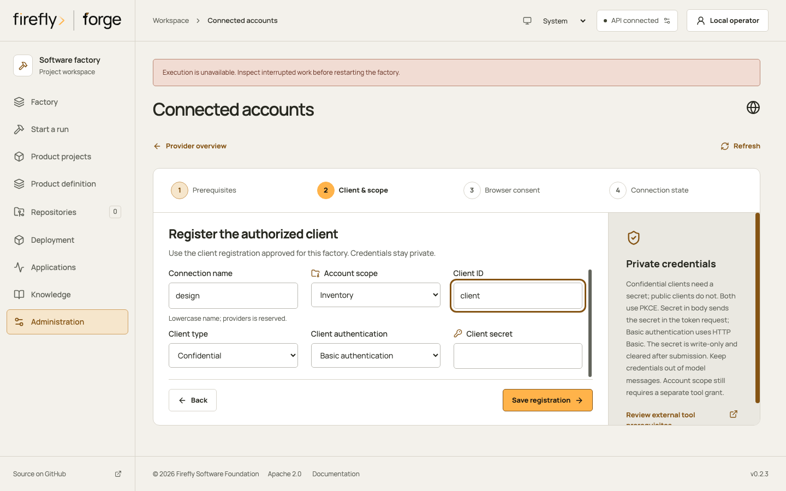
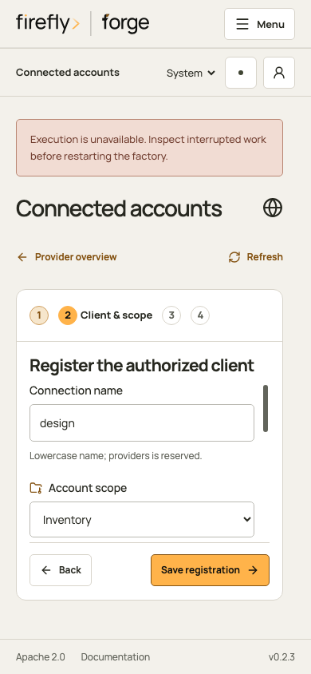
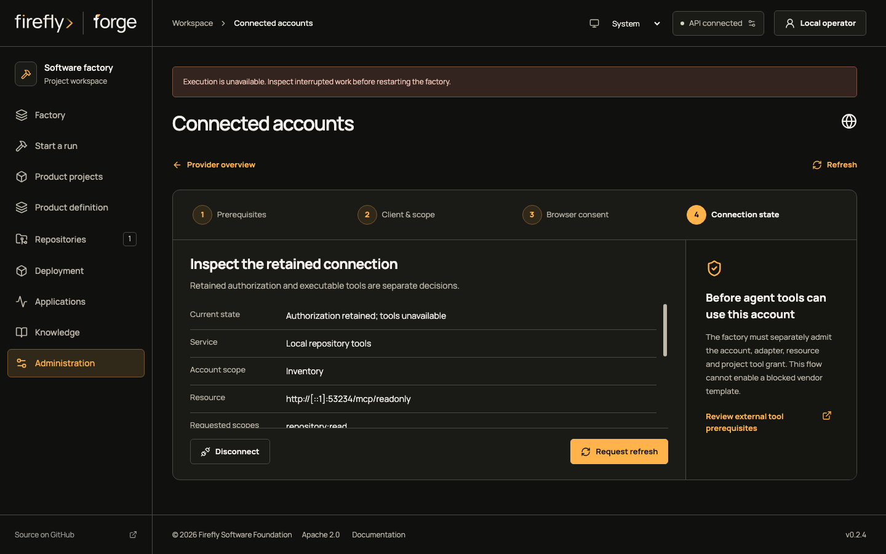
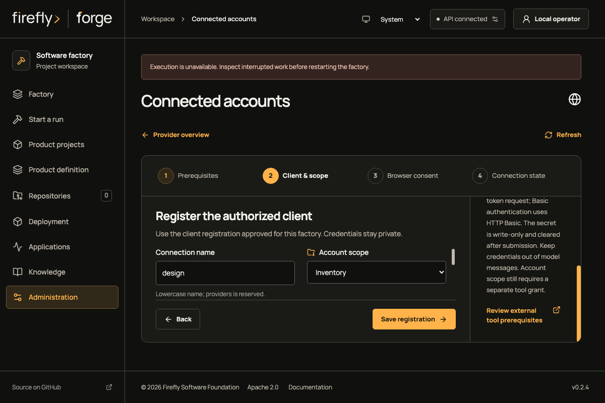

<!-- Copyright 2026 Firefly Software Foundation. SPDX-License-Identifier: Apache-2.0 -->
# Authorize a connected account

Open **Administration → Connected accounts** as a current factory administrator. This page configures the owned local repository service, registers its client, opens browser consent and shows the retained connection state. Account authorization is followed by separate MCP schema review and project/tool grants.

The native captures below retain their original Studio 0.2.3 source identity. They show an isolated API-only qualification with an owned provider and synthetic data. Current 0.2.4 walkthrough fixtures are captured separately. The execution warning reflects that API-only topology; worker readiness is a separate check.

The supported `local-repository-tools` provider is for explicit local development. GitHub, Figma, Sentry, Grafana and external Playwright OAuth remain at **Prerequisite required**. Native GitHub App SCM, the fixed GitHub token MCP adapter and the native BrowserRunner retain their own setup paths.

## Prepare the local service

Start an owned authorization server and MCP service that implement the admitted contract. The factory does not create that service or register the provider's client automatically. The native qualification used stock public pyfly 26.10.3 authorization-server and MCP APIs with synthetic repository data.

The factory needs an existing PostgreSQL installation, an authenticated administrator session and these explicit development settings:

```sh
export FORGE_OAUTH_LOCAL_DEVELOPMENT=1
export FORGE_OIDC_ALLOW_LOOPBACK_HTTP=true
export FORGE_BROWSER_ORIGIN="http://127.0.0.1:8787"
```

Use the actual factory port. The provider must use the other literal loopback host, for example `http://[::1]:8501`, with an unprivileged port from 1024 through 65535. Cookies are shared across ports on the same host. Changing only the port does not isolate the factory session; the server rejects an enabled same-host policy before contacting the provider.

The local policy fixes these values:

| Field | Admitted value |
| --- | --- |
| Provider | `local-repository-tools` |
| Issuer | The selected canonical literal-loopback origin |
| Authorization endpoint | Origin plus `/oauth2/authorize` |
| Token endpoint | Origin plus `/oauth2/token` |
| Protected resource | Origin plus `/mcp/readonly` |
| Scope | `repository:read` |

No arbitrary endpoint, discovery URL or scope can be supplied by the client registration form. Remote/shared installations require their production identity and network configuration; these flags do not authorize a vendor OAuth service.

## 1. Admit the owned service

Choose **Configure local service**, select the other loopback host and enter the provider port. Review the issuer, fixed resource and scope, then save. The setup retains an expected revision and stable request identity. A conflicting settings revision requires reading current configuration before another change.

**Save service configuration** saves policy in PostgreSQL. It does not make a provider request or prove the service is reachable. The returned directory determines whether client registration is available. If the browser cannot retain a pending request in session storage, setup blocks the save so an earlier uncertain request cannot be replaced silently.

## 2. Register the client and project

Choose **Set up a connection** and the admitted local service. Enter a connection name and the provider's actual client ID, choose the intended project, and select public or confidential client authentication. A confidential client uses its authorized secret and supported client authentication method. Secret fields are write-only; the server retains presence information without returning the value.

Register the callback shown for that exact connection in the provider's client configuration. Saving a registration retains its client/policy/project revision. It does not complete consent or enable tools.

<figure class="forge-shot" markdown="1">



<figcaption>Actual Studio registration form against the isolated native factory and owned stock pyfly service. The selected project and client are synthetic. This frame does not establish vendor account acceptance.</figcaption>
</figure>

<details class="forge-gallery" markdown="1">
<summary>Inspect registration on a phone</summary>

<figure class="forge-shot forge-shot--phone" markdown="1">



<figcaption>The same source-bound native registration journey at phone width. Scroll the fields to inspect the remaining registration controls.</figcaption>
</figure>
</details>

## 3. Complete consent in your browser

Review the issuer, resource, scope and project, then select **Open browser consent** in the signed-in factory browser. The server prepares a five-minute handoff, checks the browser session and redirects to the exact authorization endpoint. State, S256 PKCE, issuer and a callback-scoped HttpOnly nonce bind the response to its actor and registration revision.

An API bearer or service identity cannot complete browser consent. CLI, SDK and factory MCP clients can prepare a continuation link for the authenticated browser; they cannot exchange the user's authorization code as an operator tool.

On return, inspect the current state. `authorized_unverified` means a grant was retained. The connection summary keeps `agent_ready: false`; it does not certify a successful tool call or approve an adapter.

## 4. Admit MCP access separately

The local adapter has the same four fixed repository-read tool names as the GitHub adapter: `get_file_contents`, `get_commit`, `list_commits` and `list_branches`. Before dispatch:

1. Link the exact authorized connection to `local-repository-tools` and its selected project through the authenticated MCP API/client contract.
2. Request schema discovery explicitly. It contacts the owned resource and remains distinct from tool execution.
3. Review the exact returned schema digest and select the needed fixed read tools.
4. Grant the selected project, registered HTTPS GitHub repository, exact tools, implementation roles and `implement` stage.
5. Grant the worker's `external_mcp` capability, admit a run and inspect its actual broker receipt.

The factory derives the permitted owner/repository from the registered source. A policy, schema review or account cannot grant another repository. OAuthResources rechecks policy revision, grant family, expiry and current project authority before resource dispatch. Current authorization also guards cached receipts.

This MCP admission sequence is available through the API, SDK, CLI and factory MCP. The native browser qualification used browser API requests for linking, discovery, review and grants, then the in-process native broker for the real HTTP tool calls and persisted WAL. Those actions were separate from the clicked Connected accounts forms.

See [external tool admission](external-tools.md#connect-review-and-grant) for the schema and repository-grant contract.

## 5. Refresh, withdraw or disconnect

**Refresh** in the directory reads current factory state. **Request refresh** sends a recorded token refresh when the current server summary permits it. The browser retains the request identity until the exact receipt settles the outcome. A lost provider response leaves an unknown effect; refreshing the page cannot establish that the provider did nothing.

Withdrawing the local policy or changing its revision stops further resource use, including cached receipt reuse. The page shows that the policy is no longer current while leaving eligible local disconnect available.

<figure class="forge-shot" markdown="1">



<figcaption>Actual native state with a retained grant, its exact local resource and repository-read scope. Tools remain unavailable until their separate admission and grants are complete.</figcaption>
</figure>

Choose **Disconnect**, review the consequence, then **Disconnect locally**. This erases the retained active tokens and stops factory use. Remote authorization must be revoked separately in the provider account. Existing remote effects cannot be undone by clearing local credentials.

An unknown exchange or refresh blocks another authorization attempt until observed recovery permits it. Explicit supersession records the exact unknown effect identities, expected registration revision and acknowledgement that the old outcome remains unknown. It creates a new admission; it does not turn an uncertain provider call into a failed call.

<figure class="forge-shot" markdown="1">



<figcaption>Source-bound native client guidance, naturally scrolled to the credential and tool-grant explanation. The reviewed journey includes keyboard navigation and reachable actions; the full factory and vendor integrations retain separate acceptance requirements.</figcaption>
</figure>

## API and client contract

All routes below are under `/api/v1`. Administration requires current server authority. Registration uses typed `OAuthConnectionInput`; the local policy uses strict `OAuthProviderPolicyInput`, including `expected_revision` and a 32-character request identity. Summaries and effect receipts expose readiness and observed outcomes without token values.

| Action | Route |
| --- | --- |
| Current local policies | `GET /oauth-provider-policies` |
| Admit or withdraw local service | `PUT /oauth-provider-policies/local-repository-tools` |
| Provider prerequisites | `GET /connection-oauth/providers` |
| Retained connections | `GET /connection-oauth` |
| Register client | `PUT /connection-oauth/{name}` |
| Current connection | `GET /connection-oauth/{name}` |
| Prepare browser handoff | `POST /connection-oauth/{name}/prepare` |
| Browser continuation and callback | `GET /connection-oauth/{name}/continue` and `/callback` |
| Exact effect receipt | `GET /connection-oauth/{name}/effects/{request_id}` |
| Recorded refresh | `POST /connection-oauth/{name}/refresh` |
| Local disconnect | `POST /connection-oauth/{name}/disconnect` |
| Explicit unknown-outcome supersession | `POST /connection-oauth/{name}/supersede` |
| Link authorized MCP resource | `PUT /tools/mcp/{connector}/oauth` |

`ForgeClient` exposes policy, connection, receipt, refresh, disconnect, supersession and MCP-link methods. The `forge connections oauth` CLI group and the corresponding factory MCP tools use those same routes. Use owner-private secret files for CLI/tool registration; keep secrets out of arguments, product briefs and project images. Browser-only routes retain their session and callback contracts in every client path.

## Retained custody and operating limits

Connection OAuth has its own encrypted PostgreSQL registration/grant records, effect intents, receipts and append-only events. Keep those with the shared encryption key and the factory's consistent backup. An unavailable or changed context is a recovery error.

Credential admission retains purpose-bound fingerprints for historical secret representations. Its bounded history permits at most 1,024 evidence rows and 16,384 representations. Code/refresh effects reserve capacity before provider dispatch; exhausted or inconsistent history blocks new admission. Plan a reviewed retention checkpoint rather than deleting unresolved history or weakening credential checks.

The native qualification exercised real IPv4/IPv6 TCP, stock public pyfly, two token grants and two HTTP MCP calls, plus retained WAL and denial of cached receipts after withdrawal. Its screenshots show the owned local journey. Production OIDC federation, hosted vendor accounts, paid providers, cluster deployment and complete factory acceptance were not exercised by that receipt.

Source: [typed policy controller](https://github.com/fireflyframework/firefly-forge/blob/main/src/firefly_forge/oauth_provider_policy_controllers.py), [connection controller](https://github.com/fireflyframework/firefly-forge/blob/main/src/firefly_forge/connection_oauth_controllers.py), [resource custody](https://github.com/fireflyframework/firefly-forge/blob/main/src/firefly_forge/oauth_resources.py). Native image identities and qualification scope are retained in [capture provenance](assets/native-oauth/provenance.json).
