<!-- Copyright 2026 Firefly Software Foundation. SPDX-License-Identifier: Apache-2.0 -->

# Follow a change through Studio

Follow an inventory API change from connection and product definition through run review, verification and recovery. The run case ends with a failed check and an unresolved intent. Separate learning examples review an invalidation and verify an existing indexed source, each with exact-request recovery.

Screenshots use controlled fixtures.[^captures] Select an image to open its full capture; light and dark variants follow the page appearance.

## 1. Connect the factory

Open Administration, then Connections. Connect to your factory API; server sign-in and the coding provider's login are separate.

<figure class="forge-shot" markdown="1">

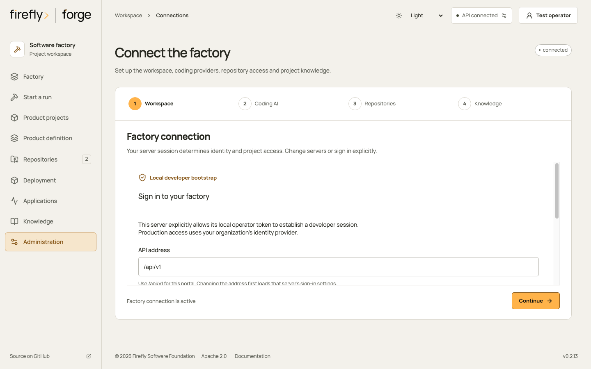

<figcaption>Workspace: this fixture session is connected. Confirm the API connection and signed-in identity on your factory. Continue to Coding AI to inspect the configured provider.</figcaption>
</figure>

<details class="forge-gallery" markdown="1">
<summary>Inspect the remaining connection steps</summary>

<div class="forge-shot-grid" markdown="1">

<figure class="forge-shot" markdown="1">

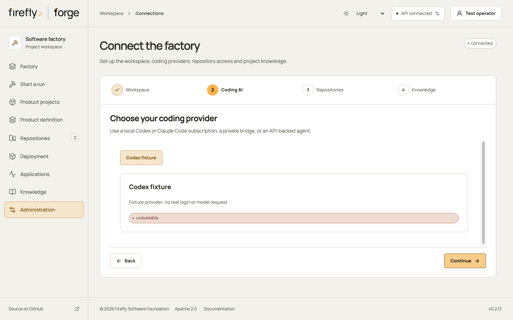

<figcaption>Coding AI: the fixture provider is unavailable and no real login has been tested. On your factory host, configure and verify a provider before admitting work.</figcaption>
</figure>

<figure class="forge-shot" markdown="1">


<figcaption>Repositories: grant access through the provider application, or register a local Generic Git repository. This fixture already contains Inventory API; it does not authorize a remote account.</figcaption>
</figure>

<figure class="forge-shot" markdown="1">

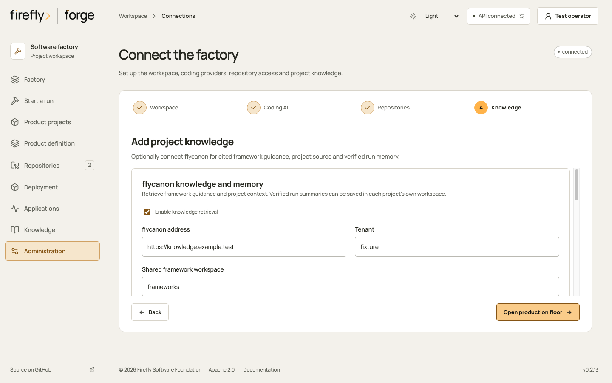

<figcaption>Knowledge: inspect the endpoint, required retrieval and automatic memory settings. These fields are configuration; authentication and a scoped cited search establish readiness.</figcaption>
</figure>

</div>
</details>

<details class="forge-gallery" markdown="1">
<summary>Follow connection setup on a phone</summary>

<div class="forge-shot-grid" markdown="1">

<figure class="forge-shot forge-shot--phone" markdown="1">

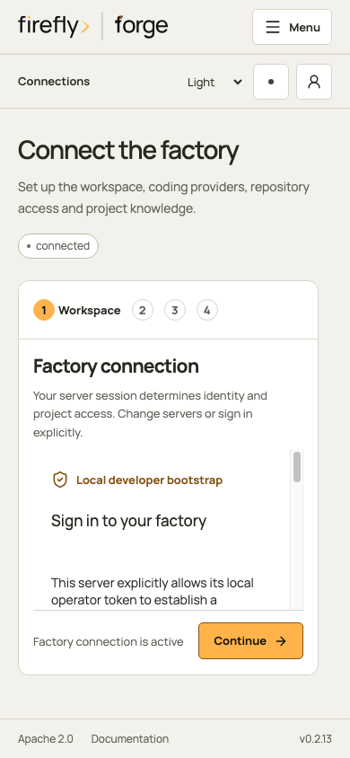

<figcaption>Workspace: this fixture session is connected. Confirm the API connection and signed-in identity on your factory. Continue to Coding AI to inspect the configured provider.</figcaption>
</figure>

<figure class="forge-shot forge-shot--phone" markdown="1">

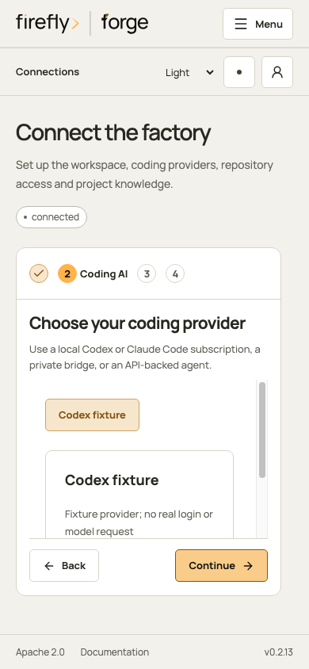

<figcaption>Coding AI: the fixture provider is unavailable and no real login has been tested. On your factory host, configure and verify a provider before admitting work.</figcaption>
</figure>

<figure class="forge-shot forge-shot--phone" markdown="1">

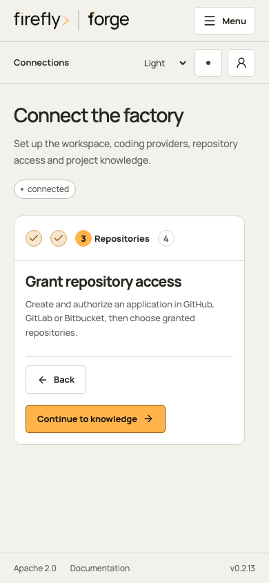

<figcaption>Repositories: grant access through the provider application, or register a local Generic Git repository. This fixture already contains Inventory API; it does not authorize a remote account.</figcaption>
</figure>

<figure class="forge-shot forge-shot--phone" markdown="1">

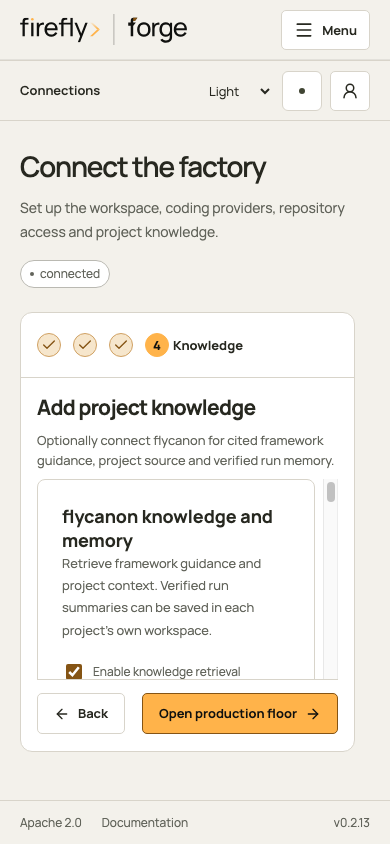

<figcaption>Knowledge: inspect the endpoint, required retrieval and automatic memory settings. These fields are configuration; authentication and a scoped cited search establish readiness.</figcaption>
</figure>

</div>
</details>

Complete the [managed knowledge initialization](knowledge.md#initialize-the-managed-service) and verify a cited search before starting work with required retrieval. A fresh managed installation enables required knowledge and automatic verified memory. The connection capture remains unverified and cannot establish successful retrieval.

Knowledge and memory currently use a separate workspace for each repository: `forge-<repository_id>`. A shared framework workspace can supply common references. A logical ProductProject does not automatically create an aggregated memory scope across its components. See [project scopes](knowledge.md#keep-project-scope-explicit).

Internet search is a separate optional connection under Administration. Follow the [search setup walkthrough](search-providers.md#connect-through-studio) to choose a provider, store its key and restrict public sources. Saving settings does not run a provider test.

## 2. Define the reservation contract

Select Product definition and Inventory API. Describe who reserves stock, what happens when stock is insufficient, and which check proves the rejection. An API-only product still needs a customer or system process, feature behavior and failure paths.

<figure class="forge-shot" markdown="1">

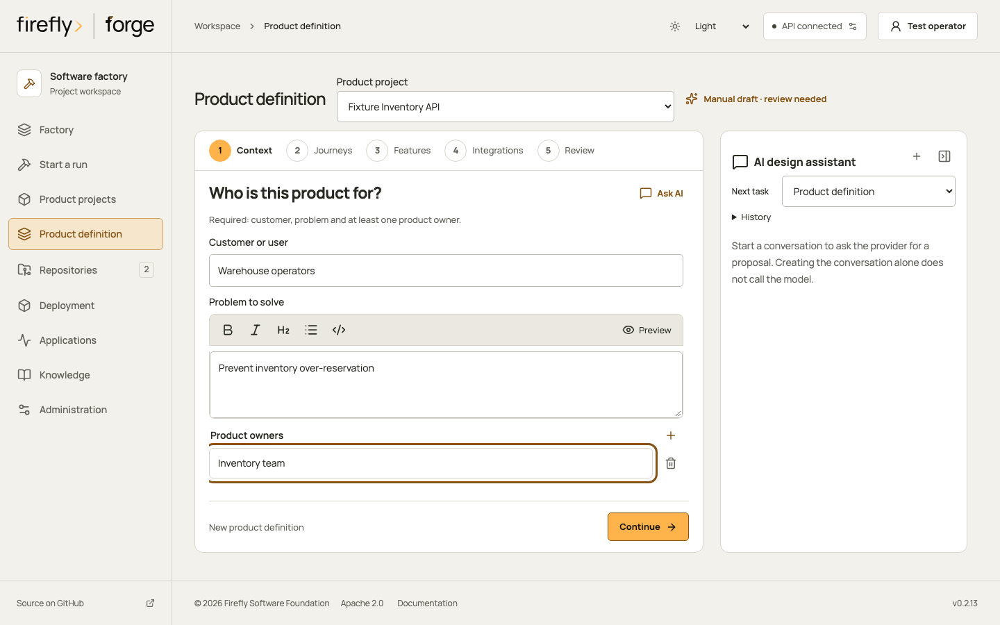

<figcaption>Context: name the warehouse operators, the over-reservation problem and the Inventory team as owner. Continue to Journeys.</figcaption>
</figure>

<details class="forge-gallery" markdown="1">
<summary>Follow the product definition steps</summary>

<div class="forge-shot-grid" markdown="1">

<figure class="forge-shot" markdown="1">

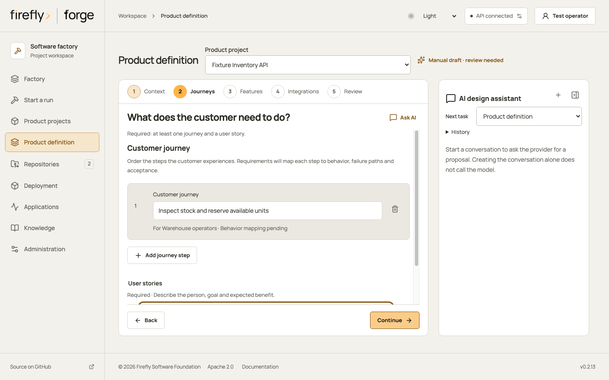

<figcaption>Journeys: record the stock reservation process and its user story. Continue to Features to specify observable behavior.</figcaption>
</figure>

<figure class="forge-shot" markdown="1">

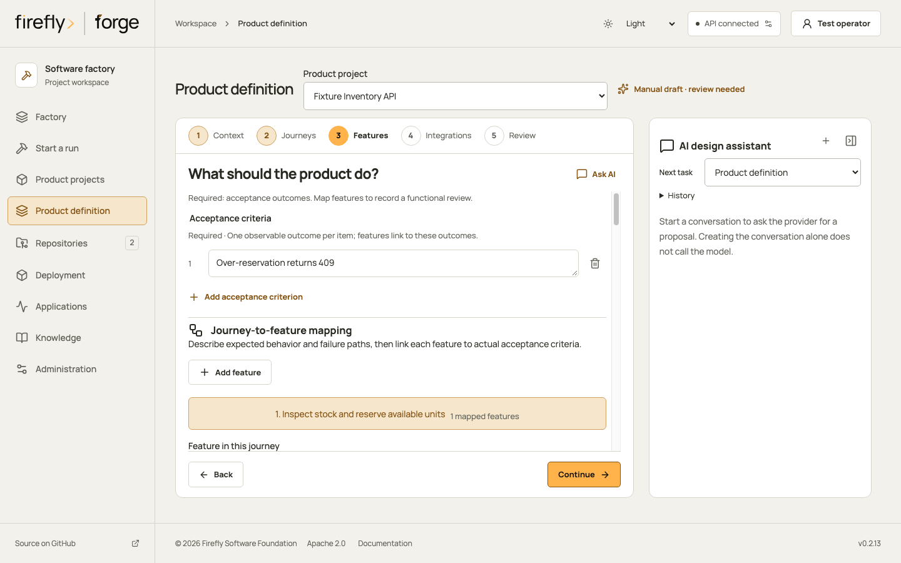

<figcaption>Features: link Reserve available stock to this journey and the 409 acceptance criterion. The architecture preference is pyfly with no frontend.</figcaption>
</figure>

<figure class="forge-shot" markdown="1">

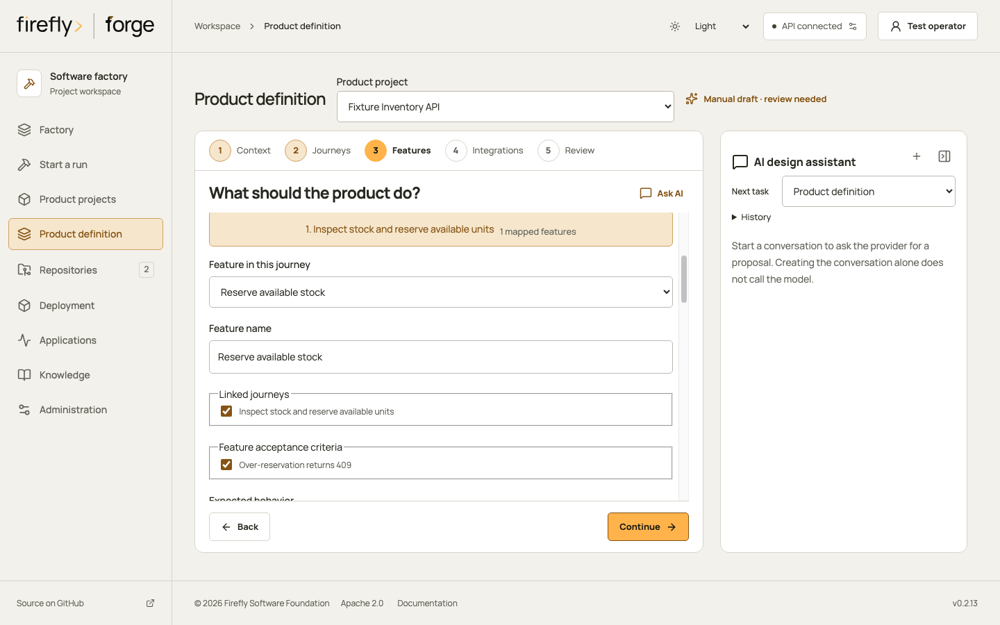

<figcaption>Feature mapping detail, naturally scrolled to Reserve available stock and its links. The phone excerpt focuses on these fields; Continue remains later in the form, shown in the preceding overview.</figcaption>
</figure>

<figure class="forge-shot" markdown="1">

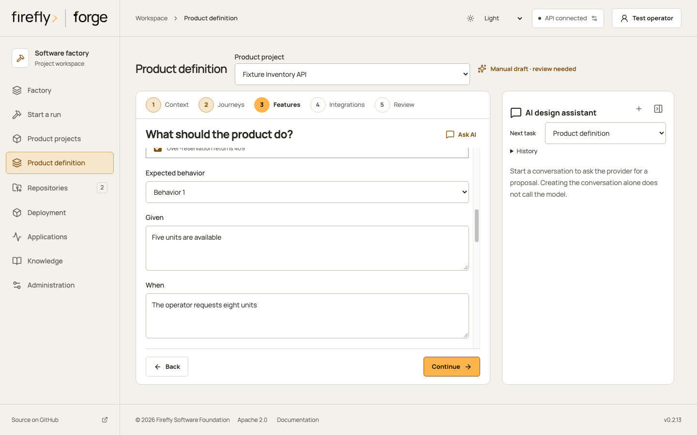

<figcaption>Features detail, naturally scrolled to the behavior fields: given five units, requesting eight returns 409 without changing stock. Record rejected quantities in the failure paths.</figcaption>
</figure>

<figure class="forge-shot" markdown="1">

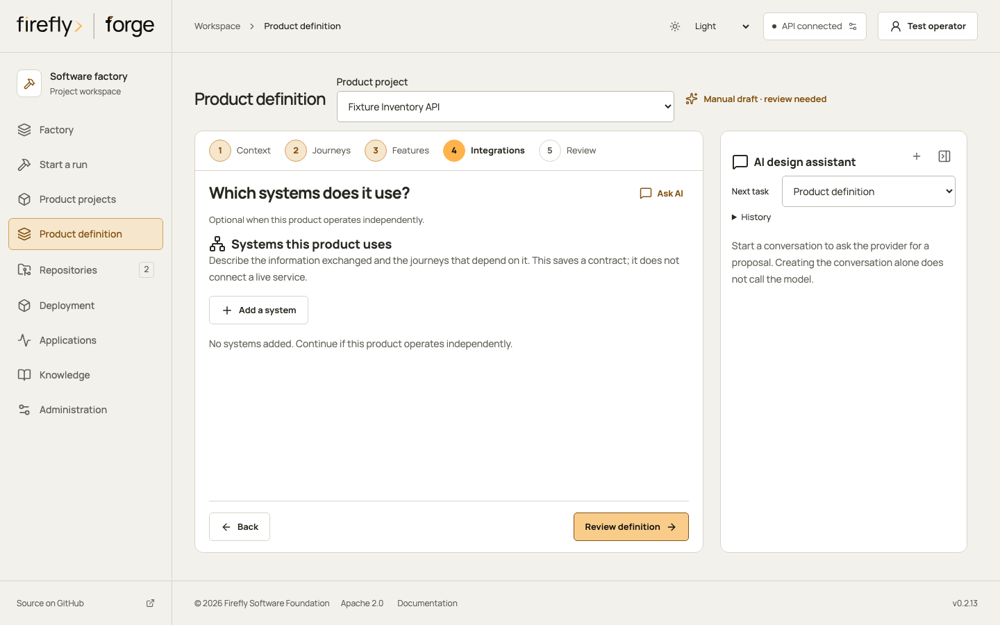

<figcaption>Integrations: add an owned or third-party system contract when this change needs one. This bounded fixture has none; Review definition opens the complete summary.</figcaption>
</figure>

<figure class="forge-shot" markdown="1">

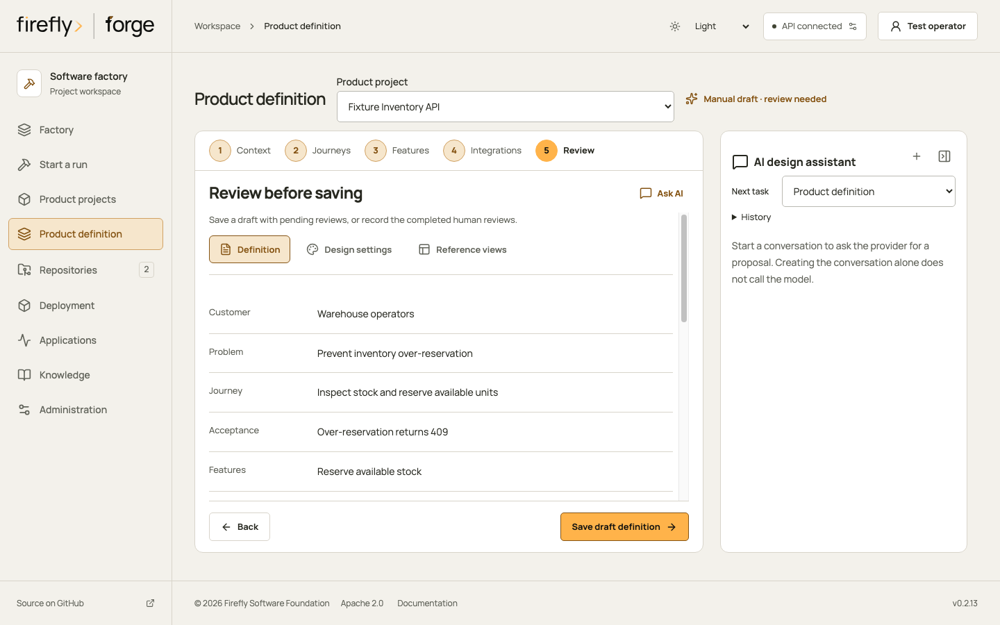

<figcaption>Review: inspect the mapped behavior and rule-based architecture before acknowledging them. The fixture saves a draft with reference views still pending; saving preserves that review state and starts no work.</figcaption>
</figure>

</div>
</details>

<details class="forge-gallery" markdown="1">
<summary>Inspect the product editor on a phone</summary>

<div class="forge-shot-grid" markdown="1">

<figure class="forge-shot forge-shot--phone" markdown="1">

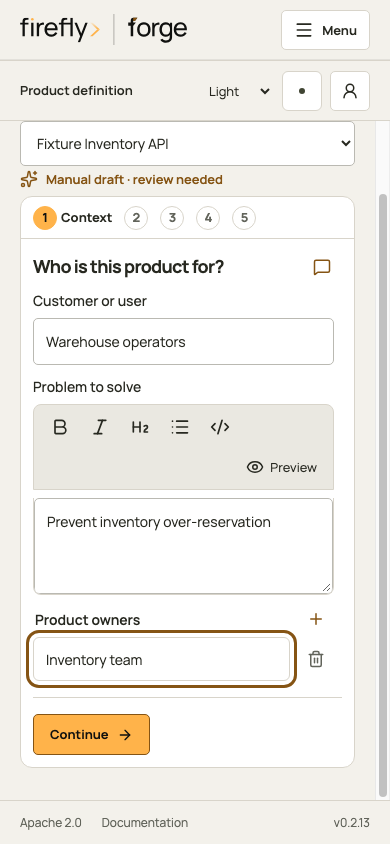

<figcaption>Context: name the warehouse operators, the over-reservation problem and the Inventory team as owner. Continue to Journeys.</figcaption>
</figure>

<figure class="forge-shot forge-shot--phone" markdown="1">

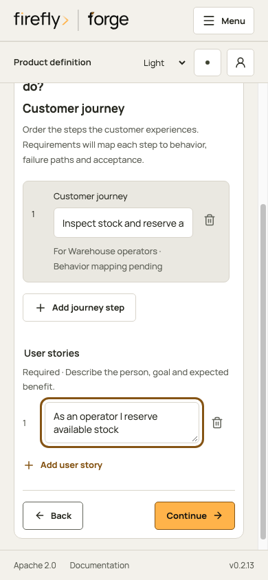

<figcaption>Journeys: record the stock reservation process and its user story. Continue to Features to specify observable behavior.</figcaption>
</figure>

<figure class="forge-shot forge-shot--phone" markdown="1">

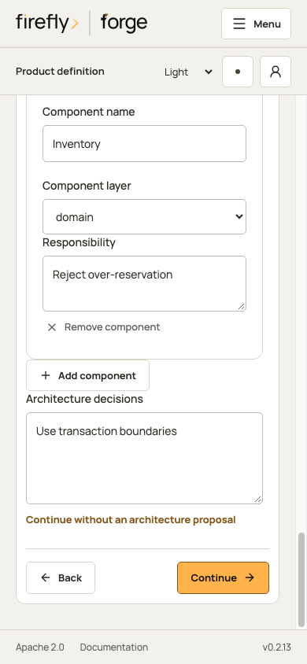

<figcaption>Features: link Reserve available stock to this journey and the 409 acceptance criterion. The architecture preference is pyfly with no frontend.</figcaption>
</figure>

<figure class="forge-shot forge-shot--phone" markdown="1">

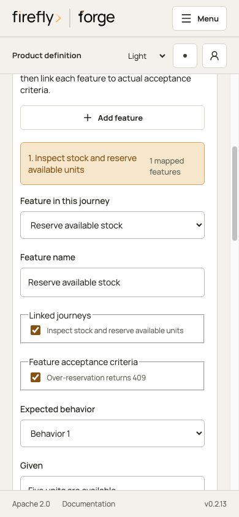

<figcaption>Feature mapping detail, naturally scrolled to Reserve available stock and its links. The phone excerpt focuses on these fields; Continue remains later in the form, shown in the preceding overview.</figcaption>
</figure>

<figure class="forge-shot forge-shot--phone" markdown="1">

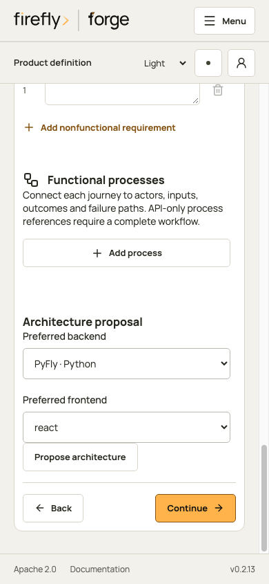

<figcaption>Features detail, naturally scrolled to the behavior fields: given five units, requesting eight returns 409 without changing stock. Record rejected quantities in the failure paths.</figcaption>
</figure>

<figure class="forge-shot forge-shot--phone" markdown="1">

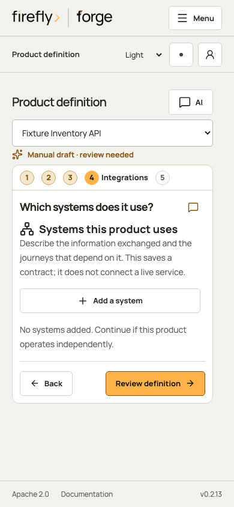

<figcaption>Integrations: add an owned or third-party system contract when this change needs one. This bounded fixture has none; Review definition opens the complete summary.</figcaption>
</figure>

<figure class="forge-shot forge-shot--phone" markdown="1">

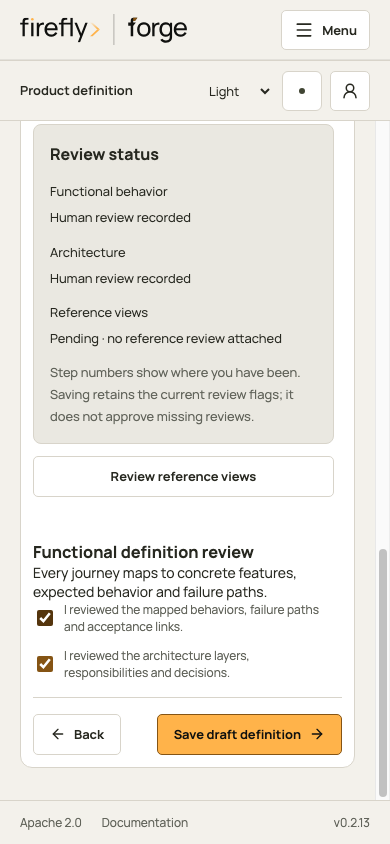

<figcaption>Review: inspect the mapped behavior and rule-based architecture before acknowledging them. The fixture saves a draft with reference views still pending; saving preserves that review state and starts no work.</figcaption>
</figure>

</div>
</details>

The assistant panel can prepare proposals and retain conversations. This case fills the form manually and uses a rule-based architecture response fixture. Preparing step context, applying a proposal and saving a definition have separate effects; see [product definition](product-definition.md).

The saved draft includes its pending reference review. For a visual product, [review every journey reference](design-review.md) before recording that acknowledgement. A saved revision freezes the agreed inputs for a run; customer acceptance and implementation verification still need their own evidence.

## 3. Review and admit the run

Start from the saved product revision. Keep the brief bounded: implement stock reservation and reject over-reservation. Inspect the foundation and choose checks that exist in the repository. Leave independent review unselected only when that matches the intended review policy.

<figure class="forge-shot" markdown="1">

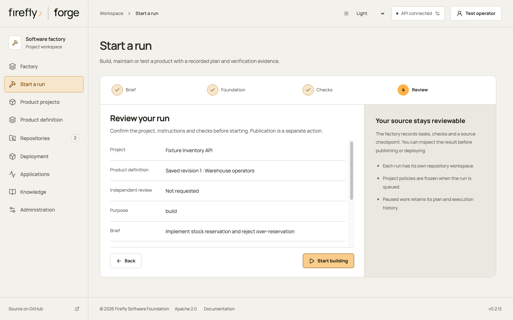

<figcaption>Review: inspect the instructions, foundation, checks and saved revision. Start building admits work on a real factory; this capture uses an intercepted fixture response.</figcaption>
</figure>

<details class="forge-gallery" markdown="1">
<summary>Follow Brief, Foundation and Checks</summary>

<div class="forge-shot-grid" markdown="1">

<figure class="forge-shot" markdown="1">

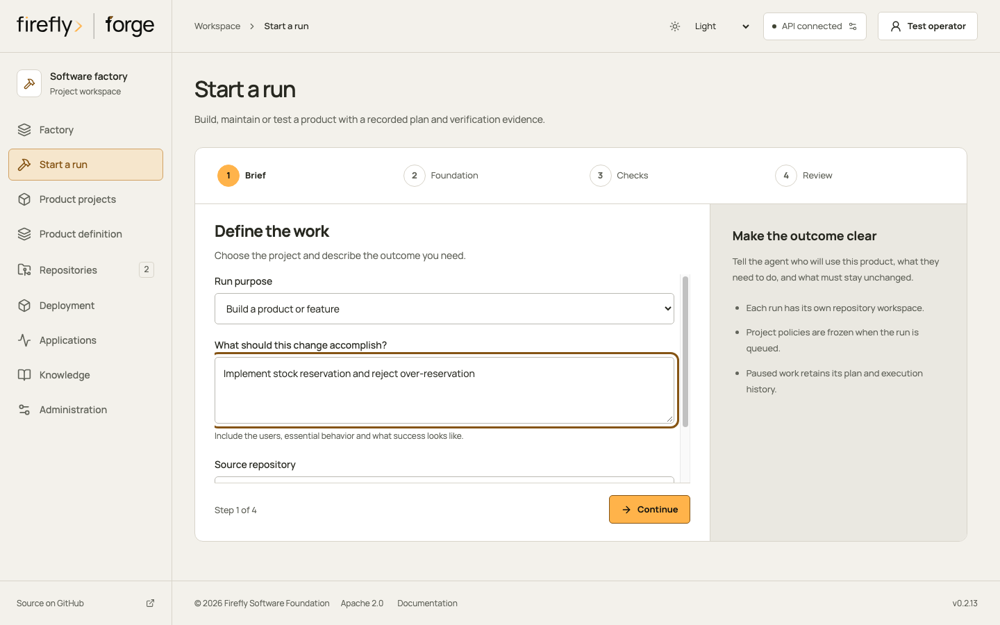

<figcaption>Brief: the saved product revision is attached to the selected repository. State the reservation change, then continue to Foundation.</figcaption>
</figure>

<figure class="forge-shot" markdown="1">

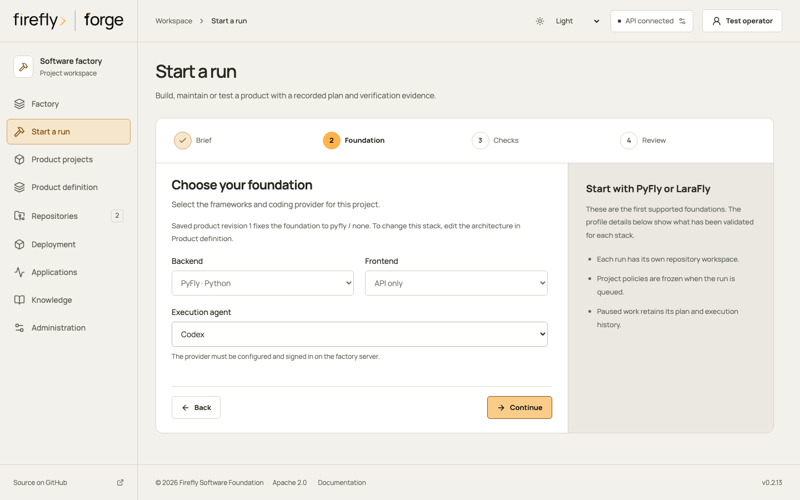

<figcaption>Foundation: the saved architecture fixes pyfly and API only. Check the selected execution agent against the provider configured on your actual host.</figcaption>
</figure>

<figure class="forge-shot" markdown="1">

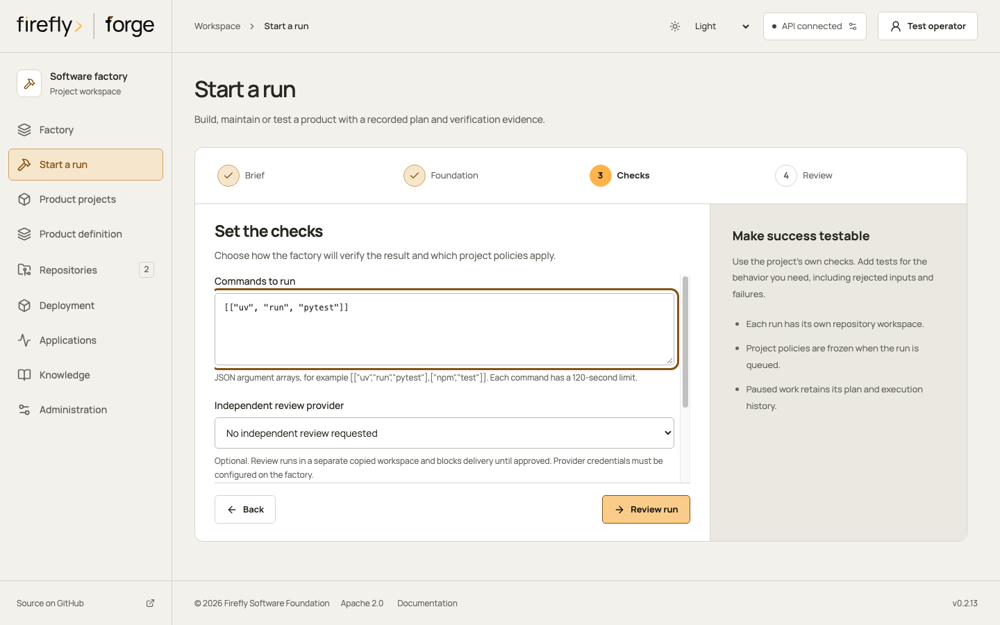

<figcaption>Checks: use the project's actual command. This example declares uv run pytest; the fixture supplies its later result and executes no command.</figcaption>
</figure>

<figure class="forge-shot" markdown="1">


<figcaption>Checks detail, naturally scrolled to the optional Independent review provider field. No independent review is selected in this fixture. Choose a separately configured provider when the review policy requires it.</figcaption>
</figure>

<figure class="forge-shot" markdown="1">

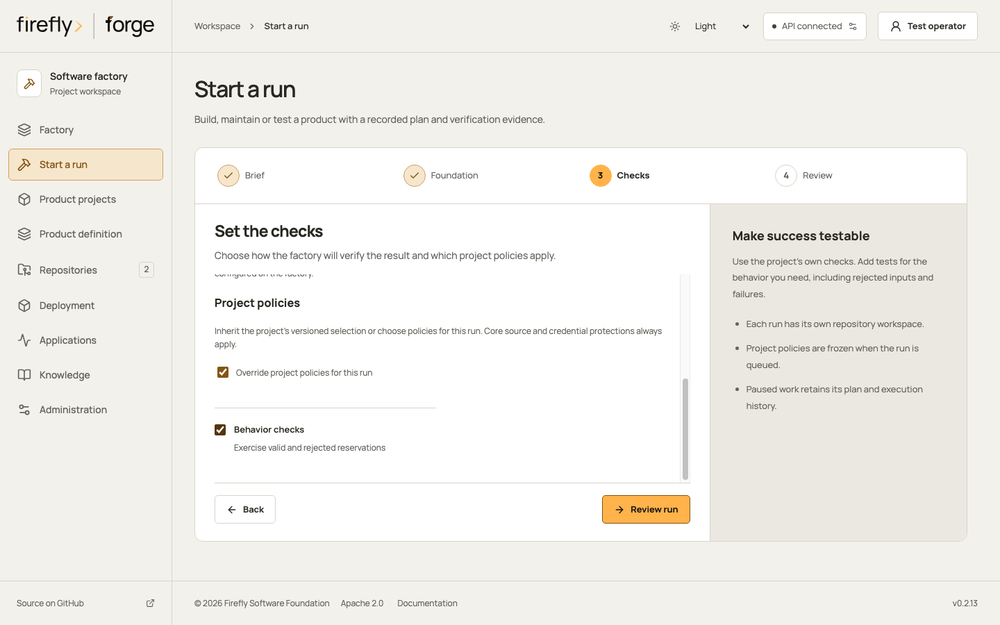

<figcaption>Checks detail, naturally scrolled to a fixture Behavior checks policy option. Override project policies exposes the available choices. This tour returns to inherited project defaults before Review run; core source and credential protections still apply.</figcaption>
</figure>


</div>
</details>

<details class="forge-gallery" markdown="1">
<summary>Review the run on a phone</summary>

<div class="forge-shot-grid" markdown="1">

<figure class="forge-shot forge-shot--phone" markdown="1">

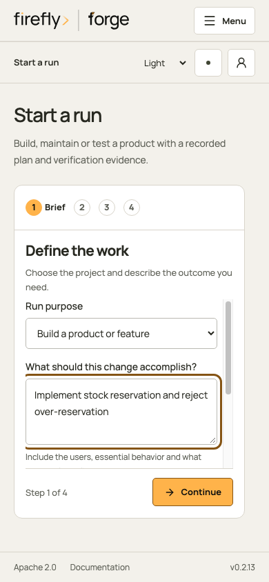

<figcaption>Brief: the saved product revision is attached to the selected repository. State the reservation change, then continue to Foundation.</figcaption>
</figure>

<figure class="forge-shot forge-shot--phone" markdown="1">

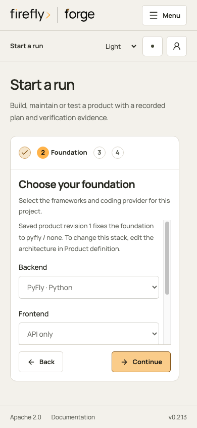

<figcaption>Foundation: the saved architecture fixes pyfly and API only. Check the selected execution agent against the provider configured on your actual host.</figcaption>
</figure>

<figure class="forge-shot forge-shot--phone" markdown="1">

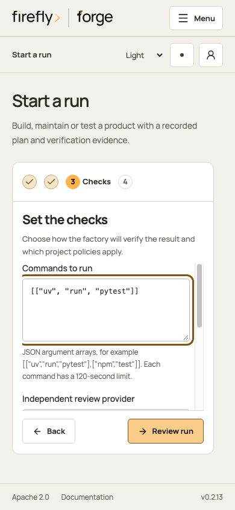

<figcaption>Checks: use the project's actual command. This example declares uv run pytest; the fixture supplies its later result and executes no command.</figcaption>
</figure>

<figure class="forge-shot forge-shot--phone" markdown="1">

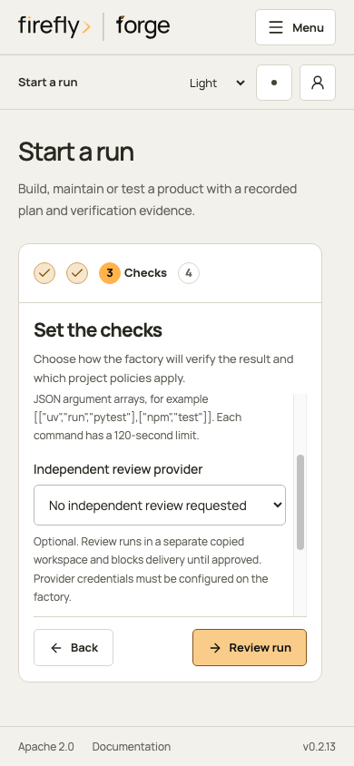

<figcaption>Checks detail, naturally scrolled to the optional Independent review provider field. No independent review is selected in this fixture. Choose a separately configured provider when the review policy requires it.</figcaption>
</figure>

<figure class="forge-shot forge-shot--phone" markdown="1">

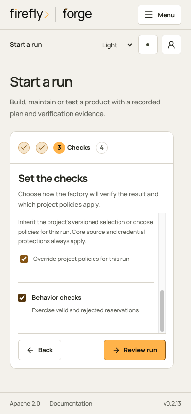

<figcaption>Checks detail, naturally scrolled to a fixture Behavior checks policy option. Override project policies exposes the available choices. This tour returns to inherited project defaults before Review run; core source and credential protections still apply.</figcaption>
</figure>


<figure class="forge-shot forge-shot--phone" markdown="1">

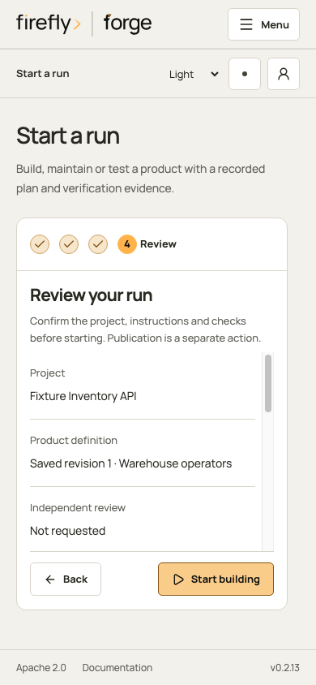

<figcaption>Review: inspect the instructions, foundation, checks and saved revision. Start building admits work on a real factory; this capture uses an intercepted fixture response.</figcaption>
</figure>

</div>
</details>

On a real factory, Start building admits the request. The retained source, product revision, provider configuration and policies belong to that run. Publication and deployment require their explicit operations; queueing work does not deliver a pull request or a live application.

## 4. Inspect the run before continuing

Factory lists the work. Select the inventory run to open its state, timeline and evidence tabs. In this example, the fixture reports `needs_reconciliation`, a failed verification command and an intent without a completion receipt.

<figure class="forge-shot" markdown="1">


<figcaption>Factory overview: select Fixture reservation verification to open its retained detail. The floor illustration describes the factory; its animation does not establish a job outcome.</figcaption>
</figure>

<figure class="forge-shot" markdown="1">

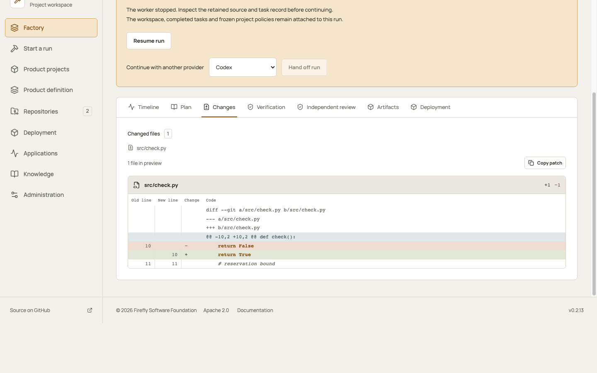

<figcaption>Changes detail, scrolled to the patch: inspect src/check.py and its removed and added lines. Copy patch retains the full recorded patch; it does not approve the change.</figcaption>
</figure>

<figure class="forge-shot" markdown="1">

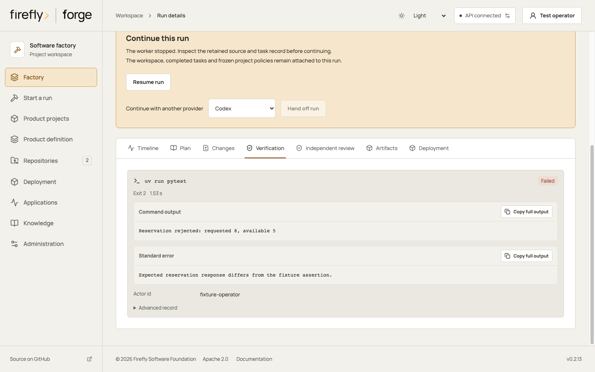

<figcaption>Verification detail: the fixture reports exit 2, 1.53 seconds, stdout and stderr. A returned command with a failed exit status does not establish a passing run.</figcaption>
</figure>

<details class="forge-gallery" markdown="1">
<summary>Inspect journal integrity and retained artifacts</summary>

<div class="forge-shot-grid" markdown="1">

<figure class="forge-shot" markdown="1">

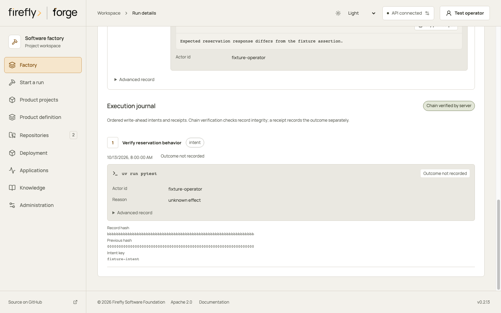

<figcaption>Plan detail, scrolled to Execution journal: sequence, record hash, previous hash and intent key stay visible. The server's chain validation and the missing outcome are separate facts.</figcaption>
</figure>

<figure class="forge-shot" markdown="1">

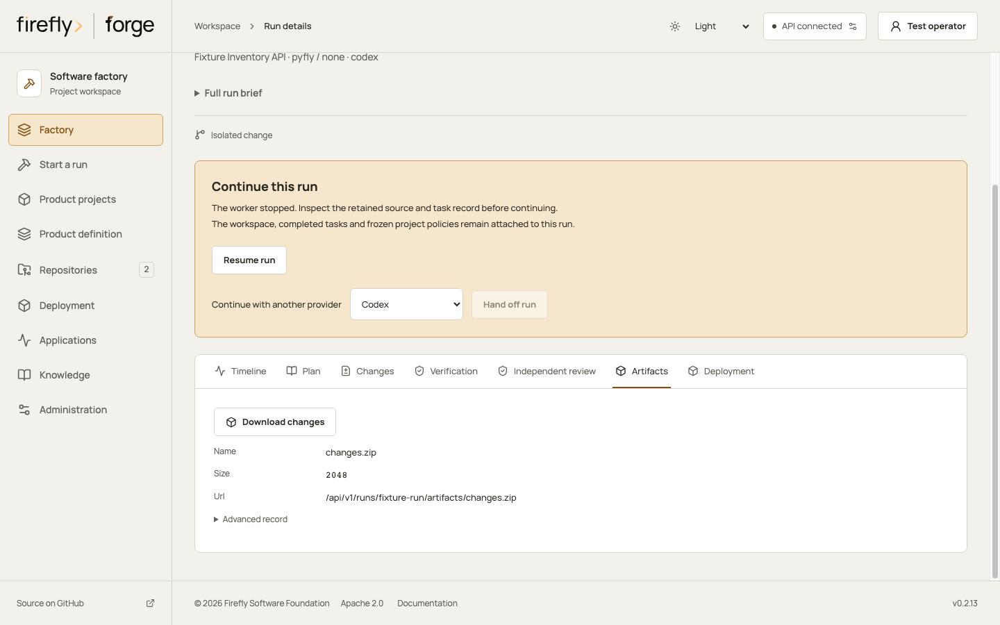

<figcaption>Artifacts detail: inspect the reported name and size. This fixture lists changes.zip; it supplies no real downloaded build or deployment evidence.</figcaption>
</figure>

</div>
</details>

<details class="forge-gallery" markdown="1">
<summary>Read run evidence on a phone</summary>

<div class="forge-shot-grid" markdown="1">

<figure class="forge-shot forge-shot--phone" markdown="1">

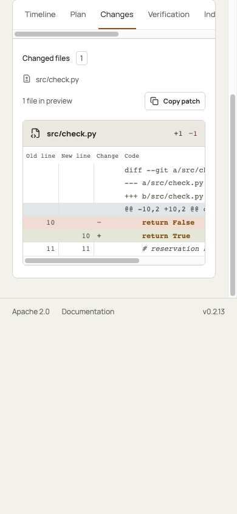

<figcaption>Changes detail, scrolled to the patch: inspect src/check.py and its removed and added lines. Copy patch retains the full recorded patch; it does not approve the change.</figcaption>
</figure>

<figure class="forge-shot forge-shot--phone" markdown="1">

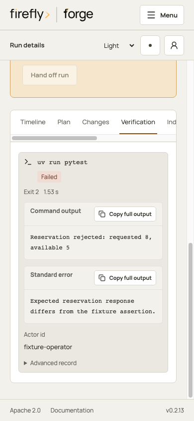

<figcaption>Verification detail: the fixture reports exit 2, 1.53 seconds, stdout and stderr. A returned command with a failed exit status does not establish a passing run.</figcaption>
</figure>

<figure class="forge-shot forge-shot--phone" markdown="1">

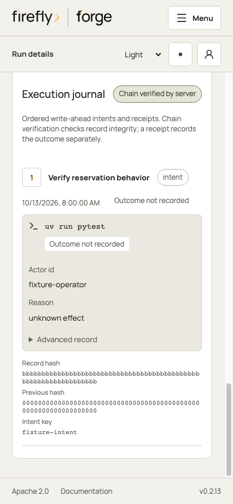

<figcaption>Plan detail, scrolled to Execution journal: sequence, record hash, previous hash and intent key stay visible. The server's chain validation and the missing outcome are separate facts.</figcaption>
</figure>

<figure class="forge-shot forge-shot--phone" markdown="1">

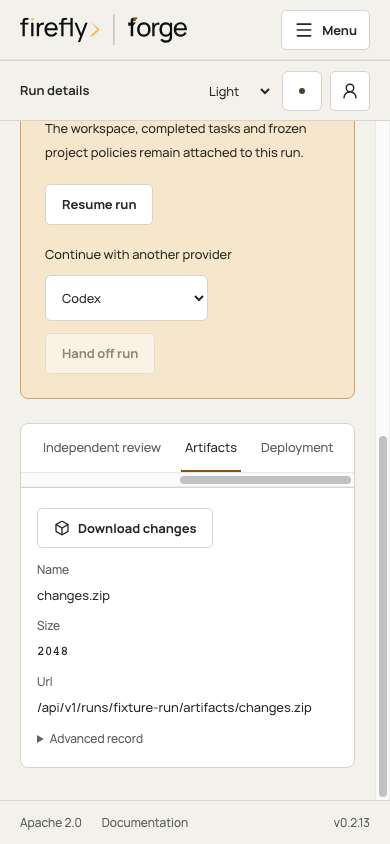

<figcaption>Artifacts detail: inspect the reported name and size. This fixture lists changes.zip; it supplies no real downloaded build or deployment evidence.</figcaption>
</figure>

</div>
</details>

Commands and outputs have bounded previews and full-copy controls. Advanced record retains the original technical payload. In Plan, a completion receipt records an outcome; hash-chain validation checks record integrity. Neither can turn a failed check into a passing build. The journal is an operator-controlled database ledger, with the [integrity limits described in recovery](recovery.md).

## 5. Choose recovery or handoff from the evidence

Inspect the actual workspace or external service for the unresolved effect, then retain its identity and result before repeating an operation. Resume preserves the run and available session. Retry creates a separate run and can repeat earlier effects. Handoff keeps the existing source and freezes a new configured provider snapshot.

<figure class="forge-shot" markdown="1">

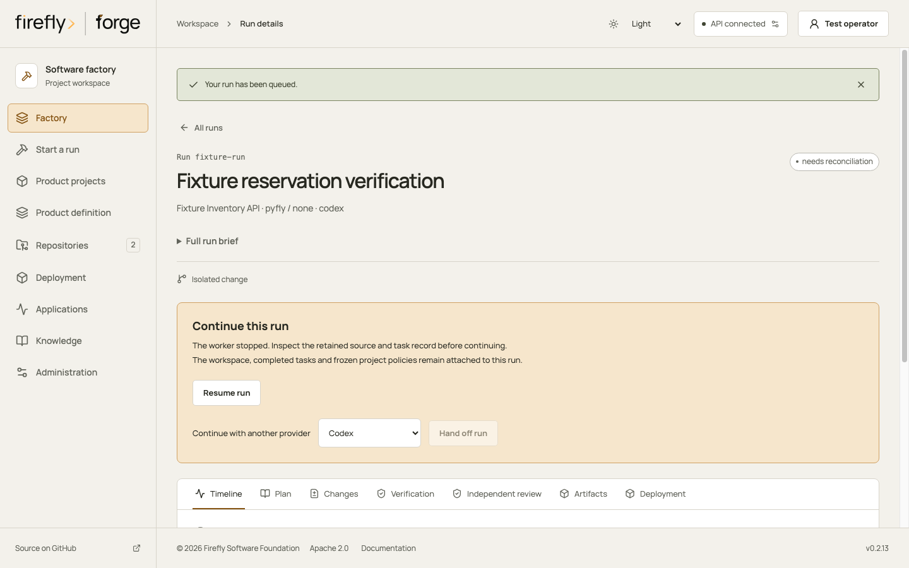

<figcaption>Run context before the evidence tabs. The fixture shows needs reconciliation and an unavailable handoff provider. Inspect the unresolved intent first; this tour does not press Resume run or Hand off run.</figcaption>
</figure>

<details class="forge-gallery" markdown="1">
<summary>Inspect the continuation controls on a phone</summary>

<div class="forge-shot-grid" markdown="1">

<figure class="forge-shot forge-shot--phone" markdown="1">

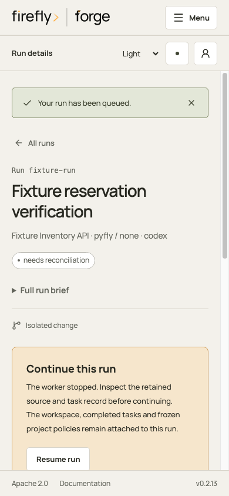

<figcaption>Continuation controls, naturally scrolled when needed. The enabled or disabled state follows the returned run and provider records; a disabled provider is not proof of a configured alternate worker.</figcaption>
</figure>

</div>
</details>

Follow [recovery and handoff](recovery.md) for the accepted state and request contract. Review the exact diff and passing checks before [publication or deployment](deployment.md). Verified memory is written only after final verification; this failed fixture cannot establish a successful memory write.

## 6. Review saved evidence and its decision

Open **Knowledge > Learning records** and inspect a record in its current scope. A saved verified state does not establish current reuse eligibility. When its evidence no longer applies, a current reviewer can enter a reason, inspect the scoped decision and explicitly confirm invalidation.

<figure class="forge-shot" markdown="1">

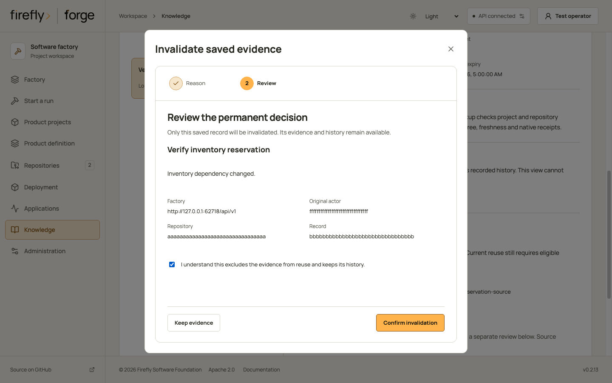

<figcaption>The separate learning fixture reviews one decision. Its original request identity is retained before the browser sends the intercepted write.</figcaption>
</figure>

If the response is lost, use **Check original request**. A missing event retains uncertainty; it cannot authorize another write. The [illustrated learning guide](learning.md#invalidate-saved-evidence) follows the same request from reason and review through an initial 404 and a later matching receipt, including filter retention and the phone layout. These are controlled fixtures with no external service writes.

## 7. Verify an existing indexed source

For an admitted source whose indexing needs verification, choose **Verify existing source**. Choose **Review source**, check the record and source, then acknowledge the operation before **Verify source**. This reads the existing content and citations and records a local observation; it does not create a source or trigger ingestion.

<figure class="forge-shot" markdown="1">

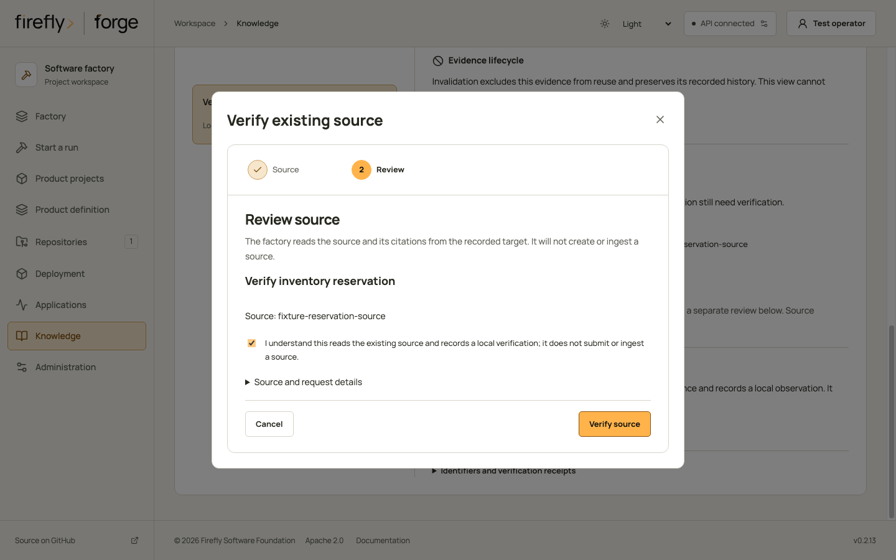

<figcaption>The separate source fixture reviews one observation. Exact factory, actor and target references remain available in expandable details. Its pending identity is retained before the intercepted request.</figcaption>
</figure>

A lost response leaves the original verification unresolved. **Check original verification** only reads its exact receipt. The [illustrated source-verification guide](learning.md#verify-an-existing-indexed-source) follows one write, an initial 404 and a later matching event. The confirmation distinguishes historical verification from current evidence eligibility and stays open when the record leaves the active filter. These controlled fixtures make no provider or knowledge-service call.

## 8. Review an original queued command

In a run's **Plan** tab, choose **Request continuation** under **Original runner command**. Select the command, review its saved identity and acknowledge the leader's final check. The [illustrated continuation guide](sandbox.md#continue-one-queued-command-after-a-controller-restart) shows both steps on desktop and phone. Its fixtures stop before sending a request. Only the live leader and controller can establish admission and execution.

## 9. Inspect a product campaign

Open **Product projects**, select the product and choose **Load campaigns**. Select a campaign, then **View report**. Compare its recorded status with the retained evidence state. Select a component for its tasks, checks, source and journal references. The [campaign walkthrough](project-campaigns.md#read-a-report-in-studio) shows the summary and component details; its fixtures do not establish a live campaign run.

## Keep captures current

For project tool permissions and provider prerequisites, follow the [external tools walkthrough](external-tools-tour.md).

The [capture inventory](assets/screenshots/walkthrough-manifest.json) records each path, fixture state, theme, actual viewport, image SHA-256, action bounds and frontend source hashes. Each entry retains its producer, shared-helper and browser-configuration hashes with the Studio version. The strict build rejects missing capture inputs, changed image bytes and mixed frontend versions until the complete inventory is refreshed.

From the repository root, with the existing Studio dependencies installed, capture through the isolated fixture browser configuration:

```sh
UPDATE_DOC_SCREENSHOTS=1 FORGE_DOCS_PORT=5227 \
  node studio/node_modules/@playwright/test/cli.js test \
  --config studio/playwright.docs.config.ts
```

The configuration captures the product journey, learning decisions and source recovery, external tool setup, queued-command review and campaign evidence. For complementary views against unchanged frontend and capture inputs, set `CAPTURE_STAGES` to a comma-separated list of state names. Existing captures keep their bytes and recorded provenance. After a frontend, Studio version or capture-input change, refresh all complete journeys.

Choose an unused local port. The configuration starts its own server and refuses to reuse another checkout. Captures wait for fonts, use the configured viewport and check visible wizard actions against the footer and click target. Native scrollbar painting stays enabled. Review the actual images and rendered guides after regeneration. Fixture screenshots remain presentation evidence, even when the browser checks pass.

[^captures]: These screenshots render the Studio source and version recorded in the capture inventory with controlled API fixtures. Provider readiness, product receipts, command results and journal hashes are fixtures. The journey makes no real model, command, remote repository or knowledge-service call. It demonstrates navigation and presentation; browser success does not establish execution, authenticated provider access or customer acceptance. Phone captures use their recorded viewport and remain bounded in the guide. See [capture maintenance and source hashes](#keep-captures-current).
