<!-- Copyright 2026 Firefly Software Foundation. SPDX-License-Identifier: Apache-2.0 -->

# Configure external tools in Studio

Open Administration, then External tools to manage a connection and its project permissions. Follow the GitHub setup below, or inspect the requirements for another provider. For the implemented local OAuth policy and browser consent wizard, use [Connected accounts](connected-accounts.md).

Screenshots use controlled fixtures.[^captures] Select an image to open the full capture; its theme follows the page appearance.

<figure class="forge-shot" markdown="1">

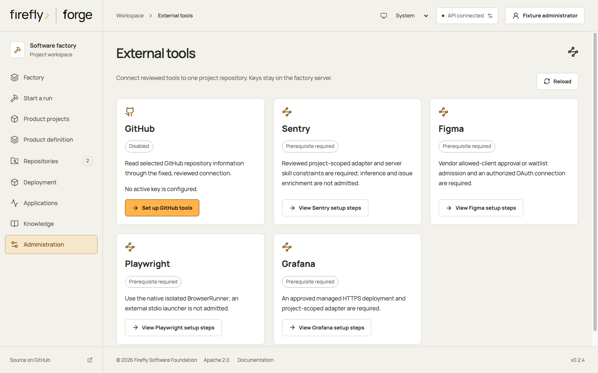

<figcaption>Fixture catalog, initial view. GitHub has a configuration flow; the other cards lead to their current setup requirements. Scroll the catalog for the remaining providers.</figcaption>
</figure>
## Connect GitHub to a project repository

A factory administrator configures the platform key and project grants. A project owner cannot change those settings. The worker also needs the `external_mcp` role permission in Agents & skills; direct Codex and Claude CLI tools use their own permissions.

### 1. Save the connection

Enter an authorized GitHub key and choose whether to enable the connection. Saving contacts your factory API. Leave a saved key blank to preserve it; the page never reads its value back.

<figure class="forge-shot" markdown="1">

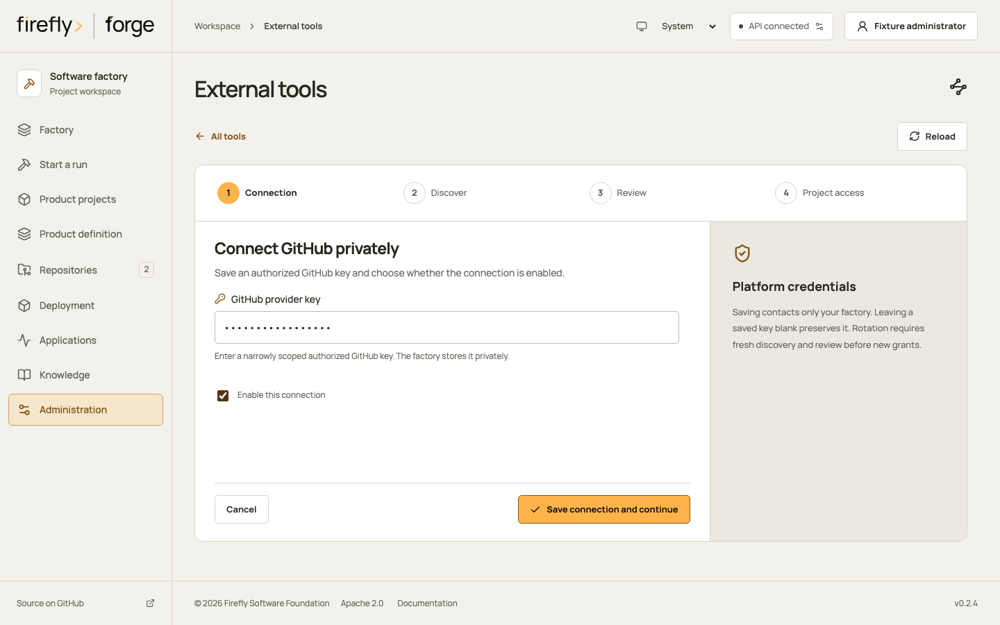

<figcaption>Fixture connection form with a masked key. Save connection and continue records the configuration; discovery is a separate action.</figcaption>
</figure>

Inspect the connection on a phone

<figure class="forge-shot forge-shot--phone" markdown="1">

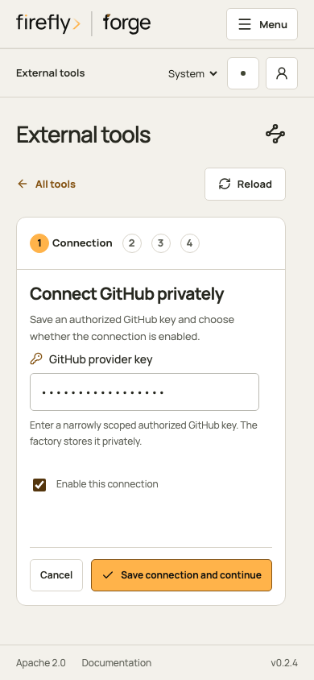

<figcaption>The same fixture form in its initial phone view. The fields scroll independently of the step title and action row.</figcaption>
</figure>

### 2. Request discovery explicitly

Discover schemas sends a remote request on your factory and may consume provider quota. Inspect the saved connection first, then start discovery when you are ready to review its result. Discovery does not execute a repository tool.

<figure class="forge-shot" markdown="1">

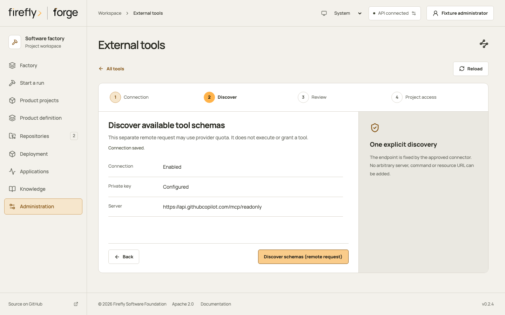

<figcaption>Fixture discovery step before the request. The key is configured and the connection is enabled; no live tool execution is verified.</figcaption>
</figure>
### 3. Review the returned tools

Choose the read tools the project needs and inspect their parameters. Copy the exact digest or open its identity disclosure when comparing schema revisions. A changed schema needs a new discovery and review.

<figure class="forge-shot" markdown="1">

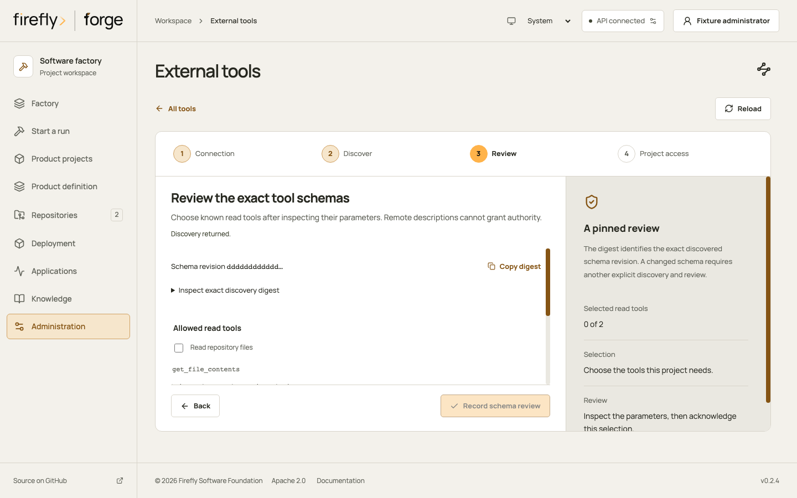

<figcaption>Fixture review overview after discovery. Nothing is selected yet. Use the visible field scrollbar to inspect the remaining tools before acknowledging this selection.</figcaption>
</figure>

Inspect parameters and the review acknowledgment

<figure class="forge-shot" markdown="1">

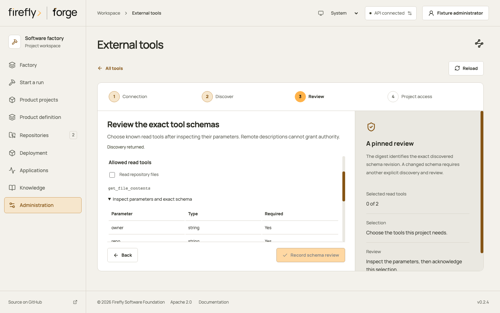

<figcaption>Fixture detail view with the first schema opened and the fields naturally scrolled. The title, progress and Record schema review action remain visible.</figcaption>
</figure>

<figure class="forge-shot forge-shot--phone" markdown="1">

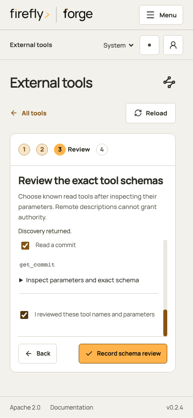

<figcaption>Fixture detail view after selecting the two returned tools. The acknowledgment applies to this selection and schema revision; remote descriptions cannot grant permissions.</figcaption>
</figure>

### 4. Grant the repository and roles

Choose a product project and one of its registered HTTPS GitHub repositories. Select the reviewed tools and implementation roles, then record the grant. Keep one current-key grant for each repository and tool, with all intended roles in that grant. To change an overlapping grant, revoke it explicitly and create its replacement.

<figure class="forge-shot" markdown="1">

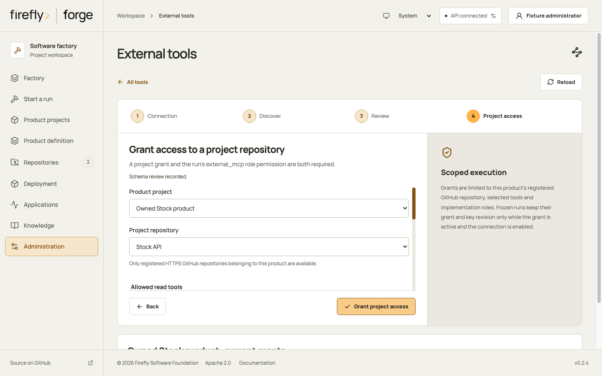

<figcaption>Fixture project-access step with Stock API selected. The server derives the allowed GitHub owner and repository from that registered source.</figcaption>
</figure>

Inspect repository, role and recorded-grant views

<figure class="forge-shot forge-shot--phone" markdown="1">

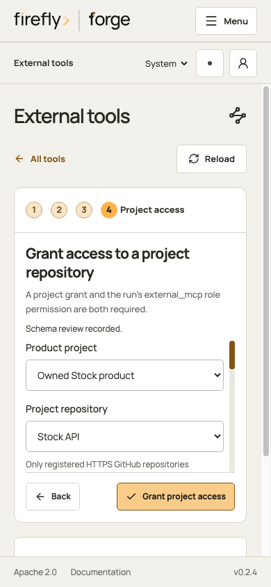

<figcaption>Fixture repository fields in a phone view. Only registered GitHub repositories belonging to the selected product are available.</figcaption>
</figure>

<figure class="forge-shot" markdown="1">

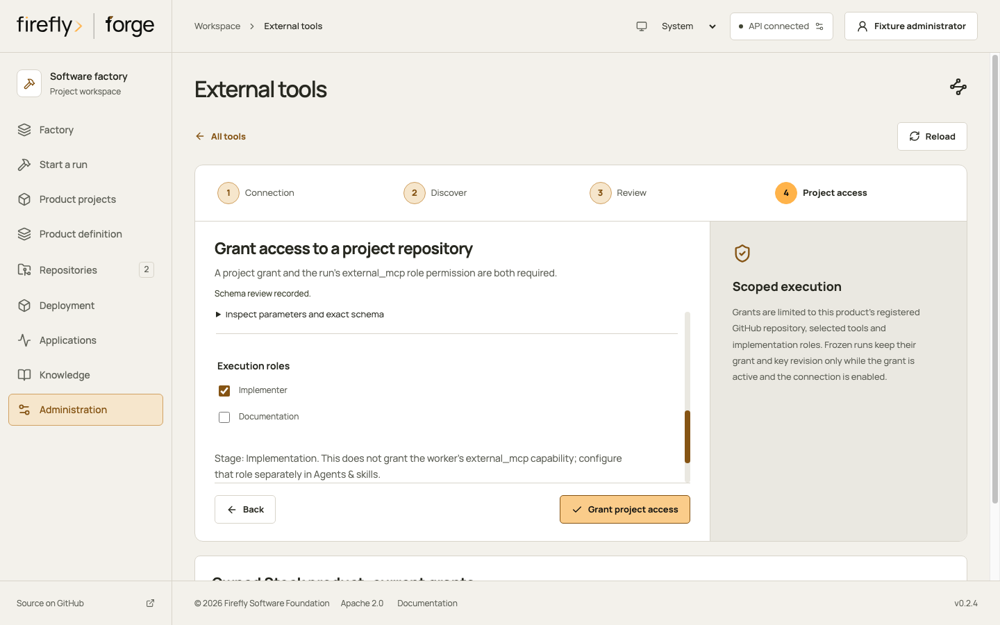

<figcaption>Fixture detail view of the role choices. The grant is limited to Implementation; the worker capability must also be configured in Agents & skills.</figcaption>
</figure>

<figure class="forge-shot forge-shot--phone" markdown="1">

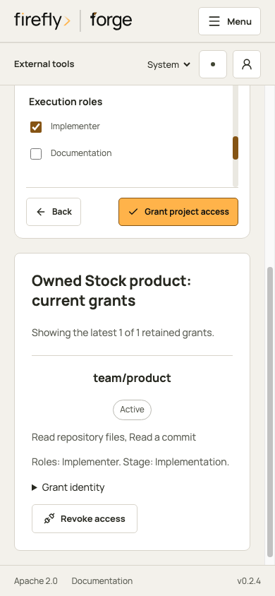

<figcaption>Fixture retained-grant view, naturally scrolled below the setup form. Active is the returned grant state, not proof that a hosted tool has executed.</figcaption>
</figure>

Rotating the key requires discovery and review before new grants. Existing frozen runs retain their recorded grant and key revision only while that grant is active and the connection is enabled. Removing the active key disables the connection and revokes its grants. If a save outcome is unknown, reload the factory state before another change.

See [external tool authority and API contracts](external-tools.md) for the exact discovery, review and grant boundaries.

## Inspect another provider's requirements

Each provider has its own Requirements, Account & scope (or Runner profile), Factory setup and Availability views. Continue moves through the guide; it does not verify an account or enable a template.

### Figma

Figma requires allowed-client approval or waitlist admission and authorized OAuth for the intended files. A factory adapter is still required; this guide has no token or OAuth form.

<figure class="forge-shot forge-shot--phone" markdown="1">

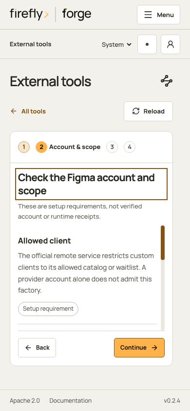

<figcaption>Allowed-client, OAuth and project-file requirements remain separate. The fixture reports Prerequisite required.</figcaption>
</figure>

Inspect the remaining Figma setup views

<figure class="forge-shot" markdown="1">

<figcaption>Fixture requirements overview. The returned catalog prerequisite remains visible before any account or runtime check.</figcaption>
</figure>

<figure class="forge-shot forge-shot--phone" markdown="1">

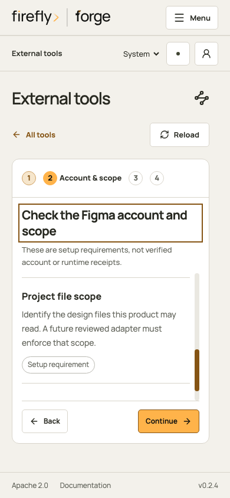

<figcaption>Fixture detail view of the last Figma requirement, reached through the internal field scrollbar. The step title and actions remain visible.</figcaption>
</figure>

<figure class="forge-shot" markdown="1">

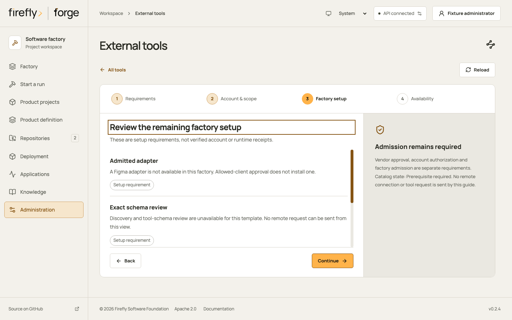

<figcaption>Fixture factory-setup view. These requirements have no local completion checkbox that could mark an unsupported adapter ready.</figcaption>
</figure>

<figure class="forge-shot forge-shot--phone" markdown="1">

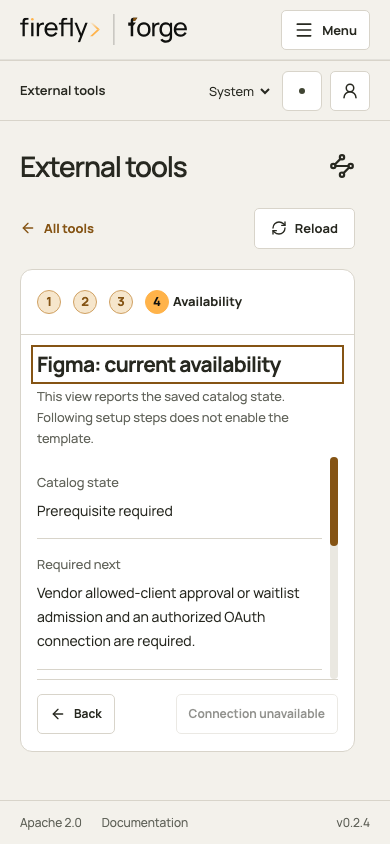

<figcaption>Fixture availability view with the connection or external template unavailable. Use the linked guide or Agents & skills for the next supported configuration step.</figcaption>
</figure>

Read the [Figma prerequisite checklist](https://fireflyframework.github.io/firefly-forge/tooling-prerequisites/#figma) for provider access and factory admission.

### Sentry

The upstream service uses Sentry-Bearer authentication and can enrich issue results. A reviewed project adapter and server skill constraints are still required before this factory can admit those calls.

<figure class="forge-shot forge-shot--phone" markdown="1">

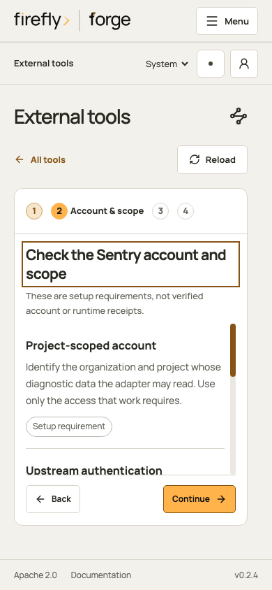

<figcaption>Account and project requirements in the fixture. This view does not accept a token or admit issue enrichment.</figcaption>
</figure>

Inspect the remaining Sentry setup views

<figure class="forge-shot" markdown="1">

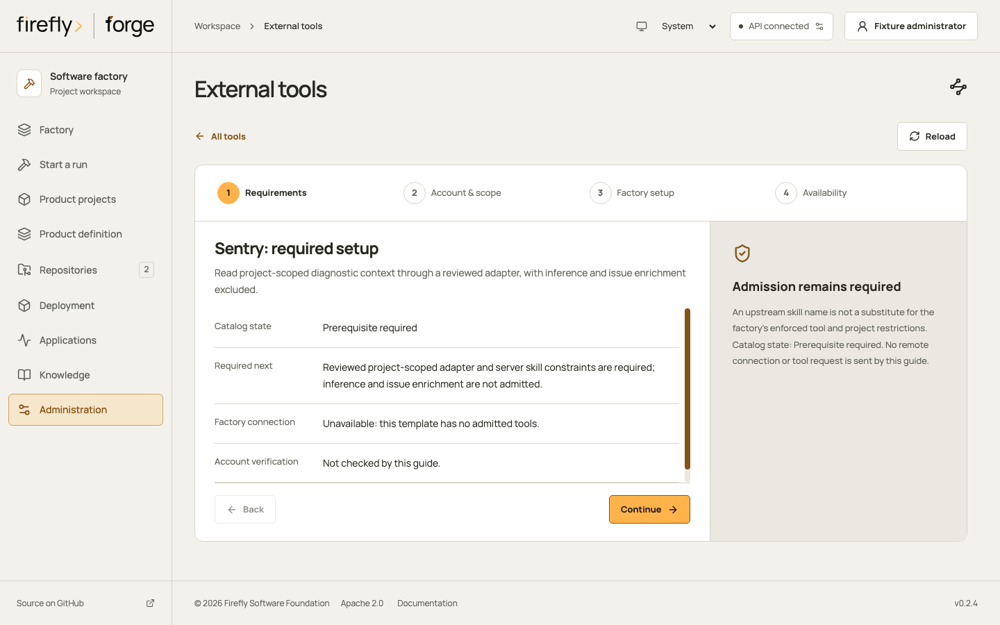

<figcaption>Fixture requirements overview. The returned catalog prerequisite remains visible before any account or runtime check.</figcaption>
</figure>

<figure class="forge-shot forge-shot--phone" markdown="1">

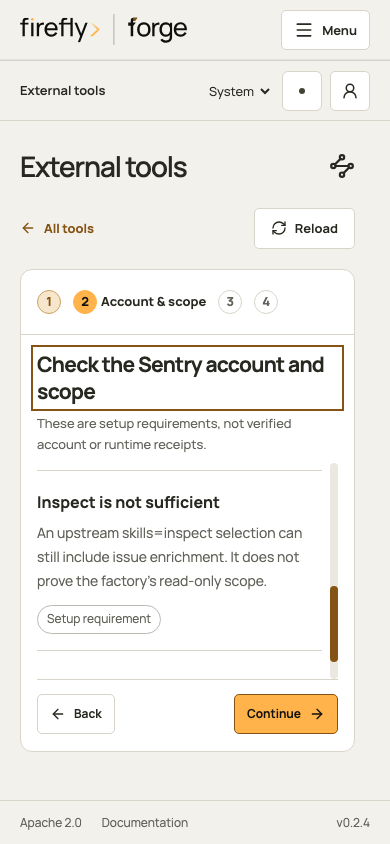

<figcaption>Fixture detail view of the last Sentry requirement, reached through the internal field scrollbar. The step title and actions remain visible.</figcaption>
</figure>

<figure class="forge-shot" markdown="1">

<figcaption>Fixture factory-setup view. These requirements have no local completion checkbox that could mark an unsupported adapter ready.</figcaption>
</figure>

<figure class="forge-shot forge-shot--phone" markdown="1">

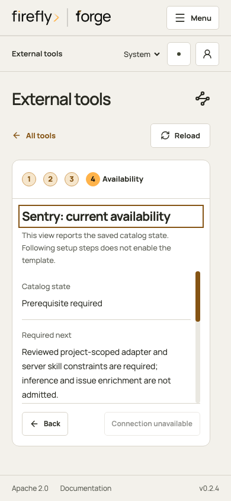

<figcaption>Fixture availability view with the connection or external template unavailable. Use the linked guide or Agents & skills for the next supported configuration step.</figcaption>
</figure>

Read the [Sentry prerequisite checklist](https://fireflyframework.github.io/firefly-forge/tooling-prerequisites/#sentry) for provider access and factory admission.

### Grafana

Prepare an approved managed HTTPS service with read-only server settings and a scoped service account. The factory still needs a reviewed adapter; an arbitrary endpoint cannot be added here.

<figure class="forge-shot forge-shot--phone" markdown="1">

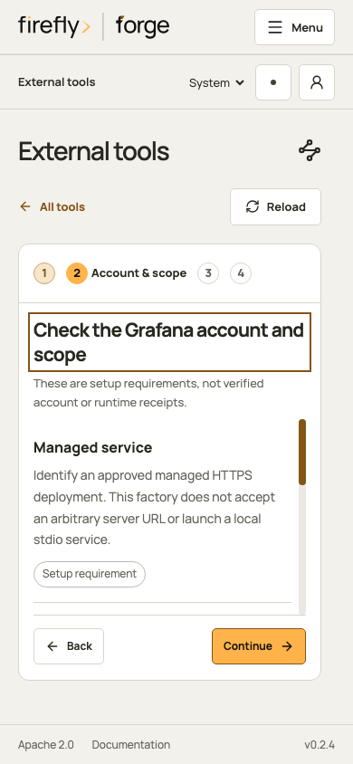

<figcaption>Server, target identity and project data requirements in the fixture. The current template remains unavailable.</figcaption>
</figure>

Inspect the remaining Grafana setup views

<figure class="forge-shot" markdown="1">

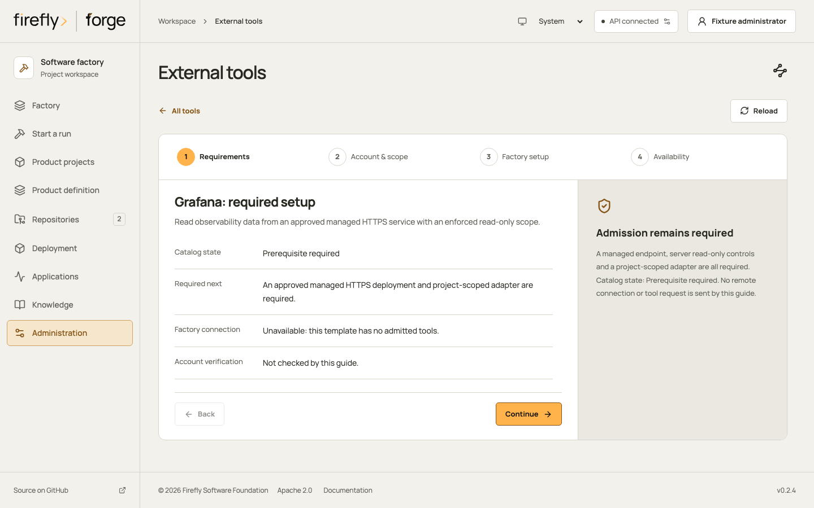

<figcaption>Fixture requirements overview. The returned catalog prerequisite remains visible before any account or runtime check.</figcaption>
</figure>

<figure class="forge-shot forge-shot--phone" markdown="1">

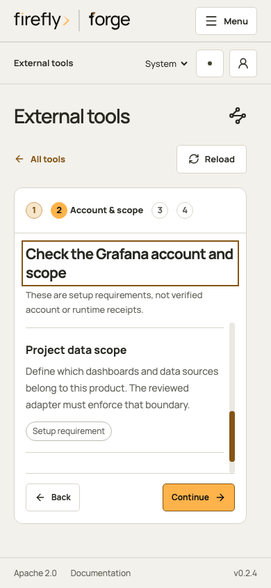

<figcaption>Fixture detail view of the last Grafana requirement, reached through the internal field scrollbar. The step title and actions remain visible.</figcaption>
</figure>

<figure class="forge-shot" markdown="1">

<figcaption>Fixture factory-setup view. These requirements have no local completion checkbox that could mark an unsupported adapter ready.</figcaption>
</figure>

<figure class="forge-shot forge-shot--phone" markdown="1">

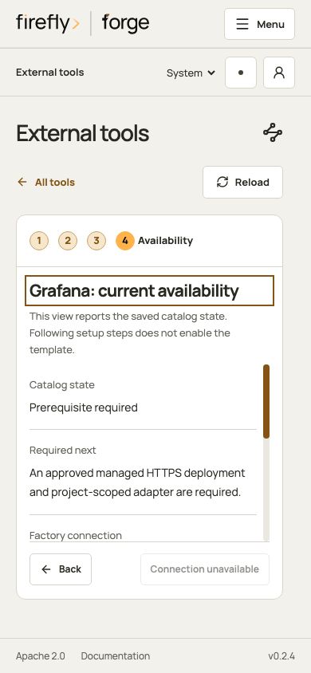

<figcaption>Fixture availability view with the connection or external template unavailable. Use the linked guide or Agents & skills for the next supported configuration step.</figcaption>
</figure>

Read the [Grafana prerequisite checklist](https://fireflyframework.github.io/firefly-forge/tooling-prerequisites/#grafana) for provider access and factory admission.

### Playwright

Use the native BrowserRunner for isolated browser checks. Configure its pinned Docker image, matching browser package and declared loopback origin, then grant the required browser role and inspect actual worker evidence.

<figure class="forge-shot forge-shot--phone" markdown="1">

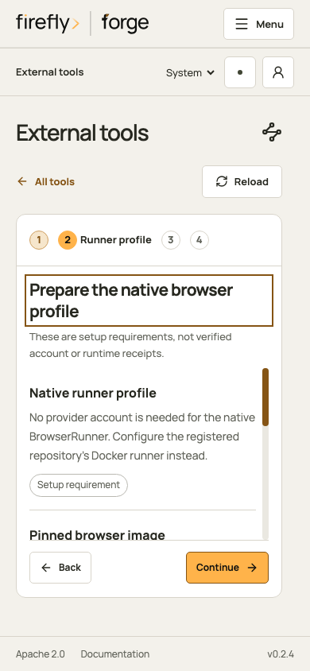

<figcaption>Native runner-profile requirements in the fixture. This guide does not save runner settings or launch an external stdio service.</figcaption>
</figure>

Inspect the remaining Playwright setup views

<figure class="forge-shot" markdown="1">

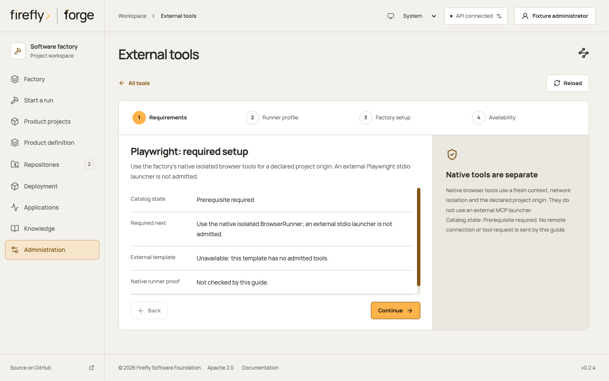

<figcaption>Fixture requirements overview. The returned catalog prerequisite remains visible before any account or runtime check.</figcaption>
</figure>

<figure class="forge-shot forge-shot--phone" markdown="1">

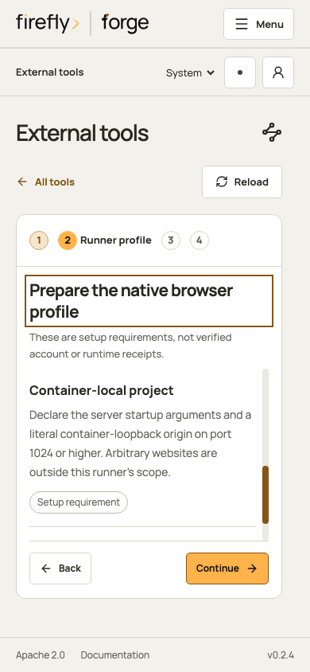

<figcaption>Fixture detail view of the last Playwright requirement, reached through the internal field scrollbar. The step title and actions remain visible.</figcaption>
</figure>

<figure class="forge-shot" markdown="1">

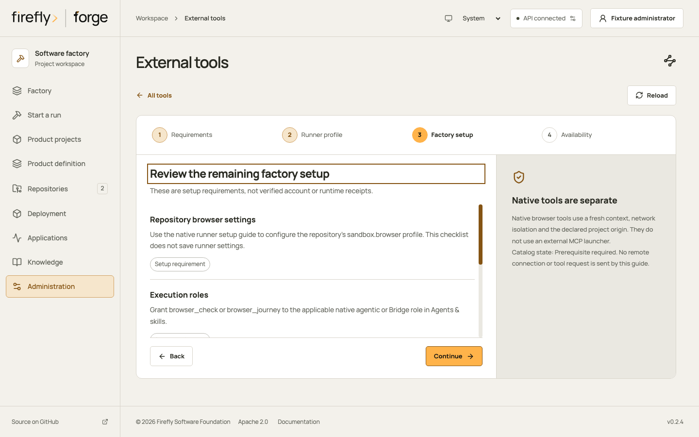

<figcaption>Fixture factory-setup view. These requirements have no local completion checkbox that could mark an unsupported adapter ready.</figcaption>
</figure>

<figure class="forge-shot forge-shot--phone" markdown="1">

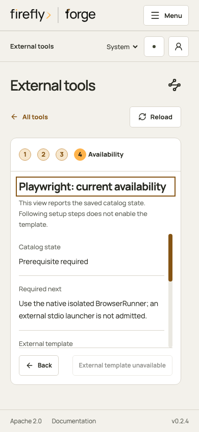

<figcaption>Fixture availability view with the connection or external template unavailable. Use the linked guide or Agents & skills for the next supported configuration step.</figcaption>
</figure>

Follow [native browser setup](agent-tools.md#configure-real-browser-checks) and [runner configuration](sandbox.md) before checking a real worker.

## Keep the walkthrough current

The [capture inventory](assets/screenshots/walkthrough-manifest.json) binds each image to its actual viewport, Studio version, frontend source and capture producer. It also records the shared capture helpers and browser configuration, including native scrollbar painting. Refresh the complete inventory after a frontend change; the strict build rejects missing inputs and mixed capture versions. Follow the [capture maintenance procedure](console-tour.md#keep-captures-current).

[^captures]: These screenshots use controlled API fixtures for the frozen Studio source recorded in the inventory. Keys are synthetic, and the projects, schema responses and grant records are fixtures. No model, hosted provider, remote repository or account-verification request runs. The images demonstrate navigation and presentation, not authenticated vendor access or actual tool execution.
