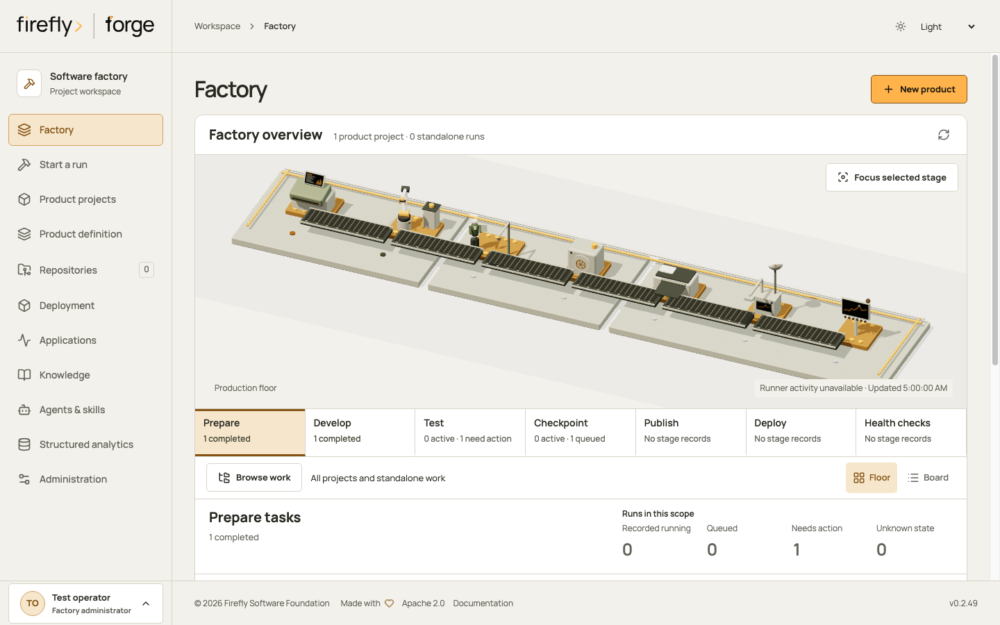
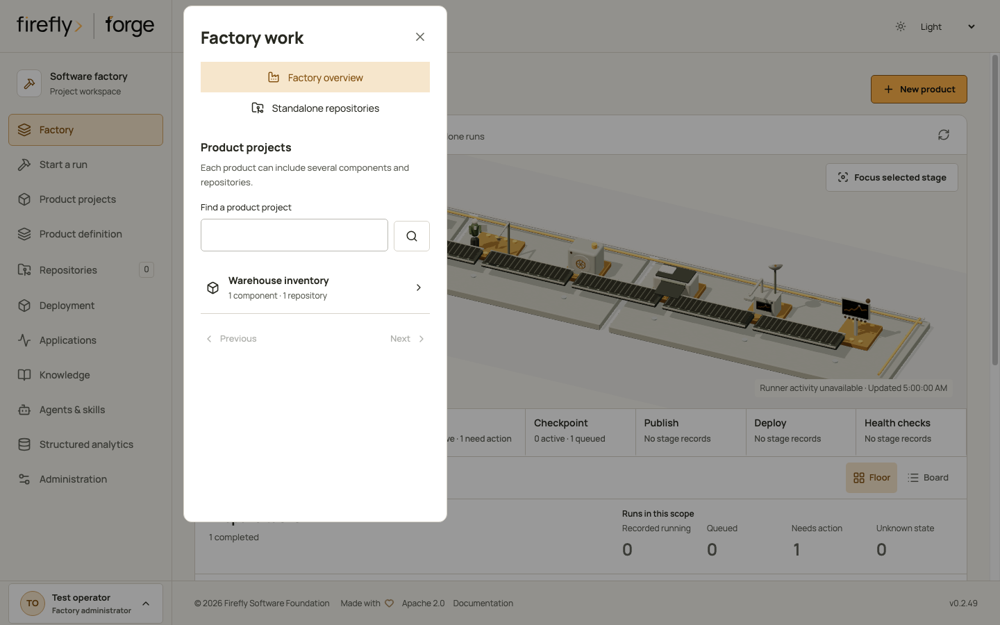
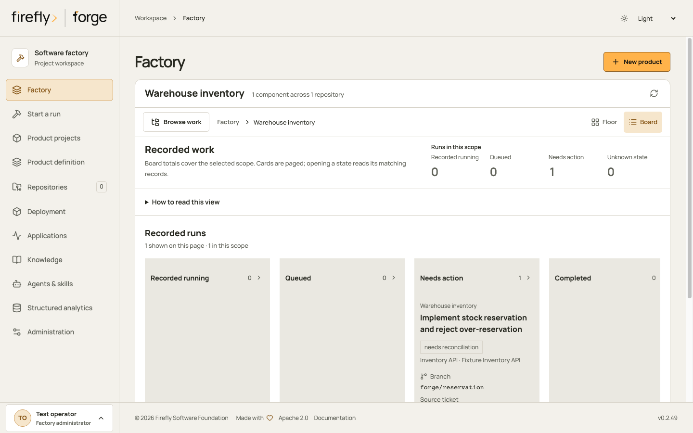
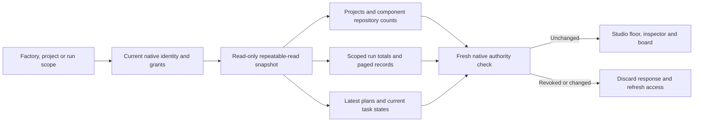

<!-- Copyright 2026 Firefly Software Foundation. SPDX-License-Identifier: Apache-2.0 -->

# Follow work across the factory

The Factory page brings product projects, their component repositories and recorded runs into one view. Use **Browse work** below the production floor to choose a product project or return to the factory overview. The model stays above the controls; on a phone it initially focuses the selected station. **Show full floor** restores the complete model.

<figure class="forge-shot" markdown="1">



<figcaption>A controlled Studio walkthrough. Counts describe saved records; the still model does not imply a live worker or deployment.</figcaption>
</figure>

## Choose the right scope

| Scope | What it includes |
| --- | --- |
| Factory overview | Product projects and runs available to your current identity. Administrators also see standalone work. |
| Product project | Runs recorded against that product-project ID, across its component repositories. |
| Standalone work | Runs with no recorded product-project association. This requires a factory administrator. |
| Run | One execution, its current plan, recorded component, branch, ticket and pull-request links. |

A repository is not a product project. Two products can use the same repository without sharing their run records or permissions. A run whose referenced project is unavailable is not relabeled as standalone work.

Project choices and run records are paged. Searching projects and requesting another page do not change the totals. Counts cover the complete selected scope, including work outside the current page.

<figure class="forge-shot" markdown="1">



<figcaption>Open Browse work, then choose a product. Product membership determines access; sharing a repository does not share its runs.</figcaption>
</figure>

## Read runs and tasks separately

The stage inspector describes **tasks** at the selected station. **Runs in this scope** counts executions across the selected factory or product project. Several task records can belong to one run, so these quantities should not be added together.

**Recorded running** means the stored run state describes work in progress. It does not establish that a worker is currently alive. A task last recorded as running can have unknown current activity while its run still has a running state.

The present projection cannot observe a fresh per-run worker lease. Execution-request claims are retained custody records; a factory-wide advisory lock is not a heartbeat for every task. The runner controller also owns a separate private ledger. The dashboard does not query that ledger by assuming a schema or adding cross-schema privileges. Machinery stays still when current activity cannot be established. Aggregate scopes never show a single package as if it represented every run.

Worker liveness, queue-wait duration, deployment health and runtime metrics remain unavailable in this view. Recorded expired or quarantined run states are separate from unknown states; they are not inferred runner-lease diagnoses. Deployment and support evidence have their own views and recorded sources.

## Inspect a run

1. Choose a product project, or keep the factory overview.
2. Use **Board** to compare recorded run states, or read the run list below the floor. Board totals cover the scope; cards are paged.
3. Select a run to inspect its plan and source-control links. Only this selected run requests a plan. Aggregate views do not poll one plan per run.
4. Open the run to inspect its activity, evidence and source changes. A missing plan remains unavailable; the view does not invent a stage sequence or a package position.

<figure class="forge-shot" markdown="1">



<figcaption>Board groups the product's recorded runs by state. Focus run returns to its floor context; Open run shows the detailed evidence.</figcaption>
</figure>

Studio refreshes observations while the page is visible. A transient read failure labels the retained observation and suspends motion. An authorization failure discards the prior observation. Changing identity or project clears the previous selection and pending reads.

## Read through the API

The authenticated endpoints are:

```text
GET /api/v1/factory-dashboard?kind=factory
GET /api/v1/factory-dashboard/projects?search=customer
GET /api/v1/factory-dashboard?kind=project&project_id=<project-id>
GET /api/v1/factory-dashboard?kind=run&run_id=<run-id>
```

The snapshot supports `bucket`, `cursor` and a per-page `limit` from 1 to 200. Project choices support `search`, `cursor` and the same page-size range. Cursors are bound to the identity, tenant schema, scope and filters; they cannot be reused for another selection. This page-size bound does not cap product projects, runs or aggregate counts.

Personal read tokens can observe an explicitly selected product project or run through their current project grants. They cannot enumerate the factory, standalone work or project choices through these endpoints. Token revocation and current membership are checked before and after the observation. Source-control actor mappings do not automatically become dashboard identities.

The same boundary applies to signed-in users. After the read-only transaction closes, a fresh transaction rechecks the native user, current role audience and expiry, exact cookie session when used, and membership state. Explicit project and run reads also recheck canonical project permission. A concurrent logout, disabled user or changed membership discards the response, including project-choice pages. A fixed-size database witness detects changes without loading a user's complete membership list. It does not grant access: the native identity and project predicates remain authoritative.

These checks use authority already recorded by forge. They do not claim instant revocation of an external identity-provider role that forge has not yet observed; access-token verification, refresh and local session revocation retain their existing behavior.

## How the read is built



`FactoryDashboard` uses native pyfly services and repositories over the existing PostgreSQL entities. Visibility predicates, totals and pages share a read-only repeatable-read transaction. SQL aggregates produce counts without loading every run or component into application memory. Reads do not acquire runner invocation locks, renew leases, dispatch work or change execution authority. The database read time is returned as `observed_at`; it is not a worker heartbeat.
