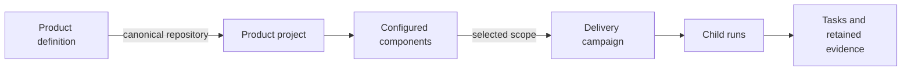
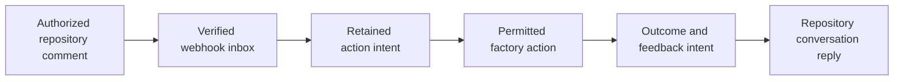

<!-- Copyright 2026 Firefly Software Foundation. SPDX-License-Identifier: Apache-2.0 -->

# Understand the factory and follow a delivery

Start with the outcome your customer needs, identify the source that implements it, and choose the work to run. In forge, the product definition describes expected behavior, the project describes the component topology, and a campaign coordinates a particular delivery across those components.

The example throughout this guide is an inventory product. Warehouse operators reserve stock through a web application; an API enforces the reservation rules. The same product can start as an API with no browser interface. Its customer process and acceptance criteria still belong in the definition.

## The concepts you will use

| Concept | What you configure or retain | Inventory example |
| --- | --- | --- |
| Product definition | A versioned customer contract: problem, owners, journeys, features, integrations, acceptance, architecture and design review. | Reserve available stock; reject an excessive quantity without changing inventory. |
| Journey | A customer or system process in that definition, including the expected outcome and failure behavior. | An operator selects stock, requests a quantity and receives a reservation or a refusal. |
| Feature | A stable capability with explicit behavior, journey references and acceptance references. | `reserve-stock`, with a conflict response for insufficient stock. |
| Integration contract | The intended exchange with an owned or third-party system, including authentication declarations, failures and retry requirements. | Notify the warehouse service after a reservation. Saving the contract does not call that service. |
| Repository | A registered Git source with its provider identity, branch, access and operator-owned execution settings. | The inventory API repository, granted through a GitHub App. |
| Product project | A versioned logical product topology that groups components and identifies the repository holding its canonical product definition. | Inventory, with API and web components and one product owner. |
| Component | A named responsibility bound to one repository, a nonoverlapping relative source root, a stack and verification commands. | `inventory-api` uses pyfly; `inventory-web` uses React with no backend. |
| Campaign | One admitted delivery across selected project components and their upstream dependencies, with frozen inputs and child-run references. | Implement the reviewed reservation change across API and web. |
| Run | One execution for a repository/component: build, maintain or test, with its own source, plan, state and evidence. | The API maintenance run adds reservation checks. |
| Task and attempt | A bounded step in the retained execution plan and a particular execution of that step. | A verification command and its actual exit result. |
| Journal / WAL | Append-only execution records that connect intent to observed outcomes using sequence and integrity references. | Publication was requested; its outcome is unresolved until reconciled. |
| Evidence report and archive | A read of retained campaign evidence, or an explicitly saved immutable receipt of that exact report. | The selected API attempt has matching checks; the web attempt is still blocked. |

The journey strings and feature IDs have different meanings. Features refer to the exact journey text; acceptance references use `acceptance-1`, `acceptance-2` and so on. A visual product can also keep journey-specific reference views and design evidence. See [product definition](product-definition.md), [feature changes](product-lifecycle.md) and [design review](design-review.md).

<div class="forge-flow forge-flow--dependencies" role="region" aria-label="Product project and campaign relationships diagram" aria-describedby="concept-flow-guide" tabindex="0" markdown="1">



</div>

<p class="forge-flow-caption" id="concept-flow-guide">Read from the product contract to execution evidence. Each arrow describes a relationship; saving configuration does not launch the next item. On a small screen, focus the diagram and use the arrow keys to scroll.</p>

## Decide where the source belongs

A monorepo project uses one registered repository with distinct component roots, such as `services/inventory` and `apps/warehouse`. A multi-repository project uses at least two registered repositories. Each component still has its own responsibility and checks. Component roots in one repository cannot overlap, and component dependencies cannot form a cycle.

Set `product_repository_id` to the member repository that owns the product definition and its design and assistant context. If omitted, the project uses its first component's repository. A project is therefore more than a folder or a GitHub repository; it is the saved topology of the product you intend to deliver.

For the inventory example:

| Component | Monorepo location | Multi-repository alternative | Depends on |
| --- | --- | --- | --- |
| `inventory-api` | `services/inventory` | Inventory API repository, root `.` | Nothing |
| `inventory-web` | `apps/warehouse` | Warehouse web repository, root `.` | `inventory-api` |

The API can use [pyfly](https://fireflyframework.org/frameworks/python/) or [larafly](https://fireflyframework.org/frameworks/php/). Choose the frontend, brand tokens, typography, grid and accessibility rules for this product in its [architecture and design](product-design.md). forge's own brand is not a requirement for generated products.

Dependencies control when work is eligible to continue. They do not merge branches, assemble services or establish whole-product integration success. Components in different repositories can execute in parallel; the factory keeps one active run per repository, so monorepo components share that execution constraint. Configure a real integration check for the assembled product.

## 1. Prepare access and connect the source

**Start with:** a running factory, an authorized user, a coding provider and the repositories you intend to use.

1. [Install and start](installation.md) the local factory, including PostgreSQL and the managed flycanon service. Verify a scoped knowledge search before admitting work that requires retrieval.
2. [Sign in](identity.md) and assign the relevant [project roles](user-administration.md). Factory administration, repository configuration and permission to execute are separate capabilities.
3. Register and approve the source-control application at GitHub, GitLab or Bitbucket. In **Connections → Repositories**, save the application settings, authorize when required, check access and select a discovered repository. Follow the [provider-specific setup](scm.md).
4. Configure the repository's collaboration settings, exact trusted actor identities and enabled commands. Configure its verification commands and execution provider. The [repository workflow](repository-workflow.md) explains webhooks and channel permissions.

**You can continue when:** the current application grant admits the intended repository, the actor has the required permissions, and the selected execution and knowledge services have actual readiness evidence. A saved connection alone does not establish access.

<figure class="forge-shot" markdown="1">


<figcaption>Connections, Repositories step. The controlled Studio fixture contains Inventory API. Follow the same navigation on your installation, then establish access through its actual provider grant.</figcaption>
</figure>

## 2. Configure the product project

**Start with:** the registered member repositories, intended topology and a named product owner.

Open **Product projects → Create product project** and follow **Product → Components → Dependencies → Review**. Set its owners, component IDs, paths, stacks, checks and dependencies, then save. The overview shows those configured components and their associated run references. Use **Edit component contracts** for later topology changes. Configuration is available through `POST /api/v1/projects` and revisioned updates through `PUT /api/v1/projects/{project_id}`. An authorized repository conversation can also manage that project through the [project commands](repository-workflow.md#coordinate-a-logical-product-from-signed-comments).

<details markdown="1">
<summary>Example: configure two components in one repository</summary>

Replace both example repository IDs below with the same actual registered repository ID. Use paths and executable checks that exist in your source. For a multi-repository product, use `multi_repo`, supply its distinct repository IDs and set each root to its actual relative location.

```json
{
  "name": "Inventory",
  "description": "Reserve warehouse stock and explain rejected requests",
  "topology": "monorepo",
  "product_repository_id": "11111111111111111111111111111111",
  "owners": ["inventory-product-owner"],
  "components": [
    {
      "id": "inventory-api",
      "name": "Inventory API",
      "repository_id": "11111111111111111111111111111111",
      "path": "services/inventory",
      "kind": "api",
      "backend": "pyfly",
      "frontend": "none",
      "responsibility": "Validate and persist stock reservations",
      "verification": [{"argv": ["make", "check"], "timeout": 600}]
    },
    {
      "id": "inventory-web",
      "name": "Warehouse web",
      "repository_id": "11111111111111111111111111111111",
      "path": "apps/warehouse",
      "kind": "web",
      "backend": "none",
      "frontend": "react",
      "responsibility": "Let warehouse operators request and inspect reservations",
      "depends_on": ["inventory-api"],
      "verification": [{"argv": ["npm", "run", "check"], "timeout": 600}]
    }
  ]
}
```

The returned project ID identifies later campaign requests; it is different from the repository ID and the component IDs. The returned revision and digest identify this saved topology. Keep them with the reviewed product revision when discussing the intended delivery.

</details>

**You can continue when:** the saved project identifies its member repositories, nonoverlapping component roots, canonical product repository and intended dependencies. Select **Product and design system** from its overview to define the product contract.

## 3. Understand existing source and define the product

**Start with:** the configured product project and its named product owner.

For an existing system, [inspect its committed component source](as-is-handoff.md) and review the exact analysis digest. Routes, declarations and file references describe the observed source. Ask the product owner to confirm the actual business behavior before accepting an AS-IS definition. Optional admission of reviewed observations to flycanon has its own upload and indexing evidence.

For a new product, open **Product definition** and follow **Context → Journeys → Features → Integrations → Review**. In the inventory case, map Reserve stock to `reserve-stock`, its sufficient-stock behavior, its insufficient-stock failure and the acceptance check that proves stock remains unchanged after refusal.

Use **Ask AI** to prepare step context, review the message and send it through the assistant. Include notes or reference files when needed. Review a proposal before applying it, then review the definition before saving. Preparing a message, calling the assistant, applying a proposal and saving a revision are separate actions. The [illustrated editor tour](console-tour.md#2-define-the-reservation-contract) follows each step.

**You can continue when:** the saved revision describes every relevant journey, expected behavior and failure path; architecture and any visual references have their required review. API-only products use system processes and contracts without inventing a frontend.

<figure class="forge-shot" markdown="1">


<figcaption>Journeys step. Start with the customer's reservation process, then map its behavior and acceptance in Features. The controlled fixture supplies these form values; it does not show a live model generating them.</figcaption>
</figure>

Choose one run for a bounded repository change, or a [campaign](project-campaigns.md) when the change spans configured components. A campaign's `component_ids` selection includes upstream dependencies. It admits its child runs together with frozen project, product, source and execution settings. The default dependency gate requires verified upstream evidence.

After admission, inspect the intended project revision, component selection and child runs, or the single run's repository and frozen product revision. A later project edit does not rewrite those inputs. **Start component run** starts one component; campaign launch uses its explicit API, SDK, CLI or MCP operation described in the campaign guide.

Milestones and waves are not configured in the current campaign report. Use the current component, task and attempt evidence to describe progress; do not infer a completion percentage or a release schedule from the illustration or workflow status.

## 4. Operate from the repository conversation

**Start with:** a configured webhook, an authorized signed actor and explicitly enabled actions.

You can define and change product contracts, manage a logical project, ask the assistant, start permitted work, inspect status, answer a recorded worker question and request allowed lifecycle actions from the repository conversation. Command families have different permissions and opt-ins; use the exact examples in [repository conversations](repository-workflow.md).

For a repository whose latest saved product revision is 3, these separate comments request implementation and inspect its status:

```text
/forge run {"brief":"Implement the reviewed stock reservation behavior","product_revision":3}
```

```text
/forge status
```

Replace the brief and revision with the actual product decision. The operator owns the provider, permitted checks and command allowlist. A comment cannot grant itself repository access, alter global credentials or bypass deployment approval.

<div class="forge-flow forge-flow--dependencies" role="region" aria-label="Source control conversation and factory feedback diagram" aria-describedby="channel-flow-guide" tabindex="0" markdown="1">



</div>

<p class="forge-flow-caption" id="channel-flow-guide">The provider carries the incoming event and outgoing feedback. forge records the operation between them. A missing reply can leave an unresolved outcome; it does not authorize repeating the action.</p>

Synchronization follows explicit events and operations:

| Direction | What moves | What to inspect |
| --- | --- | --- |
| Provider → forge | Supported webhook events and their signed actor, repository and conversation identities. | The inbox receipt, authorization result and action outcome. |
| forge → provider | Enabled conversation feedback, explicit branch/review-request publication and opted-in reference artifacts. | The retained feedback or publication receipt and the actual remote result. |
| Studio/API → forge | Current settings, product/project revisions and explicit run or recovery requests. | The returned revision, digest, request identity or operation receipt. |

This is not a bidirectional mirror of every issue, branch or project-board field. A campaign report reads retained factory evidence and reports SCM freshness as **not observed**. Remote branch changes require the appropriate new source inspection or execution; reopening a report does not fetch or merge them. Provider contract and loopback-fixture tests remain separate from acceptance of your actual GitHub, GitLab or Bitbucket installation.

## 5. Review execution and resolve interruptions

**Start with:** an admitted run or selected campaign.

Open the run in **Factory**. Inspect its activity, plan and journal, changed files, command output and retained artifacts. A build or maintenance run uses the selected coding worker and bounded repair loop. A test run executes the configured checks on existing source without invoking a coding model. Optional independent review has its own source-bound receipt. [Build, maintenance and test](workflows.md) explains those stages; [agent lifecycle](agent-lifecycle.md) identifies participants, skills, tools and knowledge access.

When work pauses, inspect the recorded reason. Answer an exact worker request through its permitted response action. Quota, provider changes, runner interruption and uncertain external effects have different [recovery controls](recovery.md). Preserve the original request identity when a write response is lost. A timeout or an initial missing receipt does not prove the write never committed.

**You can continue when:** the source under review matches the passing checks and any required independent review. An unresolved effect remains a hold; a successful model response or a green workflow label does not resolve it.

<figure class="forge-shot" markdown="1">


<figcaption>Verification tab. This controlled example records a failed command, exit 2. Read its output and repair evidence before treating the run as verified; the screenshot itself executes no command.</figcaption>
</figure>

## 6. Inspect the campaign and retain a delivery checkpoint

**Start with:** the product project and an existing campaign.

In **Product projects**, select the project, **Load campaigns**, select the campaign and choose **View report**. Compare recorded workflow status with the report's evidence state. Open a component to inspect its current tasks, checks, source references and earlier attempts. Prior attempts remain history and do not increase current component totals.

Follow the [campaign report walkthrough](project-campaigns.md#read-a-report-in-studio) and [exact report archive contract](project-campaigns.md#save-an-exact-report) to retain a selected evidence cut. Saving a report is an explicit write with a stable request identity; reading it later checks current access to its historical repository manifest. The saved report remains historical when execution advances.

**You can continue when:** the selected component evidence satisfies its delivery gate and the exact source is clear. Product-wide assembly, integration acceptance, publication and deployment still need their own results.

<figure class="forge-shot" markdown="1">


<figcaption>Campaign summary. Select a component to inspect the receipts behind its state. This successful controlled report is a separate example from the failed verification above; it does not show that failed run becoming successful.</figcaption>
</figure>

## 7. Publish, deploy and maintain the product

**Start with:** a reviewed, verified source checkpoint and an explicitly configured delivery target.

1. [Publish the change](scm.md#publish-a-verified-change) when requested. Retain the actual provider review-request receipt. Publication creates the configured branch and pull/merge request; it does not establish a merge.
2. [Deploy the verified source](deployment.md) through a repository-bound target. Keep deployment commands, post-deployment checks and rollback checks separate from build success. Validate deployment recipes locally before choosing a real external environment.
3. [Observe the application](application-operations.md) through its configured health and metric probes. Read observation age and configuration revision as well as state. Logs and trace URLs link to your separately operated systems.
4. Use an incident to request a bounded maintenance change. Review its tests and source, explicitly deliver the accepted result and collect fresh recovery observations before resolving the incident.

**You can continue when:** each requested action has its own observed outcome. A healthy HTTP probe does not prove the customer's complete reservation journey, and a maintenance run does not automatically deploy its fix.

## 8. Keep knowledge and operating guidance current

flycanon holds scoped framework and repository knowledge. A logical project does not automatically combine every member's memory into a shared workspace. [Knowledge scopes](knowledge.md#keep-project-scope-explicit) and [learning decisions](learning.md) explain retrieval, source admission, verified lessons, invalidation and reuse eligibility. External search fills a defined gap or obtains current documentation; a saved answer needs provenance and verification before reuse.

Configure the [required tools and runners](tooling-prerequisites.md), [browser review](browser-qa.md) and any [external MCP tools](external-tools.md) before work needs them. A tool listed in a role is not proof that its executor or credentials are ready. The [external-tool walkthrough](external-tools-tour.md) follows configuration and project grants.

Use the [Studio tour](console-tour.md) for the complete illustrated navigation, the [architecture](architecture.md) for persistence and agent/tool contracts, and the [capability boundaries](capabilities.md) when deciding what evidence a result establishes.

## About the screenshots

The images above render the actual Studio source with controlled API fixtures. They demonstrate navigation, field layout and retained-evidence presentation; they make no live model, SCM, command, deployment or knowledge-service call. Their [capture inventory](assets/screenshots/walkthrough-manifest.json) records source and producer hashes, Studio version, viewport and image bytes. Light/dark and desktop/phone alternatives are maintained by the same capture process.

After changing the frontend or capture inputs, refresh complete journeys and inspect the rendered guides using the [capture maintenance procedure](console-tour.md#keep-captures-current). Keep real provider acceptance and native execution evidence separate from these presentation examples.
