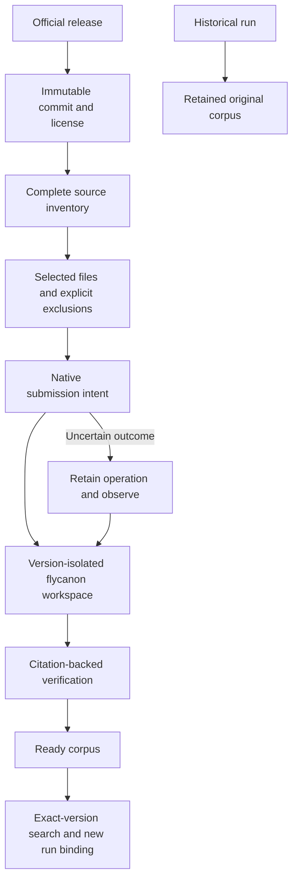
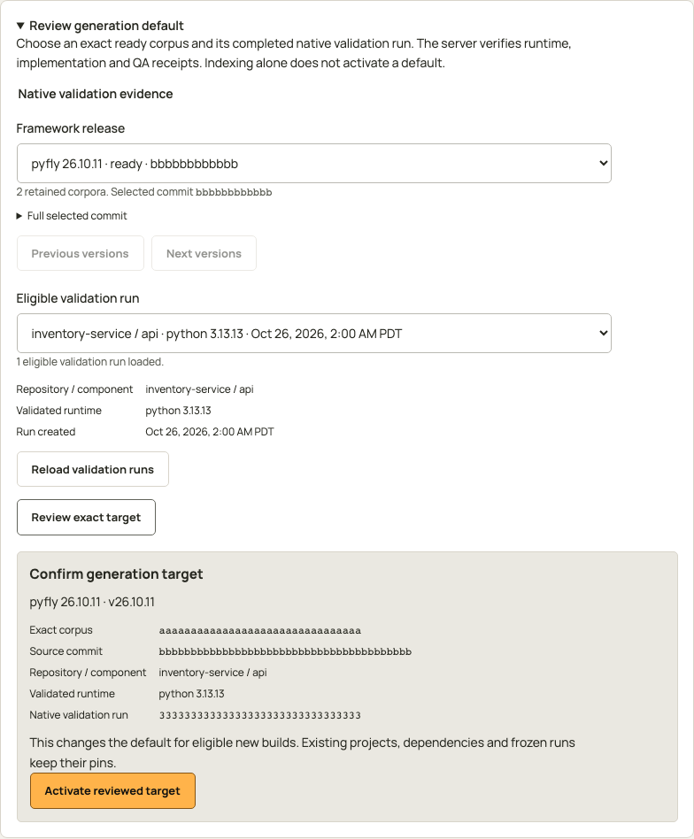
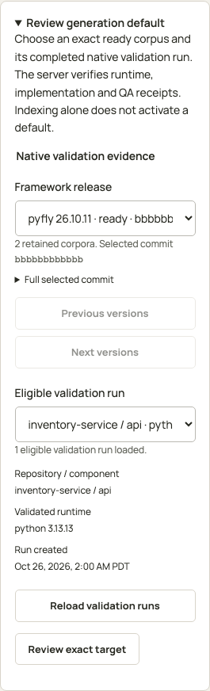
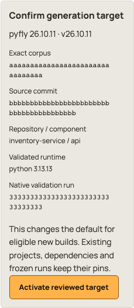

<!-- Copyright 2026 Firefly Software Foundation. SPDX-License-Identifier: Apache-2.0 -->

# Keep framework references current

!!! warning "0.2.47 pre-release guide"

    These interfaces are implemented in the 0.2.47 source tree and are awaiting integration and publication. Screenshots use controlled fixtures. Source-content checks, local framework tests and collector revision 3 full-corpus ingestion and retrieval have passed locally. Installation-specific integration and generated-product acceptance remain separate gates.

A knowledge refresh updates the references forge can retrieve. It does not upgrade project dependencies. A project using an older [pyfly](https://fireflyframework.org/frameworks/python/) or [larafly](https://fireflyframework.org/frameworks/php/) release needs references for that version, even when a newer stable release exists.

## Start with a working knowledge service

The [managed installation](knowledge.md#initialize-the-managed-service) provisions flycanon, its database and object storage, authentication and embedding service. Bootstrap writes the retained service bundle. Initialization admits starter references and checks embedding-backed retrieval. A running HTTP service, saved settings or admitted source alone does not establish retrieval readiness.

The existing starter bundle contains 14 licensed manuals: seven for pyfly 26.10.6 and seven for larafly 26.10.1. Release discovery and refresh extend that bootstrap with separately verified versions while preserving original source receipts and frozen run references.

## Read the two versions separately

The **Knowledge → Framework releases** tab shows the indexed release beside the latest stable release observed at its official upstream. A check records when release metadata was observed. Indexing has separate outcomes and counts.

| Display               | Meaning                                                                                    |
| --------------------- | ------------------------------------------------------------------------------------------ |
| Indexed release       | Current verified corpus for eligible new work; it may be older than upstream.              |
| Latest stable release | Official release metadata observed by a check; content may not be indexed.                 |
| Refresh progress      | Work for the operation's explicit target corpus, with its own counts and remaining budget. |
| Needs reconciliation  | An external outcome is uncertain; observe the retained operation before another write.     |
| Ready corpus          | Source ingestion and citation-backed retrieval completed for that immutable corpus.        |

Counts beside an indexed release describe that corpus only. Counts under a refresh describe its target. Checking for updates will not label an unindexed release ready.

A source-content audit on October 26, 2026 verified the selected Git blobs for both current stable releases:

| Framework | Audited release                                                                               | Immutable source                                                                                                         | Verified text files |
| --------- | --------------------------------------------------------------------------------------------- | ------------------------------------------------------------------------------------------------------------------------ | ------------------: |
| pyfly     | [26.10.11](https://github.com/fireflyframework/fireflyframework-pyfly/releases/tag/v26.10.11) | [46919f58cca4](https://github.com/fireflyframework/fireflyframework-pyfly/tree/46919f58cca4f17521213248ae7f01f8a89953d1) |               2,745 |
| larafly   | [26.10.4](https://github.com/fireflyframework/fireflyframework-php/releases/tag/v26.10.4)     | [8379ef8ed1d8](https://github.com/fireflyframework/fireflyframework-php/tree/8379ef8ed1d8a15ea13adba762815b900a937bc4)   |               4,321 |

The audit checked 7,068 selected bodies against their Git blob identities. Two compiled pyfly EPUB files were excluded from text references. The resulting source cache contains documentation, API code, examples, tests, licenses and configuration. Caching these sources does not create a searchable flycanon corpus or change a project's pinned version.

Collector policy revisions are separate from framework release versions. Revision 1 retains the historical source classification. Revision 2 excludes SVG image assets while retaining Markdown, Mermaid diagrams, API code and example text. Revision 3 retains those rules and excludes semantic-whitespace-only references and part windows after fully verifying the cached source. Exclusions retain their path, Git blob, content hash, original ordinal and explicit reason; an invalid required license remains blocked. The corpus metadata exposes `collector_revision`; missing historical metadata means revision 1. The selected policy is frozen into the corpus identity and manifest, so the same upstream commit collected under revision 2 has a distinct corpus.

Part counts describe admitted text windows. The optional `excluded_parts` count and `exclusions_sha256` provenance distinguish retained blank windows from submitted parts; excluded windows are never posted to flycanon. The complete UTF-8 audit identified 120 SVG assets and 67 blank files, leaving 6,879 text files and 6,986 admitted windows for collector revision 3. Classification alone does not establish index readiness.

Local operational acceptance subsequently verified all 6,986 admitted parts in published flycanon 26.10.6 using the local nomic embedding model. Authenticated native searches returned documentation, example code and API symbols for both audited releases. The ready corpora retained their exact version, commit, manifest and source citations. This qualifies the framework-knowledge component; each installation must establish its own corpus readiness and product acceptance.

Cancelling an old operation preserves its sources, submission intents, unknown outcomes and spent usage. Observing a cancelled operation is read-only. A separately reviewed collector policy can admit a distinct corpus after cancellation; it does not retry an uncertain submission or establish success for the old operation. Managed installation authorization remains a separate version 1 grant protocol.

Identical source parts can share flycanon content storage. Forge validates the canonical source, content hash and corpus scope while retaining each original path, Git blob and part identity. Source-scoped retrieval applies admitted membership before ranking, then validates returned citations against those retained identities. A shared content record does not merge framework versions or source provenance.

## Review and refresh a release

Use the Knowledge explorer:

1. Choose **Check updates** for a framework. Review its official repository, release tag, immutable commit and check time.
2. Review the target and start its refresh. The request binds discovery, current status revision and collector policy. The server's current permissions and allowed actions authorize it.
3. Follow inventory, fetching, submission and retrieval verification for that target. Retain the original operation identifier through reloads or an interrupted response.
4. If the outcome needs reconciliation, read or observe that same operation. Do not create a replacement request to hide uncertainty.
5. Search or bind new work only after the corpus is ready. Keep older ready corpora for projects and historical runs that need them.

<div class="forge-flow" role="region" aria-label="Framework corpus refresh diagram" aria-describedby="framework-refresh-flow-guide" tabindex="0" markdown="1">



</div>

<p class="forge-flow-caption" id="framework-refresh-flow-guide">Follow the refresh from top to bottom. On narrow screens, scroll horizontally or focus the diagram and use the arrow keys. Ready knowledge remains separate from generation activation.</p>

During an active import, progress counts are derived from durable inventory and part states without changing the operation ledger or charging its work budget. Inventory totals grow as files are retained, and verified exclusions can reduce the admitted totals. The lifecycle revision remains an opaque action token; final ready counts belong to the completed manifest. Cancelled and historical terminal observations retain their saved responses.

Request, byte and time work budgets are configurable, with durable spent usage. Cursor page sizes are response windows, not complete-corpus caps. The interface exposes renewal or cancellation only when the retained operation allows that action.

## Review a generation default after canonical validation

A ready corpus can be searched before it qualifies as a generation default. First run canonical validation for a component using that exact corpus. The retained native run must carry the matching runtime, implementation and QA receipts. The server checks those receipts and the retained source checkpoint before listing a run as eligible. Completing an index does not activate generation.

In **Framework releases**, open **Review generation default** and select a ready retained release. **Eligible validation run** lists completed runs for that exact corpus, labeled with repository, component, runtime and run creation time. Choose a run, then select **Review exact target**. Review the corpus, source commit, repository, runtime and retained validation run before selecting **Activate reviewed target**. Choosing a release or validation run makes no change by itself.

<figure class="forge-shot" markdown="1">



<figcaption>Controlled UI fixture with a five-file pyfly 26.10.11 corpus: one document, example, API source, project manifest and license. The modeled eligible run uses Python 3.13.13. Its IDs are illustrative; this capture does not establish full-corpus indexing or runtime qualification.</figcaption>
</figure>

<details class="forge-gallery" markdown="1">
<summary>Inspect selection and confirmation on a phone</summary>

<figure class="forge-shot forge-shot--phone" markdown="1">



<figcaption>The same controlled fixture at a 320-pixel viewport width. Expand Full selected commit to inspect its complete identity. Selecting a validation run makes no change by itself.</figcaption>
</figure>

<figure class="forge-shot forge-shot--phone" markdown="1">



<figcaption>Focused confirmation from that fixture. The complete identities remain available for review, and activation remains a separate action.</figcaption>
</figure>
</details>

If no run is eligible, complete canonical validation for the selected corpus and use **Reload validation runs**. **Load more validation runs** continues through the server's cursor pages, including an empty page with a continuation cursor. Only a null `next_cursor` ends the list. Changing the framework or corpus clears the selection and its review.

Activation sends `version: 1`, `corpus_ref`, the displayed `expected_status_revision` and the selected `validation_run_id` to `POST /api/v1/knowledge/frameworks/{framework}/generation-targets/{request_id}`. A stale status or changed validation evidence requires a new review. After an interrupted response, retain the original request ID and use **Read original activation**. Do not submit a replacement activation to resolve an uncertain result.

The activated target applies to eligible new builds. Existing project dependencies and frozen runs keep their pins. A successful controlled validation or activation does not establish that the full official corpus is indexed, or that a real generated application has passed native validation.

## Inspect sources and exclusions

A corpus identifies its framework version, release tag, commit, license hash and source manifest. Sources retain the original path and URI, Git blob identity, content hash, byte and part counts, ingestion state and any exclusion reason. Documentation, examples and API source are distinct source kinds.

The collector walks the complete immutable tree and retain selection and exclusion evidence. A policy exclusion must remain distinguishable from a selected file that has not been fetched or indexed. Public upstream reads carry no project SCM, knowledge-service or model credentials.

Each framework/version/commit/collector-policy corpus uses a separate flycanon workspace. Search scope is applied before ranking. Platform authentication and scoped agent credentials keep their existing grants.

The corpus license identifies its root license. A source citation retains the nearest recorded `LICENSE` or `COPYING` terms for that file, including nested third-party licenses. Those hashes can differ; do not replace a source's license with the corpus root license.

## Find an API or code example

Select a ready release, then use **Sources** or **Search** in the existing explorer. Ask, for example, how a transactional service rolls back on validation failure, or request a dependency-injection test example. The request names the selected corpus explicitly. Unavailable or ambiguous versions are refused; they never fall back to latest.

Inspect a result's citation before applying it. It retains framework/version, release tag, immutable commit, original path and URI, content and license hashes, and flycanon source/chunk identities. Follow the immutable source to inspect the surrounding example. Retrieved text informs implementation; executable tests still establish product behavior.

Framework release version and flycanon's internal `knowledge_version` are separate fields. A knowledge-item revision does not establish the pyfly or larafly release of a result.

The search endpoint accepts exactly one selector: an explicit `corpus_ref` or `framework_version`. Resolve a ready corpus from the corpus list before using `POST /api/v1/knowledge/frameworks/{framework}/search`. The response retains the selected corpus, hits, citation provenance and warnings.

## Preserve runs and dependency pins

Frozen runs retain their original configuration and corpus references. Refreshing latest stable does not change their model context, dependencies, source checkpoints or execution budget. A maintenance run needs an exact target or unambiguous retained dependency/lock evidence before retrieval. An unresolved target must not silently select latest.

Advancing new-project defaults requires a verified corpus and separate implementation-profile qualification. Upgrading an existing project is a source change with its own tests and delivery approval. Neither an update check nor corpus promotion grants that change.

The immutable [pyfly package metadata](https://github.com/fireflyframework/fireflyframework-pyfly/blob/46919f58cca4f17521213248ae7f01f8a89953d1/pyproject.toml) for 26.10.11 requires Python 3.12 or later; the factory's new-project policy remains Python 3.13 or later. The [larafly package metadata](https://github.com/fireflyframework/fireflyframework-php/blob/8379ef8ed1d8a15ea13adba762815b900a937bc4/composer.json) for 26.10.4 requires PHP `^8.5.12` and Illuminate `^13.38`. A knowledge update does not install these runtimes or establish that a generated application passes on them.

## Keep uncertain writes observable

Refresh commits a native source/part intent before each external submission. Complete paginated observation can attach a uniquely matching remote outcome. Without one, the operation remains in **Needs reconciliation**; the uncertain write will not be automatically submitted again.

A missing response is not evidence of a failed write. Retain operation IDs, source receipts, original objects and private configuration. Do not reset spent work, broaden credentials or create a new operation as a retry shortcut. The existing [failure guide](knowledge.md#review-failures-and-retained-data) covers service trust, authentication and embedding readiness.

## API, Python SDK and MCP interfaces

The interfaces below have SDK, native HTTP/DI and PostgreSQL tests. Operational ingestion and retrieval remain separate acceptance gates. The eight MCP tools use the existing versioned prompt catalog; they grant no additional authority. Work allowance, cancellation and resume use the separately reviewed Native API or SDK operations.

| Operation                      | Native API under `/api/v1/knowledge/frameworks`     | Python `ForgeClient` method            | MCP tool                              |
| ------------------------------ | --------------------------------------------------- | -------------------------------------- | ------------------------------------- |
| Cached status                  | `GET /status`                                       | `framework_knowledge_status`           | `get_framework_knowledge_status`      |
| Official release check         | `POST /{framework}/check-updates`                   | `check_framework_updates`              | `check_framework_updates`             |
| Submit one retained refresh    | `POST /{framework}/refreshes/{request_id}`          | `refresh_framework_knowledge`          | `refresh_framework_knowledge`         |
| Read the original operation    | `GET /{framework}/refreshes/{request_id}`           | `framework_knowledge_refresh`          | `get_framework_knowledge_refresh`     |
| Observe an uncertain outcome   | `POST /{framework}/refreshes/{request_id}/observe`  | `observe_framework_knowledge_refresh`  | `observe_framework_knowledge_refresh` |
| Renew reviewed total allowance | `POST /{framework}/refreshes/{request_id}/budget`   | `renew_framework_knowledge_budget`     | Use Native API or SDK                 |
| Cancel remaining work          | `POST /{framework}/refreshes/{request_id}/cancel`   | `cancel_framework_knowledge_refresh`   | Use Native API or SDK                 |
| Resume the retained import     | `POST /{framework}/refreshes/{request_id}/resume`   | `resume_framework_knowledge_refresh`   | Use Native API or SDK                 |
| List eligible validation runs  | `GET /{framework}/generation-candidates`            | `framework_generation_candidates`      | Use Native API or SDK                 |
| Activate a reviewed target     | `POST /{framework}/generation-targets/{request_id}` | `activate_framework_generation_target` | Use Native API or SDK                 |
| Read original activation       | `GET /{framework}/generation-targets/{request_id}`  | `get_framework_generation_target`      | Use Native API or SDK                 |
| Browse retained corpora        | `GET /{framework}/corpora`                          | `framework_corpora`                    | `list_framework_corpora`              |
| Browse a corpus's sources      | `GET /{framework}/corpora/{corpus_ref}/sources`     | `framework_corpus_sources`             | `list_framework_corpus_sources`       |
| Search an exact corpus         | `POST /{framework}/search`                          | `search_framework_knowledge`           | `search_framework_knowledge`          |

The SDK uses the existing factory connection. A read/search example for a retained ready corpus is:

```python
import os

from firefly_forge.client import ForgeClient

with ForgeClient(os.environ["FORGE_URL"], os.environ["FORGE_API_TOKEN"]) as factory:
    status = factory.framework_knowledge_status()
    corpus_ref = os.environ["FORGE_KNOWLEDGE_CORPUS_REF"]
    result = factory.search_framework_knowledge(
        "pyfly",
        {"query": "transaction rollback test example", "corpus_ref": corpus_ref},
    )
```

Select the corpus reference from a real ready corpus record. Source and corpus lists accept `cursor` and `page_size`; continue with each returned `next_cursor` until it is null. A small response window does not establish a complete inventory.

For refresh, first retain the exact discovery digest, status revision and policy digest from `check_framework_updates`. Review them before calling `refresh_framework_knowledge` with a durable original request ID and `make_current: true`. Keep the same framework and ID for readback or observation after uncertainty. Do not wrap submission in an automatic retry loop or generate a replacement ID when the response is lost.

Budget renewal sends `version: 1`, the displayed operation's `expected_revision` and a `total_budget` of requests, bytes and seconds. These are new totals, including already-spent work. No dimension can decrease; at least one must increase. Cancellation and resume send the displayed `expected_revision` on the same operation. Cancellation preserves receipts, spent work and uncertain submissions. Observe uncertain submissions before resuming; resume does not resubmit an unknown source or reset its allowance.

## Validate your installation

Before enabling a generation default, complete a refresh against your configured flycanon service, inspect its source inventory, and retrieve citation-backed results for documentation, examples and API code. Then run a real product through the selected framework runtime, implementation checks and product QA. Review that execution in **Eligible validation run** before activating the target.

Local component qualification has exercised pyfly 26.10.11 on Python 3.13.13 and larafly 26.10.4 on PHP 8.5.12. Both used native DI, persistence, transaction rollback and HTTP routes. These component checks do not establish that your factory's corpus is indexed or that a generated product has passed its own acceptance checks.
