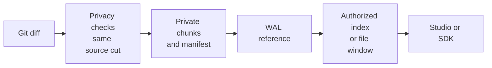

# Inspect large source changes

<!-- Copyright 2026 Firefly Software Foundation. SPDX-License-Identifier: Apache-2.0 -->

forge streams each source diff into a private artifact and records its hashes, size and file count. Read its file index, then request the portions you need. Journal entries and model context carry a small reference and preview.

The [project and campaign model](project-campaigns.md) defines a product's components, repositories and dependencies. A large monorepo can have several scoped components; a product can also span repositories. Each component run has its own source identity and diff references. Use [campaign reports](project-campaigns.md#read-a-report-in-studio) to follow dependencies and verification evidence. Commits across repositories still require separate delivery coordination.

<div class="forge-flow forge-flow--dependencies" role="region" aria-label="Git diff retention and authorized inspection diagram" aria-describedby="git-diff-flow-guide" tabindex="0" markdown="1">



</div>

<p class="forge-flow-caption" id="git-diff-flow-guide">Only the requested file pages reach the reader. Focus and scroll the diagram on a narrow screen.</p>

See [Work on a large product](large-products.md) for task scope and current capacity boundaries outside diff retention.

## What is retained

| Record | Purpose |
| --- | --- |
| Source artifact | The exact streamed Git diff, stored outside the source workspace. It is published only after privacy and integrity checks succeed. |
| Manifest | The artifact's content hash, size, file count and hash-backed chunk and index references. |
| File-index page | A bounded list of file paths, indexes, byte extents and file hashes. |
| Journal and delivery receipt | A compact typed reference to the artifact and its manifest, alongside the run or checkpoint identity. The full patch is not embedded in each receipt. |
| Preview | A bounded presentation or context excerpt. Its limit does not truncate the retained artifact. A preview is not evidence that every file was read. |

The API finds the artifact through the authorized run or exact checkpoint request. Callers supply its manifest hash, never a filesystem path or arbitrary artifact identifier.

A hash proves identity and integrity, not successful implementation, completed verification or permission to publish. A failed-unit checkpoint remains unverified. See [the development workflow](development-workflow.md).

## Configure storage work for a project

Set `diff_budget` in the project's development-workflow policy. Read the current policy, preserve its other fields and submit a fresh request with its exact `expected_previous_digest`. A current factory administrator needs project membership-management permission to configure it. Remote delivery also follows the workflow's publishing permissions.

For example, the `policy` field can include:

```json
{
  "version": 1,
  "enabled": true,
  "every_units": 2,
  "on_pause": true,
  "remote": "local",
  "max_checkpoints": 50,
  "diff_budget": {
    "max_bytes": null,
    "min_free_bytes": 1073741824,
    "timeout_seconds": 120,
    "chunk_bytes": 65536,
    "index_page_files": 100,
    "preview_bytes": 65536
  }
}
```

When no project diff budget is selected, forge uses these defaults:

| Setting | Meaning |
| --- | --- |
| `max_bytes: null` | No fixed total-byte ceiling imposed by this budget. An operator may set a finite maximum. |
| `min_free_bytes: 1073741824` | Refuse retention when available storage falls below this floor. Deployment resource limits still apply. |
| `timeout_seconds: 120` | Finite deadline for producing or reading the retained evidence. |
| `chunk_bytes: 65536` | Streaming chunk size; configurable from 1 KiB to 1 MiB. |
| `index_page_files: 100` | File records per index page; configurable from 1 to 1,000. |
| `preview_bytes: 65536` | Maximum preview size; configurable from zero to 1 MiB. |

New runs retain the selected project policy. Later schedule or budget changes leave that snapshot intact. Turning the current project workflow off stops further checkpoints and preserves saved records.

With `max_bytes: null`, storage grows with the diff. The streaming producer still checks its deadline and free space, and it enforces a total-byte limit when the operator sets one. Chunk and index proofs validate each requested portion without loading the whole patch. If a budget or integrity check fails, forge refuses the operation; it does not substitute a truncated patch or approve the checkpoint.

## Read one page through the API

All routes require current read permission for the run. The server checks the signed-in reader, run scope and selected reference before and after reading the artifact. Page responses use `Cache-Control: private, no-store`.

| Read | Route |
| --- | --- |
| Current run index | `GET /api/v1/runs/{run_id}/diff/index?expected_manifest=SHA256&page=0` |
| Current run file window | `GET /api/v1/runs/{run_id}/diff/files/{file_index}?expected_manifest=SHA256&offset=0&limit=32768` |
| Exact checkpoint index | `GET /api/v1/runs/{run_id}/git-deliveries/requests/{request_id}/diff?expected_manifest=SHA256&page=0` |
| Exact checkpoint file window | `GET /api/v1/runs/{run_id}/git-deliveries/requests/{request_id}/diff/files/{file_index}?expected_manifest=SHA256&offset=0&limit=32768` |

Copy `expected_manifest` from the typed `diff_artifact.manifest_sha256` reference in the run or checkpoint's `source_evidence`. A different current reference is a conflict; do not replace the digest with a guessed value. Earlier checkpoint evidence remains selectable by its exact request while current read permission is retained.

The index response is `GitDiffIndexPageV1`: follow `next_page` to request another bounded group of file records. A `GitDiffPageV1` contains one base64-encoded file window, its SHA-256, byte count, total file size, line-boundary flags and `next_offset`. File windows default to 32 KiB and accept at most 1 MiB per request. Follow the returned offset rather than adding the requested limit: a valid UTF-8 window can end before that limit. A page can begin or end within a source line, as the response flags indicate.

Read calls never create a checkpoint, push source, resume a worker or add execution consent. A lost read response does not start a write or trigger an automatic retry in the SDK.

## Python SDK

`ForgeClient.run_diff_index` and `run_diff_file` return the versioned Pydantic page models. Supplying `request_id` selects the exact checkpoint routes. Omitting it selects the current run reference. Invalid identifiers, manifest digests and window arguments are rejected before HTTP; mismatched returned pages are refused. File-page base64, byte count and content hash are checked before returning the typed page.

This example consumes one selected file incrementally. `ref` is a `GitDiffRefV1` read from the authorized receipt; `run_id` and `request_id` identify that receipt. It does not accumulate the full patch in memory.

```python
import base64
import hashlib
import os

from firefly_forge.client import ForgeClient

with ForgeClient(os.environ["FORGE_URL"], os.environ["FORGE_API_TOKEN"]) as factory:
    index = factory.run_diff_index(
        run_id, ref.manifest_sha256, page=0, request_id=request_id
    )
    selected = index.files[0]
    retained_hash = hashlib.sha256()
    offset = 0
    while True:
        page = factory.run_diff_file(
            run_id,
            ref.manifest_sha256,
            file_index=selected.file_index,
            offset=offset,
            limit=32768,
            request_id=request_id,
        )
        retained_hash.update(base64.b64decode(page.content_base64, validate=True))
        if page.next_offset is None:
            break
        offset = page.next_offset
    assert retained_hash.hexdigest() == selected.sha256
```

The loop reads one file from the first index page. Select other files and follow `next_page` explicitly when needed. Treat source content as untrusted text when rendering it; never interpret it as HTML or execution authority.

## Operator CLI

The CLI is an advanced inspection interface. Its JSON output preserves the typed page fields and base64 content; it does not print or fetch the entire patch by default.

```sh
forge git-deliveries diff-index RUN_ID MANIFEST_SHA256 --page 0 --request-id REQUEST_ID
forge git-deliveries diff-file RUN_ID MANIFEST_SHA256 0 --offset 0 --limit 32768 --request-id REQUEST_ID
```

These commands perform one GET each. Omit `--request-id` to inspect the current run diff. A malformed response or permission failure is reported without choosing another artifact or sending a Git operation.

## Read pages through MCP

The factory MCP server exposes `get_run_diff_index` and `get_run_diff_file`. Both require `run_id` and the exact `expected_manifest`. Add `request_id` to select a saved checkpoint. The index tool accepts `page`; the file tool requires `file_index` and accepts `offset` and `limit`.

Each invocation performs one authenticated SDK GET. The index returns `next_page`; a file window returns base64 content, its verified hash and `next_offset`. Follow those values explicitly when more evidence is needed. The default file window is 32 KiB, with a maximum of 1 MiB per read. The SDK refuses a mismatched manifest or content window before returning it to the tool.

These tools retain the server's current access checks and do not create checkpoints, resume workers or publish changes. Their descriptions are packaged YAML resources rendered through Firefly Agentic. Source text returned by a tool remains untrusted project data.

## Worker context and deployment limits

Give the worker a preview and the exact source reference. An authorized integration can use the file index to retrieve only the pages relevant to its task. The SDK example above follows that approach one file at a time.

Artifact storage is local. Cloud object storage, resumable multipart transfers, distributed replication and sharded journals are not implemented. There is no product-wide aggregate diff across repositories, automatic agent page selection or separately configured distributed-runner budget override.

Other factory stages still have their own limits. Full-source verification currently rejects more than 100,000,000 source bytes or 10,000 inventory entries; the source-inventory path also has a 4 MiB output limit. Elastic diff retention does not remove those constraints. Whole-project acceptance for repositories beyond them requires separate work.

Host tests cover artifact integrity, current-access checks, page windows, SDK/CLI calls and DI route handling. Actual PostgreSQL authorization and integrated release acceptance remain separate qualification steps. These tests do not establish production throughput for very large projects, durability after host loss or a live provider publication.
