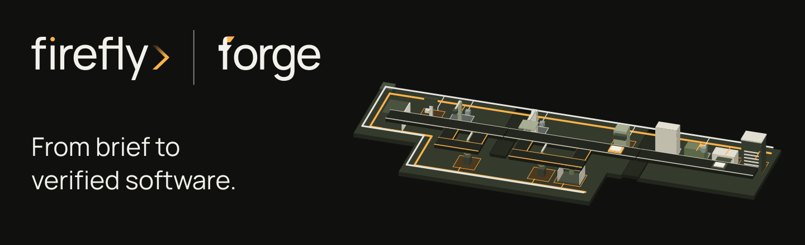
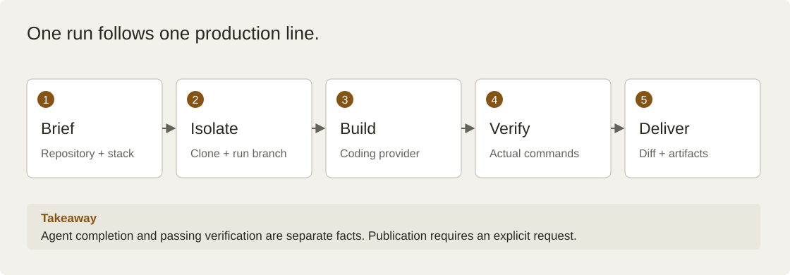

<!-- Copyright 2026 Firefly Software Foundation. SPDX-License-Identifier: Apache-2.0 -->
# Turn a brief into verified software

firefly forge is the Firefly software factory. Give it a product brief, a Git
repository and a stack. A coding agent implements the change in an isolated
workspace. forge runs verification, records the evidence and presents the diff
for your review.

Start with **PyFly** or **LaraFly**. Choose a browser frontend or deliver an API
alone. Use your signed-in Codex or Claude Code CLI, a native Firefly Agentic
provider, or an authorized internal bridge connection.

| Your goal | Start here |
| --- | --- |
| Run the factory on your computer | [Install and start](installation.md) |
| Build your first product | [Quickstart](quickstart.md) |
| Create a Python service | [PyFly walkthrough](pyfly.md) |
| Create a Laravel service | [LaraFly walkthrough](larafly.md) |
| Add an existing repository | [Git repositories](scm.md) |
| Configure a coding provider | [Agents](agents.md) |
| Maintain or test an existing product | [Workflows](workflows.md) |
| Select project policies | [Policies](policies.md) |
| Add cited context and project memory | [Knowledge](knowledge.md) |
| Continue interrupted work | [Recovery](recovery.md) |
| Deliver a verified change | [Deployment](deployment.md) |
| Understand verification and publication | [Capabilities and limits](capabilities.md) |

## Follow the production line

**How to read this diagram:** Follow the five stages from left to right. Generation
and verification are separate steps. A finished agent response is not evidence
that a product works. Publication is an explicit run option, disabled by default.

[Open the diagram at full size](diagrams/factory.svg)

forge is an early product for trusted development operators. Read its
[security model](security.md) before exposing the API or giving it access to a
repository. Each run retains the original brief, provider, selected profiles,
progress events, verification results and change evidence.
