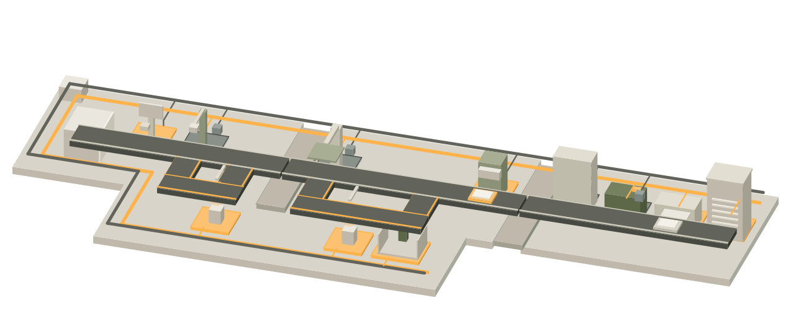
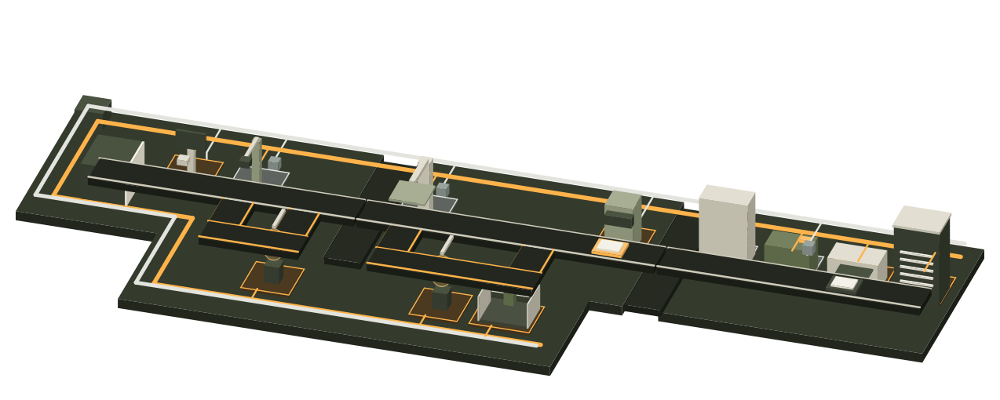

---
hide:
  - navigation
  - toc
  - footer
---

<!-- Copyright 2026 Firefly Software Foundation. SPDX-License-Identifier: Apache-2.0 -->

# Build a product. Keep the evidence.

Define the customer journey, give an agent a bounded task, and review what it actually built. firefly forge brings product decisions, source changes, verification and delivery into one recorded workflow.

[Set up forge](installation.md){ .md-button .md-button--primary }
[Build your first product](quickstart.md){ .md-button }

Start with [**pyfly**](https://fireflyframework.org/frameworks/python/) or [**larafly**](https://fireflyframework.org/frameworks/php/). Add a browser frontend when the product needs one; API and service projects follow the same delivery process.

{ .forge-docs-art-light }

{ .forge-docs-art-dark }

Illustration · no live activity
<button type="button" data-scene-toggle aria-pressed="false" disabled>Loading…</button>

## What do you want to do?

### :material-map-outline: Define the product

Capture journeys, features, integration contracts and acceptance criteria before implementation.

- [Work through the product wizard](product-definition.md)
- [Bring in an existing project](as-is-handoff.md)
- [Review an architecture proposal](product-definition.md#review-an-architecture-proposal)
- [Review wireframes](design-review.md)
- [Deliver an incremental feature](product-lifecycle.md)

### :material-source-branch: Build and review

Choose the coding provider and its tools, run checks, and inspect the source changes and evidence.

- [Choose an agent and model](agents.md)
- [Configure the execution environment](sandbox.md)
- [Review browser journeys](browser-qa.md)
- [Work from repository conversations](repository-workflow.md)

### :material-server-outline: Run the factory

Prepare identity, storage and delivery access. Keep execution, recovery and application health observable.

- [Sign in and manage project access](identity.md)
- [Separate API and worker processes](runtime-roles.md)
- [Deploy a verified product](deployment.md)
- [Continue interrupted work](recovery.md)

## Follow one change through the factory

1. **Define the expected behavior.** Save the customer journey and measurable acceptance criteria. [Product definition](product-definition.md)
2. **Prepare the task.** Choose the repository, stack, provider, policies and execution limits. [Build, maintain and test](workflows.md)
3. **Implement and verify.** Review the diff and the actual results of commands and browser checks. [Agent tools](agent-tools.md)
4. **Review and deliver.** Check the verified source, publish explicitly, then deploy to an authorized target. [Delivery assurance](assurance.md)
5. **Observe and maintain.** Inspect application health and link follow-up work to its evidence. [Application operations](application-operations.md)

## Check what each result establishes

A completed agent response, a passing test, a visual review and a successful deployment establish different things. Use the [capabilities guide](capabilities.md) to understand those boundaries and the [API reference](api.md) to automate supported actions.

New to the factory? [Find your next step](guide.md) connects the guides by role and shows where to check each result.

The home-page animation is a demonstration. It reads no run data and makes no model calls. <a href="assets/docs-scene/THIRD_PARTY_NOTICES.txt">Illustration licenses and notices</a>.

