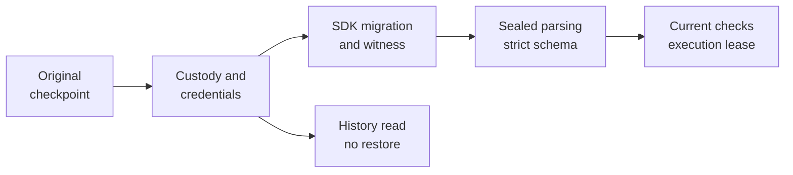
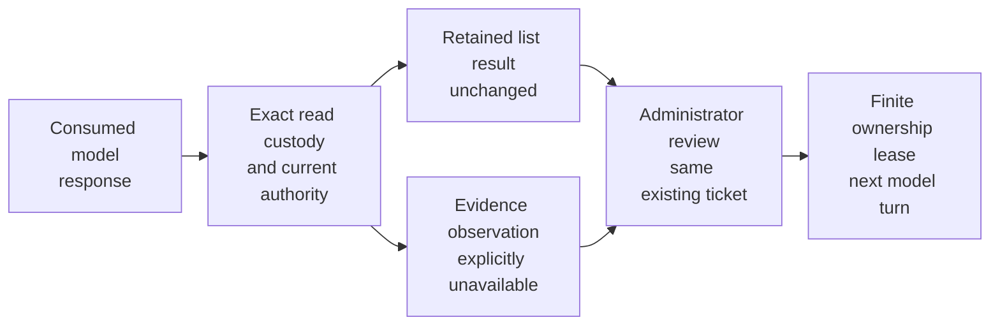
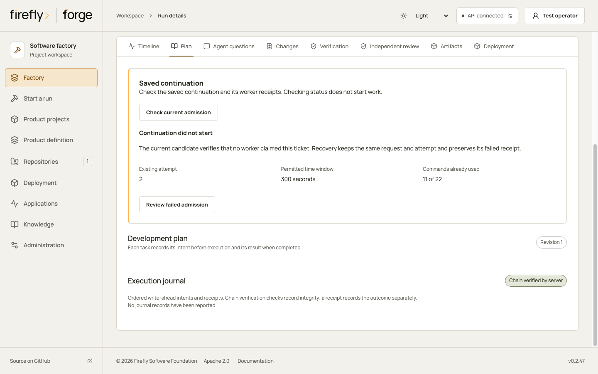
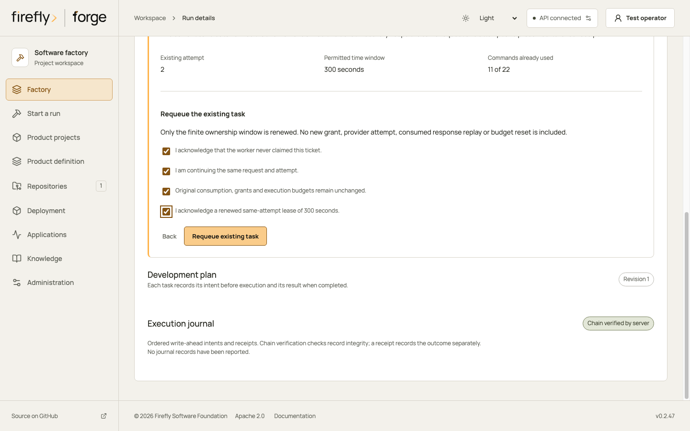
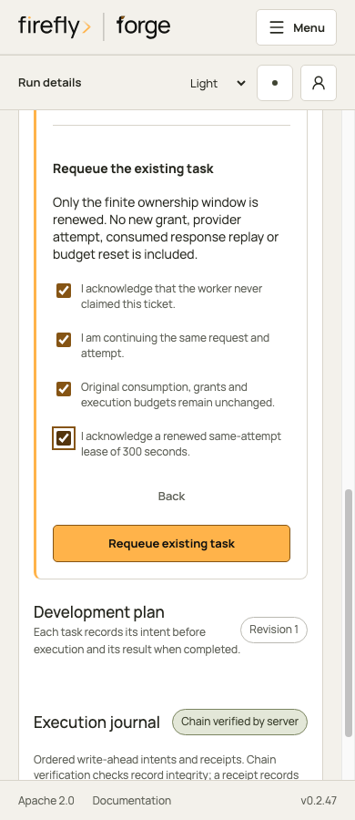
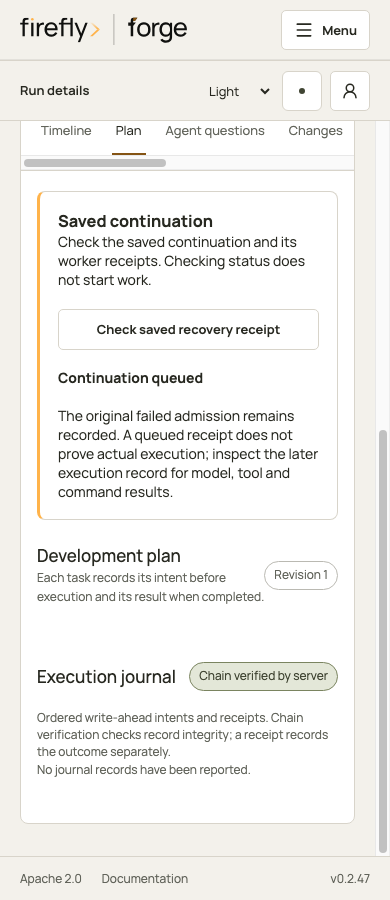

<!-- Copyright 2026 Firefly Software Foundation. SPDX-License-Identifier: Apache-2.0 -->
# Continue after a rejected evidence read

A consumed model response can stop an older required-checkpoint worker when its `read_run_evidence` call contains a query rejected before the evidence reader starts. Same-attempt continuity reconstructs that known negative outcome offline and prepares a new finite ownership lease. It preserves the original task, source, user, configuration, consumption, history, and execution limits.

This implementation is a private preview. A qualified and registered current profile covering the complete installed migration code is required before native admission. PostgreSQL and controller qualification must also pass before use on retained work.

## Exact eligibility

The candidate verifies the complete native journal and original request/checkpoint/response/consume closure. The old package runtime and pre-callback validator must match registered historical identities. The final original response must contain exactly one granted `read_run_evidence` function call with an object query accepted by the old advertised schema but rejected by its pinned validator.

Version 1 rejects every sibling call. A separately acknowledged version-2 policy can close unavailable pure source observations under the rules below. A valid query, an unknown or writable call, unsupported response content, a missing consume, or later unaccounted effects remains held. A logged error message supplies no authority. Existing unresolved command or tool custody remains subject to its original native reconciliation and acknowledgement rules.

## Unavailable pure source observations

Version 2 handles one rejected evidence query accompanied by granted `list_files` calls whose original results were not retained. Whether those reads finished remains unknown. The proof binds each original call ID, argument digest, source cut, grant and raw response. It pins the published historical source-reader implementation and preserves complete native tool-row and journal custody.

The factory policy setting `allow_unavailable_source_observations` is **off by default**. A factory administrator must enable it under the current finite-lease policy. Admission also requires a version-2 request with `acknowledge_unavailable_source_observations: true`. Enabling the setting alone creates no claim. Version-1 requests cannot admit version-2 proofs.

Sealed reconstruction appends this explicit negative result for each affected observation:

```json
{"status":"observation_unavailable","reason":"original_read_result_not_retained"}
```

The result records the missing observation. It claims neither historical success nor historical failure. Forge does not rerun the reader, inspect the current filesystem to invent its old answer, or substitute an unrelated result. Reusing a successful result requires separate exact original-call custody; matching a tool name, arguments or timestamp is insufficient.

The initial allowlist contains only `list_files`. Each call needs a unique ID, original grant and arguments accepted by its frozen schema. Writable, command, network, unknown and unsupported siblings remain held. Unfinished or unknown native effects keep their original reconciliation rules. The full original response and history remain intact. The public SDK charges the consumed response once and each original tool call once under unchanged lifetime limits and source-command budgets.

For a version-2 candidate, POST `/api/v1/runs/{run_id}/invalid-read-continuity/requests-v2/{request_id}` with its exact candidate/run/journal/policy digests, `version: 2`, the three existing acknowledgements and the observation acknowledgement. After an uncertain response, read the same identity through the shared `GET .../requests/{request_id}` route. The Python client provides `invalid_read_continuity_candidate`, `request_invalid_read_continuity` and `invalid_read_continuity`, and validates the version and acknowledgement before sending.

Current identity, execution permission, source, configuration, qualified profile and finite lease checks still apply. Revoking the policy stops execution. The negative observation supplies no coding grant, replacement attempt, reset counter or extra model allowance.

## Historical SDK migration

The package catalog identifies an eligible historical source and its dependency epoch. The supported SDK transition is Firefly Agentic 26.10.1 with Pydantic AI 2.58.0 to the same Agentic version with Pydantic AI 2.55.0. The registered source identities also bind their original prompt catalog and dependency versions. A version number or logged exception alone cannot qualify a checkpoint.

Forge validates the original encoded digest, canonical record and complete native custody before deriving a new checkpoint. Public SDK history, usage and limits must round-trip without losing fields. The original stored checkpoint remains unchanged.

The SDK-specific projection permits only these changes:

| Source element | Derived checkpoint |
| --- | --- |
| Three MCP telemetry provenance fields | Retain their exact source values and hash in the migration witness; omit the unsupported fields from the target SDK contract |
| Static function tool definitions | Retain an existing `tool_kind=None`, or add it when absent. Record each tool’s original field presence in the witness. Other values are refused. |
| Compatibility metadata | Record the exact registered SDK transition on the new checkpoint |

URL identities and tool names may each be `null` (unknown provenance) or `[]` (a collector found none). Toolset identities must be `[]`. The witness preserves those states separately. Nonempty collections, other JSON types, unknown fields and unsupported SDK pairs remain held. The current worker contract must still match after the named projection.

`output_reasoning_tokens` and `cache_write_1h_tokens` retain their exact values as bounded integer counters. Reasoning tokens are already included in `output_tokens`; one-hour cache writes are already included in `cache_write_tokens`. Preserving these counters adds neither quantity to its parent total again. Missing mandatory counters and arbitrary additional counters refuse migration.

<div class="forge-flow forge-flow--dependencies" role="region" aria-label="Checkpoint continuity diagram" tabindex="0" markdown="1">



</div>
<p class="forge-flow-caption">Read from left to right. Scroll horizontally on smaller screens. History inspection remains a read operation.</p>

## Offline reconstruction and tool migration

A sealed in-process HTTP transport exposes the already consumed response to the public SDK parser once. It never contacts a provider or repeats native consumption. Version 1 reconstructs only `{"status":"invalid_query"}`. Explicit version-2 admission also records the fixed unavailable source observations described above. Neither path invokes an original tool callback. Capture stops before any new request can leave the process. Reconstruction accounts for the original response and fixed validation outcome once; later requests and tools use the remaining allowance.

The installed `execute_agentic` entry point is independently run against another sealed transport to capture its actual rendered tool definitions and instruction parts. Migration permits exactly these changes:

| Contract element | Approved successor |
| --- | --- |
| `read_run_evidence.parameters_json_schema` | Current strict worker envelope, with page default and maximum of ten |
| `read_run_evidence.description` | Registered prompt 1.0.0 to 1.0.1, explaining correction and checkpoint-safe `invalid_query` results |

After the separate SDK projection, every other contract element must remain equal, including instructions, other descriptions and schemas, tool order and grants, return schemas, output contract, model settings, history, SDK usage and limits. Unsupported changes refuse migration. Newly derived message metadata is deterministically bound to native consumption time and the original public message run identifiers; the stored historical prefix and raw response remain unchanged.

## Historical policy epochs

An older checkpoint-mode adoption and original-selection readmission remain immutable. A package-owned compatibility catalog recognizes only the reviewed historical selection/mode/acknowledgement tuple. Recognition exists only inside this namespaced continuity preparation or execution context, under the current qualified source profile and enabled finite-lease policy. The current identity, original execution actor, provider configuration, selection, source, commands, unknown-effect custody, and original scope are still checked.

Ordinary mode preparation and restore APIs keep their strict current-policy behavior outside that context. Existing restore APIs do not gain permission to replay consumed responses or restore expired claims. The migration receipt records both policy epochs and binds them to the exact old native references, current source profile, and current lease-policy revision.

## Operator flow

1. A current factory administrator configures `PUT /api/v1/invalid-read-continuity/policy`. The versioned policy is disabled by default. Its finite window and queue bounds are explicit settings. Read it back with `GET` on the same route.
2. A currently authorized execution operator reads `GET /api/v1/runs/{run_id}/invalid-read-continuity/candidate`. Inspect its proof, current qualification, policy revision, source and custody digests, and holds. Candidate preparation creates no execution claim.
3. Submit `POST /api/v1/runs/{run_id}/invalid-read-continuity/requests/{request_id}` with the exact candidate/run/journal/policy digests, a bounded `valid_for_seconds`, and all three acknowledgements: no new grant, original consumption, and renewed same-attempt lease.
4. Read `GET /api/v1/runs/{run_id}/invalid-read-continuity/requests/{request_id}` after a lost response. An identical request is idempotent. Another identity cannot acquire a second ticket for the same consumed graph.
5. If the candidate or ticket remains held, follow its stated policy, custody or qualification requirement. Keep the original checkpoint and response unchanged. A held candidate supplies no execution claim.

Candidate and admission source inspection use read custody under the current authenticated actor. They require an eligible held run, its exact task attempt and journal, unchanged source and configuration, and no queued or executing native claim. The API acquires no worker ownership. Worker execution retains the existing ownership checks, and ordinary restore admission keeps its original eligibility and deadline rules.

The native transaction appends one migration settlement and its adjacent ownership claim, then queues the migrated checkpoint through the existing execution-request repository. The old claim and deadline remain recorded unchanged. The new lease is bounded by the factory policy, frozen provider timeout, and any recognized remaining active deadline. Unsupported time-budget protocols refuse admission.

The lease changes ownership validity only. It adds no request, token, tool, source-reader, command, repair, or attempt allowance. Admission preserves the completed-round count; a later ordinary known worker completion advances progress through the existing Engine behavior. The next request uses the migrated checkpoint rather than a fresh brief or child run.

Queue counts default to 50 tickets per run and 500 pending tickets. An administrator may configure larger positive integer counts. Native admission enforces the configured counts atomically; changing queue capacity does not change any lifetime execution allowance. The 7200-second maximum lease window follows the existing provider-timeout configuration protocol and remains bounded by the original frozen timeout and any remaining active deadline.

Command usage is measured from canonical retained native execution rows. For example, a retained ledger at 11 of 22 remains at 11 during admission. Two newly executed commands bring it to 13 of 22, with the old eleven receipts unchanged. Reading the same completed command or ticket again adds no charge. The remaining nine commands may run under the original limit; a twenty-third command is refused before execution.

## A request that failed before a worker claim

A failed continuity request can recover once under the same native request ID when its complete native event history proves that no worker ever claimed it. A missing owner or generation alone is insufficient. The current original administrator must review the unchanged source, checkpoint, scope, spent usage, configuration, qualified profile and finite-lease policy. A legitimate typed startup recovery annotation remains in the journal; unrelated later activity keeps the request held.

The recovery candidate is `GET .../requests/{request_id}/recovery-candidate`. Submit its exact digests to `POST .../requests/{request_id}/recoveries/{recovery_id}` with all four acknowledgements and a bounded window. Retain this action ID and read `GET .../requests/{request_id}/recovery` after a lost response. The SDK methods are `invalid_read_recovery_candidate`, `request_invalid_read_recovery` and `invalid_read_recovery`. A different action cannot replace an existing recovery witness.

The transaction preserves the original ticket, admission seal, settlement, reservation, checkpoint and failed receipt. It appends an explicit recovery witness and request event, then queues the same request with a new finite ownership lease. Queued means accepted for dispatch; only a native worker claim and later completion establish execution progress. This grants no new attempt, model allowance or command quota. Claimed or uncertain requests remain held and cannot use this workflow. Generic retry, resume, handoff and reconciliation cannot bypass an outstanding continuity ticket.

## A provider request refused before admission

A worker claim does not prove that a provider accepted its next request. A provider can reject a request during validation, before it creates a job or dispatches work. This case has a separate, disabled-by-default policy, `allow_pre_admission_recovery`. It never qualifies for the never-claimed workflow above.

The supported case is the first provider request of the admitted continuation. Its pending checkpoint must be byte-identical to the original ticket's checkpoint, with no intervening model response, tool outcome, source change or command. The complete native request-event chain must retain the worker claim and failed outcome. Unknown or partially executed requests remain held.

The original actor must still have current factory administrator and execution authority. The administrator reviews the exact executed provider epoch and matching source-validator and executable-probe reports. The review records the original wire digest and length, endpoint, principal, model, source revision and executable identity, with zero admissions, jobs, provider dispatches and tool callbacks. A status code, error message, missing job or absent receipt alone supplies no such proof. The API records this as an administrator-reviewed assertion with pinned evidence; it does not authenticate a remote refusal receipt automatically.

Validate the corrective provider configuration or version before admitting this one-use action. Evidence for the old rejection does not establish that the current provider will accept the request. A repeated refusal remains held.

Use the SDK or these namespaced routes after that review:

| Step | Route relative to `.../invalid-read-continuity/requests/{request_id}` |
| --- | --- |
| Inspect without admitting work | `POST /rejected-boundary-candidate` with `ReviewedProviderRejectionV1` |
| Submit the reviewed action once | `POST /rejected-boundary-recoveries/{recovery_id}` with `RejectedBoundaryRecoveryInputV1` |
| Read the saved action | `GET /rejected-boundary-recovery` |

The SDK methods are `rejected_boundary_recovery_candidate`, `request_rejected_boundary_recovery` and `rejected_boundary_recovery`. Retain the action ID before submission. Read it back after a lost response; do not choose a replacement identity or submit a second action. Admission requires four exact acknowledgements covering the reviewed provider epoch, absence of original response or tool replay, the same request and budgets, and the finite ownership lease.

Forge reproduces the pending request through a sealed public SDK transport and requires the exact wire bytes, history, settings, tool definitions, usage and limits. It supplies no model response and executes no original tool callback. The native transaction appends a distinct refusal settlement and action receipt while preserving the original ticket, admission seal, failed claim and checkpoint. Only a later worker claim can clear that exact hold and continue the pending graph under a new finite ownership lease.

SDK counters remain unchanged at admission and increase when new responses and tools complete. The rejected native request remains in the lifetime admission budget. New commands consume their original command ceiling normally. A queued receipt establishes no execution success or acceptance of the requested product work. A second failure remains held; this workflow supplies no automatic retry loop.

## A consumed turn with an unavailable evidence observation

A later continuation can receive a valid model response, consume it, and stop when `read_run_evidence` cannot durably retain its result. This needs a separate administrator decision. The provider-refusal action above is already spent; its evidence cannot authorize another request. The new `allow_readonly_observation_recovery` policy setting is **off by default** and grants no execution by itself.

The supported native history contains the complete earlier claim and refusal recovery, followed by one consumed response and exact pure-read custody. That response contains one unavailable `read_run_evidence` call and, optionally, one `list_files` call with its exact retained successful result. Each call must have its original grant, arguments, source cut, checkpoint and complete durable intent/outcome. Writable, command, network, unsupported or unaccounted later effects remain held.

<div class="forge-flow forge-flow--dependencies" role="region" aria-label="Unavailable observation continuation" tabindex="0" markdown="1">



</div>
<p class="forge-flow-caption">Read from left to right. The unknown evidence result remains unknown. Neither original reader runs again.</p>

Sealed public SDK reconstruction preserves the original raw response and history. It appends the exact retained list result and `{"status":"observation_unavailable","reason":"original_read_result_not_retained"}` for the missing evidence observation. It invokes no original callback, makes no provider request and writes no native tool result. The original `agentic_tool_unknown` record remains unchanged; the distinct `readonly_observation_recovery` witness explains the reviewed continuation.

Validation compares canonical JSON for the complete message history, request history, state, limits, contract and usage. It preserves JSON types and rejects altered model metadata, token details or retained cost fields.

Use these routes relative to `/api/v1/runs/{run_id}/invalid-read-continuity/requests/{request_id}`:

| Step | Route and typed input |
| --- | --- |
| Inspect the held turn without admitting work | `GET /readonly-observation-candidate` |
| Save one reviewed action on the same ticket | `POST /readonly-observation-recoveries/{recovery_id}` with `ReadonlyObservationRecoveryInputV1` |
| Read the saved action after an uncertain response | `GET /readonly-observation-recovery` |

The Python client methods are `readonly_observation_recovery_candidate`, `request_readonly_observation_recovery` and `readonly_observation_recovery`. Keep the action ID before submission. The strict version-1 input binds the exact `candidate_digest`, a bounded `valid_for_seconds`, and four explicit acknowledgements: `acknowledge_unavailable_observation`, `acknowledge_no_original_callback_replay`, `acknowledge_same_request_attempt_and_budgets` and `acknowledge_finite_ownership_lease`. Each acknowledgement must be the Boolean `true`. An identical action reads back the saved result; another action cannot replace it.

Admission appends one witness and one event atomically, then queues the same request. Its original checkpoint, admission seal, binding and failed receipts stay intact. A separate derived checkpoint and invocation binding carry the reviewed history and finite lease. Current administrator and execution authority, source, configuration, qualified profile, policy revision and original task attempt are checked again before claim and during execution. Revocation or expiry stops dispatch.

Reconstruction charges the already consumed response once and each original tool call once, retaining the original request, token and tool ceilings. It adds no command charge: an existing ledger at 11 of 22 stays at 11 during review and admission. New commands use the remaining original allowance. The attempt, repair budget and original consumption never reset. A queued receipt confirms admission; a later native worker claim and completion establish execution progress. The unavailable observation remains visible to that next model turn and supplies no claim that the requested product work succeeded.

## Failure and validation boundaries

Policy revocation, expired ownership, changed source/configuration/profile/scope, cancellation, actor loss, unknown effects, or a changed native ticket stop execution. Claimed tickets are never automatically requeued after owner loss. Their outcome requires explicit native reconciliation.

Automatic verification checks outstanding continuity custody before source preparation or commands. A typed refusal while entering its policy epoch leaves one native admission-refusal record and becomes ineligible for automatic scheduling. The earlier verification results and worker response remain unchanged. Cancellation, lost ownership and failures after admission retain their existing boundaries.

Host controls cover the actual Engine and installed worker adapter, strict evidence correction, two new file-tool cycles, two durable command cycles, unchanged attempt and allowances, original-consumption reuse, idempotency, expiry, revoked authority, and incompatible policy or contract changes. Prepared PostgreSQL controls use only a dedicated fictional `_test` database and in-process model transport. Host tests do not establish PostgreSQL atomicity, current installed-profile qualification, controller composition, or acceptance of a particular retained run.

## When an admitted continuation has not started

Admission records a queued continuation. A worker must still claim that ticket and pass the current execution checks before it can make a model request or run a tool or command. A successful admission receipt alone does not prove that any of those operations occurred.

An admission can fail before a worker claims it. For an exactly eligible failure, Studio offers **Review failed admission** in the run's execution record to the original execution actor with current factory administrator authority. Reviewing the current candidate queues nothing. The review identifies the existing request and attempt and explains the permitted finite time window. Opaque custody and source digests are carried by Studio; operators do not paste or edit them. The earlier generic checkpoint recovery control is withheld once continuity admission is recorded.

Recovery requires explicit acknowledgement that the worker never claimed the ticket, that the original request and attempt remain the same, that original consumption and budgets stay charged, and that only the same-attempt lease is renewed. **Requeue existing task** records one operator action against that ticket. It creates no replacement task, new provider attempt, new grant, replay, or reset allowance. The failed admission receipt remains part of the history.

If the response is lost, Studio checks the saved recovery identity. An unavailable response or a missing readback does not authorize another submission. Source races, changed qualification, revoked authority, another actor, unknown outcomes, and claimed tickets remain held. A fresh candidate is not permission to overwrite an uncertain action.

After recovery, **Continuation queued** still means admission only. Worker claim and actual execution are separate later events. A failed or held continuation is not evidence that a model or command ran, and a queued continuation is not acceptance of the requested product work.

### Follow the recovery in Studio

Open the run's **Plan** tab and select **Check current admission**. Studio reads the existing ticket before offering a recovery. These screenshots use controlled fixtures; they illustrate the review, not a completed product run.

<figure class="forge-shot" markdown="1">



<figcaption>Inspect the same attempt, permitted ownership window and commands already used. Reviewing this information does not queue work.</figcaption>
</figure>

Select **Review failed admission**, read the four acknowledgements, then choose **Requeue existing task**. The time window is supplied by the current server checks. Studio carries the request identity and custody digests without asking you to enter them.

<figure class="forge-shot" markdown="1">



<figcaption>Confirm the existing request and attempt. Original usage remains charged; recovery renews ownership time and adds no execution allowance.</figcaption>
</figure>

<details class="forge-gallery" markdown="1">
<summary>Review the mobile flow and queued receipt</summary>

<div class="forge-shot-grid" markdown="1">

<figure class="forge-shot forge-shot--phone" markdown="1">



<figcaption>Review all four acknowledgements before submitting. The action remains disabled until every acknowledgement is selected.</figcaption>
</figure>

<figure class="forge-shot forge-shot--phone" markdown="1">



<figcaption>The queued receipt confirms admission only. Follow the later worker, model, tool and command records to see what actually ran.</figcaption>
</figure>

</div>
</details>

## Credential inspection and ordinary restore

Historical query proofs keep their original validator identity. The package accepts the original reader source and an explicitly reviewed successor whose `EvidenceQuery` class and JSON schema are unchanged. It verifies the complete source hash before rebuilding a proof. Other source hashes remain ineligible until reviewed and qualified.

Authenticated journal reads may inspect canonical records from the known SDK epochs under current reader and credential guards. Historical inspection requires matching native row fields and an intact journal chain. It checks encoded bounds, hash, canonical structure and typed budgets, then passes the original JSON text to credential screening. It preserves every field, including telemetry provenance.

This inspection returns no resumable SDK object. Ordinary decode and restore retain their exact-version checks. A historical source eligible for credential inspection can still be ineligible for continuity, and a successful inspection does not renew a lease or authorize execution.
