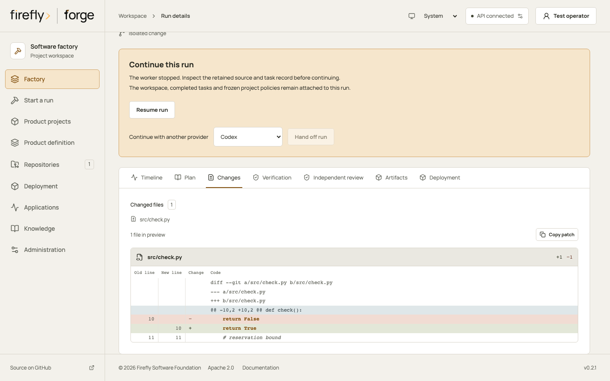
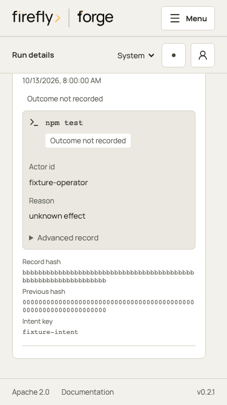

<!-- Copyright 2026 Firefly Software Foundation. SPDX-License-Identifier: Apache-2.0 -->
# Operate the factory

Sign in with an identity authorized for the intended projects. Factory administrators configure provider connections and runtime settings; project memberships govern repository work. In explicitly enabled local bootstrap mode, the loopback operator credential grants administration and execution on that development host. See [identity and project access](identity.md) before admitting users.

## Inspect actual work

Open a run to inspect its plan, journal, source diff, checkpoint revision and verification. The floor displays real project work; use receipts and exit statuses to determine outcomes.

`verification` preserves every check attempt. `final_verification` identifies the checks supporting success, and `source_tree` identifies the checked Git tree. `checkpoint_revision` is an actual local commit reference. A worker's final summary alone does not establish that a product works.

## Inspect a run from request to source

Use a run ID from a queue response, campaign child or repository receipt, with current read permission for its repository. Keep the run ID with the product revision and acceptance criteria you are reviewing.

| Question | Studio view or API evidence | What to inspect |
| --- | --- | --- |
| What was requested? | **Plan**; `GET /api/v1/runs/{id}/plan` | Task instructions and states; the API also retains frozen product, source, provider, role, policy and runner settings. Read `/runs/{id}/worker-messages` for clarification requests and answers. |
| What actually ran? | **Timeline**, **Verification**; `GET /api/v1/runs/{id}` | Provider events and each command's arguments, exit code, output and attempt. Earlier failures remain visible. |
| What source changed? | **Changes**; the run's `changed_files` and `diff` | Actual file paths and Git patch. A file count alone does not explain a change. |
| Which checks support success? | The run's `final_verification` and `source_tree` | Nonempty passing checks against the exact retained tree; any requested review must match that tree. |
| Which effects have receipts? | `GET /api/v1/runs/{id}/journal` | Intent, receipt and reconciliation entries. `valid: true` confirms the journal's hash chain, not the success of every effect. |
| What can be handed off? | **Artifacts**; `GET /api/v1/runs/{id}/artifacts/changes.zip` | The retained changed-source export and checkpoint. A test-only run can pass without changed-source artifacts. |
| Was delivery completed? | Execution requests, publication URL and deployment record | The worker's retained result, remote review request and actual deployment checks, each separately. |

The execution journal is a write-ahead record: an intent precedes an effect and a receipt records its observed outcome. An intent without a matching receipt can leave work in `needs_reconciliation`. Neither the intent nor a valid hash chain supplies a missing command result. Use the [recovery procedure](recovery.md) to inspect retained source, runner evidence and external state before continuing.

<picture>
  <source media="(max-width: 640px)" srcset="../diagrams/run-evidence-narrow.svg">
  
</picture>

[Open the evidence diagram](diagrams/run-evidence.svg) · [Portrait layout](diagrams/run-evidence-narrow.svg)

Review code from the identified source tree. Command output can be bounded or redacted, and the run diff is limited to 1 MB. Consult retained source and artifacts when the displayed patch is incomplete. A model summary, a passing formatter or an HTTP health response each establishes a different fact from a behavioral test.

**Changes** groups a text patch by file, with old and new line numbers for additions, removals and context. **Copy patch** copies the retained run diff, including content outside a bounded preview. It does not apply the change to another checkout.

Console presentation using controlled test data. The sample patch demonstrates the review layout; it is not evidence of a successful generated product.

The **Plan** journal cards distinguish intents and recorded outcomes. **Outcome not recorded** leaves the effect uncertain. Expand **Advanced record** to inspect the retained payload and correlate it with the task, attempt and command evidence before resuming.

Console presentation using controlled test data. The sample journal illustrates an uncertain outcome and does not represent live command execution.

If checks failed, read their output and the repair history. A pending worker question needs an [answer and explicit resume](agent-roles.md#worker-feedback-and-manager-requests). A changed verified tree needs fresh verification. An uncertain publication or cancellation needs [execution-request reconciliation](recovery.md#reconcile-worker-delivery-requests). Preserve earlier attempts while resolving the current one.

## Build, maintain and test

Build and maintenance use the selected coding provider followed by independent verification. Maintenance tells the worker to preserve the existing product and add focused regression coverage. Test mode verifies existing source without invoking a model or coding repair.

Empty command lists use a detected repository gate. Selected policy quality gates add their real commands. If no executable verification is found, the run fails. There are at most 20 effective verification commands per run; each retains its own timeout and output.

Failed checks return to the worker for bounded repairs. `FORGE_REPAIR_ATTEMPTS` defaults to `2`, allowing an initial implementation and two repairs; its range is `0..3`. Earlier failures remain visible after a later passing attempt. [Workflows](workflows.md) explains mode selection.

## Handle provider limits

A rate limit pauses the current task with its retry time and retained workspace. The scheduler allows up to three automatic retries when the recorded failure permits them. Quota exhaustion and authentication failures require an operator action. Configure access or credits at the provider, then explicitly resume or hand off to another configured worker.

The factory records reported usage and provider errors. It does not infer an account's remaining prepaid balance from token usage. A CLI login, a model listing and a successful generation establish different facts.

## Cancel, resume or retry

Cancellation stops queued or active work and terminates worker process groups. It cannot undo a completed external effect. Shutdown preserves interrupted work; an unacknowledged journal intent requires inspection before continuation.

Resume continues the same authorized workspace and snapshots. Handoff creates a new provider configuration and plan revision while retaining the source, policies and evidence. Retry creates a fresh run and clone. Use [recovery](recovery.md) to choose the correct action.

## Back up the ledger and source together

Stop the service for a straightforward consistent backup. Back up the dedicated PostgreSQL database with its ordinary PostgreSQL tools, and preserve the private data directory containing configuration revisions, workspaces and artifacts. Protect both backups as sensitive development data.

Restoring only PostgreSQL can leave a run referring to missing source or credential revisions. Restoring only workspaces loses its durable task and verification history. Missing or changed retained workspaces require reconciliation; they must not be reported as accepted source.

The service enforces ownership before recovering or dispatching work. Give independent installations their own data directories and ledger schemas. Global concurrency defaults to two active runs; one run per project is active at a time. There is no automatic artifact-retention policy. Review evidence before removing a completed workspace.

## Publish and deploy deliberately

Publication uses the existing local checkpoint commit, pushes a branch and creates an external review request. It never merges automatically. A changed tree or an uncertain previous publication prevents a blind repeat.

Deployment requires an explicit target tied to the repository, configured commands and post-deployment verification. Rollback uses its retained command snapshot and verification. [Deployment](deployment.md) covers these operations and their remote-effect boundaries.

For remote use, serve one HTTPS origin, restrict host headers and configure
[OIDC sign-in and project roles](identity.md). Hosted users receive access through
their project memberships; the local bootstrap is an explicitly enabled,
loopback-only administrator mode. Project authorization does not establish
isolation from arbitrary host code execution: non-admin coding requires the
configured isolated runner and provider controls.

The service has one execution owner per PostgreSQL schema. Choose a combined
service or API replicas with headless workers sharing one active execution leader before the installation's first
startup. The recorded topology, private storage binding and execution lease
reject incompatible owners. Read [API and worker roles](runtime-roles.md) for
startup, standby promotion, health and operation-routing details. Standbys provide leader replacement; this topology does not distribute active runs across independent execution owners.
