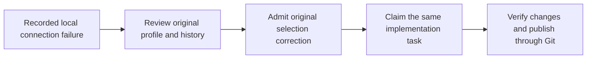

<!-- Copyright 2026 Firefly Software Foundation. SPDX-License-Identifier: Apache-2.0 -->
# Restore the original provider selection

An automatic verification handoff should keep the model profile selected for the implementation. Earlier factory versions could replace that profile with the global Bridge settings. If those settings had no endpoint or token, the next implementation stopped at the local connection check.

Original-selection readmission handles this recorded failure. A current factory administrator reviews the original profile, the failed handoff and the retained recovery records. Admission restores the connection from that original profile for one forward claim of the same task and attempt. The earlier configuration snapshots and WAL entries remain intact.

## Check the failure before continuing

Use this recovery when the recorded automatic handoff lost a named Bridge profile and the retained continuation failed because its Bridge connection was empty. The original named selection must still be current. Its model, timeout and required recovery modes must match the continuation's effective settings. A different endpoint or profile is a separate configuration decision.

The review also binds the prior checkpoint mode adoption and its claim, the current source and project authority, the command history, and the command-risk acknowledgments. Earlier model requests need their original response and consumption evidence. An unknown command outcome keeps its recorded status and spent command slot.

The operator records why the latest failure happened before an external model dispatch. Keep that observation privately, with the exact run, task and WAL references. Exclude tokens and raw configuration. Its SHA-256 digest identifies an operator observation; it cannot establish a provider outcome on its own.

## Review the candidate and retain a request ID

These routes require authenticated native administrator access and current execution access to the project.

| Route | Purpose |
| --- | --- |
| `GET /api/v1/runs/{run_id}/original-selection-readmissions/candidate` | Review eligibility and the current bindings without starting work. |
| `POST /api/v1/runs/{run_id}/original-selection-readmissions/{request_id}` | Admit the reviewed correction under the caller's retained request ID. |
| `GET /api/v1/runs/{run_id}/original-selection-readmissions/{request_id}` | Read the original admission without submitting another continuation. |

Generate and retain a new lowercase 32-character hexadecimal request ID before POST. Inspect the candidate and every acknowledgment in the request. If the source, actor, profile or policy changes, review the current candidate again before making a decision.

The following example assumes the administrator has already reviewed the candidate and retained the private observation. Set the environment variables to the actual identities and observation digest.

```python
import os

from firefly_forge.client import ForgeClient
from firefly_forge.original_selection_models import OriginalSelectionReadmissionInput

run_id = os.environ["FORGE_RECOVERY_RUN_ID"]
request_id = os.environ["FORGE_RECOVERY_REQUEST_ID"]

with ForgeClient(os.environ["FORGE_URL"], os.environ["FORGE_API_TOKEN"]) as factory:
    candidate = factory.original_selection_candidate(run_id)
    request = OriginalSelectionReadmissionInput(
        version=1,
        candidate_digest=candidate["digest"],
        policy_digest=candidate["policy_digest"],
        operator_observation_digest=os.environ["FORGE_RECOVERY_OBSERVATION_SHA256"],
        observation_provenance="native_operator_pre_dispatch_observation",
        acknowledge_known_local_readiness_failure=True,
        acknowledge_no_external_model_dispatch=True,
        acknowledge_original_selection_only=True,
        acknowledge_original_mode_and_claim_preserved=True,
        acknowledge_spent_history_and_budgets_preserved=True,
        acknowledge_same_native_continuation=True,
        acknowledge_existing_unknown_command_risk=True,
    )
    receipt = factory.request_original_selection_readmission(run_id, request_id, request)
```

The body accepts the reviewed candidate and consent. Connection credentials, alternate models, attempt numbers and execution budgets cannot be supplied through this request.

If the POST response is lost, retain the request ID and read its original record:

```python
with ForgeClient(os.environ["FORGE_URL"], os.environ["FORGE_API_TOKEN"]) as factory:
    receipt = factory.get_original_selection_readmission(run_id, request_id)
```

The SDK performs one request per call. It does not retry admission or choose another identity after a transport error. A missing readback requires investigation before any further action.

## Follow the resumed work

<div class="forge-flow forge-flow--dependencies" role="region" aria-label="Original provider selection recovery" aria-describedby="original-selection-flow-guide" tabindex="0" markdown="1">



</div>

<p class="forge-flow-caption" id="original-selection-flow-guide">Read from left to right. On narrow screens, focus the diagram and scroll horizontally.</p>

The new admission and claim refer to the preserved mode adoption, its original claim and the failed handoff. The recovery explicitly connects those historical records to the current policy checks. It leaves spent tool calls, commands and repair allowances spent. An unresolved external request cannot be treated as a successful result through this path.

After admission, inspect the implementation result, native verification receipts and Git delivery. A recovery receipt confirms an admitted configuration correction. The application's tests, commit and pull request establish what was actually built and whether it is ready to review.
