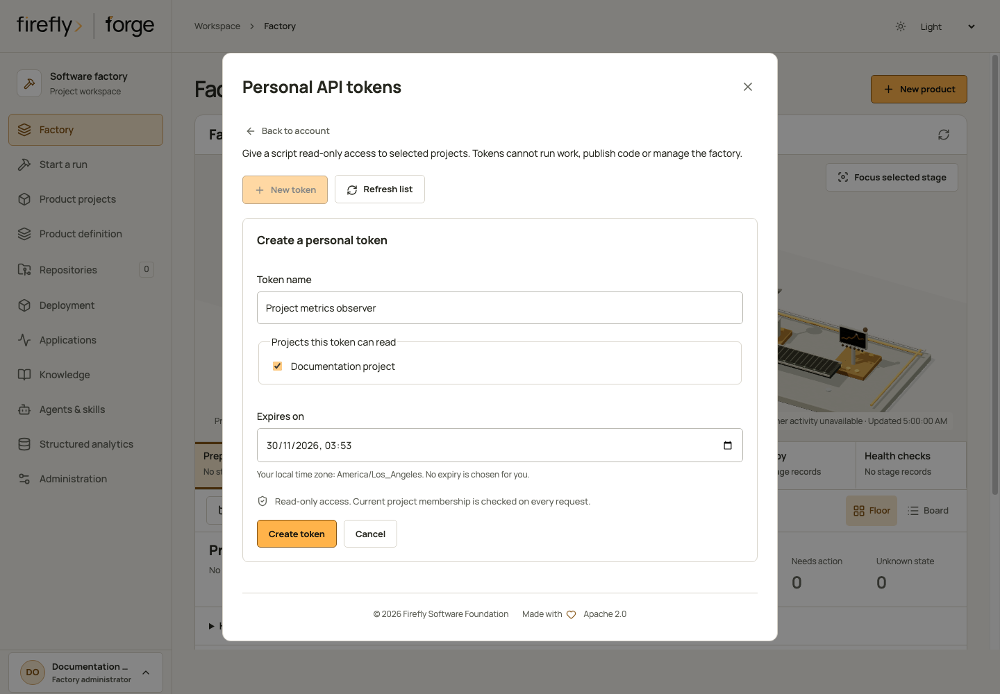

# Personal project API tokens

<!-- Copyright 2026 Firefly Software Foundation. SPDX-License-Identifier: Apache-2.0 -->

A personal token lets a script inspect selected projects without storing a browser cookie or an identity-provider refresh token. It has **read-only project access**. It cannot start work, edit a product, answer an approval, publish code, manage users or read factory configuration.

Sign in through the configured OIDC provider before creating a token. Local bootstrap credentials, signed API bearer tokens, source-control identities and personal tokens cannot manage these credentials. The existing bootstrap and OIDC API-token behavior is unchanged.

## Create and save a credential

In Studio, open your account at the bottom of the sidebar, then choose **Personal API tokens**. On a small screen, open **Menu** first and select your account. Choose **New token**, give it a useful name, select the projects it can read and choose an expiry in your local time zone. The screen shows only projects where your current session has read membership; the server checks membership again when issuing and using the credential.

Save the one-time secret in your secret manager, then choose **I saved this token**. Closing the account dialog, changing identity or leaving the screen discards the displayed secret. The browser does not save it in local or session storage. The list shows safe metadata and offers **Rotate** and **Revoke**, with confirmation before either change. Rotation revokes the old secret immediately, so update its consumers with the replacement. After a connection failure, refresh the list and inspect the outcome before making another request; the screen does not replay mutations automatically.

<figure class="forge-shot" markdown="1">



<figcaption>Choose a name, projects and an expiry before creating a token. This controlled fixture contains no issued credential; the server checks your current project memberships when you create one.</figcaption>
</figure>

### Create through the API

1. Sign in and confirm that your account has a current membership in each intended project. Factory-administrator status alone does not grant a personal token access to every project.
2. Use your authenticated browser session to send the request below to `POST /api/v1/identity/tokens`. Include the application's exact `Origin` and the native `X-XSRF-TOKEN` header with its matching CSRF cookie, as described in [browser login](identity.md#browser-login).
3. Save the returned `token` in your script's secret manager. The response uses `Cache-Control: private, no-store`. The server stores its SHA-256 digest; it cannot retrieve the secret later.

```json
{
  "request_id": "d9295ef6f24540f19d9c2c84a54c6ae0",
  "name": "Release dashboard observer",
  "project_ids": ["436c30d6b1734e689b90c7a7f0e85e92"],
  "permissions": ["read"],
  "expires_at": "2027-01-31T18:00:00Z"
}
```

The IDs above are examples. Generate one new 32-character hexadecimal request ID for each intended creation, choose actual project IDs and set a future expiry with an explicit timezone. Project IDs must be distinct. No other permission is accepted.

The response contains safe `credential` metadata, `secret_state: "returned_once"` and the secret `token`. Repeating the same request ID and body returns the same metadata with `secret_state: "not_retained"` and **no secret**. Reusing that ID with different input is rejected. If the original response is lost, inspect the credential list, revoke that credential and create another with a new request ID; do not assume a retry can recover its secret.

## Use it from a script

Send `Authorization: Bearer <personal-token>` over HTTPS. Keep the token in your secret manager or process environment, outside source files and command-line arguments.

```python
import os

from firefly_forge.client import ForgeClient

with ForgeClient(os.environ["FORGE_URL"], os.environ["FORGE_PERSONAL_TOKEN"]) as client:
    runs = client.request("GET", "runs")
```

The existing Python client uses the same REST authorization as direct HTTP requests. This credential surface supports these observations only:

| Resource | GET or HEAD path, relative to `/api/v1` |
| --- | --- |
| Current credential identity | `/auth/session` |
| Scoped lists | `/projects`, `/repositories`, `/runs` |
| Selected project and revisions | `/projects/{id}`, `/projects/{id}/revisions/{revision}` |
| Run details and evidence | `/runs/{id}`, `/runs/{id}/evidence`, `/runs/{id}/evidence.zip` |
| Run source changes | `/runs/{id}/artifacts/changes.zip`, `/runs/{id}/diff/index`, `/runs/{id}/diff/files/{ordinal}` |
| Recorded activity content | `/runs/{id}/activity/{event_id}/content` |

Underlying project and repository permissions still apply; list endpoints filter their results. A repository shared across projects retains its existing cross-project checks. Every authentication and project-access boundary rechecks the credential, its expiry, its owner and the owner's current selected memberships. Suspending the owner, changing its canonical issuer/subject, revoking the credential or removing its last selected membership prevents further authorized reads.

For the Factory dashboard, select an exact project or run with `GET /factory-dashboard?kind=project&project_id=...` or `GET /factory-dashboard?kind=run&run_id=...`. The project must belong to the token and remain available to its owner. Factory-wide and standalone scopes, and the `/factory-dashboard/projects` chooser, return `403` intentionally; they require an interactive organization session.

All other routes and every unsafe method are denied for personal tokens, including previews, searches, execution, reviews, user administration, factory settings and credential management. A personal token's service origin is never relabeled as a human decision or execution grant.

### Read through the official MCP server

`forge mcp` uses **stdio**, then calls the same REST API through `ForgeClient`; it is not an HTTP POST endpoint on the factory. Set its `FORGE_URL` and `FORGE_API_TOKEN` environment variables from your secret manager. With a personal token, observation tools such as `get_run` and `get_project` can read only the selected projects covered by the table above. Tools that call other paths, including global configuration, and all mutative tools remain denied by the API. MCP does not expand the credential's permissions, and no personal-token issuance, listing, rotation or revocation tool is registered.

## Inspect, revoke and rotate

These operations require the credential owner's current OIDC browser session. Another owner cannot list, revoke or rotate your credentials.

| Operation | Endpoint | Result |
| --- | --- | --- |
| List | `GET /identity/tokens?limit=25` | Metadata and optional `next_cursor`; never secrets or digests |
| Next page | `GET /identity/tokens?limit=25&after={next_cursor}` | Next metadata page |
| Revoke | `POST /identity/tokens/{id}/revoke` | Durable revocation; repeating it is safe |
| Rotate | `POST /identity/tokens/{id}/rotate` | New one-time secret and atomic revocation of the predecessor |

A list page holds 1–200 items; this is a pagination size, not a total credential limit. Rotation accepts a fresh `request_id` and explicit future `expires_at`. It preserves the original project selection and read-only permission, checks current memberships and records the predecessor. A repeated identical rotation returns metadata without disclosing the replacement secret again. A revoked or already rotated predecessor cannot create another replacement under a different request ID.

```json
{
  "request_id": "d02b980c7bfc4b6d9cb62977d468fa343",
  "expires_at": "2027-02-28T18:00:00Z"
}
```

Creation, rotation and revocation use native pyfly transactions. Credential and event rows commit together; an event failure rolls back a new credential and any predecessor revocation. Events contain lifecycle metadata, not the secret or its digest. Names and public payloads pass through the factory's credential scanner. Recognizable personal-token values are redacted even when they were not supplied through an environment variable.

## Architecture and validation boundary

Native `AuthenticationProvider` and `ProviderManager` validate personal tokens. Native pyfly repositories, `SessionProvider` and transaction managers own persistence; forge does not maintain a second authentication database. Owner and credential locks use the same order during authentication and lifecycle changes. Schema revision 32 adds the credential and event tables without rewriting historical execution-authority contracts.

Controlled host tests exercise native SQLAlchemy repositories and transactions with a test-scoped SQLite JSON mapping, the native controller registrar, production authorization middleware and the Python SDK through an in-memory ASGI transport. They cover lifecycle rollback, restart, current membership, owner binding, expiry, secret handling and forbidden effects. Actual MCP tool dispatch exercises own-project observations, foreign-project refusals, global/admin reads, a credential-route probe and a denied cancellation through the same SDK and native API middleware. Project/run response payloads and the browser-session boundary in that host fixture are controlled; the MCP tools, client, authentication provider, authorization and relational credential records are real.

A separate 12-case PostgreSQL 17 suite checks the revision 31-to-32 migration, native JSONB and timezone types, cold data-store restart, one-time concurrent issuance, competing rotations, both revocation/authentication orderings and membership loss during authentication. Ordered races inspect actual PostgreSQL backend blockers before releasing the first operation. The suite also verifies event rollback and checks the fixture's persisted files for raw token values after shutdown. These checks qualify the credential component; they do not replace installed-platform integration or a live OIDC/CSRF login test. Studio's owner token screen uses these same lifecycle endpoints and retains their session-only authority boundary.

Continue with [identity and project roles](identity.md), [security boundaries](security.md) and the [HTTP API](api.md).
