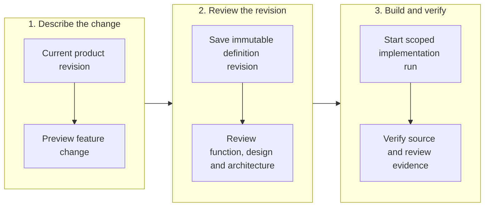

# Evolve a product without replacing its definition

<!-- Copyright 2026 Firefly Software Foundation. SPDX-License-Identifier: Apache-2.0 -->

A product can contain several customer journeys, features and integrations. Each feature has a stable ID, expected behavior, failure paths and references to the product's acceptance criteria. An integration connects those features to a named owned service or a third-party system.

Incremental changes preserve the existing product definition. A request names its base revision and digest, upserts or removes specific contract IDs, and optionally appends journeys, acceptance criteria or user stories. Existing acceptance numbers and untouched features remain unchanged.

<div class="forge-flow" role="region" aria-label="Product change lifecycle diagram" aria-describedby="product-flow-guide" tabindex="0" markdown="1">



</div>

<p class="forge-flow-caption" id="product-flow-guide">Follow the phases from left to right and the steps within each phase from top to bottom. Scroll horizontally on small screens; keyboard users can focus the diagram and use the arrow keys.</p>

Saving a definition does not modify product source, run tests, contact an integration or deploy software. Its receipt reports `implementation_status: "not_started"`. Implementation, verification and delivery have their own run receipts.

## Define integrations

Add integration contracts to `ProductDefinition.integrations`. Each contract includes:

- A stable `id`, descriptive name, `kind` (`owned` or `third_party`) and protocol.
- Exact customer-journey strings and existing feature IDs.
- Bounded, typed inputs and outputs, expected failure behavior and explicit retry rules.
- Authentication method and named secret references. Header declarations contain names only.
- Idempotency requirements for side effects. Retrying a mutation requires a mandatory idempotency key.

For an owned integration, `service_ref` identifies the intended service. HTTP integrations require an HTTPS endpoint without credentials, query parameters or fragments. These fields describe an interface; they do not authorize access to another project's repositories or credentials.

```json
{
  "id": "inventory",
  "name": "Reserve inventory",
  "kind": "owned",
  "service_ref": "inventory-service",
  "protocol": "http",
  "endpoint": "https://inventory.example/v1/reservations",
  "authentication": {
    "method": "oauth2",
    "secret_refs": ["secret://inventory/CLIENT_SECRET"]
  },
  "header_names": ["Authorization", "Idempotency-Key"],
  "inputs": [{"name": "quantity", "type": "integer"}],
  "outputs": [{"name": "reservation_id", "type": "string"}],
  "side_effects": true,
  "retry": {
    "max_attempts": 2,
    "backoff_seconds": 1,
    "retry_on": ["timeout", "server_error"]
  },
  "idempotency": {
    "mode": "required",
    "key_field": "Idempotency-Key",
    "key_location": "header"
  },
  "failure_paths": ["Insufficient stock returns a conflict without a partial reservation"],
  "feature_refs": ["reserve-stock"],
  "journey_refs": ["Reserve stock"]
}
```

`secret://profile/KEY` is a declaration, not a secret resolver. The definition never contains the secret value, and saving it does not retrieve one. Configure the generated application's runtime credentials separately. Integration tests should distinguish local contract tests from an actual provider-connected acceptance test.

Retry declarations allow at most five attempts and name their retryable failures. They describe the generated application's expected behavior; they do not start a factory retry loop or authorize repetition of an uncertain remote effect.

## Preview an incremental change

In Studio, edit the saved product's features or integrations in the existing form, then open **Review**. Under **Change selected contracts**, explain why the contract is changing and choose **Preview contract change**. The preview names changed and untouched features, affected journeys, regression criteria and the reviews required. Editing the draft or observing another saved revision invalidates that preview.

Choose **Save contract change** to apply the reviewed patch. This creates a revision through the incremental change API; it does not start implementation. The form can append journeys, acceptance criteria and stories through this path. Use the existing **Save definition** action for context, process, design or architecture edits, or to replace or reorder existing entries.

If a save response is lost, Studio retains that original request ID, body and digest in the current tab's product session. Ordinary saves, discard and proposal replacement remain held. **Inspect saved definition** reads the current product and confirms success only when its change receipt matches the original request, base and definition. A matching definition without that receipt keeps the hold. **Retry original contract change** explicitly sends the retained original request; newer typing never changes its body. Navigation preserves this state; reload, a factory connection change or sign-out clears it. Studio does not repeat either request automatically or store the product body in durable browser storage.

Read `/api/v1/repositories/{id}/product` to obtain the current revision and digest. Create a fresh 32-character hexadecimal `request_id`, then post a `FeatureChangeInput` to `/api/v1/repositories/{id}/product/changes/preview`.

| Field | Meaning |
| --- | --- |
| `base_revision`, `base_digest` | The exact current definition being changed. |
| `request_id` | Idempotency identifier for this change. |
| `reason` | Bounded explanation retained in the receipt. |
| `feature_upserts`, `remove_feature_ids` | Selected feature replacements, additions or removals. |
| `integration_upserts`, `remove_integration_ids` | Selected integration contract changes. |
| `append_journeys` | New journeys; existing entries keep their order. |
| `append_acceptance` | New criteria appended after existing `acceptance-N` references. |
| `append_user_stories` | Additional stories without replacing the existing list. |

An upsert supplies the full selected feature or integration contract. It does not replace the complete feature list. Removing an unknown ID is an error. Removing a feature still referenced by an integration is also an error; remove or update that integration in the same request.

The preview contains the proposed definition and an impact report: changed and untouched feature IDs, digests of untouched features, affected journeys, regression acceptance references and required reviews. Previewing leaves the current product revision unchanged.

## Save and review

Post the same request to `/api/v1/repositories/{id}/product/changes`. The server locks the existing product repository, checks the base revision and digest, and saves one immutable product revision with a `change_receipt`. The authenticated actor comes from the verified server identity, never a client-supplied actor field.

Concurrent writers cannot both update the same base. Replaying the identical request returns its original revision. Reusing its request ID with different content fails. A request that makes no material change also fails.

Changed contracts reset functional and design review. If the definition has an architecture, its review is reset as well. Review the proposed revision before requesting implementation; an old reviewed reference does not automatically approve a new feature.

The factory's coding instruction carries the frozen integration contracts and their feature mappings. It requires implementation of the declared failures and idempotency behavior while preserving secret and execution boundaries. Use a maintenance run for the selected change and retain regression checks for the unaffected features.

Continue with [product design](product-design.md), [reviewed AS-IS context](as-is-handoff.md), [verification and recovery](recovery.md) and [deployment](deployment.md).
