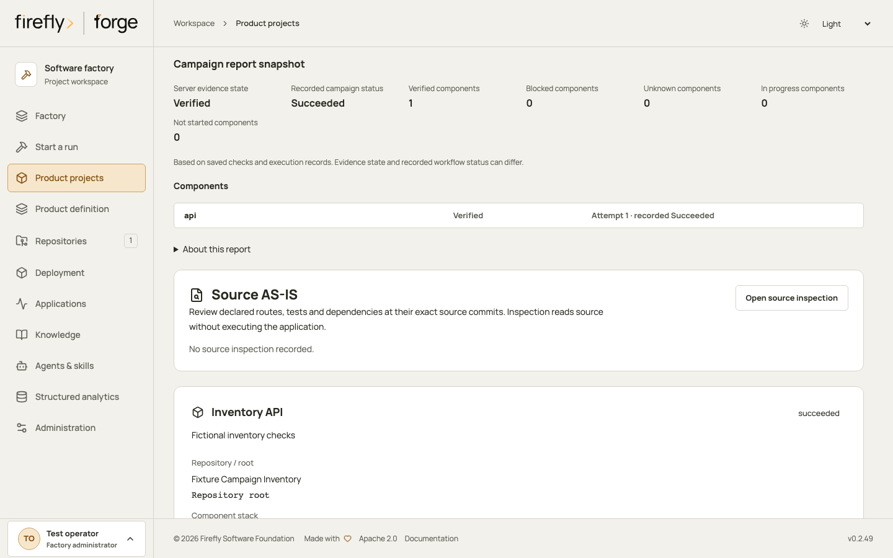
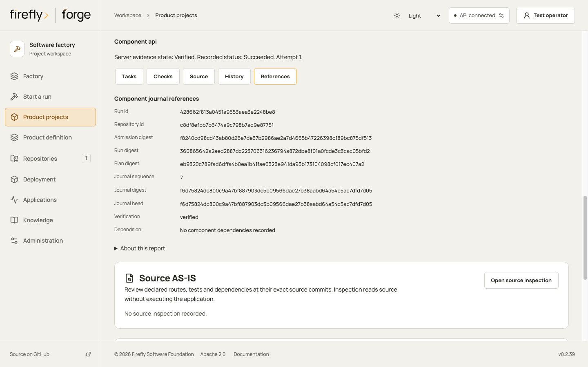
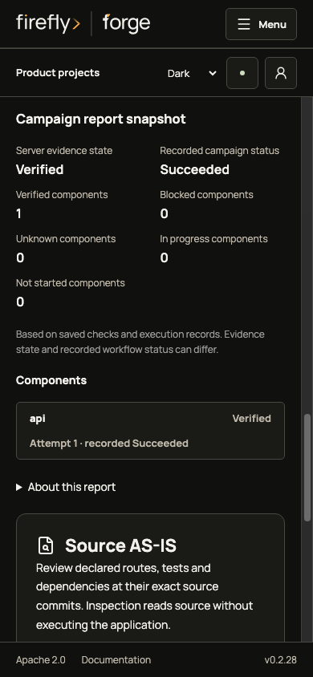
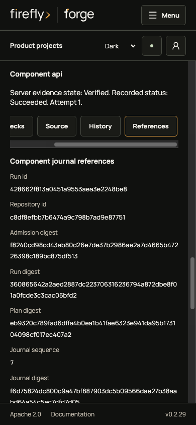
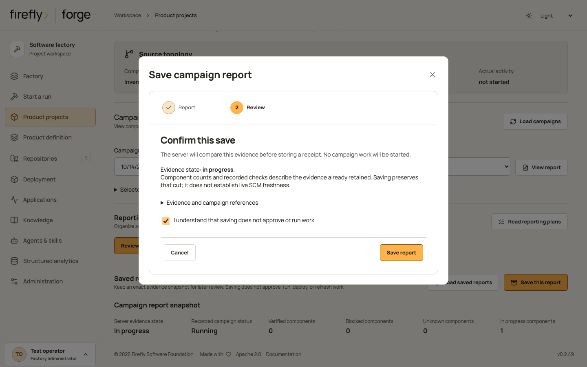
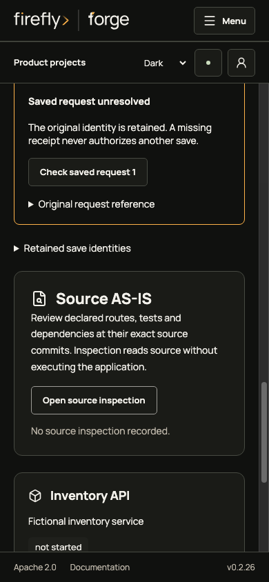
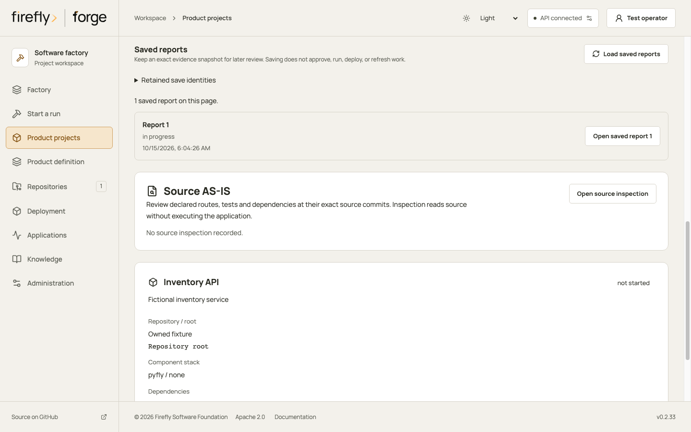
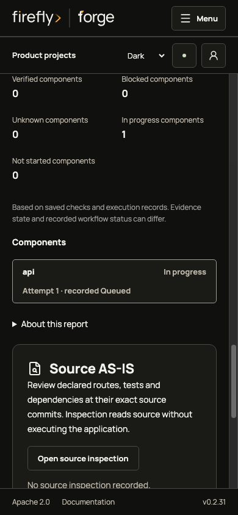
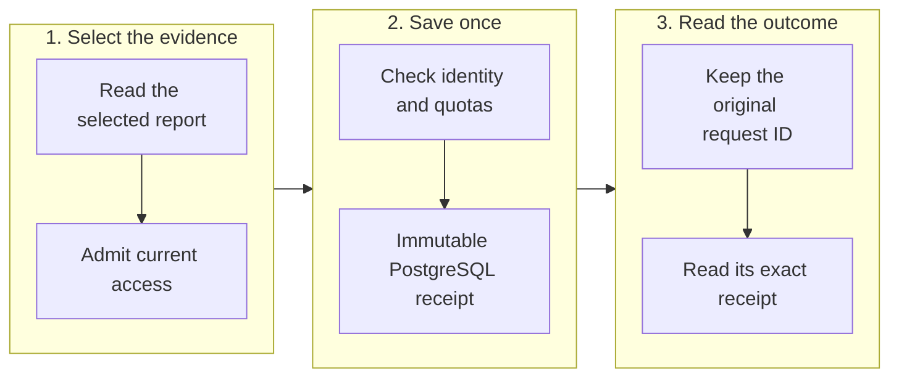
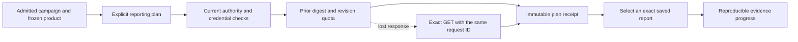

# Deliver a product across components

<!-- Copyright 2026 Firefly Software Foundation. SPDX-License-Identifier: Apache-2.0 -->

A delivery campaign coordinates the configured components of one product project. It admits every child run together, then releases components as their dependencies finish. Different repositories can run in parallel; the factory keeps one active run per repository.

Before launch, configure each component's source root, stack, dependency list and executable verification commands. Choose the coding provider and, when needed, a separate review provider. A campaign does not infer a customer's requirements or replace a reviewed product definition.

## Launch and inspect

Send an authenticated `POST /api/v1/projects/{project_id}/campaigns`:

```json
{
  "request_id": "65d93d60cb5342c6b6e6bdb0ba9e24ed",
  "brief": "Implement the approved inventory reservation behavior",
  "agent": "codex",
  "operation": "maintain",
  "assurance": {"review_agent": "claude"},
  "dependency_gate": "verified",
  "publish": false
}
```

Generate a fresh UUID without hyphens for `request_id`. Repeating the same request returns its recorded campaign without admitting duplicate children. Reusing that identifier with different content is rejected. Optional `component_ids` selects components and includes their upstream dependencies.

Use `GET /api/v1/projects/{project_id}/campaigns` to list campaigns and `GET /api/v1/projects/{project_id}/campaigns/{campaign_id}` for current child references, attempts, statuses, blocked reasons and the verified campaign journal. Child `run_id` values link to the normal run, plan, verification and artifact endpoints.

All admissions commit in one PostgreSQL transaction. The factory freezes the complete project revision, component paths and checks, canonical product definition, brand and reviewed design, policy and role selections, coding/reviewer configuration revisions, runner configuration and knowledge/search revisions. Preflight resolves actual source commits and probes runner capabilities before taking admission locks. A settings change during this process refuses admission instead of mixing revisions.

Source-control application identity is retained separately. Repository grants are checked afresh for each action, expiring credentials refresh, and revoked access is honored. A campaign does not freeze source-control permissions.

## Read a report in Studio

In **Product projects**, select a product and choose **Load campaigns**. Select an existing campaign, then choose **View report**. Both actions read retained records; they do not launch, resume or retry work. The server checks current project and repository read permissions.

The report separates the server's evidence state from recorded workflow status. Its compact summary counts components; select one component to inspect its tasks, executable check receipts, recorded source and checkpoint references, prior attempts and journal references. Lists show at most 20 items per page. An unavailable snapshot has unknown counts, rather than reporting zero components or verified completion.

The live report displays its server digest. Studio verifies the canonical report digest before offering **Save this report**, and checks the complete saved receipt when reading history. SCM freshness remains **not observed**. The original report format does not represent milestone or wave plans; its `not_configured` fields do not describe the separate reporting-plan API below. Report reads are explicit and do not poll. An HTTP error or an unmatched response does not establish a report state; a changed session or denied reread clears private report evidence.

The guide below uses controlled API fixtures: the product overview, campaign and component show the same successful recorded state with verified evidence. These screenshots illustrate reading a report; they do not establish live campaign execution or external SCM activity.

<figure class="forge-shot" markdown="1">

<figcaption>Load existing campaigns, select one by its date and status, then choose View report. Evidence state and workflow status remain separate fields.</figcaption>
</figure>

<details class="forge-gallery" markdown="1">
<summary>Inspect component references and the phone layout</summary>

<figure class="forge-shot" markdown="1">

<figcaption>Select a component, then open References. Other sections show its tasks, checks, recorded source and prior attempts.</figcaption>
</figure>

<figure class="forge-shot" markdown="1">

<figcaption>The summary uses the available width; component evidence opens only when selected.</figcaption>
</figure>

<figure class="forge-shot" markdown="1">

<figcaption>Reference values wrap within the page. The evidence sections remain reachable by keyboard and a local horizontal tab strip.</figcaption>
</figure>

</details>

## Save and recover in Studio

After **View report**, an operator with project execution permission can choose **Save this report**. Review the evidence state, continue with **Review save**, and acknowledge that saving does not approve or run work. **Save report** stores a snapshot only if the server still observes the same evidence cut. Readers without execution permission can inspect authorized history but cannot save.

Studio retains a small request reference before sending one save request. It contains the server, original operator, project, campaign, request ID and selected report digest. Tokens and report bodies are excluded. A successful response is followed by an exact receipt read. If delivery is lost, reload the same campaign and choose **Check saved request**. A missing receipt, conflict or permission error keeps the original identity unresolved; Studio does not repeat the write or replace its request ID.

<figure class="forge-shot" markdown="1">

<figcaption>Review the selected report before saving. This guide uses controlled API fixtures; it does not establish native campaign execution.</figcaption>
</figure>

Choose **Load saved reports** to read a page of up to 50 summaries, then **Open saved report** to retrieve its exact evidence. **Next saved reports** follows the server's sequence cursor. The saved sequence and server preparation time describe that receipt; they do not establish current SCM freshness. A historical report can belong to another authorized operator. Its original actor and source references remain available under **Original receipt references**.

<details class="forge-gallery" markdown="1">
<summary>Follow an unresolved save and read its retained history</summary>

<figure class="forge-shot" markdown="1">

<figcaption>The original request survives reload. Check its exact receipt without sending another save.</figcaption>
</figure>

<figure class="forge-shot" markdown="1">

<figcaption>Loading history reads metadata. Opening a saved report reads its exact body with current permissions.</figcaption>
</figure>

<figure class="forge-shot" markdown="1">

<figcaption>The historical snapshot remains separate from a later live report. Preparation time is not a commit or freshness timestamp.</figcaption>
</figure>

</details>

A confirmed identity stays recoverable in browser storage. After reloading, check each retained request before starting another explicit save. Other tabs may also save; browser storage does not provide a global lock. If storage cannot be verified, saving is unavailable. An access refusal clears private report views while keeping the request reference for an authorized exact read.

## Understand the dependency gate

The default `verified` gate requires an upstream run to succeed with nonempty passing executable checks, matching source/checkpoint receipts, and an approved matching independent-review receipt when review was requested. A successful status alone is insufficient.

The optional `published` gate additionally requires an actual branch/pull-request publication receipt. If launch explicitly sets `publish: true`, that requested publication is also part of child completion. Test-only campaigns cannot request publication.

Downstream context records upstream run IDs, actual source commits/trees, branches, artifacts and publication receipts. It retains its own frozen source base. Those references **do not merge upstream code** into the downstream repository or prove an assembled product passes integration tests. Publication does not imply a pull request was merged or an application deployed. Configure and execute whole-product integration verification separately.

## Stop and recover explicitly

Every action requires a fresh `request_id` in its request body.

| Action | Endpoint suffix | Result |
| --- | --- | --- |
| Cancel | `/{campaign_id}/cancel` | Stops release and requests cancellation of current child runs. Successful children retain their receipts. |
| Resume | `/{campaign_id}/resume` | Resumes eligible paused/interrupted children in their existing workspaces and keeps their identities and frozen configuration. |
| Retry | `/{campaign_id}/retry` | Admits one fresh attempt for explicitly selected failed, cancelled or interrupted components, preserving the original graph, source base and admission snapshots. |

Retry also requires `component_ids`, for example:

```json
{"request_id":"a5717fe447cc42379284a0e3e4386272","component_ids":["inventory-api"]}
```

Each component allows three explicit retries. Repeating the same action request does not create another attempt. An active downstream component must stop before its upstream component can be retried. Resume does not answer a pending worker question or mark a failed component successful; answer the question or choose an explicit retry.

An unfinished effect intent, uncertain publication or interrupted cancellation holds new releases. Inspect the child plan and reconcile its recorded effect using the existing run reconciliation controls. The coordinator never automatically repeats an unknown external effect. If a cancellation request stopped before its receipt, stop its recorded children and reconcile their journals first; explicit campaign resume then records the observed stopped outcome. Cancelled children still require an explicit retry to start again.

Campaign events and child admissions are immutable PostgreSQL history. The coordinator verifies its hash-linked journal before releasing work. Loss of the factory execution lease stops coordination; restart against the same owned data directory and schema to retain the campaign and its current child references.


## Read a campaign evidence report

Use `GET /api/v1/projects/{project_id}/campaigns/{campaign_id}/report` to read the campaign's current component attempts and their saved evidence. The same read is available through `ForgeClient.project_campaign_report(project_id, campaign_id)`, `forge campaign report PROJECT_ID CAMPAIGN_ID`, and the read-only MCP tool `get_project_campaign_report`. Current read access to the project and every referenced repository is required, including repositories retained by earlier attempts.

The report counts current attempts by state. `verified` requires the existing campaign delivery gate: passing executable checks, matching source and checkpoint receipts, and any requested review or publication. `in_progress` describes a recorded nonterminal run; it does not establish that a worker is currently alive. `blocked` covers stopped runs and unmet dependency gates. `unknown` preserves reconciliation obligations and missing verification evidence. Tasks with matching immutable completion receipts are labeled `receipted`; this alone does not establish component verification. Each completion must match its current task attempt and a preceding exact intent. A started unresolved task holds component verification even when the run status says `succeeded`. An unstarted optional remote task does not imply an unknown effect. Earlier attempts remain references and do not increase current totals.

Each component includes its run and admission digests, plan digest and journal head. Task, branch, source-tree and checkpoint references identify the exact journal sequence and digest. Checks include their command digest, argument count, actual exit code and receipt reference. Command arguments and output are omitted. Follow those references through the existing run plan and journal endpoints. Campaign event count and head refer to the existing campaign journal.

A report reads one PostgreSQL repeatable-read, read-only snapshot. Its `digest` is SHA-256 of the entire returned JSON object except `digest`, with recursively sorted keys, compact separators and unescaped Unicode. Version, defaults and limits are included. Identical retained evidence produces the same report; a later read can produce a different digest. Reading a report returns it to the caller without archiving it. Credential admission runs after the snapshot closes, with repository permissions checked before and after it.

The snapshot allows 200 child attempts, 1,024 campaign events, 128 tasks per current run, and 2,048 journal entries and run events per current run. A shared 16 MiB JSON evidence budget is checked in PostgreSQL before rows are loaded. The transaction has a ten-second deadline. Exceeding a limit or detecting inconsistent evidence returns `unknown` with a reason, no component totals and no partial verified result.

## Save an exact report

Archiving is an explicit operation. First read a report, keep its digest, and choose a stable request ID before sending `POST /api/v1/projects/{project_id}/campaigns/{campaign_id}/report-archives` with `request_id` and `expected_report_digest`. The server captures the same evidence cut and its complete historical repository manifest in one read-only transaction. A changed digest refuses the archive. A coherent `unknown`, blocked or running report may be saved with that state; an unavailable integrity or limit result with `counts: null` cannot be archived.

<div class="forge-flow" role="region" aria-label="Campaign report archive and recovery diagram" aria-describedby="archive-flow-guide" tabindex="0" markdown="1">



</div>

<p class="forge-flow-caption" id="archive-flow-guide">Follow the groups from left to right and their steps from top to bottom. Read the exact receipt after a successful response or lost delivery. Keep the original request identity while the outcome is unresolved. Focus the diagram and use the arrow keys to scroll on a small screen.</p>

Archiving requires current project execute permission and read access to every repository in the captured history, including prior attempts. Reading a saved report requires current read permissions for that same manifest. Credential admission also applies to retained reports and summaries. Losing access or registering a matching credential can therefore prevent a later read; saving a report does not grant access to it.

The receipt preserves the original report and digest, originating actor, sequence, source cut and its own digest. `prepared_at` is the database time when the receipt was prepared, before credential admission and final insertion. It is neither a commit timestamp nor evidence or SCM freshness. The source cut is the captured campaign journal head and count, project and launch digests, and the run/journal references inside the report. Later work does not rewrite that history. PostgreSQL rejects updates and deletion of saved receipts; archiving does not append report bodies to the campaign execution journal.

Use these client operations explicitly; none generates a request identity, retries a write or dispatches campaign work:

| Action | Python SDK | CLI | MCP |
| --- | --- | --- | --- |
| Save selected report | `archive_campaign_report(project_id, campaign_id, request)` | `forge campaign archive-report PROJECT_ID CAMPAIGN_ID --request-id REQUEST_ID --expected-digest REPORT_DIGEST` | `archive_project_campaign_report` |
| Read exact receipt | `campaign_report_archive(project_id, campaign_id, request_id)` | `forge campaign report-archive PROJECT_ID CAMPAIGN_ID REQUEST_ID` | `get_project_campaign_report_archive` |
| List saved summaries | `campaign_report_archives(project_id, campaign_id, after=0)` | `forge campaign report-history PROJECT_ID CAMPAIGN_ID --after 0` | `list_project_campaign_report_archives` |

The list route is `GET .../report-archives?after=0`; exact readback is `GET .../report-archives/{request_id}`. History returns at most 50 summaries with a `next_after` sequence cursor, without loading report bodies. A campaign allows at most 100 archives, and each receipt and metadata page has a 16 MiB JSON bound. Oversized data is refused, never truncated into a successful report. Existing evidence row and snapshot limits still apply.

The write commits one immutable receipt atomically. Reusing the same ID, actor and selected digest returns that exact receipt; changing its binding refuses. Concurrent different requests can prepare the same next sequence: only one is admitted and the other receives an explicit history-advanced conflict with no insert. Keep the original request identity. A lost response, timeout, cancellation, 404 or conflict text does not prove that an earlier write cannot still commit, and does not authorize automatic resubmission or a new ID. A late loss of execute permission can also refuse the POST response after its receipt has committed; an authorized reader can still read that exact receipt. Read the exact receipt first. Saving a report records evidence; it does not approve delivery or configure milestones, waves or live SCM observation.

The report follows the campaign's frozen component graph. Its original format represents neither the separate reporting plans below nor execution-wave orchestration, so its milestone and wave fields remain `not_configured`. It never contacts Git or a source-control provider; `scm_freshness` remains `not_observed`. Saved branches and commits do not prove current remote synchronization, a merged pull request, deployment or whole-product integration acceptance. Project planning before admission, execution-wave orchestration, reports across campaigns and Studio planning controls remain separate work.

## Define reporting milestones and waves

After a campaign has been admitted, operators can save explicit reporting criteria for its frozen component graph. These plans organize saved evidence; they do not change execution, launch waves or establish that the criteria governed earlier QA. Every receipt and progress response declares `criteria_binding: reporting_only_post_admission` and `enforced_at_admission: false`.

Choose named waves in order, assigning each selected component exactly once. A dependency must be in the same wave or an earlier one. Give each wave at least one milestone. A milestone can require a verified component (`component_verified`) or an exact current task receipt (`task_receipted`, with `prepare`, `implement`, `verify`, `checkpoint` or `review`). The phase must exist in the frozen admission: a test-only run cannot require implementation, and a run without independent review cannot require a review receipt.

Optional feature IDs, exact journey strings and one-based `acceptance-N` references must resolve against the product definition frozen in the campaign admission. Editing the current product does not rewrite those references. A task attempt and a component retry attempt are different counters. A valid current prepare receipt can satisfy its condition even if a later publication effect is unknown; the component and wave remain unknown until their required evidence is established.

The authenticated API uses `/api/v1/projects/{project_id}/campaigns/{campaign_id}/delivery-plan-revisions`:

| Action | Method and suffix | Result |
| --- | --- | --- |
| Save a revision | `POST` | Immutable plan receipt with the caller's request ID, actor, source cut and prior digest. |
| List revisions | `GET` | Bounded metadata for the immutable revision chain. |
| Read an exact revision | `GET /{request_id}` | Original receipt, subject to current read authority and credential admission. |
| Read progress | `GET /{request_id}/progress?report_request_id={archive_request_id}` | Deterministic evaluation against one explicitly selected saved report. |

Saving requires current project execute permission and access to every repository in the captured campaign and plan history. Reads require current project and historical repository read access. A save uses `expected_campaign_request_digest` and `expected_project_digest` from the frozen campaign, plus `expected_previous_digest` (`null` for the first revision). Keep the same `request_id` and body after an uncertain response, then read that exact identity. Reusing it with another actor or input is refused. Concurrent different requests can produce an explicit revision conflict; the server does not retry them automatically.

A permission loss can refuse a POST's return after its immutable insert committed. A transport error or permission error therefore does not prove that no plan was saved. Preserve the request identity and use an authorized exact read. `prepared_at` is database time when the receipt was prepared, before final admission; it is neither source freshness nor the insertion instant.



Progress never creates a report archive or starts work. A milestone is satisfied only by all its conditions. A wave also requires every assigned component to be verified; a later completed wave remains `dependency_blocked` while an earlier wave is unsatisfied. Unknown evidence remains unknown. Progress includes counts, exact run/task attempts and retained receipt references, without estimated percentages or a live SCM claim. Repeating it for the same immutable plan and report returns the same digest.

Use `ForgeClient.save_campaign_delivery_plan`, `campaign_delivery_plans`, `campaign_delivery_plan` and `campaign_delivery_progress`, or the corresponding `forge campaign plan-save`, `plan-list`, `plan-get` and `plan-progress --report-request-id` commands. `plan-save` reads a JSON document containing the stable request ID and explicit criteria. MCP exposes `save_project_campaign_delivery_plan`, `list_project_campaign_delivery_plans`, `get_project_campaign_delivery_plan` and `get_project_campaign_delivery_progress` through the same authenticated API.

Limits are 20 waves, 20 milestones, 200 total conditions and 50 immutable revisions per campaign. Each receipt with its summary and the bounded summary history must fit 1 MiB. Selected plan and report bodies with their summaries, and the resulting progress, must fit the 16 MiB aggregate bound before materialization. Existing report row and time limits still apply; an unavailable or integrity-limited report cannot establish a plan's source. A coherent report with unknown component evidence can be selected without inventing completion.

This API does not yet configure project or product plans before campaign launch, orchestrate execution waves, or add a Studio planning flow. Those remain separate delivery requirements. The original campaign report and its digest remain unchanged; use this separate progress response for explicit reporting criteria.
