<!-- Copyright 2026 Firefly Software Foundation. SPDX-License-Identifier: Apache-2.0 -->
# Recover paused and interrupted work

Use the durable plan and journal to determine what happened before continuing a run. The same run can retain partial source, provider and policy snapshots, earlier failed checks, a real checkpoint commit and remote-effect receipts.

## Settle an uncertain run submission

Run creation has a separate identity from the run it may admit. `POST /api/v1/run-creation-requests/{request_id}` accepts the original `{"version":1,"input":...}` envelope under a retained 32-character hexadecimal request ID. A new admission returns HTTP201; an exact replay by the original user and authentication method returns HTTP200 with the unchanged receipt. The legacy `POST /api/v1/runs` route remains a separate operation.

In Studio, an uncertain submission appears as **Original run request retained**. Choose **Check original result** to read its terminal decision without starting another run. If a run was admitted, Studio reads its current record before opening it. If no decision is available, keep the retained request. **Send original request again** appears after a missing decision; it resends the original saved input and identity. **Review original input** shows that saved input, which may differ from your current edits.

To abandon the original submission, choose **Cancel this request**. A confirmed cancellation prevents it from starting later. If admission already won, Studio opens the existing run. Cancel that run separately if needed. Your current edits stay available; review them before explicitly starting a new request.

After signing in again as the same enabled user, you can read the original receipt or decision and settle cancellation with current read access. A different authentication method can perform those reads and cancellation, but admission replay still requires the original method and current execution access, including release access for a publishing run. An access error leaves the request unresolved.

The receipt binds the original input, actor and admitted run. Read it with `GET /api/v1/run-creation-requests/{request_id}` after a lost response. Its admitted status is historical; open the referenced run to inspect its current state. A timeout, refusal or missing receipt alone cannot establish that no run was created.

If the original request must be abandoned, POST `/api/v1/run-creation-requests/{request_id}/cancel` with only its version, original input digest and scope:

```json
{
  "version": 1,
  "request_digest": "the-64-character-original-input-digest",
  "repository_id": "the-original-32-character-repository-id",
  "project_id": null,
  "component_id": null
}
```

This is a request-shape example. Replace the placeholder strings with the original request's retained digest and repository ID. Do not compute the digest from your current edits. Studio supplies the retained values when you choose **Cancel this request**.

For an assigned component, supply both its original project ID and component key. The server requires the same enabled native user and current read access to that scope. A different session authentication method for that same user may settle cancellation; it cannot replay the original admission under a different method. Unassigned requests require a factory administrator.

Admission and cancellation share a request fence. When cancellation wins, the immutable `cancelled` decision prevents even a delayed original POST from admitting work. When admission has already won, cancellation returns `admitted` with the existing version-1 receipt. It does not stop that run; use the run's separate cancellation operation if required.

Read `GET /api/v1/run-creation-requests/{request_id}/decision` after an uncertain cancellation response. It returns the original admitted receipt or the immutable cancellation. HTTP404 leaves the request unresolved. Release a held form only after verifying its exact terminal decision; preserve current edits, and review them before explicitly submitting a new request.

A small ownership reservation commits before preparation, so cancellation can settle while source checks are still running. Reservations and cancellations store digests and scope, without duplicating the raw brief or commands. A user may hold at most 50 unresolved reservations; admitted and cancelled requests do not count. This limit never blocks cancellation. The additive schema-28 migration preserves existing version-1 admission receipts without synthesizing historical reservations.

### Review an uncertain submission

These controlled Studio fixtures show a missing decision followed by a confirmed cancellation. They do not start a native run or contact a coding provider.

<figure class="forge-shot" markdown="1">
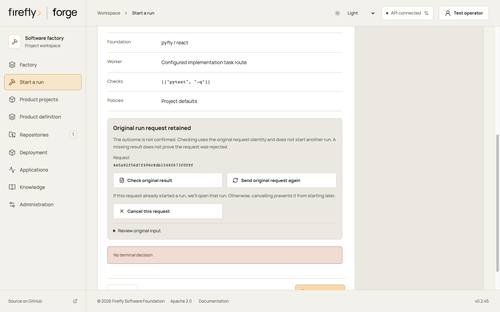
<figcaption>Check the original identity first. A missing decision keeps the request held and exposes the explicit resubmission choice.</figcaption>
</figure>

<figure class="forge-shot" markdown="1">
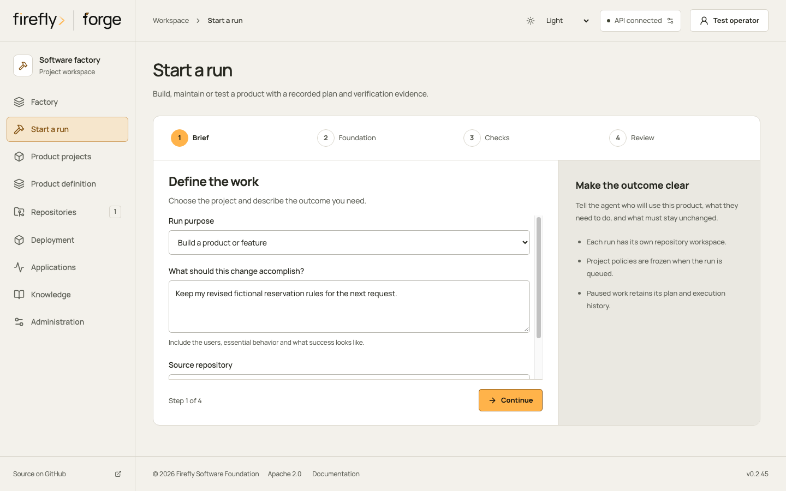
<figcaption>Confirmed cancellation releases the original request. Current edits stay available for review before another submission.</figcaption>
</figure>

<details class="forge-gallery" markdown="1">
<summary>Check and cancel an original request on a phone</summary>

<figure class="forge-shot" markdown="1">
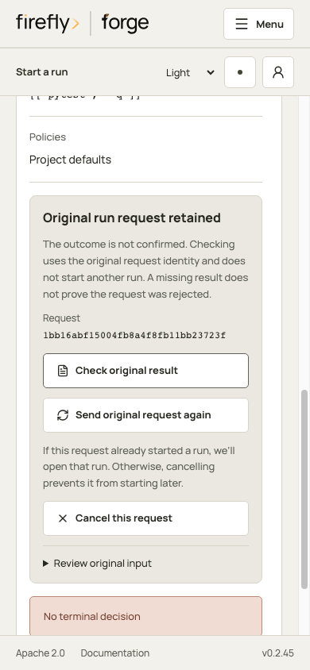
<figcaption>Scroll the form to the retained-request controls. Checking does not start another run.</figcaption>
</figure>

<figure class="forge-shot" markdown="1">
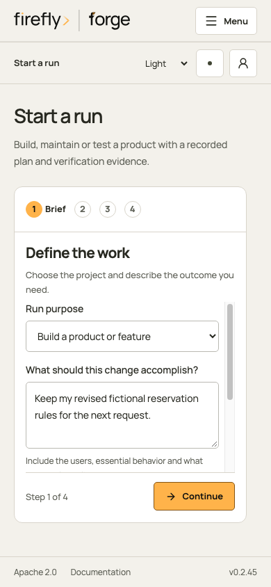
<figcaption>The form can continue after the exact cancellation decision is confirmed.</figcaption>
</figure>

</details>

## Read the records

`GET /api/v1/runs/{id}/plan` returns the current plan revision and task states. `GET /api/v1/runs/{id}/journal` returns its hash-chain entries and a validity flag. Each intent identifies its task and attempt; each receipt records the outcome actually observed.

| State | Meaning | Action |
| --- | --- | --- |
| `paused`, rate limit | Provider access was throttled | Wait for an allowed bounded retry, or explicitly resume later |
| `paused`, quota | The provider reported exhausted credits or quota | Resolve it at the provider or hand off explicitly |
| `paused`, authentication | The selected access failed | Fix access and choose a fresh configured provider snapshot through handoff |
| `interrupted` | The worker stopped before completion | Inspect the retained workspace and task journal |
| `needs_reconciliation` | An intent lacks a trustworthy completion receipt | Establish the actual local or remote outcome first |
| `failed` | The implementation or verification did not complete successfully | Inspect failure evidence; a fresh retry creates a separate run. An eligible official-CLI failure has a separate same-run recovery below. |

A task marked done has a completion receipt. Inspect its evidence: completing a verification command can record a failing exit status. Overall success requires the final passing checks and matching source snapshot.

The [Studio walkthrough](console-tour.md#4-inspect-the-run-before-continuing) shows a fixture failed check and unresolved intent, with the continuation controls in context.

## Recover a known failed official CLI attempt

On POSIX, a negative exit code matching `SIGXFSZ` (for example, `-25` on macOS) can indicate a file-size limit. With the stdlib asyncio event loop and a finite soft limit, the trusted CLI launcher preserves its inherited ignored `SIGXFSZ` disposition so an oversized write can return `EFBIG` without raising the limit. `forge serve` selects asyncio explicitly; the headless worker already uses `asyncio.run`.

An external ASGI host must select the stdlib loop, such as Uvicorn's `--loop asyncio`. The verified uvloop 0.23 subprocess path resets the child's ignored signal even with `restore_signals=False`. Forge rejects a known uvloop host with a finite soft file-size limit before the configured provider dispatch intent and before the final CLI launch guard or process creation. The typed runtime-admission error explains how to select asyncio. Already-spent implementation tasks and reservations remain spent; this refusal refunds nothing and grants no retry.

Bounded native and CLI comparisons qualify this launch mitigation. They do not identify the original offending write or file, establish a plugin cause, or qualify a generated application. Inspect the retained process and verification evidence before using the recovery contract below. The kernel limit, original attempt history and repair budget remain unchanged.

A current native factory administrator can explicitly admit one replacement Codex or Claude dispatch in the same failed run. The run must still identify its failed implementation task and retained workspace. Recovery preserves the run ID, source, earlier task receipts, repair budget and spent verification grants. It keeps the original provider and configuration by default; it does not change workers or repeat a verification handoff.

Read `GET /api/v1/runs/{id}/provider-recoveries/candidate?agent=codex` (or `claude`). Review its exact source, failure, operator and policy binding. Keep a new 32-character hexadecimal request ID, then POST `/api/v1/runs/{id}/provider-recoveries` with that `request_id`, the returned `candidate_digest`, the same `agent`, and exactly one process proof:

- For a native known failure, supply its returned `native_process_digest`.
- For a historical failure without the new dispatch protocol, supply `legacy_attestation` with `provenance: "legacy_operator_attestation"`, the sealed external receipt's SHA-256 as `evidence_digest`, its nonzero `exit_code`, and explicit `true` acknowledgments for `trusted_operator_observation`, `process_terminated`, `process_group_drained` and `no_accepted_final_result`.

The legacy option records an administrator's trusted observation. It does not establish that the server inspected the old process. A new-protocol dispatch with absent or uncertain native evidence cannot use this option. Unknown descendants, an uncertain external effect, current execution or changed authority keep recovery held.

An admission returns HTTP201 with an immutable receipt and queues one reserved dispatch. After a lost response, read `GET /api/v1/runs/{id}/provider-recoveries/{request_id}`. An identical POST returns the original receipt; different content or a replacement ID cannot consume the old failure again. Preserve the original ID and body while settling an uncertain response.

### Adopt an updated CLI for one recovery

Changing provider settings alone leaves an existing run's frozen executable unchanged. To recover with an updated CLI, first configure its absolute executable path in the same provider's settings. Request the candidate with `adopt_current_executable=true`, review its `executable_adoption` descriptor, then include `"adopt_current_executable": true` in the admission body. Keep the returned candidate digest and the process proof described above. The server derives the path and SHA-256; the client cannot supply a replacement descriptor.

The executable must be a regular file outside the execution workspace tree, at most 512 MiB, executable by the worker and not writable by the group or everyone. A symlink entrypoint is refused. API and execution workers must see the same canonical path and file identity; configure the real installed path before reviewing the candidate.

The receipt and dispatch WAL bind that executable to one reserved implementation task. forge checks its bytes and identity again before dispatch, immediately before process creation and before accepting the result. A changed file or configuration stops continuation. Only the executable setting is overlaid: the original model, timeout, permissions and budgets remain frozen. Later normal repairs use the original configuration. The original snapshot and earlier receipts remain intact.

This descriptor identifies the entrypoint file. Administrators remain responsible for its installation, dependencies and filesystem access; the check does not attest every library or make a path-based operating-system launch atomic. Qualify an updated CLI locally before spending another recovery attempt.

The Engine rechecks current authority and the reserved source before launch. Its normal inspection may stage the same retained source; that index-only transition gets a separate native preparation receipt. Source, HEAD, refs and policy changes refuse dispatch. The ordinary recovery contract counts every implementation intent toward a maximum of four dispatch reservations, including failed or unreceipted attempts. The separate final-allowance contract below is the only native exception. Consuming a reservation does not renew the repair or verification budget.

Future official-CLI failures retain typed native process evidence separately from provider output. A known nonzero exit requires the leader to have exited, both streams to have drained and its own process group to be absent. A zero exit without a valid final report, missing receipt or uncertain group remains unresolved. Provider output cannot assert those facts. This HTTP surface has no Studio, CLI or SDK recovery shortcut in this change.

### Reserve one final native provider attempt

After the fourth dispatch fails, a current native factory administrator can explicitly reserve one final dispatch in the same run. This allowance has a separate HTTP contract. The ordinary recovery API and automatic verification remain limited to four attempts.

Eligibility requires a native fourth-attempt process receipt with a nonzero exit, a waited leader, drained streams and an absent process group. Historical operator attestation cannot establish eligibility. Unfinished tools, unknown remote effects, cancellation and changed execution authority keep the run held.

1. Configure the reviewed current CLI executable, then read `GET /api/v1/runs/{id}/provider-recoveries/allowances/candidate?agent=codex&adopt_current_executable=true` (or `claude`). Review the failure, source, Git, policy, configuration and executable bindings.
2. Retain one new 32-character hexadecimal `request_id`. POST `/api/v1/runs/{id}/provider-recoveries/allowances` with that ID, the returned `candidate_digest` and `native_process_digest`, the same `agent`, `adopt_current_executable: true`, a nonblank `reason` of at most 2,000 characters, and `mitigation_evidence_digest` containing a lowercase SHA-256.
3. Keep the exact ID and body. If delivery is uncertain, read `GET /api/v1/runs/{id}/provider-recoveries/allowances/{request_id}` using the original current administrator. An identical POST reads back the reservation. A different ID, body or operator is refused.

The reason and mitigation digest record an administrator's attestation. The server does not run the referenced mitigation tests or establish that they address the failure. The executable descriptor identifies the selected entrypoint; it does not attest forge's runtime source or every dependency. Qualify the running worker separately before reserving.

A successful reservation consumes the run's only allowance immediately. It adds a sealed `provider_recovery_allowance`, a linked version-2 native admission and one new implementation intent in the existing transaction. The normal Engine consumer performs the dispatch. A timeout, lost response, cancelled run or failed fifth attempt never restores the allowance. There is no sixth dispatch through this contract.

The original WAL prefix, partial workspace, model settings, repair budget and verification grants remain intact. Current authority and the exact native allowance link are checked at execution boundaries. Source or executable drift prevents launch. A fifth-attempt worker report uses a distinct typed feedback variant with the allowance ID and digest; the worker cannot create or extend the grant. Its completion report remains separate from verification and product acceptance. Questions that require another coding dispatch remain held after the final allowance is spent.

The Python SDK offers `provider_recovery_allowance_candidate`, `reserve_provider_recovery_allowance` and `provider_recovery_allowance`. Each method performs one explicit request. In Studio, open the run's Plan tab and choose **Review final allowance** under **Final provider allowance**. The three steps review the failed attempt and selected CLI, record your mitigation reason and evidence fingerprint, then confirm the final reservation. This action is available to native factory administrators for an eligible failed fourth attempt; the server rechecks eligibility before reservation. Studio saves the exact request in the browser before sending it and offers **Check saved reservation** for readback. Closing the review or losing a response never creates a replacement request.

If the browser's saved request is lost, the run's native allowance identity still provides **Read existing reservation**. This performs only an exact receipt read under the original administrator's current authority. Studio validates the returned operator, protocol, run and task bindings without claiming that the request body was previously saved locally. A missing or refused receipt stays unresolved; this path cannot reserve another attempt.

### Grant scoped configured checks to an official CLI

An eligible final provider recovery can carry a separate native administrator grant for `run_configured_check(command_index, request_id)`. This ephemeral coding MCP channel is distinct from the operator MCP server. It exposes only selected retained configured commands, with their frozen arguments and timeouts; it grants no arbitrary command, operator API, publication, deployment or broader network access.

General role tools remain advisory for official CLIs. Codex keeps `workspace-write` and global `approval_policy="never"`. For the already granted channel, the adapter sets `approval_mode="approve"` only on `run_configured_check`. Configured checks may write files and still pass through the native grant, runner and source checks. Claude receives an explicit private, strict MCP configuration. Adapter fixtures alone do not establish live provider or product acceptance.

#### Review and bind the grant

Preallocate the future recovery request ID, then read `GET /api/v1/runs/{run_id}/coding-check-grants/candidate` with that `recovery_request_id` and an explicit `bind_port` (zero selects an ephemeral loopback port). Review the returned commands, runner descriptor, source and authority fingerprints, final-check count and remaining shared budget.

An administrator may POST the strict `CodingCheckGrantInput` to the same collection. Its separate grant request ID must remain unchanged after uncertain delivery: GET `/{request_id}` to read the original receipt, and GET `/current` to check current revision, revocation and expiry. The current `receipt_digest` matches the opaque seal returned with the immutable grant receipt; clients compare it without reserializing numbers or recomputing a hash.

After confirming the grant, refresh the final-allowance candidate because the journal advanced. Reserve with the original preallocated recovery request ID and explicit `coding_check_grant_id`; never fall back to a legacy CLI-only reservation if this linked flow is refused. Grant creation alone neither reserves another dispatch nor changes old snapshots. POST `/coding-check-grants/revocations` with its own request ID, exact grant ID and expected revision to revoke. Repeated original requests return their retained receipts; another request identity cannot bypass an uncertain effect.

#### Keep execution and verification separate

The grant counts new check invocations, not distinct indices. A new request can check a legitimately edited source again within the call cap; exact known readback consumes no command budget, and an old result cannot represent a new source. The grant cap is bounded by requested calls and shared command capacity remaining after independent final checks. No runner budget resets or final-QA guarantees are introduced.

Current native actor, lease, task, grant and source are rechecked around credential admission and before runner effects; uncertainty or expiry after an effect retains a reconciliation hold. These checks do not make filesystem mutations atomic against unrelated processes.

The channel listens only on literal loopback, with one invocation token, exact origin/host checks and an expiry no later than the selected provider deadline. A fixed port is a separately reviewed capability choice, not permission to open every local port or change the CLI network sandbox. Accepted commands retain their existing timeout and drain before channel teardown. Tokens are scoped in memory through source/evidence admission and are redacted before activity retention; they never enter command arguments or saved provider configuration. Host runners remain trusted service-account execution with timeout/output controls, not filesystem or network isolation.

#### Use the SDK or CLI

The Python SDK provides `coding_check_candidate`, `grant_coding_checks`, `coding_check_receipt`, `coding_check_current` and `revoke_coding_checks`. The equivalent CLI group is `forge coding-check-grants`, with `candidate`, `grant`, `get`, `current` and `revoke`; write commands consume an explicitly reviewed JSON document.

### Review the final allowance in Studio

Open the failed run, select **Plan**, then choose **Review final allowance**. The server supplies the current candidate and checks native process evidence and administrator authority. These screenshots use controlled HTTP fixtures. They illustrate the review and readback controls without running a CLI or establishing a successful recovery. Screenshots follow the documentation's light or dark appearance; select one to open it at full size.

#### 1. Review the failed attempt

Review the failed fourth attempt and the selected current CLI. Expand **Source and executable fingerprints** to inspect the retained source, Git, executable and native process digests. If the candidate is refused or changes during review, refresh it and inspect the new values before continuing.

<figure class="forge-shot" markdown="1">
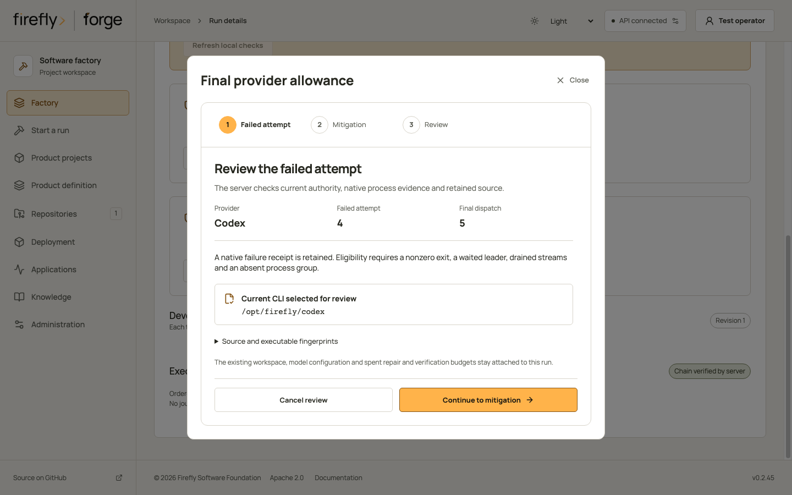
<figcaption>The failure candidate identifies what the administrator is reviewing. It does not establish that another dispatch or product check has succeeded.</figcaption>
</figure>

#### 2. Record the mitigation

Describe the mitigation you reviewed and enter its 64-character lowercase SHA-256 fingerprint. Confirm **Use the reviewed current CLI for this attempt**. The fingerprint records your attestation; forge does not execute or validate those mitigation tests through this form.

<figure class="forge-shot" markdown="1">
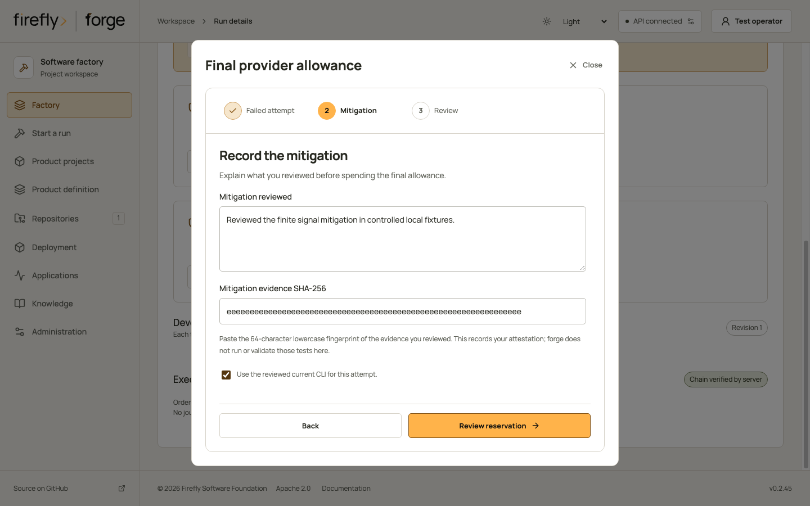
<figcaption>The reason, evidence fingerprint and executable choice stay part of the exact reservation request.</figcaption>
</figure>

#### 3. Confirm the reservation

Review the reservation summary and acknowledge that this is the run's final allowance. **Reserve final allowance** saves the original request in the browser before sending one POST. Reservation spends the allowance, including a timeout, an unlaunched dispatch or a failed fifth attempt.

<figure class="forge-shot" markdown="1">
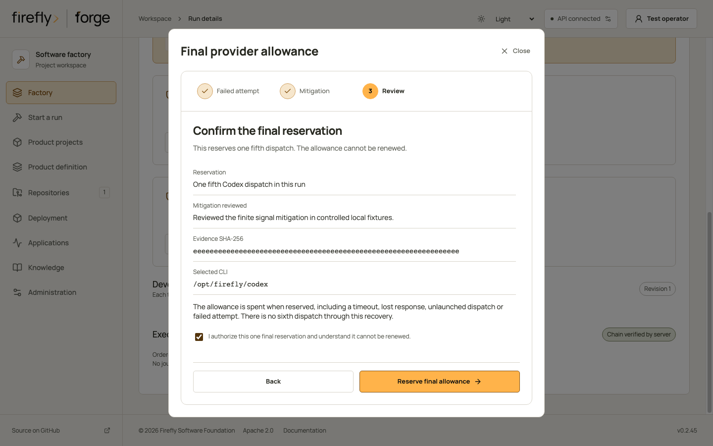
<figcaption>Confirm only after reviewing the source, selected executable and mitigation. This recovery cannot authorize a sixth dispatch.</figcaption>
</figure>

After submission, **Check saved reservation** reads the exact receipt. A pending, missing, refused or mismatched response leaves the request held. If browser storage is lost, **Read existing reservation** uses the identity retained on the run and performs only a receipt read. Neither action sends another reservation. Follow the run's plan, activity and actual verification results to determine what happened after admission.

<figure class="forge-shot" markdown="1">
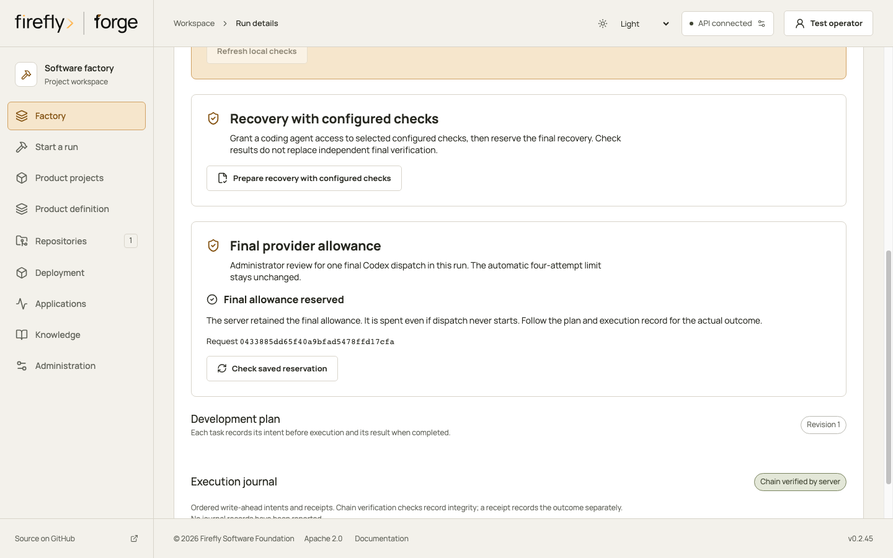
<figcaption>A confirmed reservation records admission. Implementation, verification and product acceptance remain separate outcomes.</figcaption>
</figure>

<details class="forge-gallery" markdown="1">
<summary>Review and reserve the final allowance on a phone</summary>

<figure class="forge-shot" markdown="1">
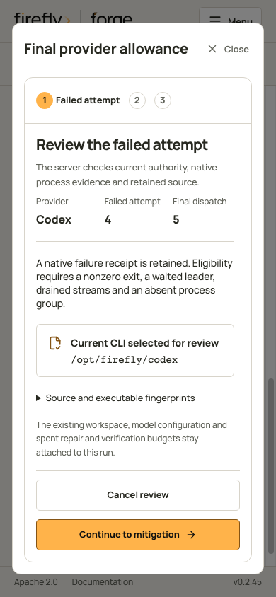
<figcaption>Review the failed attempt, then continue to the mitigation. The dialog scrolls as one form.</figcaption>
</figure>

<figure class="forge-shot" markdown="1">
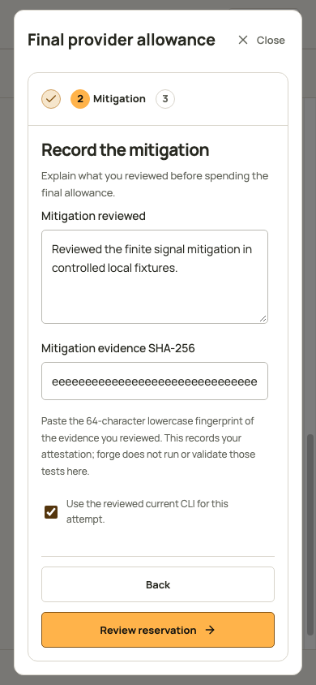
<figcaption>Enter the reviewed evidence fingerprint and explicitly select the current CLI.</figcaption>
</figure>

<figure class="forge-shot" markdown="1">
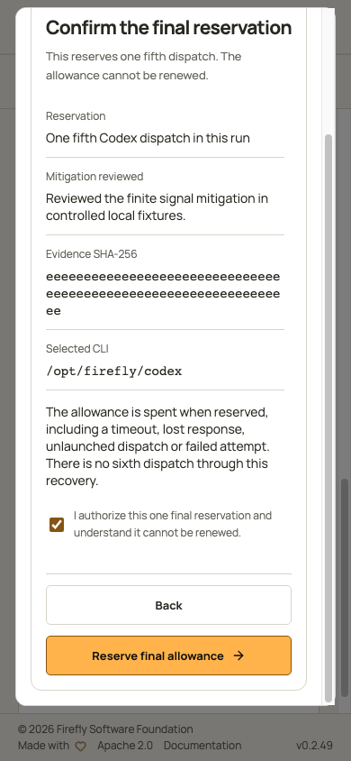
<figcaption>Scroll to review the acknowledgment and final action. Closing the dialog preserves any already saved reservation identity.</figcaption>
</figure>

<figure class="forge-shot" markdown="1">
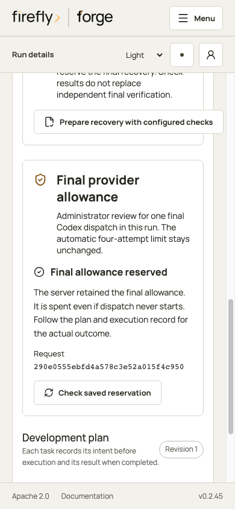
<figcaption>Use the retained identity for readback and inspect the execution record for the actual outcome.</figcaption>
</figure>

</details>

### Grant configured checks for the final recovery

Native administrators can choose **Prepare recovery with configured checks** in the Plan tab. This is a separate flow from CLI-only recovery. It gives the coding agent one scoped tool for selected, retained check commands; it does not add general command permissions or change the original runner policy.

1. **Review configured checks.** Read each command and its timeout, choose the checks, and inspect the runner and source fingerprints. The budget separates interactive check capacity from independent final verification. A host runner uses the forge service account and enforces timeout and output limits; it does not provide filesystem, CPU, memory or network isolation. Under **Advanced connection**, leave the loopback port at `0` for automatic selection or choose `1024–65535`.
2. **Grant selected checks.** Set a maximum number of calls, a lifetime of 30–3600 seconds, and a reason. A selected check may be called again within those limits. Granting access does not start a command or reserve a provider dispatch. Studio saves the exact grant body and future recovery request ID before sending the grant once.
3. **Review the mitigation.** Read the confirmed grant and its current expiry. Studio refreshes the final allowance candidate after the grant is recorded. Review the source, current CLI and native fourth-attempt failure, record the mitigation and its evidence fingerprint, and explicitly adopt that CLI. The fingerprint is an administrative attestation, not a server-verified QA result.
4. **Reserve the final attempt.** Review the grant and the same future recovery request ID, acknowledge the one-use limit, then reserve explicitly. The reservation includes the grant ID. There is no automatic second POST, CLI-only fallback or sixth dispatch. Independent configured and policy checks remain subject to the existing final-verification limit of 20 and the retained shared command budget.

An immutable grant receipt records what was granted. Its matching current revision, receipt fingerprint and unexpired status must also be confirmed before reservation; an old receipt cannot establish current authority. Permission loss, revocation, expiry or changed execution authority holds the flow.

If its browser record has been removed, Studio checks the current server grant before preparing another identity. An existing, expired, revoked or unconfirmed grant holds this wizard for review of the original retained identity; it does not create a replacement.

After a lost response, use **Check saved grant** or **Check saved final reservation**. These actions read the exact saved identity without repeating either POST. Closing the wizard, reloading or switching tabs does not authorize a replacement request. Check outcomes in the execution record: a grant, reserved dispatch or successful interactive check does not establish product acceptance.

<details class="forge-gallery" markdown="1">
<summary>Walk through a scoped configured-check recovery</summary>

These controlled HTTP fixtures illustrate the five visible states. They do not issue a native grant, call a coding provider or establish product QA. The four wizard frames begin at the title and current step; the last frame shows the confirmed reservation. When the form is taller than the screen, scroll inside the dialog to reach its action.

<figure class="forge-shot" markdown="1">
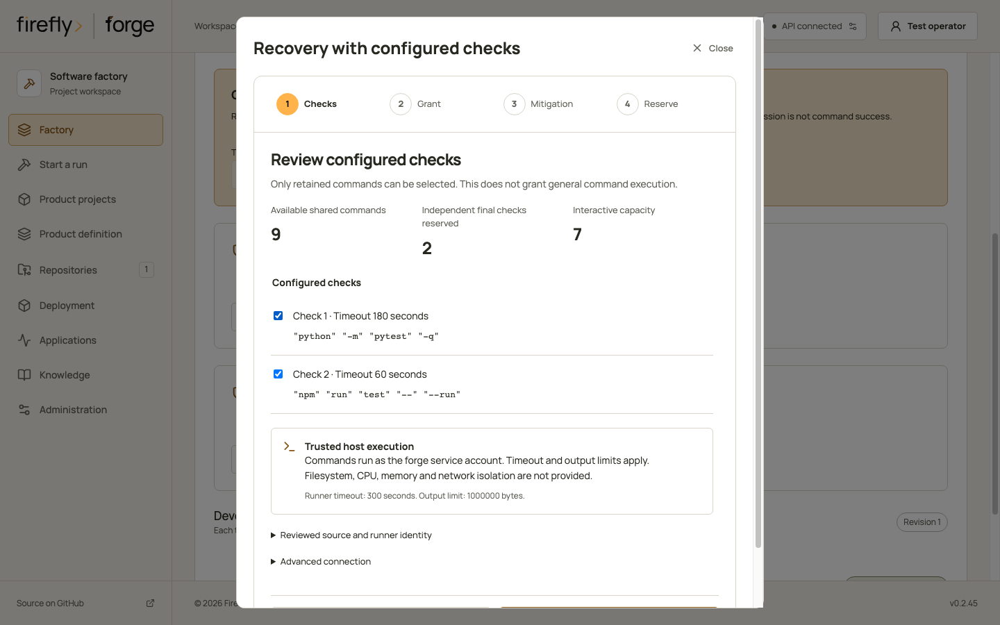
<figcaption>Read the configured commands, runner controls and budget. Only the selected retained commands can be granted.</figcaption>
</figure>

<figure class="forge-shot" markdown="1">
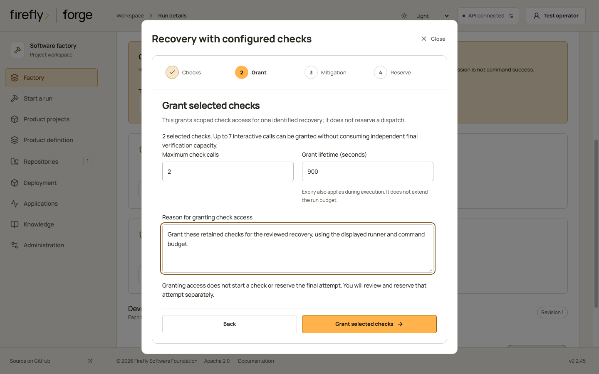
<figcaption>Set the call cap, expiry and reason. This explicit grant does not reserve a coding dispatch.</figcaption>
</figure>

<figure class="forge-shot" markdown="1">
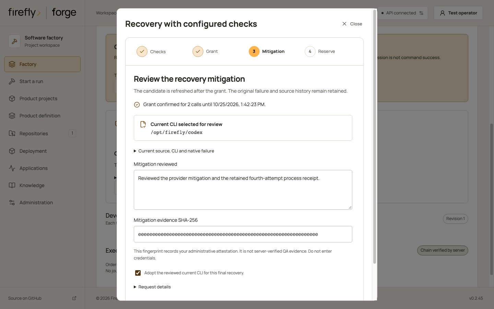
<figcaption>Confirm the grant, inspect the refreshed current CLI and source, then record the reviewed mitigation.</figcaption>
</figure>

<figure class="forge-shot" markdown="1">
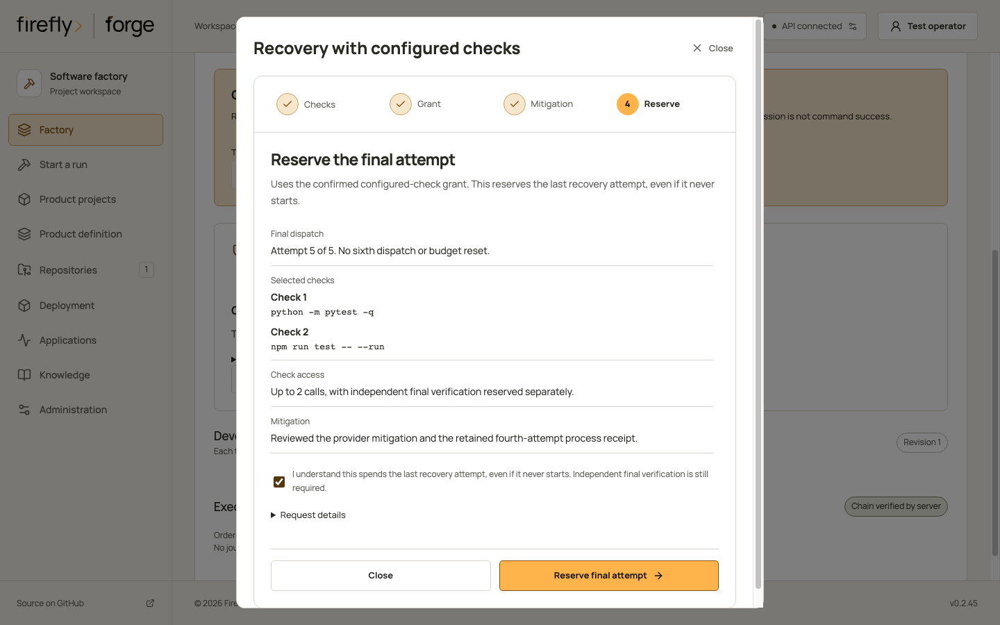
<figcaption>Review named checks and acknowledge the last recovery attempt. Technical identities are available under Request details.</figcaption>
</figure>

<figure class="forge-shot" markdown="1">
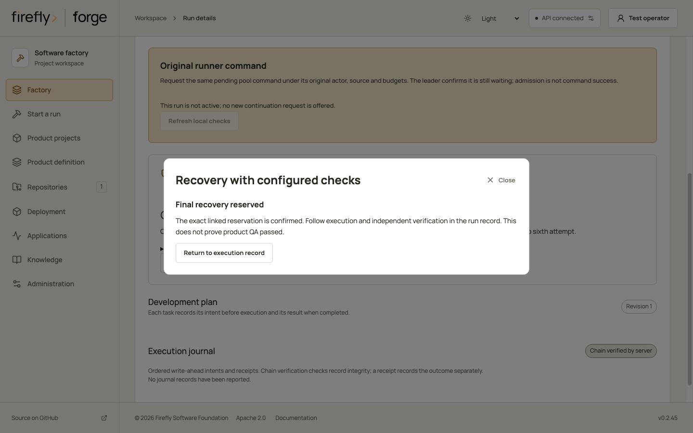
<figcaption>The exact receipt confirms reservation. Follow actual execution and independent verification before accepting the product.</figcaption>
</figure>

<details class="forge-gallery" markdown="1">
<summary>Follow the same decisions on a phone</summary>

<figure class="forge-shot" markdown="1">
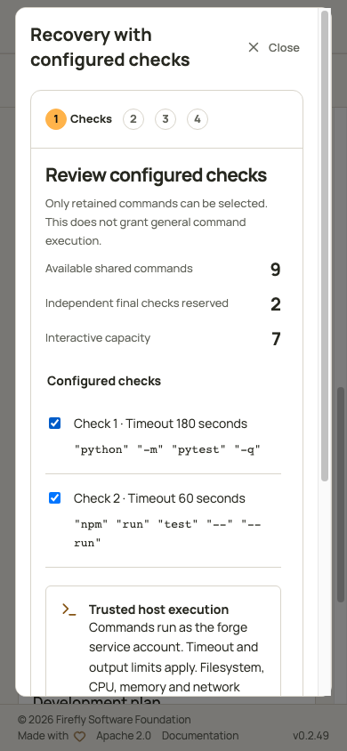
<figcaption>Read the configured commands, runner controls and budget. Only the selected retained commands can be granted.</figcaption>
</figure>

<figure class="forge-shot" markdown="1">
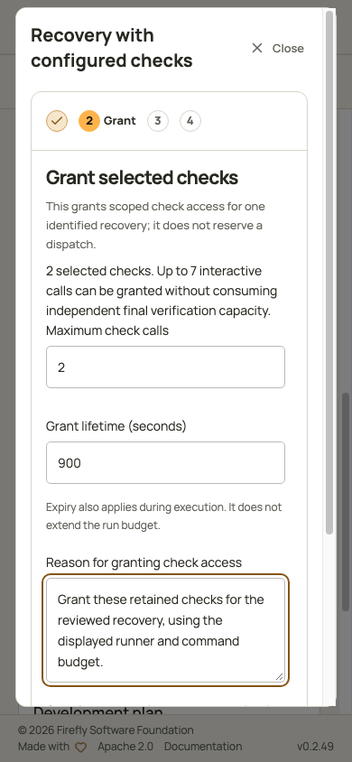
<figcaption>Set the call cap, expiry and reason. This explicit grant does not reserve a coding dispatch.</figcaption>
</figure>

<figure class="forge-shot" markdown="1">
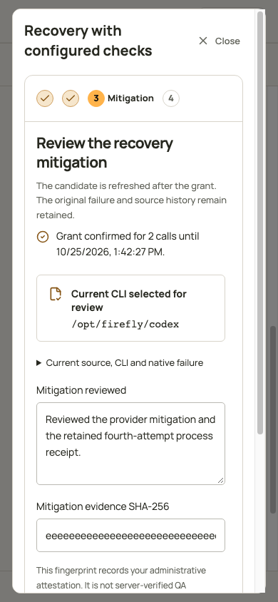
<figcaption>Confirm the grant, inspect the refreshed current CLI and source, then record the reviewed mitigation.</figcaption>
</figure>

<figure class="forge-shot" markdown="1">
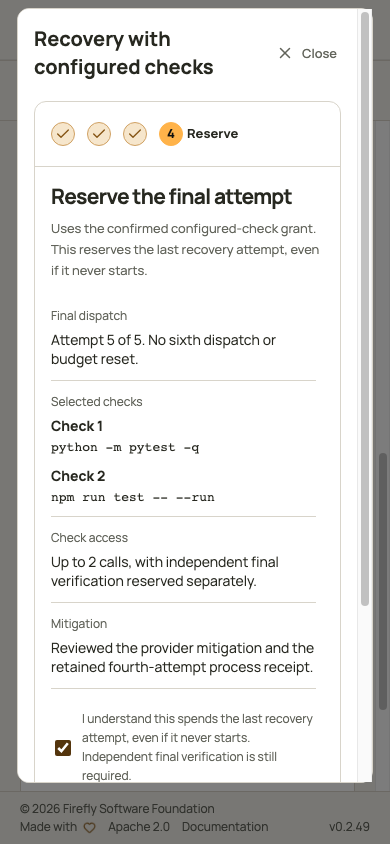
<figcaption>Review named checks and acknowledge the last recovery attempt. Technical identities are available under Request details.</figcaption>
</figure>

<figure class="forge-shot" markdown="1">
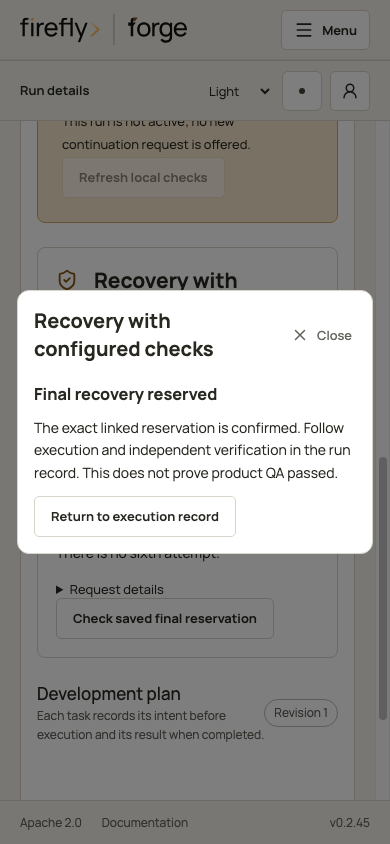
<figcaption>The exact receipt confirms reservation. Follow actual execution and independent verification before accepting the product.</figcaption>
</figure>

</details>

</details>

## Inspect a factory verification handoff

A pending implementation request with typed `kind: "verification"` can use the run's frozen automatic-verification grant. forge executes all explicit approved commands through the existing authorized runner. It records each intent and known result before supplying protected factory feedback and admitting a bounded continuation. Question text and request IDs never choose commands or expand permissions.

New runs default to `automatic_verification: {enabled: true, max_continuations: 1}` in their frozen tool-policy settings. Administrators can configure a positive finite continuation window and explicitly renew it through the current policy and a fresh exact adoption. Every prior handoff remains spent; changing the window does not reset history or command slots. Each completed handoff grants one additional coding task separately from `repair_budget`, within the existing four-attempt coding-stage ceiling. A snapshot without that explicit setting remains manual. Older SDK/MCP policy writes that omit the setting preserve its current value.

Read `verification_handoff` on the run and its matching journal entries:

| State | Meaning |
| --- | --- |
| `pending` | The handoff is awaiting factory verification; no completed result is recorded |
| `running` | The factory is collecting command results under that intent |
| `completed` | Every configured command has a known result, including any failures |
| `held` | The handoff cannot continue safely; inspect its retained evidence |

Known failing checks become feedback for the allowed coding continuation. Completed does not establish product acceptance. Unknown command or continuation effects are held without automatic replay. A refusal before intent has its own `verification_handoff_refused` event and leaves the original question pending. Changed source, revoked authority, changed policy/provider or exhausted limits cannot authorize another coding task. Product decisions and credentials remain manual questions.

### Adopt one older paused request

An authenticated native operator can explicitly adopt an older pending verification question. Read `GET /api/v1/runs/{run_id}/verification-handoffs/candidates?agent=codex`, selecting the configured provider explicitly. Review the returned source, command and configuration digests before admission.

Retain a new 32-character hexadecimal `request_id`, then POST `/api/v1/runs/{run_id}/verification-handoffs/adoptions` with that ID, `agent`, and the exact `pending_request_digest`, `source_digest`, `commands_digest`, `policy_digest` and `provider_digest` from the candidate read. The receipt binds only this pending question and partial source. Explicit provider selection captures its current configuration through the normal native handoff; earlier snapshots stay immutable. Host coding still requires current administrator authority.

After a lost response, GET `/api/v1/runs/{run_id}/verification-handoffs/adoptions/{request_id}`. Preserve the original identity while the result is missing or uncertain. Do not create a replacement ID, retry a command or assume that admission failed. Reusing an ID with changed content is refused. HTTP admission records the adoption for the normal execution owner; it does not execute commands inline. See the [HTTP contract](api.md#automatic-verification-handoffs) for SDK methods and authority boundaries.

### Acknowledge an unknown command for follow-up verification

A cleanup receipt can coexist with a missing start result. Cleanup does not prove
that a host command never ran, completed successfully, or left no effects. Startup
must not infer host-process absence from a missing Docker container observation.
Use the original runner's native stop, drain and custody controls before reviewing
follow-up work; an operator acknowledgement itself is not process-absence proof.

For a paused implementation with a held verification request, the native operator
can review one canonical execution whose create and cleanup have receipts while
its start remains unknown, or whose complete native WAL has no start intent.
These are separate classifications, `start_unknown` and `closed_before_start`.
This contract covers the native host runner under its
original frozen sandbox policy; it does not adopt Docker or pool custody. Select a fresh **future verification adoption ID** and
request the unknown-command candidate. It binds the current operator, full WAL,
run, task, original command identity, current source, approved commands, policy,
provider, next continuation and exact new command ordinals.

Review the candidate and use its exact classification. An unknown start requires
acknowledging an unknown result and possible effects. A closed-before-start
record instead requires acknowledging the absence of a native start intent;
this is not an operating-system process-absence attestation. The acknowledgement is restricted to
the reviewed verification and its bound native continuation, and prohibits replay
of the original execution identity. The strict consent field is
`acknowledge_bound_verification_and_continuation: true`.
Submit its strict version 1 body once, retaining the acknowledgement request ID.
If the response is lost, read that same receipt; an uncertain write never permits
a replacement POST or a new command identity by itself.

This appends `unknown_command_acknowledgement` with disposition
`unknown_abandoned_for_verification` or
`closed_before_start_retired_for_verification`. The original effect records and
spent command slot stay unchanged. Nothing is marked completed, interrupted or not run, and the
run remains held. No supplied JSON document can attest an original exit or runner
absence through this interface.
If more than one eligible record blocks the handoff, review and acknowledge each
separately against the same future adoption ID. Their original classifications
and all consumed ordinals remain retained.

Separately review and submit the ordinary verification adoption using the exact
future adoption ID and bound source, command, policy and provider digests. Only
its later running native handoff can allocate the reviewed new ordinals. The
acknowledging operator and original execution identity must still have current
permission. A changed source, request, configuration, lease, task or policy keeps
execution held. Once all reviewed verification results are known, including RED
results, the actual factory response, completed handoff, native resume and coding
continuation intent can carry that consent into the same run's coding, normal QA
and Git. The original frozen repair and provider grants still bound any descendant
repair; the acknowledgement grants no extra round or budget. Current acknowledging
actor permission is checked again at dispatch and Git boundaries. Publication
communication retains an explicit original-custody risk note. Unrelated runs,
resumes, grants and unreviewed unknown effects remain held.

If prior handoffs exhausted the policy, explicitly renew the finite policy before
requesting a candidate. A policy window of 17 retains all earlier spent handoffs;
it does not grant 17 additional handoffs or raise the separate coding-stage limit.

## Resume the same run

For a human implementation question, first record the answer under its original request identity, then resume explicitly with current execution authority. The journal seals a bounded continuation from that exact question and authenticated answer. This can continue a zero-repair run while preserving its spent calls and the ordinary four-attempt ceiling. It grants no retry for an unknown provider outcome, no fifth dispatch or sixth final-allowance attempt, and no additional tools. See [worker feedback and manager requests](agent-roles.md#worker-feedback-and-manager-requests) for the separate request and repair limits.

Send `POST /api/v1/runs/{id}/resume` with `{}`. Resume preserves the workspace, original brief, policy content and provider revision. Local reconciliation inspects the Git root, authorized origin, HEAD and source tree before continuing an unfinished task.

```json
{}
```

A completed prepare task does not clone the repository again. Completed implementation work remains in place. A failed check can authorize a new bounded repair attempt, with its previous evidence recorded before the next worker call. Retrieved knowledge context and its digest remain available to the continuing worker.

## Hand off to another configured worker

Send `POST /api/v1/runs/{id}/handoff`:

```json
{"agent": "claude"}
```

Handoff is explicit. It creates a new provider configuration snapshot and immutable plan revision, retains earlier revisions, and continues the existing project source. It does not delete partial files, weaken checks or change the frozen project policies.

Test the new provider before handing off. A fresh snapshot can also renew authentication for the same provider. Quota and authentication pauses are not automatically bypassed by selecting another account.

## Reconcile remote work

Publication, deployment, rollback and knowledge writes have separate remote task intents. An unknown remote outcome cannot be retried through generic local reconciliation. Inspect the corresponding provider for the recorded branch, job, source or knowledge version. Retain its identity and outcome as evidence before deciding on the next operation.

Retry uses a fresh run and clone; it is separate from resume. It preserves the failed run's history. A new run does not roll back any external effect from the earlier run.

### Reconcile worker delivery requests

Read `GET /api/v1/runs/{id}/execution-requests` before repeating publication or cancellation. Each request retains its admitted source, actor, status and hash-chain events. A worker records dispatch before the effect and its observed result afterward. An interruption between those records leaves `needs_reconciliation`.

An authorized operator can ask the server to reconcile the exact request:

```sh
forge execution-requests RUN_ID
forge reconcile-execution-request RUN_ID REQUEST_ID \
  --reconciliation-id 0123456789abcdef0123456789abcdef
```

The HTTP body contains only `{"reconciliation_id":"0123456789abcdef0123456789abcdef"}`. The caller cannot assert success or absence of an effect. The server rechecks current project authority and matches retained evidence to the admitted and current source. Publication requires a terminal worker receipt or the matching immutable publication intent and receipt, including its branch, checked source and pull-request URL. Mutable task status or run metadata alone cannot establish publication.

If no matching proof exists, the request stays unknown and the server returns HTTP409. Reconciliation makes no provider call and never repeats the effect. Reusing the same reconciliation ID returns its retained result; a different ID for an already reconciled request is rejected. Cancellation also requires a terminal worker receipt proving that work drained.

A retained rejection before dispatch can settle a request as failed. Publication then permits an explicit bounded retry, up to three admitted attempts, provided no earlier publication intent remains unresolved. Any failure after dispatch retains uncertainty until its terminal receipt is established, even if the provider's error sounds like validation or authorization.

## Understand automatic limits

Eligible rate-limit and transient pauses use their recorded delay and a budget of at most three automatic retries. Typed factory verification uses its separate frozen grant and continuation limit. Other pauses require an operator decision. Local concurrency is bounded globally and per project; work is selected across projects rather than filling both worker slots with one backlog.

The journal's hash chain detects a changed record sequence or payload. It is an integrity check within the operator's PostgreSQL ledger, not an external signature or protection against a database administrator replacing the entire history.

## Recover a product conversation

Product-design turns have their own persisted ownership records. A turn's `ownership` includes its process owner, `claim_epoch`, lease expiry and last heartbeat. The active process renews its lease against PostgreSQL's clock. Only that owner and epoch can retain a response while the lease remains valid. A different API instance can read the conversation without interrupting it.

An expired turn stays `processing` until an editor explicitly recovers it. Inspect the current turn and use its `recovery.expected_epoch`:

```sh
forge assistant get REPOSITORY_ID CONVERSATION_ID
forge assistant recover REPOSITORY_ID CONVERSATION_ID TURN_ID \
  --request-id 0123456789abcdef0123456789abcdef --expected-epoch 1
```

The server locks the conversation and turn, verifies expiry using database time, increments the epoch and records an immutable recovery receipt. The turn becomes `needs_reconciliation`. A late reply from the former owner cannot replace this result. Repeating the same recovery ID and body returns the original receipt; a changed body is rejected. No model retry occurs.

Processing turns created before ownership tracking have epoch zero and no owner. They require `--legacy-confirmed-stopped` as an explicit assertion that their original process has stopped. This assertion is recorded separately from an expiry proof. Do not use it while the original request may still be running.

Graceful factory shutdown stops new dialogue admissions, cancels and drains owned requests, then closes the data layer. An abrupt process loss leaves the durable claim for inspection and explicit recovery. An unknown provider outcome remains unknown even when local ownership has been fenced.

## Agentic model-boundary development

The internal `AgenticBoundary` helper supports an explicit, in-memory model-request boundary using Agentic's public capabilities and typed message codec. It captures closed text history, cumulative native usage and limits, model/tool settings, written-file names and the exact HTTP-body digest. Restoring that boundary uses `prompt=None`; it does not append the original brief again. The pending request keeps its recorded timestamp through the public history objects.

The first restored request must match the original body and state. Its original response passes a one-use consumption callback before reaching the ordinary SDK parser. Earlier tool calls stay in history; genuinely new tool calls and model requests may follow. An invocation-local shared context keeps this distinction across native task boundaries.

Checkpoint messages must have complete native lifecycle states. Usage and numeric limits must be finite, nonnegative and bounded; integer counters cannot exceed `2^53 - 1`. Payloads and responses use immutable bytes, and the response returned after consumption is the exact byte sequence whose digest was consumed.

This helper refuses unfinished tools, retries, vision, deferred or changing tools, dynamic instructions and unsupported message parts. It has no configuration switch or public endpoint. Engine activates the supported implementation slice only through the explicit checkpoint setting described below. Assurance and Product Assistant do not activate it.

### Internal checkpoint storage

The native `AgentCheckpoints` service can retain a captured boundary beside its unchanged Bridge request intent in one PostgreSQL transaction. An exact admission replay must match both records. A failed checkpoint append rolls back the new intent and hold as well. Records use the existing immutable journal table; this adds no SQL migration or historical backfill.

Version-1 consumption requires the original retained successful HTTP response and its exact request, checkpoint, wire digest and task attempt. Authenticated remote terminal evidence cannot substitute for that version-1 HTTP record. The service commits a single consume receipt before its response callback succeeds. A second consumption is refused, including after cancellation or interruption. A failure after the consume commit can leave a consumed boundary without delivering its response; it cannot re-arm that boundary. Exact receipt reads return checkpoint and consume evidence without returning the completion body.

Checkpoint payloads are limited to 192 KiB, journal envelopes to 256 KiB and consume envelopes to 4 KiB. Each run permits at most 100 checkpoints and 4 MiB of checkpoint/consume evidence, with pending consume space reserved inside the shared 16 MiB completion budget. Scalar SQL bounds run before loading checkpoint JSON. Admission checks current execution authority, current reader access when present, owned run/source/configuration and task state. Credential admission occurs outside native transactions; current authority and credentials are checked again before commit and return. Generic journal reads also admit the new checkpoint payloads under their existing reader fence.

Checkpoint operations prepare an immutable credential registry outside native units. Locked rejection scans that registry and checks a process-local configuration-write cut without taking a file lock or reading settings. A local configuration write invalidates the cut and refuses the writer transaction. External credential sources are read again outside the transaction before exposure; a refusal after consumption remains consumed. This does not establish atomic cross-process configuration admission.

Without explicit checkpoint selection this storage service remains unused by execution. Reading a terminal result or checkpoint never resumes a graph or enables generic resume, handoff or Retry.

### Explicit closed-text implementation continuation

New Bridge implementations may select `checkpoints: required` together with `completion_recovery: required` in saved provider configuration or an implementation model profile. These optional fields freeze into the new run; absent fields leave historical snapshots and defaults unchanged. The supported static text tools are `list_files`, `read_file`, `write_file`, `search_text`, `edit_lines`, `git_diff`, `execute_command`, `knowledge_lookup` and `read_run_evidence`. Each needs an explicit frozen role grant and its configured native executor. A grant does not create runner, knowledge or evidence access by itself. Unsupported grants, streaming, vision, QA state, deferred tools, retry state, dynamic instructions or dynamic tool catalogs refuse before completion submission. Direct API providers and independent review do not support required checkpoints; use a separate review profile with checkpoints disabled.

Reviewed wireframe references may accompany those tools as textual descriptors. They must exactly match the native descriptors derived from the frozen design bundle, product review and frontend choice, including hashes and ordering. Missing or changed references are refused. The generator's Engine source joins the runtime contract, and both snapshots remain bound to the invocation. Descriptor text grants no image, browser or other QA tool access; active QA and multimodal checkpoint history remain unsupported.

Commands keep their sandbox intents, receipts and lifetime budget. Completed text results and changed source paths enter the next closed checkpoint history. A command-enabled restore requires every retained execution to have a canonical durable v2 identity, matching native WAL, a completed result and confirmed cleanup under the frozen runner policy. Every prior effect must finish before the selected checkpoint. Pending, interrupted, orphaned, altered or unreconciled effects refuse restoration; explicit stage reconciliation does not silently make an interrupted command restorable.

After the original result is consumed, later completed commands must have creation intents after that exact restore ticket and generation's consume record. Forge allocates their next durable ordinal; restoring a graph does not replay an earlier command, reset command or browser budgets, or expose a consumed result again. Read-only restoration retains its existing behavior. Runtime contract hashing includes the restore implementation, so this correction does not make older checkpoint contracts eligible. These checks require their own native SQL qualification before a runtime adopts them.

In Studio, open **Connections → Coding AI → Bridge → Configure**. Under **Original model results**, select **Required: retain the original result**, then **Required: save implementation checkpoints**. Saving these settings does not test the connection or change an existing run. **Keep current default (unset)** omits the field from this save; it does not clear a saved value. Choose **Disabled** to stop requiring checkpoints. The other choices explicitly save `legacy`/`required` recovery or `disabled`/`required` checkpoints. The equivalent provider API is `PUT /api/v1/providers/bridge/configuration` with `values` containing the selected fields. Named implementation profiles use `PUT /api/v1/model-profiles/{id}`.

<details class="forge-gallery" markdown="1">
<summary>Choose original-result recovery in Studio</summary>

The controlled fixture selects required result recovery before required checkpoints. The settings have not been saved or connection-tested in these views.

<figure class="forge-shot" markdown="1">
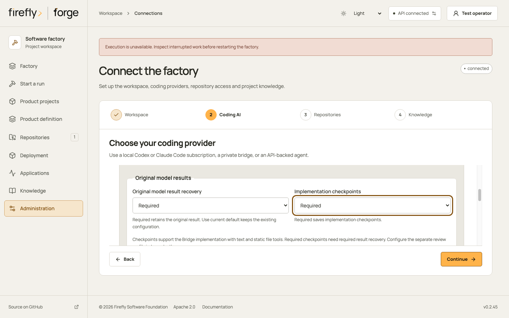
<figcaption>Configure implementation and independent review separately. Saving these choices affects new runs.</figcaption>
</figure>

<figure class="forge-shot" markdown="1">
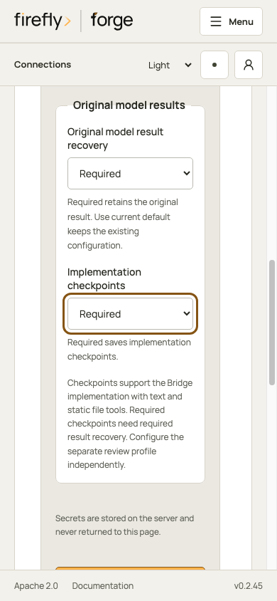
<figcaption>Unset omits a field from the save. Choose Disabled to stop requiring checkpoints.</figcaption>
</figure>

</details>

#### Review a held result in Studio

1. Open the held Bridge run and choose **Plan → Original model result**. The panel requires current project execution access and, for a publishing run, release access. It reads saved checkpoint references without contacting Bridge or continuing work.
2. Select the original implementation attempt. Check its saved time, original deadline and result state. **Check original result** requests an observation of that original Bridge completion when its result still needs checking.
3. When the original result is saved, choose **Review original result**. Read the continuation steps and acknowledge that the result is consumed once. **Continue from original result** admits that specific continuation; verification and delivery retain their separate outcomes.
4. If a response is lost, choose **Read exact saved request**. Studio retains the observation or continuation identity in this tab before submission and keeps it across reload. A missing receipt or access error holds that identity. A recorded continuation discovered on the server can also be read without submitting another one.

This panel must save and read back its tab marker before sending a new request. Keep the original tab open while a request is unresolved. Reloading that tab retains the marker; closing the tab or clearing its session storage can lose it. A new tab can discover server-recorded continuation tickets, but it cannot rely on the old tab's observation or unsent request marker. Changing the factory, account, run or current permission context clears the displayed details and ignores late responses. The panel shows references and states, not the model's private history or response body.

An **Original implementation receipt recorded** message confirms the original implementation receipt. Check the run's verification, any later repairs and delivery records before accepting the run. A consumed result cannot be re-armed after a later failure.

<details class="forge-gallery" markdown="1">
<summary>Review and read back one original-result continuation</summary>

These controlled Studio fixtures show a saved result, an acknowledged review and an uncertain restore response. They exercise the interface without running Agentic, Bridge or native restoration.

<figure class="forge-shot" markdown="1">
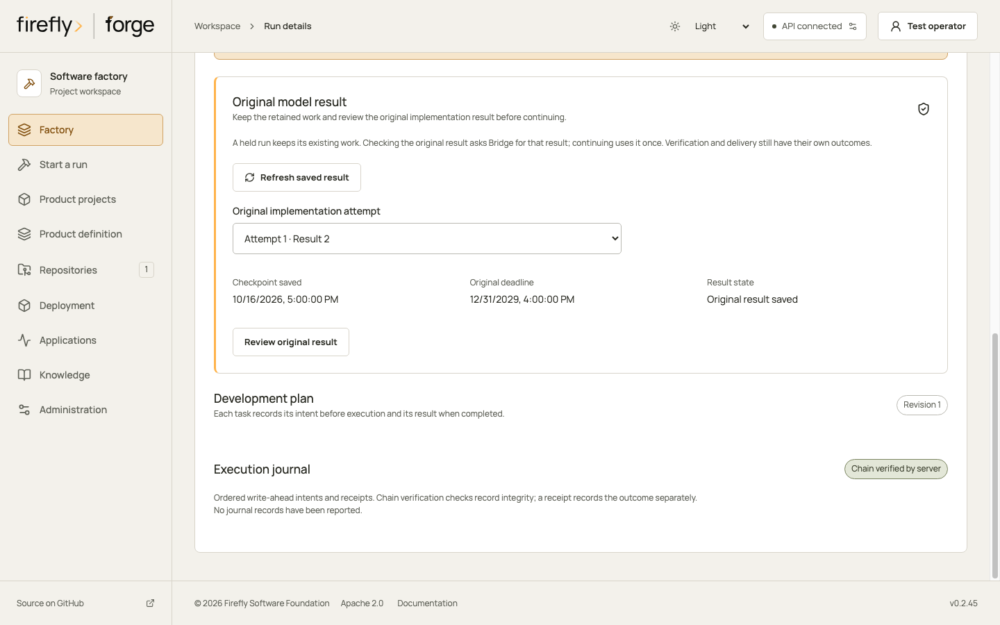
<figcaption>Inspect the original attempt, checkpoint time, deadline and result state before opening the review.</figcaption>
</figure>

<figure class="forge-shot" markdown="1">
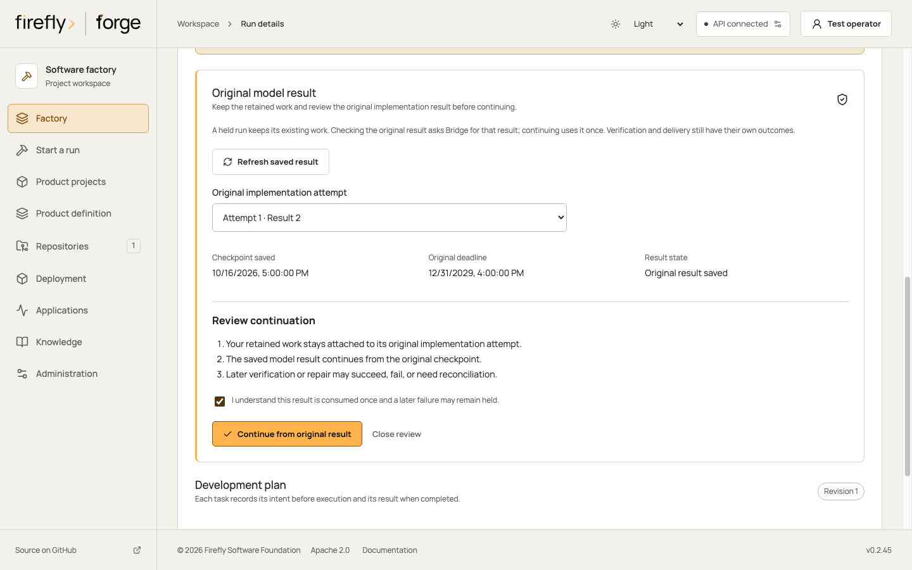
<figcaption>Reviewing is separate from admission. Continue from original result becomes available after the acknowledgement.</figcaption>
</figure>

<figure class="forge-shot" markdown="1">
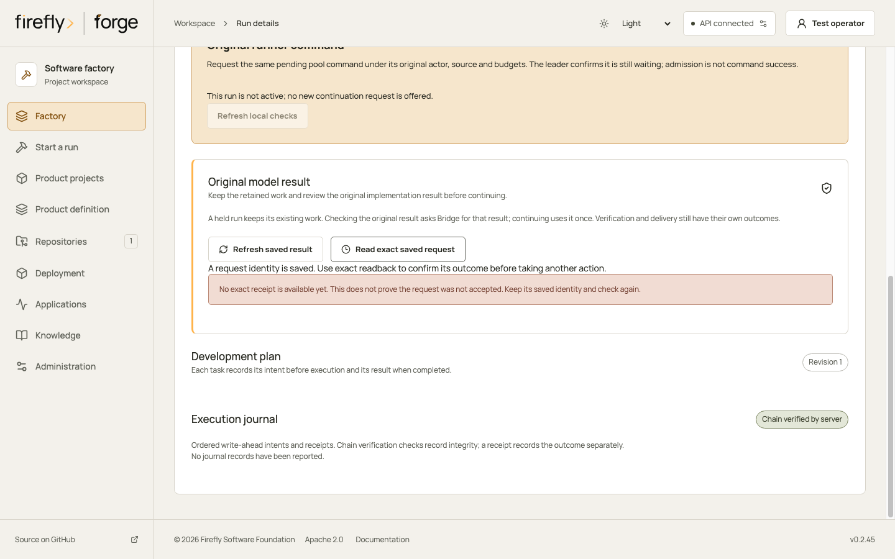
<figcaption>A lost response and missing exact receipt retain the original request identity. They do not permit another continuation admission.</figcaption>
</figure>

<figure class="forge-shot" markdown="1">
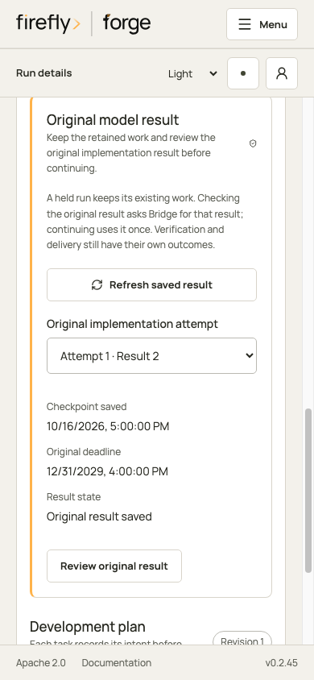
<figcaption>The same original-result references are available on a phone.</figcaption>
</figure>

<figure class="forge-shot" markdown="1">
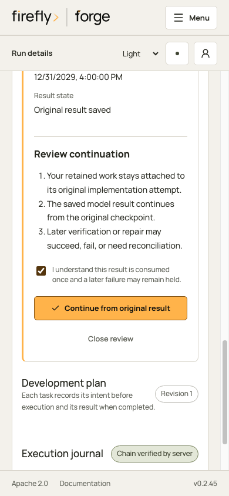
<figcaption>Scroll to the acknowledgement and continuation action. Later verification and delivery keep their own outcomes.</figcaption>
</figure>

<figure class="forge-shot" markdown="1">
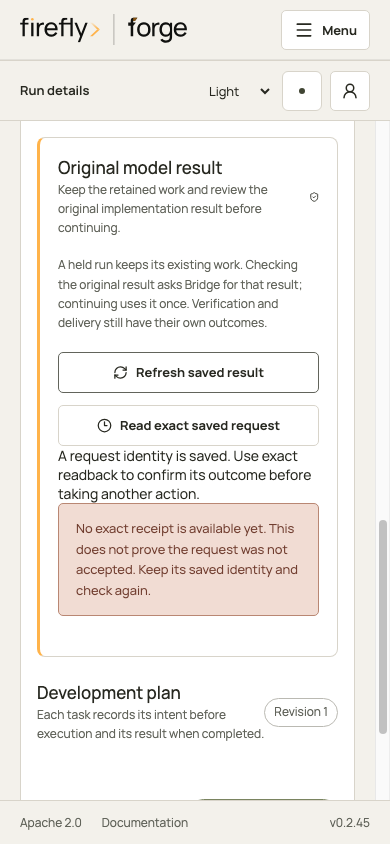
<figcaption>Keep this tab while the request is unresolved and read its exact saved identity again.</figcaption>
</figure>

</details>

The real Agentic implementation captures a closed native message history at the exact HTTP request boundary. Version-2 checkpoint envelopes bind the original composed instructions, runtime and prompt contracts, cumulative native usage and limits, absolute deadline, task attempt, file-tool state and retained owned workspace. The original Bridge intent and checkpoint commit together before POST. Both ordinary and restored results commit a consume receipt before reaching the native parser. Version-1 checkpoints and HTTP-only consume receipts retain their original semantics and cannot authorize restoration.

Accumulated native history uses a lossless boundary codec. New canonical records above 64 KiB use a version-3 canonical JSON envelope. Identical native `history` and `request_history` arrays are stored once with an exact shared-history marker before standard zlib/base64 compression. Decoding reconstructs the complete canonical record and verifies its full byte count and SHA-256. The packed size is bounded separately, and the expanded size is checked before allocating the mirrored record. Small raw version-1 records and historical version-2 compressed records retain their original decoding and encoded identities.

The full canonical record retains its explicit **8 MiB** limit. Bounded decompression rejects truncated streams, trailing or concatenated data, invalid shared-history references, size/hash mismatches and noncanonical representations. Messages, tool results, usage counters and file-tool state remain complete. Encoded-size refusals are distinct from digest refusals and disclose no record text. The encoded snapshot remains bounded at **192 KiB**; its invocation binding, JSON escaping, WAL record and consume reserve must still fit **256 KiB**, and the per-run retention budget remains **4 MiB**. Shared storage removes duplicate history; it does not guarantee that arbitrary history fits these bounds. Incompressible history and exhausted custody/credential budgets remain held before dispatch. Chunked overflow storage is separate pending work; this is not unbounded enterprise history.

Capture, consumption, restoration and authenticated generic journal reads inspect the full decoded canonical record against current credential custody. Generic reads check one record at a time outside native database units and return the original encoded WAL. A restored request must first match native model state and original wire bytes; it then reuses the original encoded snapshot and digest. Valid zlib streams do not require byte-identical recompression across library versions. This codec does not grant restoration authority to an outer version-1 WAL checkpoint or re-arm consumed results. Source admission explicitly binds the Journal/decoder dependency. The changed version-3 decoder requires fresh qualification before runtime adoption; earlier profiles retain their exact provenance.


Checkpoint source identity covers tracked source, including force-tracked ignored files, and nonignored new files. Git-ignored untracked dependencies, caches and private runner results are outside that identity. A final directory timestamp change alone therefore cannot establish that selected source changed. Forge retains exact file stamps and deletion witnesses, plus directory device/inode/owner/mode guards. Canonical Git supplies ignored directory roots; their paths are streamed into an owned temporary disk index, without reading dependency contents or introducing a source-file count limit.

If a remaining directory namespace changes during final admission, Forge rechecks the exact canonical selection and the original credential/Git authority within the existing inspection deadline. Selected additions, deletion/reappearance, file changes, index/ignore-policy changes and directory replacement or permission changes still refuse. Git metadata keeps strict identity and timestamp witnesses across the entire inspection, so a temporary ignore-policy change cannot hide new source and then restore identical policy bytes before the final check. This bounded local read revalidation does not repeat a model request, command, consume or remote effect. Persistent namespace churn may still exhaust the inspection deadline. The updated source-identity helper changes retained runtime and source-admission contracts and requires fresh qualification before adoption.

An authorized operator first selects an immutable original HTTP result or retains a successful original-result observation through the existing `POST /api/v1/runs/{run_id}/bridge-requests/{completion_request_id}/observations` route. Then POST `/api/v1/runs/{run_id}/agent-checkpoints/{completion_request_id}/restores` with a retained 32-character hexadecimal `request_id`, `expected_checkpoint_digest`, `expected_intent_digest` and a tagged `source`. An `http_response` source has its `record_digest`; a `bridge_observation` source also has `observation_id` and the original `terminal_digest`. The server does not accept an arbitrary response body. GET the same route with `/{request_id}` for exact readback; a missing or uncertain response never authorizes another admission. Each checkpoint permits one ticket, within a maximum of 50 restore tickets per run and the shared bounded worker queue.

Discover completion request IDs through `GET /api/v1/runs/{run_id}/bridge-requests` and read the selected intent at `/{completion_request_id}`. The authenticated run journal (`GET /api/v1/runs/{run_id}/journal`) contains the matching `agent_checkpoint`, any `bridge_request_response` and their immutable record digests. Select the version-2 checkpoint whose idempotency key matches that request; its record digest is `expected_checkpoint_digest` and its payload binds `expected_intent_digest`. For an observation source, retain the observation POST response and its successful original terminal digest. Keep the client-generated restore request ID before POST, then read that exact ticket after a lost response; do not generate a replacement ID.

The execution owner claims that ticket once, repeats current operator and execution-actor authority, source/configuration and credential checks, and enters the same unfinished implementation attempt. It calls public `FireflyAgent.run(prompt=None, ...)` with retained native history and usage. The first reconstructed request must match its original wire bytes and receives only the selected original result, with zero replacement POSTs. An authenticated remote observation stays a distinct result source; it is never relabeled as an original HTTP response. Earlier file tools are not executed again. Genuinely new tools and requests may follow, each new request retaining its own checkpoint. Successful continuation rejoins the ordinary implementation receipt and verification path.

The original deadline includes downtime. Changed or missing workspaces, unsupported state, current permission loss, cancellation and stale claim generations refuse. This requires the same retained local workspace; it does not reconstruct source on another host or make filesystem checks atomic against unrelated local processes. A workspace that cannot be treated as exclusively owned is ineligible. A crash after consumption, including before delivery to the parser or before the next checkpoint, cannot re-arm that boundary. Executing tickets recovered after owner loss need reconciliation and are never automatically requeued. Generic completion holds remain in place, including for old unknown runs without an eligible checkpoint. This is continuation at the supported model boundary, not arbitrary graph or Python-stack restoration.

## Internal run-admission boundary

Run admission prepares runner capabilities, provider settings, policies, roles and reviewed design files before taking the insertion locks. `Store.prepare_run` retains immutable bytes and original field presence. The locked insert checks the current native actor, project/component and repository/product cuts, then saves the queued run and its first event together. Campaign and incident admissions prepare before entering their own atomic write.

A separate process-local mutable-settings cut starts before preparation and stays checked through insertion and return. Writing the admission’s own snapshots into the exact private `revisions` and `model-profile-revisions` directories does not advance this cut; changes to current provider, policy, role, channel or application settings do, including a change immediately restored. Channel and application admissions also reread their captured settings outside the write transaction. The existing all-writes credential generation keeps its original behavior.

Credential matching uses the prepared registry and process-local configuration generation, with current native OAuth evidence checked inside the transaction. Fresh credential and authority checks also apply before returning the committed result. A refusal after commit does not establish that nothing was saved. These guards do not serialize configuration files written by another process.

Ordinary `POST /runs` retains its existing contract. Use the [original-request protocol](#settle-an-uncertain-run-submission) when creation needs an exact identity and terminal decision. A matching brief or the latest run list cannot settle an uncertain original submission.

## Reconcile legacy dependency preparation

A retained workspace can have a directory-only factory ignore such as `node_modules/` that fails to exclude a read-only dependency symlink. If source admission refuses that staged alias before an already queued verification continuation dispatches, a current factory administrator can review `GET /api/v1/runs/{run_id}/workspace-reconciliations/candidate` on the execution owner. The candidate binds the failed record, existing task, completed native verification handoff, source and Git metadata, current authority, provider settings and remaining command budget.

Retain a new `request_id` and POST the reviewed `candidate_digest` with both `acknowledge_environment_only: true` and `acknowledge_resume_existing_task: true`. The fixed operation removes only enumerated dependency-symlink index entries absent from the original baseline and adds the factory's bare dependency ignores. It preserves the worktree aliases, dependency targets, application source and Git history. Tracked private paths, private regular files, changed cuts and unresolved effects remain refused.

The native journal commits an intent before the filesystem effect. Only a known completion receipt can queue the same existing task. Its attempt, repair allowance, handoff use and lifetime command budget stay unchanged; final verification still needs its reserved headroom. The historical failed record and its error are retained in the immutable receipt. This operation does not authorize another failed-provider recovery or expand a final allowance.

The sandbox command limit counts native governed runner executions. Shell calls inside an official coding CLI are separate observed effects, not runner receipts. An environment continuation with retained unmetered CLI activity is held before admission, filesystem effects and provider launch. Its refusal reports observed CLI calls, governed calls and required final checks; missing, conflicting or incomplete archives also hold. Observing these calls afterward does not enforce a preventive combined limit. Such a continuation needs a separately supported tool-admission boundary before it can resume; changing a prompt or subtracting an estimated count does not provide that boundary.

After uncertain delivery, read `GET /api/v1/runs/{run_id}/workspace-reconciliations/{request_id}`. A pending intent returns `needs_reconciliation` and cannot execute again, including under another request ID. Do not reset Git metadata or resubmit an unknown effect. Database commits and filesystem changes are not one atomic transaction, and this protocol requires an exclusively owned retained workspace.

The Python client exposes `workspace_reconciliation_candidate`, `reconcile_workspace` and `workspace_reconciliation`; the CLI equivalents are `forge workspace-reconciliations candidate`, `admit` and `get`. Normal execution after admission still checks current permissions, scans source, runs the configured checks and records its own result. An environment receipt is not product acceptance or publication.


### Explicit source-only continuation

A current native administrator can review `GET /api/v1/runs/{run_id}/source-edit-continuations/candidate` for the same supported environment refusal and queued implementation task. Activation requires version 1, the original request identity and candidate digest, and all four explicit acknowledgements: environment-only change, the existing task, existing read scope and no commands. POST that strict document to `/source-edit-continuations`; read the identical request at `/{request_id}` after any uncertain response. The SDK provides `source_edit_candidate`, `activate_source_edit` and `source_edit_continuation`; the CLI group is `forge source-edit-continuations candidate|activate|get`.

The activation explicitly enables only `list_files`, `read_file` and `search_text` already present in frozen implementation roles. It does not infer external MCP authority from those roles, edit the original MCP snapshot, grant an operator API, or enable arbitrary execution. The original broker retains its durable request/source identities, unknown holds and shared tool-call limits, capped at 30 calls and 10 per reader. Reads exclude private paths, symlinks and hardlinks, admit credentials before returning content, and require an unchanged current source cut. Known readback consumes no new call; reusing an identity after a source change is refused.

This mode requires a package-owned, versioned native capability profile before any metadata process or durable activation intent. The profile binds executable bytes, platform, model/provider, the canonical model-catalog asset SHA256 and loader helper, policy flags, loader source hashes, runtime versions, the exact native tool schemas, and complete positive and negative native probe evidence. Unknown builds, missing proof, capability drift, or profile withdrawal hold admission. Provider settings and API requests cannot supply a profile or a `closed: true` assertion. The package includes one measured Codex 0.163 Darwin arm64 profile for the pinned executable, model, provider, runtime and loader bytes. Its native boundary evidence covers 235 supported cases and 15 separate diagnostics without real model calls. Account configuration, managed-policy admission and actual project verification remain independent gates. Normal Codex and Claude execution paths are unchanged.

A registered profile is sealed into the reviewed candidate and revalidated at activation, source reads, dispatch and final verification. Its native qualification must exercise the actual tool catalog, patch operations and filesystem boundaries in one bounded run, with no real model calls. Private and outside-source sentinel reads and writes, including case aliases, must be denied. Minimal operating-system runtime reads remain available; this does not establish blanket denial of all reads outside the workspace. A successful catalog listing alone cannot qualify the profile.

The source-only policy sets `agents.enabled=false` and exposes the three governed MCP readers directly, excluding deferred and Code Mode exposure. Both metadata and execution force the same package-owned model catalog. Its explicitly derived client presentation changes only the pinned upstream entry's `tool_mode` from `code_mode_only` to `direct`; the original instructions, other model metadata, model and provider remain unchanged. Upstream provenance, the exact one-field difference and license notices accompany the asset. Mandatory managed controls retain precedence. Actual native catalog and denied-invocation evidence are still required before registration.

Source-only execution uses a named native permissions profile bound to the current workspace and trusted private directories. It grants workspace source edits, denies private filenames and their descendants, and disables network access. It grants no general home-directory, root-filesystem or temporary-directory access. The metadata check and eventual provider launch use the same canonical policy, whose digest is retained in the reviewed receipt. This replaces the legacy `workspace-write` sandbox selection only for this explicitly admitted recovery mode.

Filesystem policy version 2 also inspects current workspace names before configuration or launch. The bounded scan adds literal deny paths for existing private objects, without reading file contents or following dependency symlinks. It does not descend private directories. Hardlinks, special files, unstable entries or exceeded scan limits hold admission. A changed set of private names changes the permissions digest and invalidates earlier metadata; actual lowercase environment examples remain available.

The fixed no-model metadata operation initializes the native app server, waits for initialization, then reads effective configuration and managed requirements before closing stdin. Its version-5 proof retains only configuration, profile and permissions fingerprints. The pinned native agents representation must contain exactly `enabled: false` and its six unused options as null, with no role declarations or extra fields. Missing responses, unexpected capabilities, enabled autoloading, telemetry or incompatible mandatory requirements hold admission. The native API does not expose every utility switch; the qualified catalog and invocation checks establish their absence. Raw configuration, native error bodies and managed requirement values never enter activity logs or the retained proof.

Governed file tools check both the requested relative name and the actual opened file or directory before reading contents, truncating a file or creating descendants. This prevents a case-insensitive filesystem from treating an allowed spelling such as `.env.example` as an alias for the private `.env.EXAMPLE`. Real lowercase `.example`, `.sample` and `.template` suffixes remain available. Unsupported descriptor-path verification fails closed.

These controls assume a trusted developer machine and an exclusively owned workspace. They do not isolate hostile processes sharing the service account. Production multi-tenant runners require separate operating-system identities or containers. Native qualification and metadata checks also do not establish that the real project's implementation and final tests have passed.

The reviewed scope also names four bounded native utilities: `clock.curr_time` reports UTC time, and `list_mcp_resources`, `list_mcp_resource_templates` and `read_mcp_resource` can address only the singleton source server. That server registers no resources or templates: listings are empty, reads return not found, and resource URIs never open files or network locations. These utilities grant no additional source access. Image viewing, plan updates, user-input callbacks, deferred execution, context reset and sleeping remain disabled. Unknown native tools, namespaces or changed schemas hold qualification.

The combined command budget does not reset. For example, a limit of 35 with 21 observed CLI calls and 7 native checks leaves 7 independent final checks and zero interactive commands. Each final native effect rechecks that combined count. Activation preserves the same provider, model, attempt, history and final verification plan; it cannot authorize another verification handoff, another failed-provider allowance, publication or a new run.


#### Version 0.2.37 limitations

A restricted source-only grant admits one implementation attempt. Saving a human answer does not admit the next attempt under that grant. A current native administrator can review the answered question and grant its next attempt through the dedicated human-readmission API. The new grant preserves the original tool scope, command history and reserved final checks; it does not renew the old grant or repeat its environment changes.

### Continue after a source-only question

The answer stays attached to its original question, even after the execution grant expires. Review the completed activation, the current source and the authenticated answer before admitting another attempt. Each clarification needs its own admission. The existing request limit and four-attempt ceiling still apply.

The next implementation prompt includes the run's retained question-and-answer pairs in their original order, with native receipt references, alongside the latest answer. This bounded context preserves earlier diagnostics when a later reply resolves a different hold. It contains historical information: an old verification result does not establish that the current source passes, and an answer does not grant tools, commands, another attempt or publication authority. Current access and credential admission are checked again before the context is supplied. An oversized, altered or ambiguous message history is held instead of silently dropping an earlier answer.

Implementation feedback must match its stated disposition. A blocked or clarification report needs one genuine typed question and its context; a completed or failed report must omit the question or set it to null. An invalid report remains a failed attempt with its original provider output retained. forge does not invent a question, retry the model or reset an allowance to repair its format.

<div class="forge-flow forge-flow--dependencies" role="region" aria-label="Source-only human continuation diagram" aria-describedby="source-human-continuation-guide" tabindex="0" markdown="1">


</div>

<p class="forge-flow-caption" id="source-human-continuation-guide">Follow the original question and saved answer from left to right. Scroll horizontally on small screens; keyboard users can focus the diagram and use the arrow keys.</p>

| Action | Result |
| --- | --- |
| Read the human-readmission candidate | Reviews the exact question, answer, source, current administrator and remaining allowance. No work starts. |
| Admit the reviewed candidate | Saves a new intent, links the human answer, queues one next attempt and seals its receipt in one transaction. |
| Read the saved admission | Returns the original receipt. It never queues another attempt. |
| Source, index, configuration or authority changed | Holds the admission for review. It does not accept the changed state silently. |

The candidate and admission routes are under `/api/v1/runs/{run_id}/source-edit-continuations/{completed_activation_request}`: `human-readmission-candidate`, `human-readmissions` and `human-readmissions/{admission_id}`. They require current native administrator authentication. Request bodies are strict, include the reviewed candidate and contract fingerprints, acknowledge the preserved budgets, and set a lifetime of at most 30 minutes within the retained provider timeout.

This recovery requires the same source and staged public content as the completed activation. A Git index stat-cache refresh can be reviewed only when a completed native index-sanitation receipt proves the exact public entries, file identities, modes and blobs. Each renewed human receipt preserves that verified ancestry, and the current raw index must remain unchanged throughout its admission. Private or extra entries, different staged content and unproven index changes remain held. If the model edited files before asking its question, keep the answer and review that source transition separately. A saved answer, an expired allowance or a lost response never authorizes an uncertain operation to run again. Ordinary GitHub conversation remains available independently of this restricted execution grant.

The retained verification context can be clipped and omit the original root error. Scoped retrieval of retained diagnostics is being corrected separately. Inspect the available native evidence and preserve the paused request; a saved answer or an incomplete diagnostic excerpt is not permission to resume.

#### Reader argument checks

The pinned Codex 0.163 client keeps property types and required fields when it presents MCP tools to the model, but omits pattern, string-length and numeric-limit keywords. The factory validates the original arguments before the reader callback runs. A simplified advertised schema does not grant broader access.

<div class="forge-flow forge-flow--dependencies" role="region" aria-label="Source reader argument validation diagram" aria-describedby="source-reader-flow-guide" tabindex="0" markdown="1">

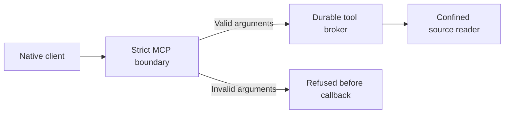

</div>

<p class="forge-flow-caption" id="source-reader-flow-guide">Follow validation from left to right. Invalid arguments stop before the reader callback. Scroll horizontally on small screens; keyboard users can focus the diagram and use the arrow keys.</p>

Every reader requires a unique `request_id` containing exactly 32 lowercase hexadecimal characters (`0–9`, `a–f`). Unknown fields and type coercion are refused.

| Reader&nbsp;identifier | Arguments and bounds |
| --- | --- |
| `list_files` | Only `request_id` is accepted. |
| `read_file` | Required `path` string: relative path, 1–1,000 characters. |
| `search_text` | Required `text` string: literal text, 1–500 characters. Optional `path` string: relative path prefix, 0–1,000 characters. Optional `max_results`: integer, 1–100, default 50. Booleans and numeric strings are refused. |

The version-1.0.1 reader descriptions state these constraints in the packaged prompt catalog. The selected resource bytes, catalog manifest and prompt renderer are part of the native loader fingerprint, so changing them invalidates the qualified profile.

The version-4 registry requires a separate `source_reader_bounds_enforced` result. Earlier sixteen-outcome proofs cannot activate this mode. Qualification must send malformed arguments through the actual native client and distinguish a client-side rejection of a non-object argument envelope from a server-side refusal. It also checks valid transport boundaries. Those positive transport cases do not prove that an arbitrary path exists or is readable; real source reads and filesystem denials have separate checks. Host-only validation and an advertised tool listing cannot replace this native evidence.


### Observe an interrupted source-only environment transition

If that review finds a newly indexed Vitest result cache outside the protected
public source, it stays held. A separate native administrator action can review
`GET .../{original_request_id}/index-sanitation-candidate` and submit
`POST .../{original_request_id}/index-sanitations`. The strict
`IndexSanitationInput` binds a fresh request ID, original intent, exact candidate
and admission-contract digests, previous catalog path and a finite duration of
1–1800 seconds. Four explicit acknowledgements authorize only generated-index
sanitation, preservation of physical files and original budgets, continued unknown
SCM delivery, and no queue or provider dispatch.

This operation accepts only bounded new `.cache/vite/vitest/{40-hex}/results.json`
entries absent from the original Git base. It verifies their staged blobs against
descriptor-safe regular files and the exact current public source. Private paths,
links, case aliases, existing repository assets and other generated files remain
refused. The complete proposed public patch passes credential admission before
a durable intent commits. The effect removes only the reviewed index entries;
the physical cache and all run, task and budget values remain unchanged. A second
credential and authority check precedes the completion receipt. Read
`GET .../{original_request_id}/index-sanitations/{new_request_id}` after a lost
response. An intent without completion holds every further recovery and cannot
be replayed. A completed sanitation still requires the separate observed-effect
readmission below before the existing task can queue.

Future snapshots exclude only new untracked known Vitest results absent from the
Git base. They preserve established tracked assets and hold an already indexed
new cache for explicit sanitation. Staged-cache and exact admitted patch/index
checks repeat across asynchronous credential admission before checkpointing.

A durable environment intent with an unknown outcome must not be replayed. A current
native administrator can review an already completed effect through
`GET /api/v1/runs/{run_id}/source-edit-continuations/{original_request_id}/observed-effect-candidate`,
supplying the original package-owned `previous_catalog_path`. The review requires
unchanged public source, exact staged public-file blobs and modes, protected Git
identity, preserved dependency aliases, and the original task and command reserve.

The separate `POST .../{original_request_id}/observed-effect-readmissions` accepts
`ObservedSourceReadmissionInput`: a fresh request ID, the exact original intent,
observed candidate and admission-contract digests, the previous catalog path, a
finite integer duration of 1–1800 seconds within the original provider limit, and
four explicit acknowledgements. It does not apply the dependency plan again. The
service checks the authenticated credential history and current secrets against
the complete bounded source patch before writing a readmission event, new native
intent, completion receipt and queue transition in one transaction.

The original intent and unknown SCM delivery remain unchanged. The new event
records the old and new deadlines and preserves the original SCM provenance as a
parent reference; it grants native administrator consent rather than reusing the
old SCM seal. It cannot reset counters, add commands, admit a new provider dispatch
after the original intent, or silently accept configuration drift. A catalog path
relocation is allowed only when exact old/new configuration digest reconstruction
proves that the package path is the sole difference. Lost readmission responses
require reading the new request's receipt; repeating the old environment effect
is never a recovery procedure.

Source patches use a dedicated flat-text credential admission capped at the
existing 4 MiB Git bound. Generic JSON admission retains its 1 MiB text bound, and
credential-history, matching-work and full-match limits remain unchanged. A patch
that exceeds those matching limits stays held before an environment effect.

## Review an exhausted source-read budget

A refused read is different from a tool whose outcome is unknown. When the lifetime
read allowance is exhausted, the tool reports that no effect started, the consumed
and remaining counts, and the other capabilities still available. It does not ask
the agent to reconcile an operation that never ran.

An administrator may enable a finite source-budget policy. The default policy
disables extensions. Enabling the policy alone does not change an existing run:
the operator must review its current question and answer, retained tool history,
source, permissions and newly qualified native profile before admitting one exact
continuation. The approved limit is an absolute lifetime ceiling. Raising ten file
reads to twenty keeps the first ten counted; it makes at most ten further reads
available, still subject to the unchanged shared tool limit. Original command
consumption and the reserved final checks remain intact.

A worker question pauses the implementation while its provider reservation remains
consumed. Reviewing that pause requires the exact native dispatch, its complete
archived turn, unchanged summary and usage, accepted typed worker question and
authenticated answer. The review also requires idle execution and settled tools.
This evidence does not declare the implementation complete or attest an operating
system exit. A missing output, changed question, active invocation or unknown
effect remains held.

The final budget admission writes its intent, queue state and receipt in a native
PyFly unit on the existing execution-lease connection. Nested Store checks require
the same task, unit, session and backend PID; they neither reacquire the lease lock
nor commit that connection. The lock remains held through transaction settlement.
A 30-second work deadline includes waiting for the lease lock; PostgreSQL lock and
statement timeouts are one and five seconds. Cancellation waits for shielded commit
or rollback cleanup, so the work deadline is not a hard bound on lost-network
settlement. A lost or uncertain commit never authorizes automatic replay. Other
admission paths retain their existing transaction contracts.

A separately admitted budget successor retains the old paused provider reservation
as consumed history. Only its exact sealed, current queued activation can enter
normal dispatch for the next canonical task key. That dispatch records its own
intent and launch custody; it does not complete or reuse the prior reservation.
Missing consent, changed authority or unknown outcomes keep execution held.

The Python SDK exposes `source_budget_policy`, `configure_source_budget_policy`,
`source_budget_candidate`, `admit_source_budget` and `source_budget_receipt`.
Candidates require the original run and parent receipt, the previous catalog path
and a versioned proposal containing all three explicit limits. Admission also
requires the exact candidate and contract digests, a fresh request identity, a
finite duration and all four acknowledgements. The server checks current authority
and may refuse a stale candidate even when the client accepted its structure.

Operators can use the equivalent `forge source-budget` commands: `policy`,
`configure-policy`, `candidate`, `admit` and `get`. The candidate command requires
`--previous-catalog-path`, `--read-file-lifetime-limit`, `--activation-ceiling` and
`--additional-activations`. Policy and admission commands read their reviewed JSON
document from a file. These are administration interfaces; people answering an
agent's question in GitHub continue to write ordinary messages.

Submit an admission once. If its HTTP response is lost, read the receipt using the
same run, parent and request identities. Neither the SDK nor CLI retries the write,
chooses a new identity or falls back to another provider. An unknown dispatch stays
held for reconciliation. A saved answer does not grant this continuation, and
notes arriving during a sealed source-only call are not injected into that call.

A failed source-only activation whose native CLI turn completed but whose implementation report failed validation needs a new, explicit review. It does not become an answered worker question or a successful implementation. For this case, the source-budget candidate accepts `basis=known_completed_output`; the CLI exposes the same choice with `--basis known_completed_output`. The default candidate continues to require its authenticated answered question.

The candidate binds the completed parent receipt, the archived final message and usage, the failed canonical activation, the original tool history, and the current public source manifest. It requires the exact retained Git index, refs, provider configuration and execution authority. New public UTF-8 files are included in the bounded credential review without staging them. Admission additionally requires `acknowledge_output_not_success`, `acknowledge_no_exit_attestation`, `acknowledge_current_source_changes`, `reviewed_source_digest`, and `reviewed_patch_sha256`. The source and patch digests must match the fresh candidate. Review the actual source changes before acknowledging them.

A finite policy and a newly measured native profile must both cover the exact next activation and reader ceiling. The native transaction records consent before queuing that activation, preserves prior failed output and tool receipts, and keeps the original command ceiling and final-check reserve. It does not replay the old environment effect, process dispatch or source invocation. An incomplete or unknown admission remains held. The prior native v5/v6 profiles remain historical evidence and do not authorize the new v7 loader or its additional module. No additional model turn is issued to repair the failed report implicitly.
