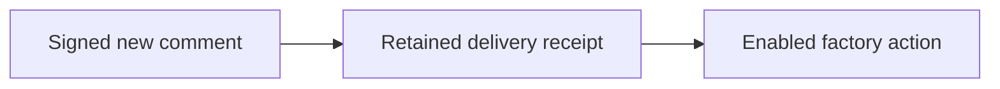

# Work from your repository

<!-- Copyright 2026 Firefly Software Foundation. SPDX-License-Identifier: Apache-2.0 -->

Use an issue or pull request conversation to request work and receive its recorded result. forge accepts structured comments from GitHub issues and pull requests, GitLab issues and merge requests, and Bitbucket Cloud pull requests. `run`, `test` and `maintain` admit factory runs; the other supported commands read evidence, change explicitly authorized settings or request an existing lifecycle action. An accepted command is not evidence that its work passed verification.

Source-control integration has two directions: a signed conversation can request a permitted action, and forge can reply with its retained outcome or publish verified code. This is not continuous mirroring of issue text, product definitions and repository files. Your team still reviews requirements, resolves conflicts and merges pull requests. [Source-control connections](scm.md#understand-the-two-directions) describe the Git boundary.

| Provider | Inbound verification | Supported conversations |
| --- | --- | --- |
| GitHub | HMAC-SHA256 over the original body; `X-Hub-Signature-256` | Issues and pull requests |
| GitLab | Constant-time comparison of `X-Gitlab-Token` | Issues and merge requests |
| Bitbucket Cloud | HMAC-SHA256 over the original body; `X-Hub-Signature` | Pull requests |

<div class="forge-flow forge-flow--dependencies" role="region" aria-label="Signed repository command flow" aria-describedby="repository-command-guide" tabindex="0" markdown="1">



</div>

<p class="forge-flow-caption" id="repository-command-guide">The signature identifies a delivery; current actor, command and repository checks decide whether its action may run. A receipt can be denied or unresolved. Focus and scroll the diagram on a narrow screen.</p>

Bitbucket Cloud [removed its native issue tracker API in August 2026](https://developer.atlassian.com/cloud/bitbucket/changelog/). forge rejects Bitbucket issue creation and legacy issue events. Use a pull request conversation; a Jira connector is not part of this integration.

## Connect and authorize

1. Connect the repository through [your GitHub App or provider OAuth application](scm.md). forge checks its current grants before remote writes. GitHub issue authoring needs the App's **Issues: write** permission; pull request comments also use **Pull requests: write**. GitLab needs its configured API grant. Bitbucket needs pull request write access.
2. Open **Administration → Repository workflow → Repository commands**, select the registered repository under **Workflow project**, and configure the Trust, Commands, Webhook and Review steps. Enable the workflow and enter exact trusted actor IDs: numeric GitHub/GitLab user IDs or Bitbucket account UUIDs. Names, organization membership, labels, and a comment mentioning forge do not grant execution rights.
3. Save a separate webhook secret. It is write-only; configuration responses show whether it is present. This secret is independent of the forge operator token and provider OAuth/App credentials.
4. Configure the provider webhook to send comment events to `https://YOUR-FACTORY/api/v1/webhooks/PROVIDER/REPOSITORY_ID`. Use `github`, `gitlab`, or `bitbucket` and the forge repository ID. Terminate HTTPS at your organization's gateway. The webhook route verifies provider credentials rather than accepting the operator token.
5. Select the allowed commands, agent, product stack, publish setting, and operator-owned verification commands. Save a [product definition](product-definition.md) when the work needs a customer contract.

GitHub and Bitbucket signatures are verified against raw bytes without JSON reserialization. GitLab's supported secret-token mode requires HTTPS; it does not provide a payload HMAC. GitLab's newer signing-token mode is not supported by this configuration. Consult [GitHub verification](https://docs.github.com/en/webhooks/using-webhooks/validating-webhook-deliveries), [GitLab webhook headers](https://docs.gitlab.com/user/project/integrations/webhooks/), and [Bitbucket webhook secrets](https://support.atlassian.com/bitbucket-cloud/docs/manage-webhooks/).

### Keep the authorities separate

| Authority | What it controls |
| --- | --- |
| Factory administrator | Provider application settings, shared application onboarding, and the global delivery receipt process/reconciliation routes. |
| Current project/repository permissions | Read repository settings; change collaboration policy with repository `members` permission; author an issue with repository `edit` permission. A reviewed product save also requires `review`. |
| Exact provider actor and allowlists | Which signed comments may use the repository's enabled commands. Configuration actions also require `configuration_actors`; shared ingress rechecks its global actor lists. |
| Provider application grant | Whether forge can currently access the remote repository or write the requested comment, issue or branch. |

A provider user ID is separate from the factory session identity. Granting a comment author permission does not turn that author into a factory administrator or let a command replace operator-owned checks. A factory administrator should complete the full Studio setup and receipt-inspection journey; the repository policy API also enforces the narrower project permissions above.

## First request: inspect, test, then build

1. Finish the connection and workflow setup, including exact actor IDs and operator-owned verification commands. Confirm that the signed webhook URL is reachable through your deployment's HTTPS gateway. An API-only process can receive a delivery but does not start the collaboration poller. A configured execution owner is required to execute admitted runs and provide automatic lifecycle processing.
2. From an allowed provider account, post `/forge project` to read the registered repository and saved product revision. For a Bitbucket workspace, use a pull request conversation.
3. Post `/forge test` to request the configured checks. Inspect its receipt and the associated run in Studio; a queued run, a provider reply or an execution intent does not establish passing checks.
4. Once the product definition is reviewed, post a new `/forge run` command with a concrete brief. Inspect **Plan**, **Changes**, **Verification** and any required independent review before publication.
5. Keep publication disabled for a first test. Enable the separate publication policy only when the provider grant, project release authority and review gates are ready. Merging the resulting pull request remains a provider-side action.

<figure class="forge-shot" markdown="1">

<figcaption>Studio and signed commands use the factory's run machinery. This controlled setup screenshot illustrates reviewing a run before starting it; it is not a real webhook delivery or provider publication.</figcaption>
</figure>

## Commands

Post one complete command as the comment. Options are a JSON object on the same line. Ordinary discussion, edited comments, review annotations, and shell command lines do not dispatch work.

```text
/forge run {"brief":"Add customer ticket search with account-level access checks"}
/forge test
/forge maintain {"brief":"Fix the failed ticket search acceptance case"}
/forge status
/forge status {"run_id":"0123456789abcdef0123456789abcdef"}
```

`run` and `maintain` require a brief. `test` runs the operator-selected verification plan and reports failures. New runs receive the current saved product revision; add `"product_revision":3` to require that exact current revision. If it changed before dispatch, forge denies the command rather than silently using another contract.

Comments cannot supply executable arguments, provider credentials, arbitrary branches, publish flags, or deployment scripts. Agent, stack, verification commands, and publication come from the repository's operator settings. A command from an untrusted actor, another remote repository, or a revoked setting receives a denied receipt and creates no run.

Deployment requires an explicit command, trusted actor, allowed `deploy` command, `deploy_enabled`, and an allowlisted existing target:

```text
/forge deploy {"run_id":"0123456789abcdef0123456789abcdef","target_id":"staging"}
```

The deployment manager still checks repository ownership and the verified source snapshot. The command cannot create a target or bypass its deployment controls. Keep production targets disabled until an operator enables the required deployment policy.

## Receipts and feedback

forge records a delivery digest, provider identity, actor, command, decision, and associated run. GitHub delivery IDs, GitLab retry-stable `webhook-id`/`Idempotency-Key` headers, and Bitbucket request UUIDs prevent duplicate delivery processing. The originating comment ID also prevents a second run when a provider sends a new delivery ID for the same comment. A delivery ID reused for different bytes is rejected.

The inbox and run creation share a PostgreSQL transaction. The lifecycle worker runs under the factory's execution lease, dispatches accepted receipts once, and posts queued, paused or terminal status back to the originating conversation. An API-role process does not start this execution poller. `GET /api/v1/collaboration/receipts?repository_id=ID` exposes receipt state to a current factory administrator; it is not a project-reader history endpoint.

Inspect `status` separately from `feedback_status`. An action can have completed locally while its remote reply is uncertain. The receipt retains provider, actor, originating conversation, run/action references and any remote write intent. **Changes** and **Verification** show the associated run evidence; receipt processing never substitutes for those checks.

<figure class="forge-shot" markdown="1">

<figcaption>Inspect the retained patch and run status before resuming or publishing. The interrupted fixture shown here does not establish a successful run or a remote commit.</figcaption>
</figure>

Remote comments and issue creation record a durable write intent before calling the provider. A timeout, interrupted write, or uncertain response produces `feedback_status: needs_reconciliation`. forge does not repost it automatically. Check the provider conversation before taking a new action; do not treat an unknown outcome as a failed write. After checking, a current factory administrator can call `POST /api/v1/collaboration/receipts/ID/reconcile` with `outcome: posted` or `not_posted` and a note. This records the observed result and sends no remote request. If no comment was posted, request a new explicit `/forge status` rather than replaying the uncertain write.

Operators can author GitHub/GitLab issues through `POST /api/v1/repositories/ID/issues` with `title`, `body`, and an optional `idempotency_key`. Reading the same key returns its retained decision, including an uncertain outcome, without creating another remote issue. Keep that identity when checking a lost response. Without a key, identical title/body content shares a digest key. Changing content with the same key is rejected. Provider App/OAuth credentials authorize the outbound call; the forge operator token is never used as a provider credential.

### Choose the right receipt action

| Observation | Explicit next step |
| --- | --- |
| `status: received` | The execution owner may process the retained receipt. The administrator's `/collaboration/receipts/ID/process` route addresses that same receipt. |
| `feedback_status: needs_reconciliation` | Check the original provider conversation, then record `posted` or `not_posted` with a bounded evidence note. Reconciliation makes no remote request. |
| `status: needs_reconciliation` with an uncertain channel action | Check its local product/source/model result and any remote reference, then record `completed` or `not_completed`. This does not retry the action. |
| Run needs reconciliation or publication outcome is unknown | Use the run's own [recovery contract](recovery.md). A conversation receipt cannot clear an unknown execution or publication effect. |

Redelivery of the same originating comment is deduplicated, even with a different delivery ID. A newly posted comment is a new input and may request new work; do not use one as an automatic retry for an uncertain effect. After inspecting a missing reply, a new explicit status comment can request a fresh observation. Provider settings and actor permissions are checked again during dispatch, so an earlier accepted delivery can still be denied after revocation.

These flows are tested with isolated PostgreSQL schemas and provider HTTP transports. They do not claim a live customer repository has granted access or accepted a webhook. Validate those grants and one signed delivery on your deployment before enabling automatic work.

The loopback HTTP lifecycle test also starts the authenticated [pyfly](https://fireflyframework.org/frameworks/python/) API and
provider fixture servers. For each managed provider, a trusted project comment
reaches the inbox and receives one remote reply. A fixture disconnect after
accepting a second reply leaves the receipt uncertain; repeated processing and
operator reconciliation do not repost it. Revoking the fixture's repository
grant prevents the next outbound comment. This demonstrates the local request
and durable-receipt lifecycle, without claiming live provider installation or
permission acceptance.

## Register projects from a shared provider channel

For shared ingress, open **Repository workflow → Application onboarding** as a factory administrator. Configure the connected GitHub App or OAuth application once, then save operator-authenticated `PUT /api/v1/collaboration/bootstrap/PROVIDER`. The setup fields are `enabled`, `auto_register`, `trusted_actors`, `configuration_actors`, `defaults`, and the write-only `webhook_secret`. `configuration_actors` must be a subset of trusted actors. Both `enabled` and `auto_register` start false; enabling onboarding does not by itself authorize registration of new repositories. Defaults use the repository collaboration schema; verification commands, stack, agent, publication and deployment settings remain operator-owned.

Point the provider webhook at `https://YOUR-FACTORY/api/v1/webhooks/PROVIDER`. No forge repository ID is needed in this route. The first trusted structured comment can register its repository only after a fresh application-grant check confirms its exact remote identity and URL. Existing repository settings are preserved. GitHub installation and added-repository events must match the configured App installation; registration uses fresh granted repositories, not a repository list asserted by the payload. [GitHub documents these installation events](https://docs.github.com/en/webhooks/webhook-events-and-payloads).

`GET /api/v1/collaboration/bootstrap/PROVIDER` returns readiness booleans and a relative ingress path. It never returns a webhook secret or invents a publicly reachable URL. Operators provide their deployment's HTTPS address. `GET /api/v1/collaboration/bootstrap/PROVIDER/receipts` returns the latest global receipts, including denied events and the routed repository receipt ID. Dispatch rechecks global actor permissions and current repository grants, so removal after delivery prevents queued work.

## Define and operate a product in the conversation

Enable individual entries in the operator-owned `channel_commands` allowlist. Its default is empty for existing repository configurations; global onboarding defaults allow only `project` in this additional registry. Product saves, brand changes and design previews also require an explicit configuration actor in both repository and global settings when the delivery uses global ingress.

| Command | JSON options and actual action |
| --- | --- |
| `/forge project` | Return the registered repository and current product revision; `operation: repositories` discovers authorized registered repositories; `configure` saves a `project_definition` with optional `project_id`; `status` reads the specified `project_id` |
| `/forge analysis` | `operation: start`, `project_id` and optional `component_ids`; `status` with optional `analysis_id`; or `review` with `analysis_id` and its exact `digest` |
| `/forge assistant` | `operation: start` with optional `project_id`; `status` with optional `conversation_id`; or `turn` with `conversation_id`, a 32-character hexadecimal `request_id` and `message` |
| `/forge roles` | `operation: status`, or `configure` with validated `roles`; optional `project_id` selects logical-product defaults, otherwise repository defaults |
| `/forge product` | `definition`: complete product definition; save an immutable revision after normal architecture/design validation |
| `/forge brand` | `brand`: generated kit inputs or supported token/static SVG import; save the owned project kit |
| `/forge design` | `operation: preview` with optional complete `definition`, or `operation: status` with a saved `digest` |
| `/forge knowledge` | `operation: search` and `query`; `operation: index` with same-repository `run_id` and bounded `paths`; or `operation: remember` with a same-repository `run_id` |
| `/forge applications` | Return configured applications for this repository |
| `/forge maintenance` | `incident_id` and `brief`; queue maintenance for an existing same-repository incident with the operator's verification checks |
| `/forge resume` | `run_id`; use the execution journal's existing resume guards |
| `/forge handoff` | `run_id` and `agent`; hand off a paused/interrupted run through the journal |
| `/forge cancel` | `run_id`; cancel the same-repository run through the engine |
| `/forge publish` | `run_id`; require repository `publish` opt-in and the engine's final verification, source and review gates |

These commands supplement `run`, `test`, `maintain`, `status`, and the explicitly enabled `deploy` action. They accept data fields, not operator settings, shell arguments or provider credentials. Incident maintenance cannot provision a new application or deployment target. Knowledge indexing uses a validated run workspace; file paths are checked by the existing knowledge service. Brand import supports inline bounded JSON and static SVG, not arbitrary external attachment downloads.

Read-only search and status still require a trusted actor and an allowed command. A coding provider, configured application runtime or knowledge integration must actually be available for its action to succeed. Unsupported or uncertain effects remain visible in the receipt; they are not presented as completed capability.

## Publish review references without changing application source

The operator can enable `remote_artifacts` for a repository or its onboarding defaults. The flag is false by default. A permitted configuration actor's brand or design preview command can then publish the generated review files to `forge/references/DIGEST`, a separate deterministic branch. The originating conversation receives that branch link. A design status request only checks an existing reference; it does not create one.

Brand and design files live under `docs/forge-references/DIGEST/brand` or `design`, with a SHA-256 manifest. An assistant turn can publish its complete unreviewed proposal to `docs/product/proposals/TURN_ID.json` and `.md` on the same separate reference branch when `remote_artifacts` is enabled. The files mark the proposal as unreviewed for functional, architecture and design decisions. Publication accepts only generated kit and design reference names, at most 210 source files, 500 KB per file and 10 MB total. Provider reads are streamed with a 1 MB response cap.

The factory checks every expected file hash on an existing branch. A mismatch stops publication; it does not replace those files. The factory does not merge reference branches or alter the default branch. Repository collaborators can still edit branches unless the repository's own protection policy prevents it; subsequent hash checks detect changed reference files.

GitHub uses a repository-scoped **Contents: write** grant, separate from its issue-comment grant, and the [Git tree/reference APIs](https://docs.github.com/en/rest/git/trees). GitLab uses its authorized API grant and [create-only commit actions on a new branch](https://docs.gitlab.com/api/commits/#create-a-commit-with-multiple-files-and-actions). Bitbucket uses its OAuth **repository:write** scope and [branch/source upload APIs](https://developer.atlassian.com/cloud/bitbucket/rest/api-group-source/). Provider-specific contracts are covered by HTTP transport tests; this does not claim your installation has accepted a live reference publication.

The repository receipt records the target branch and manifest before any content write. Ownership, actor roles, command permission and the artifact opt-in are checked before remote effects. A timeout or interruption leaves `status: needs_reconciliation` with the retained reference intent. Processing the same receipt does not replay the action. Check the provider branch, manifest and any local product/brand changes, then record `completed` or `not_completed` through the existing receipt reconciliation route with an evidence note. This records an operator observation and sends no provider request. It does not automatically retry missing files or replay a partial write.

## Answer a factory question from the repository

An issue-bound paused run can post its durable worker request through the same feedback intent used for lifecycle status. Enable `respond` in `channel_commands` and grant the author a configuration role. `/forge respond {"run_id":"0123456789abcdef0123456789abcdef","request_id":"request-1","answer":"Support account owners receive alerts."}` records the answer once under the signed actor identity. The run remains paused until an explicitly enabled resume action. An answer does not authorize deployment or publication. See [Factory roles](agent-roles.md) for the typed feedback contract and request budget.

## Coordinate a logical product from signed comments

Project discovery returns at most 20 authorized registered repositories and a `next_cursor`. Supply that cursor in the next `project` request with `operation: repositories`. A repository appears only when the connected provider grants its exact remote ID, canonical name and URL, and the signed actor has configuration permission and the `project` command in that repository. The list does not reveal other registered projects.

A project configuration includes the native `ProjectDefinition` fields: name, description, topology, owners, components, and optional canonical `product_repository_id`, dependencies and roles. Component verification commands must remain omitted or empty in the comment. forge copies each component repository's operator-owned checks. Comments cannot replace shell arguments, webhook secrets, model credentials or the global role registry.

Every current project member must use the same connected provider as the signed origin, grant the exact actor and enable the requested action. Mutations, source inspection starts/reviews, repository discovery and model turns also require configuration permission across the graph. Reading older source reports or conversations checks their frozen member graph too. Removing a repository or revoking its grant does not authorize disclosure of its old evidence. A numeric actor ID from GitHub cannot stand in for a GitLab or Bitbucket identity.

Start a conversation with `/forge assistant {"operation":"start","project_id":"PROJECT_ID"}`. The operator's `assistant_agent` setting selects `bridge` or `agentic`; comment authors cannot override it. forge uses the project's canonical product repository after authorizing all members. Starting freezes configuration without invoking a model. A `turn` invokes the configured model and records its response under a caller-supplied request ID. Reusing the same ID and message retrieves the known response. A different message cannot reuse that ID. The reply remains unreviewed and cannot create a run, change the saved product, answer a worker, resume execution, publish code or deploy.

Use `analysis start` to inspect the authorized source components. `analysis review` acknowledges the exact observed-source digest, not functional behavior or a product design. Role configuration changes validated future-run defaults and preserves old run snapshots. Global role instructions and provider settings remain operator-only.

The repository inbox records an action intent before a model request, source inspection or configuration effect. Authorization failure before dispatch records a denial without an action intent. Unknown outcomes retain reconciliation state; the factory does not blindly retry a model turn or provider write. Comments contain a bounded summary, receipt and relevant IDs. Unreviewed status appears before shortened proposal text; an enabled reference publication supplies the complete proposal branch. Without that opt-in, the full result remains available through the authenticated receipt and assistant APIs.
