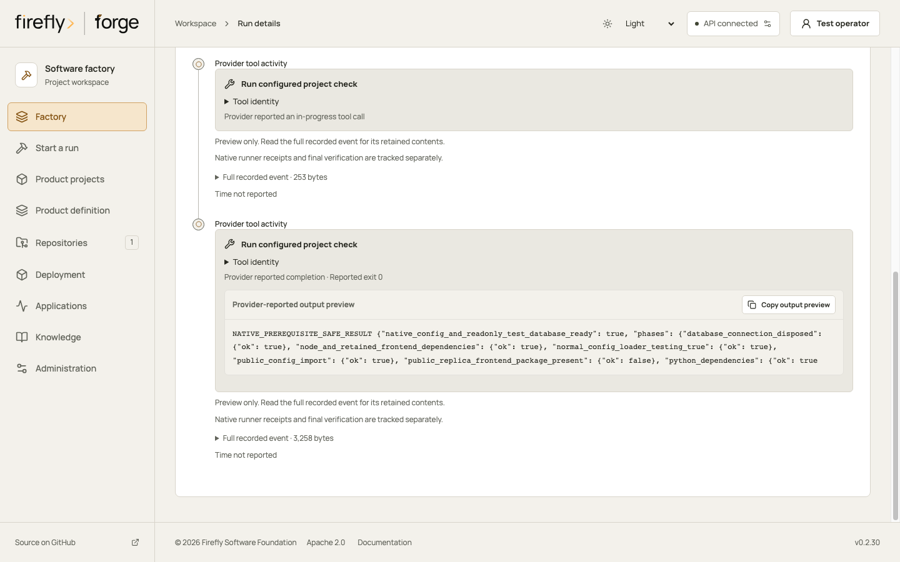
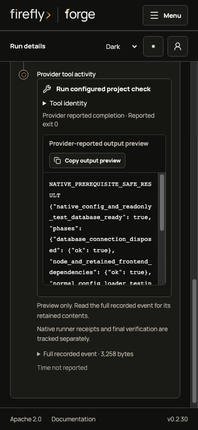
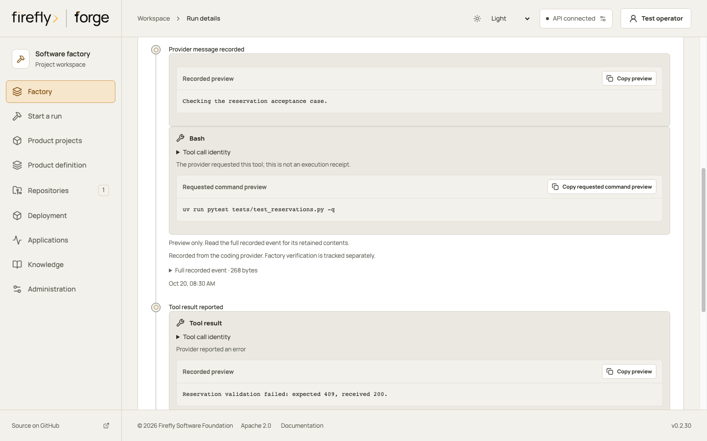
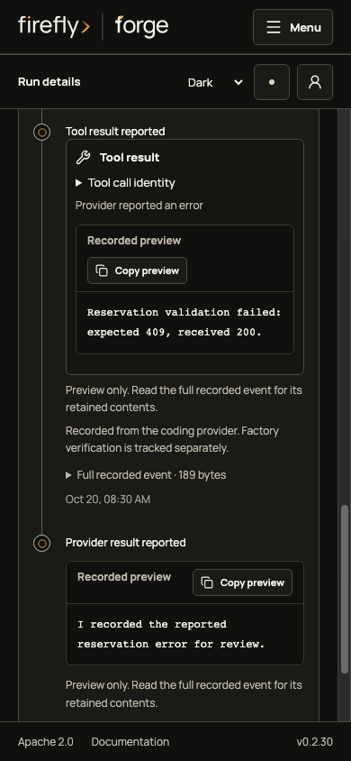
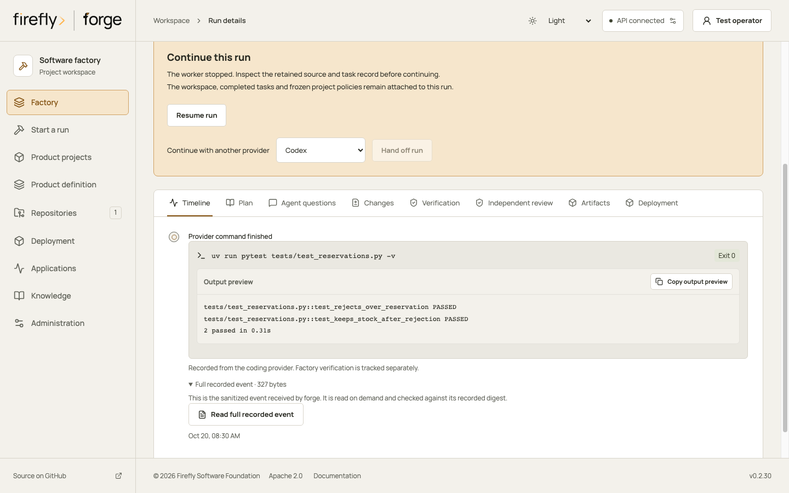
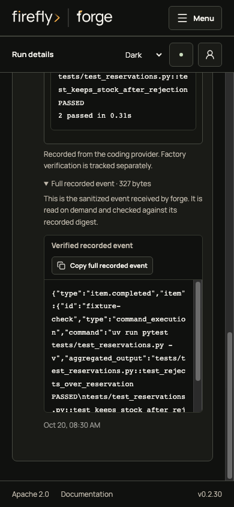

<!-- Copyright 2026 Firefly Software Foundation. SPDX-License-Identifier: Apache-2.0 -->
# Read and export run evidence

A run's evidence reader collects its retained activity, development plan, task state, WAL and tool results. It returns a consistent cut with exact record references. Reading evidence does not execute commands, replay tools, resume a run or resolve an unknown outcome.

Start with a small page:

```bash
forge evidence query RUN_ID --limit 10
```

The response contains a manifest, its `digest`, a `filter_digest`, matching records and `next_after`. Keep both digests when requesting another page:

```bash
forge evidence query RUN_ID --expected-cut CUT_DIGEST \
  --expected-filter FILTER_DIGEST --after NEXT_AFTER --limit 10
```

Use `--kind journal`, `--task-id implement` or `--text 'literal text'` to narrow a query. Text matching is literal and local; it does not call a search provider or model. Filters never expand access to other runs or repositories. A preview reports `payload_bytes` and `omitted_bytes`. Read the exact record when the preview omits content:

```bash
forge evidence query RUN_ID --expected-cut CUT_DIGEST --record-id journal:3
```

The query and its output are bounded. Exact records can be at most 1 MiB. A page has at most 50 records and 1 MiB of JSON. The full cut permits 2,048 journal entries, 4,096 activity entries, 1,000 tool rows, 128 tasks, 128 artifact references and 16 MiB of source JSON, with a ten-second snapshot timeout. Oversized or inconsistent evidence is withheld. A cut that changes before another page or export returns `evidence_cut_changed`; read a new cut explicitly. The server does not keep a separate history of these query snapshots.

## Export the reviewed cut

```bash
forge evidence export RUN_ID --expected-cut CUT_DIGEST --output run-evidence.zip
```

The output file must not already exist. The ZIP contains `manifest.json`, `run.json`, `plan.json`, `tasks.json`, `activity.json`, `journal.json`, `tools.json` and `artifacts.json`. The manifest lists each data member's byte length and SHA256. Its own `digest` seals its canonical JSON fields except `digest`; the HTTP `X-Content-SHA256` header identifies the complete ZIP. Repeating an export of the same unchanged cut with the same Python/zlib runtime produces the same bytes. Entries use fixed timestamps, Unix file modes and empty comments/extra fields; compressed bytes are not promised identical across different compression implementations or versions.

The WAL retains its original payloads and chain hashes. Activity and task rows carry observed state; they do not become immutable receipts merely by appearing in an export. The plan includes an explicit projection and the original plan digest. An execution actor copied from the run is labeled `observed_run_row` rather than presented as an immutable historical attribution.

`artifacts.json` contains references. A reference is `receipt_bound` only when its SHA256 appears in a matching immutable receipt. Older `changes.zip` records have no historical byte hash and are labeled `not_historically_bound`. Their bytes are not copied, rebuilt or certified by this export. The existing source ZIP endpoint remains available separately.

## Read complete provider activity

New stdout and stderr events retain a short preview and, for recognized provider JSON, a typed activity summary. Codex command records show their observed exit code and output. Claude records distinguish text, tool requests, reported tool results and final provider reports. **Read full recorded event** retrieves the retained sanitized message explicitly. Factory verification and product acceptance have their own records.

Codex MCP cards name the server and tool and show whether the provider reported an in-progress call, completion or failure. A bounded text preview and a reported exit code appear when the event supplies them. Completion is a provider report; it does not establish a native runner receipt or product QA. Arbitrary tool arguments and unsupported structured results stay in the full retained event. The native journal labels the separately governed `coding_configured_check` tool **Run configured project check**.

<div class="forge-shot-grid" markdown="1">

<figure class="forge-shot" markdown="1">



<figcaption>Actual redacted finite-client messages, displayed through controlled API fixtures. Reported exit 0 does not establish a native runner receipt or product acceptance.</figcaption>
</figure>

<figure class="forge-shot forge-shot--phone" markdown="1">



<figcaption>The exact tool identity is available separately. The preview preserves provider text; reading the full retained event requires an explicit action.</figcaption>
</figure>

</div>

Claude tool requests name the requested tool and show a Bash command preview when available. A request does not prove that a tool ran. Tool-result cards show the provider's reported result or error without deriving an exit code, and keep the original call ID under **Tool call identity**. forge does not infer a tool name from another event. A successful final provider report supplies no factory QA approval.

A Claude message can contain several content blocks. Studio displays up to four bounded blocks and states how many blocks were omitted from the preview. When the archive retained the full event, you can read those blocks there. An archive-limit notice means only the preview was retained. Tool input objects, attachments and unsupported block formats stay in the retained event. Unknown, malformed or oversized JSON previews receive a short generic card; plain text logs remain readable. Full content is loaded only when requested and within its archive budget. These display rules recognize an observed JSON format; they do not authenticate the provider or replace a command receipt.

<div class="forge-shot-grid" markdown="1">

<figure class="forge-shot" markdown="1">



<figcaption>This controlled Claude message requested a command. Its request card supplies no execution receipt.</figcaption>
</figure>

<figure class="forge-shot forge-shot--phone" markdown="1">



<figcaption>The provider reported a tool error. Read the full retained event explicitly when needed; factory verification is recorded separately.</figcaption>
</figure>

</div>

<figure class="forge-shot" markdown="1">

<figcaption>This controlled walkthrough shows a preview. Reading complete content is a separate action.</figcaption>
</figure>

<figure class="forge-shot" markdown="1">

<figcaption>The client verifies all returned chunks before offering the complete sanitized content for copying. These fixture screens establish presentation, not live provider execution or product acceptance.</figcaption>
</figure>

Each new event carries an `activity_content` descriptor binding the run, event, stage, byte count and sanitized-message SHA256. Available content is limited to 4 MiB per message, 64 MiB and 4,096 messages per run. `budget_exceeded` means the full message was not retained. Historical events are not backfilled. D04 run-evidence pages and ZIP exports retain only the activity index and bound descriptors; they exclude complete content bytes and keep their existing limits.

Read one available message using its exact descriptor:

```bash
forge evidence activity RUN_ID EVENT_ID --expected-descriptor DESCRIPTOR_SHA256 --chunk 0
```

HTTP uses `GET /api/v1/runs/{run_id}/activity/{event_id}/content` with `expected_descriptor` and `chunk`. The SDK method is `ForgeClient.run_activity_content(run_id, event_id, query)`; MCP exposes `get_run_activity_content`. Each response returns at most 16 KiB in `data_base64`, with byte offset, total size, sanitized-message digest and `next_chunk`. Follow that ordinal until `null`, concatenate decoded bytes, and verify the complete size and SHA256 before decoding UTF-8: a character may span chunks.

Every chunk requires current native read authority over the run's repository and frozen project scope, and checks the whole retained message for newly registered credentials. Revocation, descriptor or scope changes, missing or corrupt content and exhausted budgets withhold content with an explicit error. Private responses are not cacheable. These reads do not replay commands or change a run's verification state.

## Current access and withheld evidence

The reader needs a current native identity, project read permission and read access to all historical repositories named by the verified project revision. Unassigned executions require a factory administrator. A delegated SCM status or answer permission does not grant evidence export.

Forge checks current credentials before returning a page or download and rechecks access afterward. A newly registered credential in retained output causes the evidence to be withheld; the original sealed payload stays unchanged. Credential admission failure, a revoked reader, integrity errors or timeout cannot yield a partially verified download. The service refuses calls made inside an existing transaction so credential checks do not wait while that caller holds database locks.

## Agents and clients

`ForgeClient.run_evidence` and `export_run_evidence` use the same authenticated endpoints. The factory MCP tool `query_run_evidence` supports the typed query, including exact record reads.

The native Agentic tool `read_run_evidence` is an explicit implementation-stage role grant for API and Bridge workers. Existing default workspace grants stay unchanged. Its callback is bound to the current run and task by the server, checks that task's frozen grant, the original execution identity and current read permissions, and limits output to ten records and 32 KiB. It accepts no alternate actor, project, run or task. Independent review and design providers do not receive this callback. Larger records remain available to authorized operators through the bounded HTTP reader. This tool reads retained records without invoking ToolBroker callbacks or writing query events into the WAL it reads.

An evidence export describes the retained records and their stated verification boundary. It does not establish live provider execution, certify unbound artifact bytes or restore an interrupted Agentic graph.
