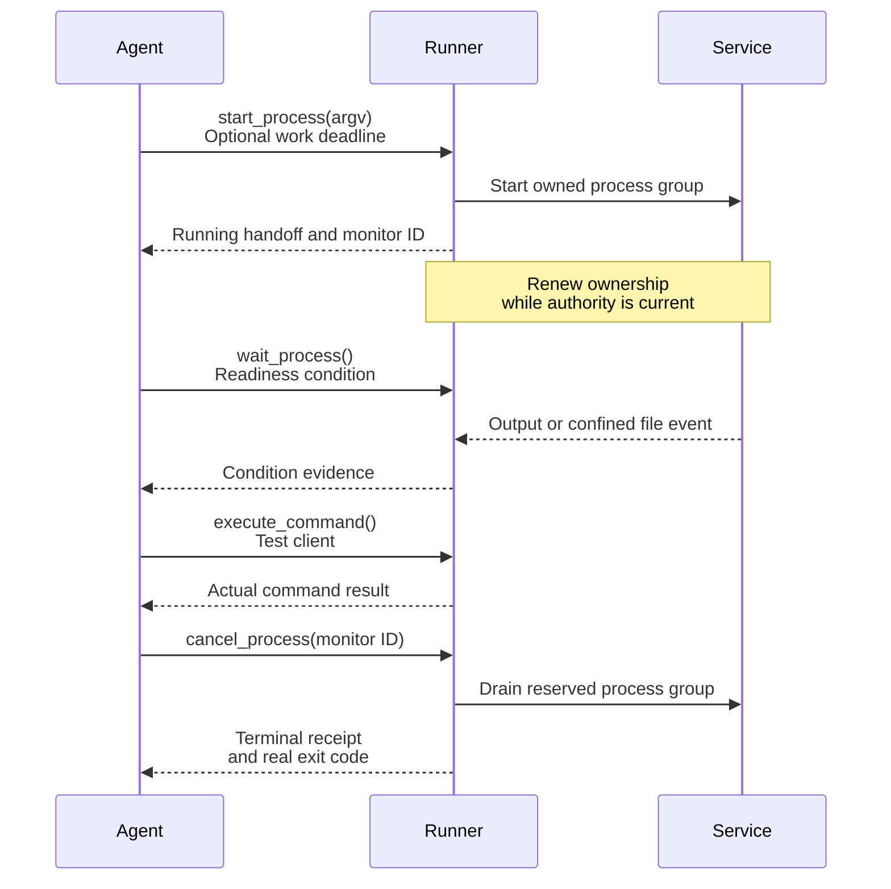

<!-- Copyright 2026 Firefly Software Foundation. SPDX-License-Identifier: Apache-2.0 -->
# Wait for an owned process

Use process monitors when an implementation needs a running service or must wait for a concrete event before continuing. `start_process` returns a monitor ID after the running process has a durable ownership handoff. `wait_process` evaluates its condition inside the runner, so the agent can make one wait call instead of repeatedly asking the model whether work has finished. Once the service is ready, another authorized tool can use it.

This capability is disabled by default. It supports the native Python tools used by Firefly Agentic and bridge providers with a host runner. Docker and pool transports are unavailable. Invocations requiring native checkpoints reject monitor grants; ordinary Codex and Claude Code processes keep their own CLI policies.

## Configure the runner and role

In the repository runner settings, enable `process_monitor` for host mode. `max_output_bytes` bounds captured output, and each start consumes one slot from `command_limit`. Select the version-two work-duration policy so jobs have no work deadline unless one is chosen. `monitor_owner_grace_seconds` controls orphan detection while ownership heartbeats are renewed; it does not limit job length. For example, the body of `PUT /api/v1/repositories/{id}/runner` can contain:

```json
{
  "sandbox": {
    "mode": "host",
    "process_monitor": true,
    "work_duration": {"protocol": "forge-work-duration-v2", "timeout_seconds": null},
    "monitor_owner_grace_seconds": 30,
    "monitor_timeout_seconds": null,
    "max_output_bytes": 1000000,
    "command_limit": 20
  }
}
```

Choose these settings for the project workload. `work_duration.timeout_seconds`, `monitor_timeout_seconds`, and a start request's optional `timeout_seconds` are explicit work caps. The smallest chosen value applies; when all are `null` or omitted, the process has no work-duration cap. Captures without `work_duration` retain the legacy command policy and cannot enable monitors. The host service account still supplies the operating-system permissions; host mode does not enforce CPU, memory, or network isolation.

Before creating the run, add the five monitor tools and `execute_command` to the implementation role's allowed tools. Preserve any source tools the role needs. Saving the runner setting does not grant a role new tools, and changing settings does not update an existing run's frozen policy.

## Start, wait, use, stop

Call `start_process` with a typed `request`, such as:

```json
{
  "request": {
    "argv": ["python", "-u", "server.py"]
  }
}
```

Keep the returned `monitor_id`. To wait for the service's readiness message, call `wait_process`:

```json
{
  "request": {
    "monitor_id": "<returned monitor ID>",
    "condition": {"kind": "output", "text": "Listening"}
  }
}
```

A start request may include `timeout_seconds` when that job needs a deadline. That deadline includes startup admission and is not restarted after a slow handoff write. A wait request may include its own `timeout_seconds` when the caller wants to stop waiting after a chosen interval. Both default to `null`; an unbounded wait remains cancellable. The output condition matches a literal UTF-8 string in the same redacted text returned by logs. Other conditions are `{"kind":"exit"}` and `{"kind":"file","path":"ready.json"}`. A file condition may also require an exact `sha256`. Paths are relative to the component and use the same descriptor checks as source tools: private paths, symlinks, hardlinks, aliases, and changed files are refused. File readiness checks stay within the component; arbitrary HTTP URLs and operating-system PIDs are not accepted as wait targets.

The wait returns typed evidence with `condition`, `outcome`, and `observation`. `outcome` is `satisfied`, `timeout`, `process_ended`, or `unavailable`. Unverified terminal custody reports `unavailable`; it cannot satisfy an exit condition. A verified exit condition can be satisfied by a failed process: inspect `exit_code` to decide what to do next. A wait timeout or cancellation of the wait itself leaves the service running. Call `cancel_process` with its monitor ID when finished; cancellation or completion of the whole agent invocation also drains its owned monitors.

<div class="forge-flow forge-flow--dependencies" role="region" aria-label="Process readiness and cleanup sequence" aria-describedby="process-readiness-guide" tabindex="0" markdown="1">



</div>
<p class="forge-flow-caption" id="process-readiness-guide">The agent waits for observed readiness before testing the service, then closes its owned process. Scroll horizontally on a small screen to follow the exchanges.</p>

## Coordinate independent services

Start each service once and keep its own `monitor_id`. The processes can run at the same time while the agent waits for each required readiness condition. Read status and logs by that identity. Cancelling one monitor leaves the other owned processes running; they retain their own exit results and terminal receipts. When the whole owning invocation ends, it drains all of its remaining monitors.

For example, start an API and its frontend, wait for both readiness messages, then run a browser check against them. If the frontend fails, preserve its output and inspect the API separately before deciding which component needs a change. Each start still consumes its own durable command slot; parallel execution does not create another budget or refund a stopped service.

## Read status and output

`process_status`, `process_logs`, and `cancel_process` take `monitor_id`. Statuses are `running`, `settling`, `exited`, `cancelled`, `timed_out`, `output_limit`, and `needs_reconciliation`. `settling` means cleanup or its durable terminal record is still pending; its exit code remains unavailable. A running handoff does not contain a successful exit code.

Logs are bounded redacted snapshots; incremental cursors are not implemented. Known credential representations are redacted before the response is bounded, including incomplete credential suffixes split across pipe reads. `output_bytes` and `output_sha256` describe the visible redacted text. `output_truncated` identifies a captured output overflow, an incomplete UTF-8 suffix, or a redacted response that exceeded its byte window. Exceeding the captured output policy stops the owned process.

The host guardian retains its direct child's PID without reaping it until group signaling finishes. It then reaps the child and verifies the group has no runnable members. The manager requires that private control receipt and drained output/control streams before recording successful cleanup. The runner renews ownership through sequenced heartbeats on its private control pipe after checking current ownership, authority, and budgets. Control-pipe EOF or a missed heartbeat drains the group; cancellation and revocation also stop it. The manager never signals an arbitrary PID supplied by a caller. An unavailable non-reaping POSIX primitive refuses startup.

Start services in the foreground so their descendants remain in the owned process group. Daemonizing or moving a child into another session is unsupported. Host monitoring provides process custody within that group; it does not replace operating-system isolation.

## Budget and restart behavior

Starts use the existing durable command ordinal and total command budget. Status, log reads, waits, and cancellation create no new process or command allowance; they still count as native tool calls. Stopping a monitor does not refund a command. Active services do not masquerade as finished foreground commands: later commands require the exact current manager, acknowledged ownership window, running handoff, and journal anchors. Terminal cleanup has its own real receipt.

A new executor cannot adopt or restart an unresolved retained monitor. It reports `needs_reconciliation` and refuses commands that depend on that live handoff. No command is automatically dispatched again after a lost owner or an uncertain handoff write.

Waits remain inside the active agent invocation and its existing deadline. Durable parked-agent resumption and deferred SDK tool results are outside this capability. A heartbeat renews ownership only. It does not reset or extend the run's provider, command, or grant budgets. `ownership_expires_at_ms` is renewable liveness evidence; `work_deadline_ms` is `null` unless an explicit work cap applies. Owner loss reports `needs_reconciliation`; `timed_out` identifies a chosen work deadline.
