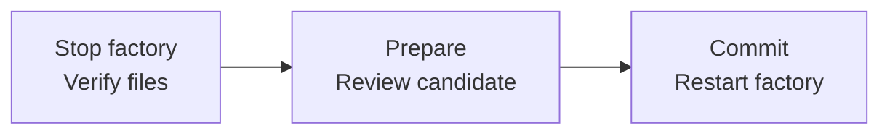

<!-- Copyright 2026 Firefly Software Foundation. SPDX-License-Identifier: Apache-2.0 -->
# Separate API admission from execution

Choose the runtime topology before starting an installation. The default combined service serves the API and owns execution. A split installation has API replicas and headless worker replicas, with one execution leader and waiting standbys. Every process uses PostgreSQL and the same private configuration, workspace and artifact storage.

| Process | Start command | Responsibility |
| --- | --- | --- |
| Combined | `forge serve --role combined --data-dir /srv/forge` | Serve the API and execute queued work |
| API replica | `forge serve --role api --data-dir /srv/forge` | Authenticate requests, check project access, admit work and read results |
| Headless worker | `forge worker --data-dir /srv/forge` | Wait for leadership, then execute queued work and retain command, verification and delivery receipts |

`FORGE_SERVICE_ROLE` selects the role when no explicit serve option is given. `forge worker` always selects the worker role and opens no HTTP listener. Configure the database and identity settings described in [installation](installation.md) and [sign-in](identity.md). Serve remote users through one HTTPS origin.

## Share the actual retained state

Every process in an installation must use the same database, schema, private storage root and operating-system identity. The topology record binds the resolved storage path, owner ID and a retained random `runtime-storage.identity` marker. That marker must remain a private regular file with one link and mode 0600. Separate storage roots with the same path and owner ID have different markers and are rejected.

A copied backup can carry the same marker, so marker equality does not prove a live shared filesystem. Multiple machines require a verified read-write shared volume with working file locks, atomic publication and durable writes. Mount and verify the actual shared storage before starting workers. Local multiprocess qualification does not establish multi-host failover.

Workspace and runner receipts retain absolute storage paths. Every failover node must see the same retained files at those paths before it can reconcile or continue an operation.

Before an older installation first adopts the marker, stop **all** existing runtime nodes, including API replicas. The first upgraded startup preserves the original immutable topology row and records an additional immutable storage attestation after validating its mode, path and owner. A PostgreSQL execution fence excludes a live leader during adoption; old API processes are not detectable through that fence. Keep the new marker with the installation's private state and backups. Never delete or replace it to make a different storage root pass admission.

The first startup records `combined` or `split` in PostgreSQL. Later processes cannot change that choice. Starting an API replica against an existing combined installation is rejected; a second combined execution owner is also rejected. There is no automatic topology conversion. Plan an explicit maintenance procedure and preserve the ledger and source together before changing an existing installation.

## Move a stopped local installation

Keep active configuration, workspaces and runtimes on a fully available local filesystem. Cloud-synchronized folders can leave file placeholders unavailable just when a worker needs them. Moving a folder also changes its storage binding: copying the identity marker or editing paths in old receipts does not authorize the new location.

`forge native-locations` provides offline maintenance for an existing **combined** installation. Stop every factory process first. Keep the same PostgreSQL cluster, database, schema, operating-system owner and private `runtime-storage.identity`. The database must remain available for maintenance. This procedure does not convert a combined installation to split mode or move files for you.

Use the upgraded release for every process after the move. Keep the former root and any retained identity copy out of service. Location receipts are enforced by the upgraded runtime; they do not prevent an obsolete binary from accepting an old topology at its former path. Restarting or failing over to that binary after transfer is unsupported.

<div class="forge-flow" role="region" aria-label="Offline location maintenance diagram" aria-describedby="native-location-flow-guide" tabindex="0" markdown="1">



</div>

<p class="forge-flow-caption" id="native-location-flow-guide">Follow the move from left to right. On a narrow screen, focus the diagram and scroll with the arrow keys.</p>

Prepare three private JSON documents outside source control:

| Document | Contents |
| --- | --- |
| Location plan | Version 1, exact `source_storage` and `target_storage`, selected `workspaces`, and any `verification_runtimes`. Each workspace retains its original run ID and relative directory. |
| File manifest | Version 1, `required_files` with exact relative paths and SHA-256 values, and a separate `unavailable_files` inventory. Required inputs include the retained identity, provider and source-budget policy files, and every selected configuration revision and model-selection manifest. |
| Acknowledgment | Version 1, a fresh `request_id`, the reviewed `candidate_digest`, and explicit `true` values for `acknowledge_stopped_runtime`, `acknowledge_history_preserved` and `acknowledge_no_execution_grant`. Create this after reviewing the candidate. |

A runtime mapping declares either `byte_identical` content or an explicitly reviewed `verification_runtime_baseline`. The latter binds the new dependency environment and its approval digest; it cannot reuse checks from the old environment. Missing required bytes, placeholder files, aliases, changed source or a different Git identity stop preparation. Unavailable historical files remain unavailable; maintenance cannot turn them into empty files or default settings.

With the existing database environment configured, prepare a candidate at the target storage root:

```bash
forge native-locations prepare \
  --data-dir /srv/forge \
  --postgres-data /srv/postgresql/data \
  --plan /srv/maintenance/plan.json \
  --files /srv/maintenance/files.json \
  --scratch /srv/maintenance/scratch \
  --output /srv/maintenance/candidate.json
```

All input files and the scratch and output directories must be private and owned by the operator. The candidate output must be a new file. Review its digest and selected paths, then write the matching acknowledgment before committing:

```bash
forge native-locations commit \
  --data-dir /srv/forge \
  --candidate /srv/maintenance/candidate.json \
  --files /srv/maintenance/files.json \
  --acknowledgment /srv/maintenance/acknowledgment.json \
  --scratch /srv/maintenance/scratch

forge native-locations status REQUEST_ID --data-dir /srv/forge
```

Commit remeasures the candidate, excludes a live execution owner and appends an authenticated intent/receipt pair. The original topology, WAL, command arguments and counters stay unchanged. Upgraded runtime startup accepts the completed current location and rejects the former root. Retained logical paths are linked to their reviewed physical paths in new execution evidence; scripts and historical records are not rewritten.

If commit does not confirm, inspect **the same request ID** before doing anything else. An unknown outcome stays held. A completed repeat returns its saved receipt; it does not transfer the installation again. Maintenance grants no model, command, publication or deployment authority. Any later recovery or execution must pass its normal current permissions, source and budget checks.

## Run standby workers

In a split installation, additional headless workers remain in `standby` while the existing leader holds either ownership fence. A worker must acquire both the private storage lock and the PostgreSQL schema advisory lock before recovering retained work or starting any execution consumer. Standbys retry contention every half second; database, topology and configuration errors cause startup to fail. A stop signal cancels waiting startup without promoting the worker.

After a leader exits, a standby can acquire the released fences, recover retained work and become the new leader. Recovery rechecks ownership between services. Interrupted work with an intent but no durable receipt requires reconciliation; promotion does not repeat uncertain commands or remote effects. Losing the database ownership session drains the old leader and stops its consumers before its storage fence is released. A stuck process or an unavailable shared filesystem can therefore delay promotion; supervisors must stop the old process and verify retained work.

Shutdown closes dispatch before capturing every execution consumer and its active effect tasks. When several consumers detect the same lost lease, shutdown lets an effect already handling cancellation finish draining its process and recording its interrupted status; it does not cancel that cleanup again. If a consumer exceeds the native shutdown deadline or suppresses cancellation, the storage fence remains retained even when the PostgreSQL connection closes. The standby cannot recover that work while the old process can still produce effects. Promotion then requires actual process exit or an explicit stop after every retained consumer and effect task finishes. A timeout alone does not prove that execution drained.

`FORGE_CONCURRENCY` sets the active leader's coding/test-job budget, from 1 to 64 (default 2). The scheduler also admits at most one active job per repository. Standbys add availability, not execution capacity: two replicas still share one leader's budget. This is not an active distributed worker pool, and it does not provide independent storage replicas or deployment-target failover.

For a new Compose installation, use `docker compose -f compose.split.yaml up --build --scale worker=2 -d` with the same database and identity environment required by the default Compose file. The split example includes the same managed Flycanon dependencies as the default stack. It shares one private factory volume and exposes only the forge API service on loopback. Both API and worker startup wait for authenticated knowledge initialization and actual cited framework retrieval. Put that API behind the installation's HTTPS origin. Do not start the combined Compose service against the split schema. Moving workers to multiple machines requires separately verified shared storage, matching paths and the same operating-system owner; a same-host Compose volume alone does not establish cross-host availability.

## Follow admission through delivery

An API replica may resolve bounded Git metadata, but it does not run project commands, publish branches, deploy products or execute rollback commands. Publication and cancellation create persisted execution requests; deployment and rollback have their own persisted operation records. The worker rechecks authority and source before dispatch.

HTTP acceptance means the request was retained. It does not mean a pull request exists or a worker has stopped. Inspect the request's status and receipts, then the recorded publication URL or deployment checks. [Recovery](recovery.md#reconcile-worker-delivery-requests) explains what happens when an effect has an uncertain result.

Admission snapshots preserve the requesting identity, but they do not freeze its authority indefinitely. The worker checks current local identity status and project permissions before effects. An OIDC administrator also needs a current, unexpired validated API-client grant matching the admitted audience. An expired or removed global role cannot authorize host coding or host verification. Current project membership may still permit isolated work. Refresh sign-in before relying on administrator authority for a long-running job; a queued administrator flag is not a renewal. See [identity](identity.md) for token ordering and provider-revocation limits.

Product conversations and identity administration can run on an API process. Their own ownership and recovery controls apply. Some explicit channel messages and verified-source knowledge indexing still require the execution owner; they are not queued through an API replica. Check the operation's contract before routing every write to a split API.

## Read health accurately

`GET /api/v1/health` reports the process role, `admission_ready` and `execution_ready`. A healthy API replica reports `execution.state = api_only` and local execution disabled. It can accept authorized work without claiming that a remote worker is available; `remote_worker_state` remains `unknown`.

Studio does not show an execution-restart warning for that healthy API-only state. It still shows degraded health, an explicit diagnostic or an unavailable execution process. The authenticated metrics endpoint uses the same health calculation: `forge_admission_ready` reports local admission readiness, while `forge_execution_ready` reports local execution readiness. Neither gauge establishes remote worker availability or confirms a command's outcome.

On an execution process, `execution.state` distinguishes `standby`, `recovering`, `ready`, `stopped` and `degraded`. Only `ready` reports `execution_ready = true` and a nonzero `max_parallel_jobs`. A standby has admitted its topology but has no execution consumers or capacity; headless workers expose no HTTP listener, so their supervisors must also track process state and the retained ledger. An API replica continues to report remote worker availability as unknown.

Every required leader consumer is supervised: coding, delivery requests, deployments, campaigns, repository-channel work and application observations. A stopped consumer degrades health; a headless worker drains its lifecycle and exits so its supervisor can handle the failure. Inspect retained work before restarting. Neither a successful health response nor an automatic restart resolves an unknown external effect.
