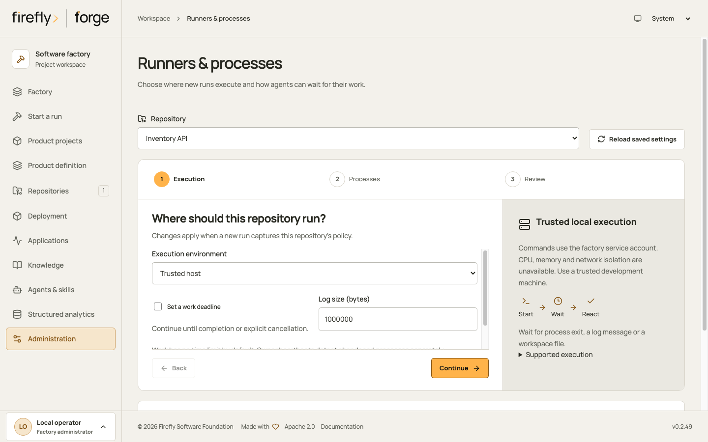
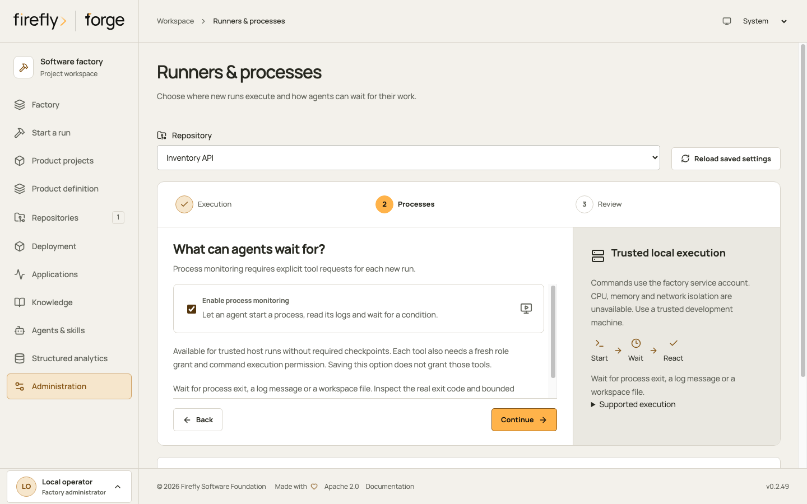
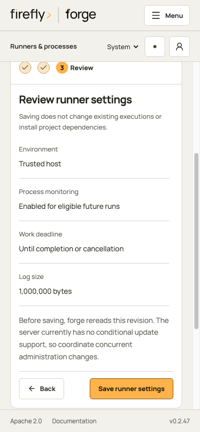
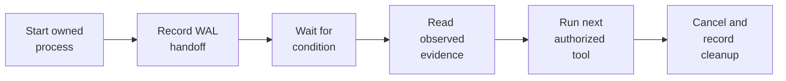
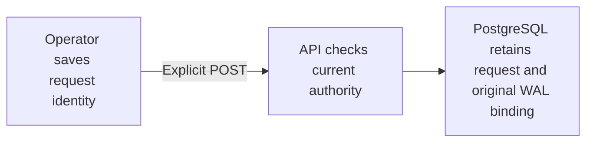
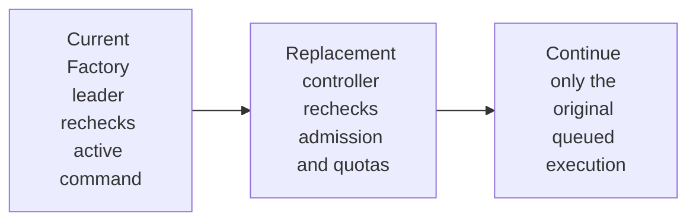
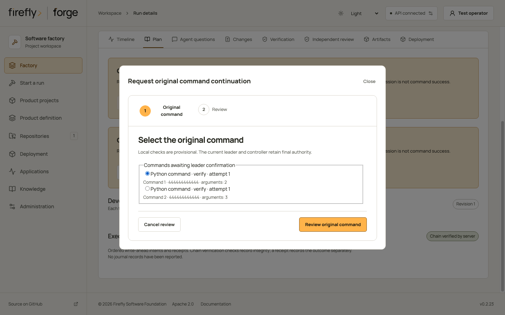
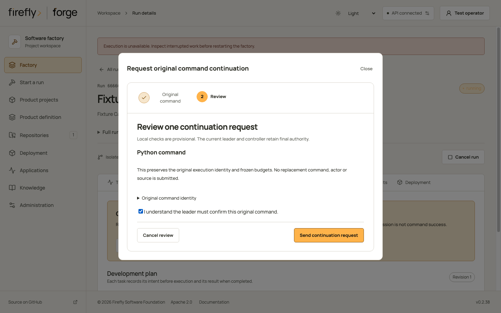
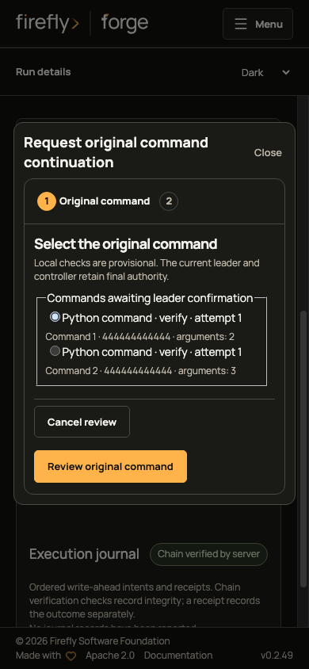
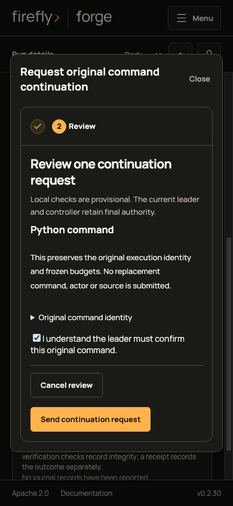

<!-- Copyright 2026 Firefly Software Foundation. SPDX-License-Identifier: Apache-2.0 -->
# Configure isolated execution

Choose a runner before queueing a run. firefly forge freezes its configuration, resource limits and command budget with the run. Repository defaults apply to new runs; an explicit run configuration takes precedence. Changing defaults or handing work to another coding provider preserves the existing run's execution policy.

## Choose the execution boundary

| Mode | Behavior |
| --- | --- |
| `host` | Commands run as the development service account with a filtered environment, the selected duration policy and an output limit. The operating system account can access other host files and networks. |
| `docker` | Commands run in a digest-pinned image with the component workspace mounted, a read-only root filesystem, dropped capabilities and resource limits. An unavailable image or context fails execution. |
| `pool` | Administrator opt-in command execution through an authenticated local controller, with frozen profiles, durable admission quotas and archive transport. Requires a separately configured Factory worker. |

The runner applies to independent verification and the native Firefly Agentic `execute_command` tool. Native Codex and Claude Code processes use their official CLI policies. Their own file, command and network tools execute outside this Docker runner. Native Python tool grants cannot enforce restrictions inside those CLIs.

## Set up a repository in Studio

Open **Administration → Runners & processes**, then choose a registered repository. The wizard loads its saved defaults before allowing changes. Factory administrator access is required in Studio.

1. **Execution:** choose trusted host or Docker execution. Docker needs an image pinned by SHA256 and an explicit context. Leave **Set a work deadline** off when the duration is unknown, or choose a deadline for this repository. Review the log size; existing command budgets and other saved controls are preserved. Switching to host removes Docker-only settings. A saved pool remains read-only in this form.
2. **Processes:** optionally enable process monitoring for eligible host runs. This is off by default and requires fresh agent tool grants as well as command permission. Docker, pool and required-checkpoint execution do not support this first monitor implementation. Existing runs keep their original tools and policy.
3. **Review:** inspect the proposed settings and save them for future runs. If the save response is uncertain, reload the saved version before making another request. The form rereads the revision before saving; the server does not yet provide a conditional update, so coordinate concurrent administration changes.



*The execution step loads the selected repository's saved policy. This walkthrough uses fixture data.*



*Enable the capability first, then review the implementer's tool requests under Agents & skills. This setting does not itself grant tools.*



*Review the values before saving. The actions remain inside the scrollable content above the footer.*

Use **Check availability** after saving. A successful check establishes that the worker can use the runner; it does not prove that project dependencies, a server or Playwright work. An API-only replica reports worker availability as unverified. Verify the actual [tool prerequisites](tooling-prerequisites.md) before starting implementation.

### Work duration and process ownership

Newly admitted runs capture the explicit `forge-work-duration-v2` policy, including runs that use older repository defaults. Its `timeout_seconds` is `null` by default: work continues until completion, cancellation or loss of execution authority. If a project or an individual operation explicitly chooses a deadline, the earliest chosen deadline applies. There is no fixed one-hour ceiling on a chosen work deadline.

```json
{
  "work_duration": {
    "protocol": "forge-work-duration-v2",
    "timeout_seconds": null
  }
}
```

Work duration and owner liveness answer different questions. A renewable heartbeat confirms that the authorized controller still owns a process. Losing that controller starts orphan cleanup; a healthy heartbeat does not extend an explicitly chosen work deadline. Control requests, readiness checks and cleanup retain their own finite timeouts, so a broken connection cannot leave a control operation waiting indefinitely.

Saving new defaults does not rewrite an existing run, checkpoint or command receipt. An existing captured run without `work_duration` follows its original finite-duration contract. Recovery preserves that captured contract and its remaining usage. For new runs, choose a deadline through `work_duration` when one is required; the old runner `timeout` field and legacy provider timeout defaults do not silently supply a new work deadline.

Work without a deadline also needs an execution boundary that supports it. Plain Docker execution currently refuses an uncapped command before recording a command intent: losing the Docker client does not guarantee that its container stops. Choose a work deadline or use a supported host path; forge never inserts a hidden deadline or switches runners. Pool execution without a deadline requires the explicit run-bound ownership profile described below. Check runner availability before starting the project. Ordinary host commands retain their documented crash-reconciliation limitation; the optional host process monitor has its own guardian and owner heartbeats.

### Wait for a condition during development

The optional native process tools let an agent start an owned background process, inspect its state and bounded logs, wait for a condition, and cancel it. Conditions cover process exit, a literal log message, or a confined workspace file with an optional content hash. Waiting occurs inside the tool call, so a pending condition does not require repeated model requests.

Follow [Wait for an owned process](runner-monitors.md) for the tool requests, ownership checks and cleanup receipts.

<div class="forge-flow forge-flow--dependencies" role="region" aria-label="Owned process lifecycle" aria-describedby="owned-process-flow-guide" tabindex="0" markdown="1">



</div>
<p class="forge-flow-caption" id="owned-process-flow-guide">Follow the process from left to right. On a small screen, focus the diagram and scroll horizontally to keep the labels readable.</p>

An observed exit includes the actual exit code; it does not establish that the task succeeded. Waiting has no time limit by default. An explicitly chosen wait timeout returns control while the owned process continues; a chosen work deadline stops the process. Owner heartbeats continue during the wait. Explicit process cancellation or the end of the agent invocation drains owned processes. A service restart never silently adopts or redispatches a retained handle. Unknown ownership or cleanup remains a reconciliation condition.

This wait is separate from durable agent parking and distributed event subscriptions. Those continuations require their own persisted history, usage, event cursor and wakeup contract; enabling process monitoring does not provide them. Logs in this first implementation are bounded redacted snapshots, not incremental cursor reads.

Cloud provisioning and deployment commands use the separately configured [deployment target and credentials](deployment.md). Their credential workflows are outside this code runner.

## Recheck authority after waiting for a runner

After acquiring its run lock and execution capacity, the runner rechecks coordinator ownership, cancellation and the recorded actor's current execution authority. It checks again before a new create intent and before host execution or Docker preparation and start. Revocation or cancellation observed at these checks prevents dispatch. These are point-in-time checks: they do not lock permissions through process launch or undo effects already performed. Legacy and internal executions without a recorded actor retain their existing admission contract. Returning a retained result also requires admission; the original result and journal remain intact when access is refused.

Cleanup can still remove the invocation's owned containers and volumes after revocation or cancellation, with the existing ownership-label and coordinator checks. Removing execution permission must not prevent those resources from draining. Effects a command already performed remain part of its retained history and recovery process.

## Preserve command identity across service restarts

An omitted command ordinal represents a new invocation, even when its arguments match an earlier command. The factory allocates the next slot from canonical persisted run/task/attempt records and writes the create intent under the same database run lock. A fresh executor instance cannot restart that cursor or reset the total run budget. An explicit ordinal retains exact replay semantics: a matching completed result can be returned without executing the command again, while changed arguments are refused.

Allocation checks the retained scalar identities, request payloads, effect receipts, and intact journal together. Missing or inconsistent projections, unknown creation/start/cleanup, interrupted effects, and uncertain workspace publication prevent fresh dispatch. An explicitly reconciled interruption or closed preparation can advance only after all command effects have known receipts and the original native task has a later explicit retry reconciliation. Merely increasing an attempt or restarting the service does not authorize another effect. Allocation and dispatch reject an ambient caller transaction; process and controller effects start after the factory's own intent transaction commits.

Implementation checkpoint runtime contracts include the command allocator, executor, pool worker, and their policy/persistence modules. A checkpoint captured under different executor semantics cannot be restored silently. The conservative restore restriction and native source qualification gates still apply; this command identity contract does not by itself authorize command-enabled restoration.

Checkpoint source identity is separate from command workspace transport. It streams every tracked Git file, including tracked assets matched by ignore rules, and every nonignored untracked file. A newly created, nonignored package lock is included. Ignored, untracked installed dependencies and generated outputs are outside this source identity; their presence does not prove a successful or reproducible installation. Selected private paths, source links, hard links, unreadable files, or concurrent source, index, HEAD, credential, or ignore-rule changes refuse the checkpoint. Complete file bytes are hashed and checked in bounded chunks without a total source-size or file-count truncation. Git metadata and the selected source are checked again before publishing the identity.

The runner's archive transport retains its own explicit workspace byte budget and strict regular-file contract. Checkpoint source selection does not silently change transported files, import dependencies, or permit dependency links in an archive. A runner that needs installed dependencies must provide them through its configured workspace or image and retain the corresponding command receipts.

## Keep Python verification tied to current source

Factory commands receive a fresh execution-owned Python cache namespace and `PYTHONDONTWRITEBYTECODE=1`. The namespace replaces inherited or caller-supplied `PYTHONPYCACHEPREFIX` values. This prevents normal Python imports from accepting an earlier timestamp-and-size cache after a same-size source edit. Disabling bytecode writes alone would still allow an existing stale cache to be read.

Host execution uses a private temporary directory and removes only that owned directory after the process has exited or been terminated. Docker and pool commands use their existing fresh container `/tmp` filesystem. Project caches are not cleared; command arguments, runner resource limits and journal recovery rules stay unchanged.

These settings govern Python interpreters that honor their environment. `-E` or `-I` ignores them; an explicit interpreter cache-prefix option or a custom loader can select other behavior. Source-less `.pyc` modules remain explicit project artifacts, and this policy does not establish their source equivalence. Keep source available and avoid those overrides when a verification check must evaluate current Python source. Native coding CLIs retain their separate execution boundary.

## Admit optional PHP diagnostics

The native `profile_php` tool requires both its own role grant and `execute_command`, plus a frozen Docker profile with archive transfer, network `none` and no pool binding. It uses the same authority checks, command budget and sandbox start/cleanup receipts as other commands. It cannot fall back to a host PHP binary. Runner readiness describes configuration, not interpreter, extension or application readiness.

Prepare the PHP interpreter and the application's existing dependencies before admission. A [larafly](https://fireflyframework.org/frameworks/php/) `artisan` command needs its normal bootstrap and Composer/vendor files within the image or archive budget; the diagnostic tool does not install them. The runtime recipe observes wall/CPU/memory. The separately selected Xdebug recipe requires its already installed extension and POSIX file limits, disables debugger connections and caps each child-written file at 8 MiB. Missing prerequisites refuse the workload, while a missing or invalid report remains incomplete evidence. See [PHP profiling](agent-tools.md#observe-a-php-or-larafly-workload) for recipe requests, units and outcome limits.

## Prepare an image and context

Use a dedicated Docker context and a non-root development service account. Prepare an image containing the project's actual Python/PHP/Node runtimes, package tools and dependencies. Copy its immutable `repository@sha256:...` reference from the image inventory. Runtime commands use `--pull=never`; image preparation belongs to the operator.

With network policy `none`, dependency installation and external databases are unavailable. Prepare dependencies in the image or choose the explicit `egress` policy. `egress` uses Docker's bridge network and permits outbound access; it does not implement a hostname allowlist. Browser checks always use network `none`.

Post repository defaults to `PUT /api/v1/repositories/{id}/runner`:

```json
{
  "sandbox": {
    "mode": "docker",
    "image": "ghcr.io/your-team/project-runner@sha256:REPLACE_WITH_64_HEX_DIGEST",
    "context": "your-isolated-context",
    "cpus": 1,
    "memory_mb": 1024,
    "pids_limit": 128,
    "timeout": 300,
    "max_output_bytes": 1000000,
    "network": "none",
    "command_limit": 50
  }
}
```

Replace the image reference before submitting this example. `GET /api/v1/repositories/{id}/runner` returns the saved default. `GET /api/v1/repositories/{id}/runner/readiness` reports the selected context, cached image evidence and native tool availability. `POST /api/v1/runners/probe` accepts a sandbox configuration for a read-only image check. Cached image presence does not prove that a project's checks or browser startup command work.

Each container receives only the component source mount. Verification additionally sees the repository's `.git` directory through a nested read-only mount. Implementation commands cannot read that metadata through the source mount. The container receives no host home directory, login credentials or Docker socket. Its writable temporary directory and private shared memory are bounded. Docker controls include CPU, memory, process count, no-new-privileges and bounded daemon logs. See the official [Docker execution options](https://docs.docker.com/reference/cli/docker/container/run/).

### Transfer workspaces to a remote or isolated daemon

`workspace_transport` defaults to `bind`, which requires the selected daemon to read the exact host workspace path. For a remote daemon, or a virtual machine without host filesystem sharing, select `archive`. The executor copies source into private anonymous Docker volumes and collects the completed result through the Docker API. The daemon never needs a host workspace mount. The selected context is operator-owned; its authentication belongs to the service account, outside the command container.

Archive mode also requires the administrator to set `FORGE_SANDBOX_TRANSFER_IMAGE` to a cached, trusted `repository@sha256:...` image containing `/app/.venv/bin/python`. The project image does not perform privileged initialization. A separate helper uses the administrator image, an absolute Python entrypoint with `-I -S`, and a fixed ownership initialization script for the two archive volumes. This helper has a read-only root, network `none`, no host mounts or credentials, and only the `CHOWN` capability. Repository code runs later in the non-root command container with all capabilities dropped. Missing transfer images fail without a pull or host fallback. The execution journal records the selected transfer image and helper cleanup.

Set `workspace_max_bytes` to bound transferred file contents (64 MiB by default, 1–256 MiB permitted). Archive overhead has an additional 1 MiB ceiling. Only regular files and directories transfer: symbolic links, hardlinks, special files, absolute paths, parent traversal, duplicate paths and oversized results fail. `.env` files and host credential directories stay local; configured credentials in transferable source cause rejection. Verification receives Git metadata through its separate read-only volume, and result collection never imports `.git` changes.

Source reads and result extraction use directory-relative descriptors with no-follow file opens. Collection prepares the complete replacement tree privately, preserves local Git and credential metadata, and publishes it with an atomic directory exchange. It verifies both exchanged directory identities and the retained original tree, then rolls back if concurrent source or metadata changes are detected. Preparation failures leave the original workspace untouched; no original files are deleted to make room for an incomplete copy. Successful publication retains the original tree at `workspace_backup_path` with its source hash. If the filesystem also rejects rollback, the exchanged backup remains available and publication stays uncertain until reconciled. Include these retained workspace trees in operator-managed backup and retention procedures.

The host workspace filesystem must support Linux `renameat2(RENAME_EXCHANGE)` or macOS `renameatx_np(RENAME_SWAP)`. Unsupported filesystems fail closed. Completed source collection is idempotent during receipt recovery. A returned archive is retained privately before publication; its hash and actual command outcome are recorded in the execution receipt. Failed imports record `workspace_import=requires_reconciliation`; retrying that invocation does not report success or run the command again. Inspect its retained archive and source before explicit stage recovery. If the archive cannot be retained locally, the exited owned containers remain available for reconciliation.

Command timeout, rejected archives with retained evidence, and failed initialization clean up the owned command container, helper and anonymous volumes under their exact durable labels. Include private `.forge-sandbox-results` archives with the execution journal in operational backups; they can contain source and Git metadata.

## Administrator opt-in local command pools

Pool selection uses the explicit `forge-factory-pool-v1` policy and `forge-project-bundle-v1` transport. Earlier `pool_binding` fields remain disabled and never activate a pool or change a frozen run. The trusted Factory worker retains user, project, repository and stage authority; project containers receive neither its PostgreSQL credentials nor its controller token, TLS material, provider credentials, other workspaces or Docker socket. The controller alone owns the administrator Docker context.

Start the controller with an explicit private configuration through `python -m firefly_forge.runner_controller_runtime --configuration /absolute/private/controller.yaml`. Its runner schema must differ from the Factory schema in the same PostgreSQL database. Mutual TLS, a private controller token, cached approved image digests, the observed Docker engine identity and an administrator-controlled absolute `git_binary` are required for project bundles. No image pull or host fallback occurs. Factory enables this adapter only when `FORGE_RUNNER_WORKER_CONFIGURATION` points to a private owner-controlled YAML or TOML file with the `forge.runner.worker` section, an active `transport` and an absolute `git_binary`. Transport binds the HTTPS endpoint, certificate, private key, CA, token, profile ID and immutable profile revision. The repository policy must match that approved private profile. Keep these files private and outside project source.

Factory transfers sanitized component source and a synthesized parentless Git snapshot of those exact files. This snapshot supports local source diffs; it does not expose or reproduce the original repository's history, remotes, configuration or hooks. The controller independently reconstructs the minimum Git snapshot before admission and before creating project resources. Git metadata stays read-only and is never imported into the Factory repository. Transferring original repository objects would grant repository-read authority; component selection alone would not make those objects confidential.

Project commands use network `none`, a read-only source volume, bounded writable workspace tmpfs, a non-root user and an independent PID1 deadline. Workspace tmpfs consumes the container memory budget. Export has a separate bounded grace period; a lost export leaves an unknown outcome. One profile identity owns each physical engine, with capacity and project quotas shared across its immutable revisions. Quarantined resources continue reserving capacity until exact backend observations establish drain.

The pool supervisor reaps adopted child processes while the command runs. Before publishing its authenticated completion status, it terminates and reaps remaining descendants, including children that started a separate session. The original supervisor deadline remains active during this drain; an incomplete drain cannot produce a completion receipt. This controls processes inside the local command container. External services and effects already performed by the command remain outside this lifecycle boundary.

Factory records a local preparation receipt and durable start intent before its single submission. A lost response leaves that start uncertain; repeat calls never resubmit. Returned archives and output are retained before atomic publication. Concurrent host edits reject publication while preserving the returned artifact and host source. Restart recovery observes or cancels the original controller identity, records interruption and drains observed resources without automatically importing source or replaying commands.

### Run-bound command ownership

An administrator may explicitly select `run_liveness: forge-run-owned-liveness-v1` on a new pool profile that also selects `work_duration`. The resulting invocation seals the original run, implementation or verification stage, stage attempt and deterministic original task key, actor, component and runner snapshot, Factory fence and fresh worker epoch. Profiles and invocations without this selector retain their existing serialized contract.

The worker renews one controller lease only after rechecking the current run and stage authority. The private authenticated `POST /runner/v1/renew-run` control accepts the exact invocation, Factory fence, controller epoch, next sequence and one-use challenge. A controller rechecks the original command start WAL, journal chain and current actor permissions before granting renewal. Factory-wide health cannot renew a specific run. Cancellation, a changed stage or actor, expired ownership and lost acknowledgements stop that run's renewal; another healthy run keeps its own lease.

For the selected protocol, each PID1 owner message authenticates the entire invocation digest and a new worker grant sequence. Status observation cannot refresh the owner alarm. A fresh grant's remaining time is measured from the peer challenge, so transport delay cannot restart its grace period. The owner heartbeat bounds loss of authorization; it is separate from the explicitly chosen work deadline. Cleanup uses the existing finite drain window and exact resource labels.

A healthy queued command renews a separate security lease using database time. Each renewal retains the original request, Factory fence, worker and controller epochs, sequence and one-use challenge. The worker renews at one third of the shorter admission or owner interval; waiting does not acquire a work-age maximum. Expired or canceled queued work cannot be revived. A command that has already been claimed cannot extend its old waiting admission. Untagged profiles retain their original finite queue expiry. The worker also requires the matching `forge-run-owned-admission-v1` controller capability before dispatch.

A restarted controller has no authority to recreate the volatile grant. It quarantines retained commands without a live matching controller epoch, and repeat submission or implicit continuation cannot redispatch them. Keep uncertain outcomes for observation and reconciliation.

A pool profile that explicitly selects both `forge-run-owned-liveness-v1` and `forge-work-duration-v2` can preserve a null work deadline through admission, execution and result collection. The worker verifies the matching authenticated controller capability before dispatch. Fresh ownership grants keep healthy work running; cancellation, revocation or owner loss withdraws that authority. Untagged profiles and plain Docker remain unavailable for uncapped work. Ordinary foreground host commands retain their crash-reconciliation limitation. A child wait that preserves the active run and task does not revoke ownership; a wait marker cannot grant renewal. Paused verification handoffs require their separate custody protocol and remain unavailable through this pool selector.

### Continue one queued command after a controller restart

A currently authorized operator may request continuation of one original pool command while its Factory worker is still waiting. The Factory run and stage must remain active under the original database owner. This does not resume an interrupted run or submit a replacement command.

**1. Record the operator's request**

<div class="forge-flow forge-flow--dependencies" role="region" aria-label="Record an explicit continuation request diagram" aria-describedby="runner-continuation-flow-guide" tabindex="0" markdown="1">



</div>

<p class="forge-flow-caption" id="runner-continuation-flow-guide">The API records admission. Exact receipt reads observe this saved request without dispatching work. On a narrow screen, focus the diagram and scroll horizontally.</p>

**2. Continue the original command**

<div class="forge-flow forge-flow--dependencies" role="region" aria-label="Continue the original queued command diagram" aria-describedby="runner-continuation-dispatch-guide" tabindex="0" markdown="1">



</div>

<p class="forge-flow-caption" id="runner-continuation-dispatch-guide">The leader follows the retained admission through the controller. Command success still needs the original execution receipt; an accepted continuation alone does not establish it.</p>

Send one authenticated `POST /api/v1/runs/{run_id}/runner-continuations` with a retained request identity and the original `execution_id` from that run's sandbox intent in its journal:

```json
{
  "request_id": "aaaaaaaaaaaaaaaaaaaaaaaaaaaaaaaa",
  "execution_id": "bbbbbbbbbbbbbbbbbbbbbbbbbbbbbbbb"
}
```

Choose a new random UUID hex value for the operator request and save it before sending. The execution identifier must be the existing command's identifier. API replicas only record the request. The active Factory leader verifies the original actor, requesting operator, project, repository, stage attempt, source, profile, owner and WAL before sending the exact scoped request to the trusted controller. The controller checks the native Factory admission and current permissions again before effects. It can claim only that command, before its admission expires and with no external create/start intent. An expired, never-started lease may be claimed with a new controller epoch. Normal resource and project limits still apply. A capacity refusal does not schedule a later wake or select another queued command.

The Python client, CLI and factory MCP expose the same request and exact read. The CLI requires both identifiers; none of these adapters generates a replacement identity or retries a failed request. Studio offers a separate selection and review flow described below.

```bash
forge runner-continuation-candidates RUN_ID
forge request-runner-continuation RUN_ID --request-id SAVED_REQUEST_ID --execution-id ORIGINAL_EXECUTION_ID
forge runner-continuation RUN_ID SAVED_REQUEST_ID
```

In Python, call `client.request_runner_continuation(run_id, {"request_id": saved_request_id, "execution_id": original_execution_id})` once, then use `client.runner_continuation(run_id, saved_request_id)` to inspect that operation. External agents use `request_runner_continuation(identifier, request)` and the read-only `get_runner_continuation(identifier, request_id)` MCP tools. Retain the request identity in the agent's task record before calling the write tool. If delivery is uncertain, use the read tool rather than allocating another request.

Read `GET /api/v1/runs/{run_id}/runner-continuations/{request_id}` for the retained operation. Neither that read, repeating the same Factory request, nor controller startup dispatches work. The original command's result must still pass its existing credential, authority and workspace-publication checks. An operation marked `completed` with `result.disposition=accepted` confirms continuation admission; it does not prove that the command succeeded or that source was published. Use the original command and run receipts for those outcomes.

There is one explicit continuation identity per command, with at most 50 such admissions per run and the existing bounded worker queue. Commands admitted before their original Factory fence was retained are ineligible. Cancellation, revoked access, a changed stage or source, an expired admission, a stale owner and any uncertain create/start effect are refused. If the continuation response is lost, or the replacement controller also stops, keep the exact operation unresolved and use the existing observation/cancellation/reconciliation path. This first continuation flow does not retry an unknown operation or authorize another controller restart. It adds no command budget, automatic queue recovery, Kubernetes execution or multi-host storage.

Once a continuation decision is retained, the generic queue pump cannot reclaim that original command or change its ownership, lease or history. This also applies to an expired lease, a refused decision and incomplete continuation metadata. A held invocation keeps its capacity reservation; a refused invocation still queued does not acquire a slot merely because its decision is retained. Read the exact request and use explicit observation, cancellation or reconciliation to inspect retained work. A new unrelated submission does not authorize the original command to resume.

### Request continuation in Studio

Open a run's **Plan** tab and inspect **Original runner command**. **Request continuation** appears only when current local checks find an original pending command and your current role permits execution (or release for a publishing run). Select the original command, review its identity, and acknowledge that the leader must confirm it is still waiting. Studio saves one request identity before sending **Send continuation request**. The leader and controller perform the final checks; an accepted admission does not establish command success.

The local `GET /api/v1/runs/{run_id}/runner-continuations/candidates` reads retained authority and command evidence without controller RPC, lease claims, work dispatch or subprocesses. Its candidates explicitly require leader confirmation. A separate API process needs access to the original shared workspace for the confined source check. If that source is unavailable, Studio displays that condition rather than presenting an empty eligible list. The preview contains a fixed command-family label and argument count, not command arguments or paths; the original evidence remains in the run's journal. Inspection examines at most 16 active original commands. Each source pass reads at most 16 MiB plus bounded archive overhead, shared across commands; one final pass rechecks the source after credential admission. Each API service admits one source reader at a time, outside the event loop, with a three-second cooperative processing deadline and at most 4,096 traversal/read checkpoints. Exhaustion offers no continuation; the existing exact POST contract and saved receipt reads are unchanged. Cancellation retains the reader until it exits cooperatively. These checks do not promise to interrupt a blocked filesystem syscall.

Inspect the same result with `client.runner_continuation_candidates(run_id)`, `forge runner-continuation-candidates RUN_ID`, or the read-only MCP tool `get_runner_continuation_candidates(identifier)`. Each makes one authenticated GET and preserves unavailable or empty states; none allocates a request identity or admits work. A candidate still requires the leader's confirmation through a separate explicit continuation request.

The selection shows a command number, a short execution reference and argument count. Its accessible name retains the complete execution identifier, so commands with the same label or reference prefix remain distinguishable. The review keeps that original identity; it cannot replace the command or its budgets.

The following guide uses controlled API fixtures. It stops before **Send continuation request**; no runner dispatch, command result or native recovery is established by these images.

<figure class="forge-shot" markdown="1">

<figcaption>Select the exact original execution. Local checks still require the leader's confirmation.</figcaption>
</figure>

<details class="forge-gallery" markdown="1">
<summary>Inspect the continuation review and phone layout</summary>

<figure class="forge-shot" markdown="1">

<figcaption>Review the original identity and acknowledge the leader's final check. The guide does not send the request.</figcaption>
</figure>

<figure class="forge-shot" markdown="1">

<figcaption>The same numbered choices remain available on a narrow screen.</figcaption>
</figure>

<figure class="forge-shot" markdown="1">

<figcaption>The review keeps its action footer while longer fields scroll within the dialog.</figcaption>
</figure>

</details>

After an uncertain response or page reload, use **Check original request**. A successful POST also requires this exact receipt read before Studio shows admission acceptance. A missing receipt, denied access or unknown outcome never clears the saved identity or enables another POST. Even a refusal before server admission cannot be inferred from an HTTP error: retain the request and inspect authorized run evidence or cancellation/reconciliation controls. The browser marker contains only the API/scope identity and binding digests; it does not retain command arguments, workspace paths, credentials or private receipt payloads. Changing operator or API scope does not transfer a saved request to the new session.

Retained artifact reads and command-output returns check the current credential registry, including the first result and later cached results. If a retained value is now recognized as a credential, the read is refused and command-output access requires reconciliation. The private artifact and original receipts remain intact; the command is not resubmitted. This checks registered credential values and their supported escaped forms, so operators must still review source and results for unregistered secrets.

Local qualification covers a trusted Factory host, mutually authenticated controller and isolated command containers. Browser pool profiles, Factory worker container placement, project database sidecars, Kubernetes and shared multi-host storage require separate qualification. Native Codex/Claude provider processes retain their own execution boundary.

## Read execution and recovery evidence

The native PostgreSQL ledger records creation, start and cleanup intents before each effect, then records actual receipts. Invocation IDs bind the run, stage, stage attempt and command ordinal. The frozen total command budget applies across repairs, resume and provider handoff.

At startup, the execution owner inspects containers with the exact persisted ownership labels. An exited container can supply its real exit code and bounded logs. A running or missing container with an uncertain command outcome requires reconciliation. Recovery cleans up owned containers and retains the decision in the journal. It does not start the uncertain command again.

A timeout or output overflow terminates the local process group and removes the owned Docker container. Host executions have no container to inspect after a service crash; an uncertain host command outcome requires operator review. Keep the [run journal and private configuration backups](recovery.md) together when restoring an installation.

The executor permits at most two active commands across runs and serializes commands within each run. The engine's project scheduling controls still apply above that limit.
