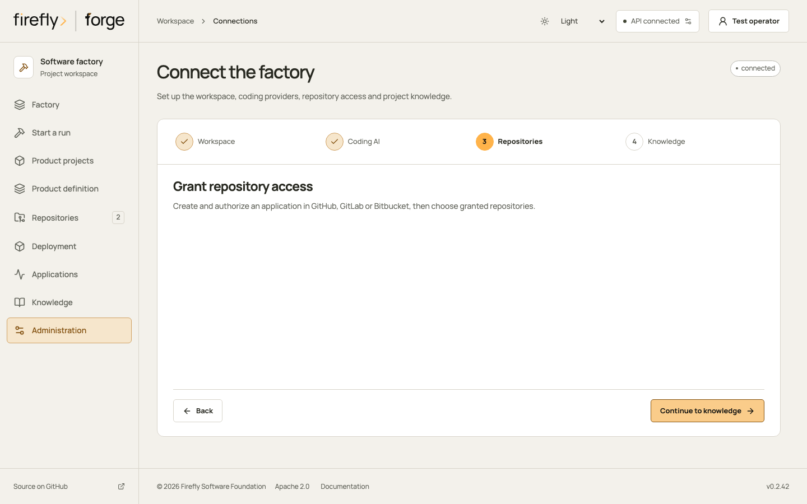
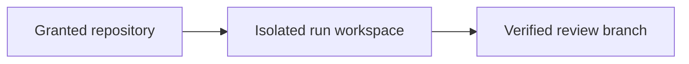
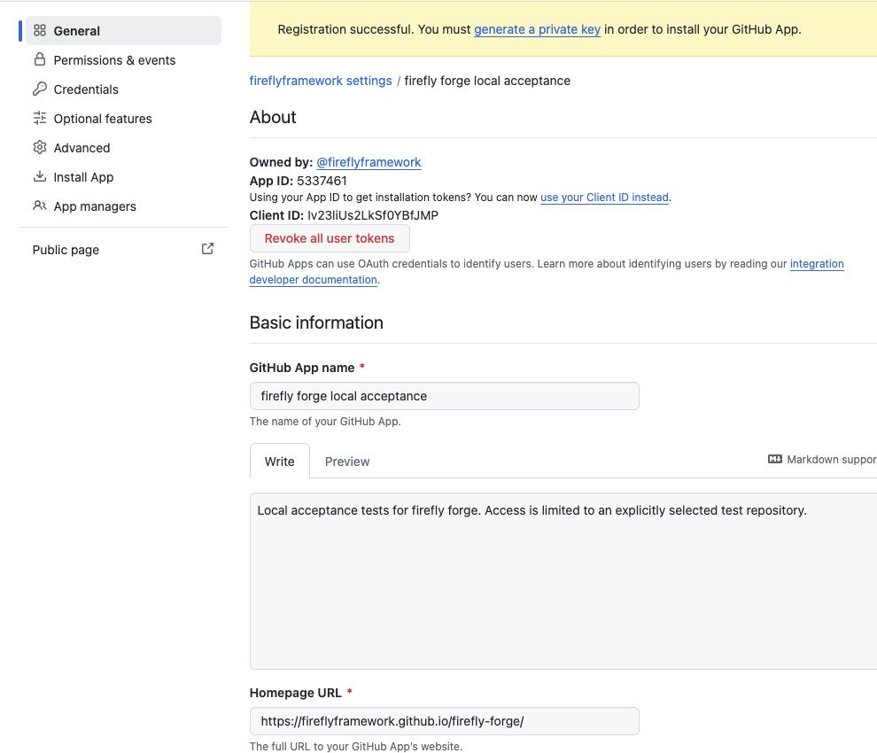
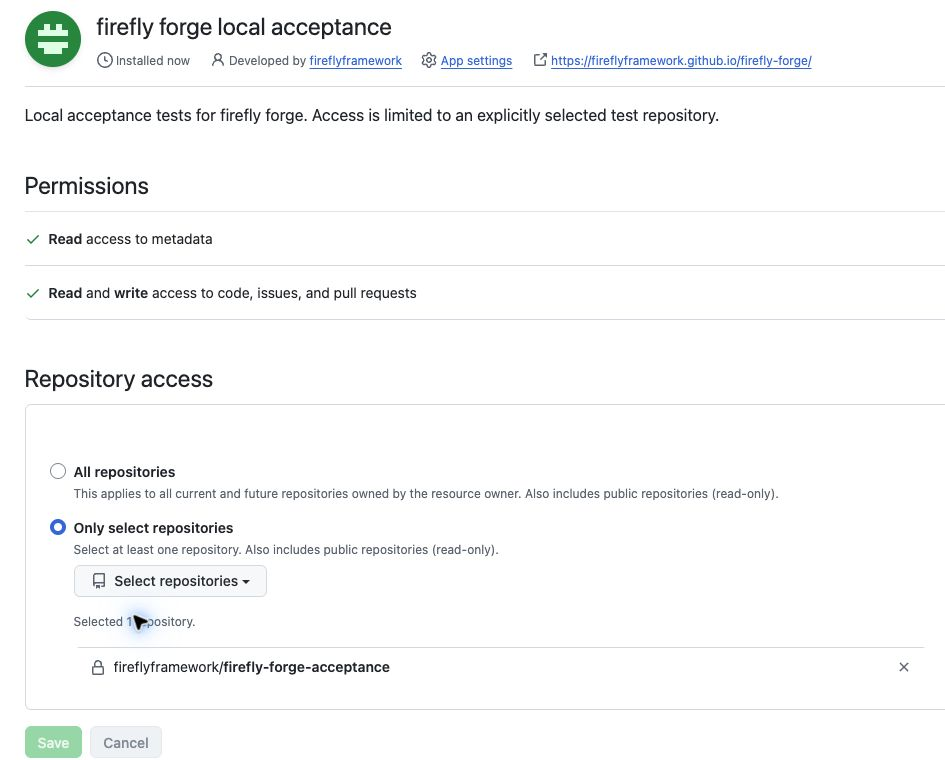
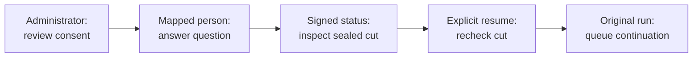
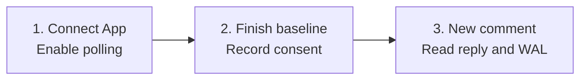
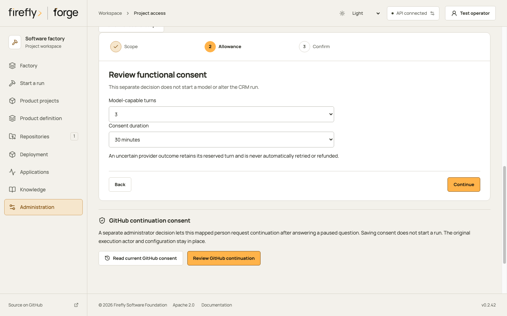
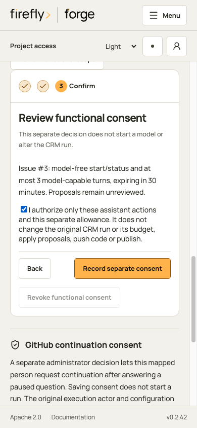
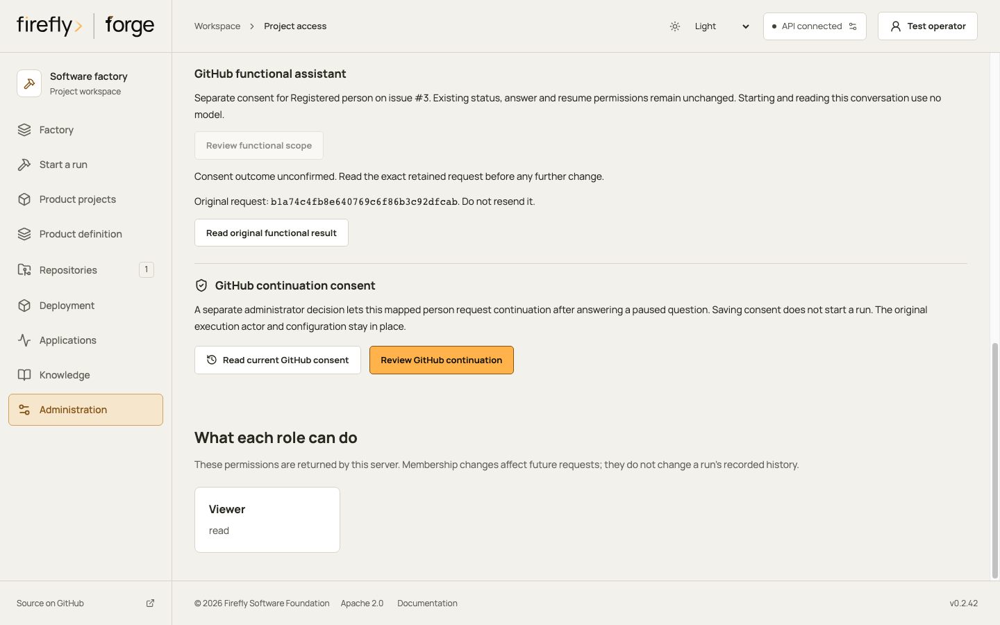

<!-- Copyright 2026 Firefly Software Foundation. SPDX-License-Identifier: Apache-2.0 -->
# Connect source-control applications

A source-control connection lets forge read granted repositories and publish reviewed changes through the provider's API. GitHub Apps, GitLab OAuth applications and Bitbucket OAuth consumers supply that authority. Your factory sign-in controls who may configure forge; it does not grant access to the provider account.

## Talk to forge in your issue

Use ordinary language in the connected GitHub issue. You do not need slash commands or JSON to ask about work or answer a confirmed pending question:

- `@forge, what is blocking this task and what do you need from me?`
- `@forge, help me define a CRM for our account managers.`
- After forge publishes a confirmed question in that issue, reply naturally: `Keep the existing contacts and let their account owners approve changes.` You do not need to repeat the mention or copy a request identifier.

The configured AI interprets the message using the issue's linked work and retained questions. Unclear or conflicting references require clarification. A reply can save your answer without restarting work; it does not silently authorize a new run, source change, publication or budget.

An administrator first connects the repository, enables [local issue polling](#use-github-issue-comments-from-a-local-factory), maps your account to current project permissions and configures the communication profile. Product discussions also require the [separate functional allowance](#review-the-account-and-allowance-in-studio). Read the [natural conversation guide](#ask-about-the-current-ticket) for supported requests and authority boundaries. The typed slash-command and signed-ingress examples later on this page remain advanced compatibility paths for integrations and troubleshooting.

## Connect one repository

A factory administrator completes these steps in **Connections → Repositories**:

1. Select **GitHub App**, **GitLab OAuth application** or **Bitbucket OAuth consumer**. Use **Create application** to open the provider's registration instructions. Create and approve the application in the organization or workspace that owns the repository.
2. Supply the application fields described below and choose **Save application settings**. Saving those values records configuration; it does not create the provider application or establish a repository grant.
3. Install the GitHub App on the intended repositories. For GitLab or a Bitbucket authorization-code grant, choose **Authorize in…** and finish consent in the same browser. Bitbucket client credentials use the configured consumer and workspace instead.
4. Choose **Check access**. This makes a real provider request. A successful check describes the current grant, not a permanent permission.
5. Choose **Find granted repositories**, inspect the returned repository name and URL, then **Connect NAME**. forge checks discovery again and registers the selected remote repository ID with its provider URL and default branch. It does not accept a caller-substituted URL or credentials in this action.
6. Select that registered repository when defining a product or starting work. Enable [local GitHub issue polling](#use-github-issue-comments-from-a-local-factory) for natural issue conversations. [Signed conversation commands](repository-workflow.md) remain a separate compatibility transport; connecting an application alone does not enable either one.

<figure class="forge-shot" markdown="1">

<figcaption>The Repositories step is the entry point for application access. This controlled Studio screenshot shows the setup stage, with no provider catalog populated; it is not evidence of a live installation or grant.</figcaption>
</figure>

## Understand the two directions

| Direction | Implemented behavior | What the result establishes |
| --- | --- | --- |
| Provider → factory | Discover granted repositories and clone their configured default branch when preparing a fresh run; a campaign can supply its frozen source commit. | The run's recorded source base, not a continuously synchronized workspace. |
| Provider conversation → factory | Read natural GitHub issue conversations within current account consent, or accept separately enabled typed and signed actions. | A retained message and its admitted response or action; ordinary discussion alone does not authorize execution. |
| Factory → provider | Push verified source to the run branch and request a pull or merge request; optionally publish separate review-reference files. | A recorded publication outcome, not a merged default branch or deployment. |
| Factory → conversation | Post queued, stopped or terminal status and supported worker questions using the conversation's original identity. | Feedback about retained work; an uncertain reply remains unresolved until checked. |

These are explicit source and conversation flows. forge does not mirror every issue edit into a product definition, continuously merge remote changes into an active workspace, or merge its own pull requests. Resuming a run inspects its retained workspace. New upstream work and merge conflicts require a reviewed source decision; see [recovery](recovery.md) and [repository commands](repository-workflow.md).

<div class="forge-flow forge-flow--dependencies" role="region" aria-label="Source publication flow" aria-describedby="scm-publication-guide" tabindex="0" markdown="1">



</div>

<p class="forge-flow-caption" id="scm-publication-guide">Source enters an isolated run. Publication requires passing checks and current release authority; the provider still owns review and merge. On a narrow screen, focus the diagram and scroll horizontally.</p>

## GitHub App

[Register a GitHub App](https://docs.github.com/en/apps/creating-github-apps/registering-a-github-app/registering-a-github-app)
under the account that should own it. Request repository **Contents: read and
write** and **Pull requests: read and write**. Install it on the selected
repositories. Save its app ID, installation ID and unencrypted RSA private key
in forge. The optional app slug provides a direct installation link.

### Walk through registration

Start in your organization's **Settings → Developer settings → GitHub Apps →
New GitHub App**. Give the application a name that identifies its purpose and
set its homepage to your factory's documentation. For a local acceptance test,
use a separate test application and a repository containing fictional data.

<figure class="forge-shot" markdown="1">

<figcaption>Captured from GitHub during the local acceptance setup. The registration banner confirms that the application exists. Installation and a successful connection check are separate steps. Use your own application identifiers; the values shown belong to this test application.</figcaption>
</figure>

Configure these repository permissions before installing the application:

| Permission | Access | Purpose |
| --- | --- | --- |
| Contents | Read and write | Clone source and publish reviewed branches. |
| Pull requests | Read and write | Open pull requests and post feedback in pull-request conversations. |
| Issues | Read and write, when using issue conversations | Post status and questions back to the issue that requested the work. |
| Metadata | Read-only | Discover the repositories granted to the installation. GitHub marks this permission as mandatory. |

Organization and account permissions are not needed for this installation-token
flow. GitHub user authorization is separate from the factory's sign-in and from
the repository's signed conversation-command settings.

Complete setup in this order:

1. In **Credentials → Key pairs → New key**, generate an RSA private key. Keep
   the downloaded key out of source control, screenshots and shared support
   reports. Supply it only to forge's write-only private-key field. If the
   download is interrupted, check the browser's downloads and the application's
   existing key list before creating another key.
   [Verify the downloaded key](#verify-the-downloaded-key) before supplying it to forge.
2. Open **Install App**, select the intended account and choose **Only select
   repositories**. Select the test repository and inspect the permission summary
   before confirming the installation. Record its installation ID.
3. In forge, save the app ID, installation ID, private key and optional app slug.
   Choose **Check access**, then **Find granted repositories**. Check the returned
   repository name before connecting it.
4. Choose the incoming conversation transport. [Signed inbound commands](repository-workflow.md)
   need an HTTPS route that GitHub can reach and a separate webhook secret.
   [Local issue polling](#use-github-issue-comments-from-a-local-factory) reads through
   the App API and needs no incoming webhook route. Its supported actions are
   limited to `respond` and `status` on existing scoped runs. Registration and
   repository discovery alone establish neither transport.

### Verify the downloaded key

In the GitHub App's **Credentials → Key pairs**, find the public SHA256 fingerprint for the key pair. On your own machine, run this in Bash or Zsh with the path to the downloaded PEM file:

```bash
set -o pipefail
openssl rsa -in "/path/to/downloaded-key.pem" -pubout -outform DER |
  openssl sha256 -binary |
  openssl base64
```

This fingerprints the public key's DER SubjectPublicKeyInfo bytes; it does not print the private key. Compare the base64 result with GitHub's displayed fingerprint. If any command fails or the values differ, stop and check the file, application and selected key pair. Do not retry authentication or generate another key to work around a mismatch. A matching fingerprint identifies the key pair; installation and repository access still require their own checks. See [GitHub's private-key verification instructions](https://docs.github.com/en/apps/creating-github-apps/authenticating-with-a-github-app/managing-private-keys-for-github-apps#verifying-private-keys).

<figure class="forge-shot" markdown="1">

<figcaption>After installation, GitHub shows the effective permissions and the selected repository. This acceptance application is restricted to one private repository containing fictional data. The image records the provider installation; a forge grant check and webhook delivery still need their own evidence.</figcaption>
</figure>

These captures record registration and installation. A complete acceptance
record also needs a real grant check, a confirmed inbound command and its
outbound feedback. Replace screenshots when the provider changes its screens
or the documented workflow changes; review every image for credentials before
publishing it.

forge signs a short-lived app JWT. Repository discovery uses an installation
token with metadata permission. Git execution and pull requests use a token
restricted to the selected repository ID, with the two write permissions above.
Tokens are refreshed before expiry. Organization approval, branch protections
and workflow-file permissions can still prevent an operation. See
[GitHub's installation-token contract](https://docs.github.com/en/apps/creating-github-apps/authenticating-with-a-github-app/generating-an-installation-access-token-for-a-github-app).

For GitHub Enterprise Server, set **Host** to its HTTPS origin. forge derives
`/api/v3` from that origin and rejects clone URLs or pagination links from another
host. App installation and permissions must exist on that same server.

## GitLab OAuth application

[Register an OAuth application](https://docs.gitlab.com/integration/oauth_provider/)
with the redirect URI displayed in forge:

```text
https://your-forge.example/api/v1/scm/connections/gitlab/callback
```

Use `api`, `read_repository` and `write_repository` scopes for merge requests and
Git access. Save the application ID and redirect URI; save its client secret
when the application is confidential. Select **Authorize** to complete the
provider's consent screen.

forge uses authorization code with PKCE, a browser-bound state that expires
after ten minutes, and server-side rotating refresh tokens. State can be used
once. Discovery requests non-archived projects where the authorized user is a
member with developer access or higher. GitLab OAuth follows the user's grants;
it does not provide GitHub's per-repository installation-token restriction.
Self-managed GitLab uses its configured HTTPS origin. See the
[GitLab OAuth API](https://docs.gitlab.com/api/oauth2/).

## Bitbucket OAuth consumer

Create an [OAuth consumer in the workspace](https://support.atlassian.com/bitbucket-cloud/docs/use-oauth-on-bitbucket-cloud/)
and enable `repository`, `repository:write`, `pullrequest` and `pullrequest:write`.
Save its client key, client secret and workspace slug. The default grant is
**client credentials**: forge obtains a short-lived token representing the
consumer's owner and lists repositories in the configured workspace.

For user consent, choose **authorization code**, register the forge callback
URI and select **Authorize**. This uses browser-bound, single-use state and
rotating refresh tokens. Client-credentials tokens are obtained again on expiry;
that grant does not require a refresh token.

API calls use bearer authentication at `api.bitbucket.org`. App passwords are
deprecated and are not used by this connection. See the current
[Bitbucket authentication contract](https://developer.atlassian.com/cloud/bitbucket/rest/intro/#authentication)
and [OAuth changes effective May 2026](https://community.developer.atlassian.com/t/oauth-2-0-and-api-authentication-changes-for-bitbucket-cloud/99003).

## Protect and revoke access

Private keys, client secrets and OAuth grants stay in `configuration/` under the
server's private data directory. Files have `0600` permissions and the directory
has `0700` permissions. API summaries return configured flags for secrets;
secret values cannot be read back. Blank secret fields preserve saved values.
Use the explicit clear action to remove them. Changing application settings
invalidates saved grants, cached tokens and pending authorization state.
Changing an OAuth host or client ID also requires an explicitly supplied client
secret or an explicit clear action. forge refuses to carry a confidential
client's saved secret to that new destination. A public GitLab client can clear
the old secret before starting a new authorization.

Before refreshing a rotating token, forge persists a dispatch marker in its
current private SCM grant storage. A timeout, invalid response or interrupted
process leaves that marker unresolved; subsequent requests cannot send the old
refresh token again, including after restart. The connection reports
**Needs authorization**. Complete a new provider consent flow to establish a
fresh grant. This recovery does not claim whether the previous provider request
succeeded. SCM storage remains owner-private configuration. The [connected-account OAuth lifecycle](connected-accounts.md) uses a separate policy, client and credential store; configuring it does not register an SCM application or move these grants into that store.

Token issuance and repository discovery also check that the application revision
did not change while a provider request was in flight. An obsolete response cannot
cache credentials or register a repository. Repeat the operation after saving the
current application configuration. Malformed credential or repository responses
fail closed; they do not mark an application as connected.

Git credentials are passed only to the clone or push process. They are not
written into repository URLs, `.git/config`, global Git configuration or generated
products. Coding and verification workers do not receive those credentials.
Provider errors omit response bodies that might contain sensitive data.

Revoke an installation or OAuth grant at the provider to remove its authority.
forge's next grant check fails if access is revoked. Clearing the local secret
removes forge's copy; it does not uninstall the provider's application. Existing
remote branches and pull requests remain.

## Connection API

All routes below use `/api/v1` and require current factory-administrator authority, except the two OAuth callback routes. Hosted clients authenticate through the configured OIDC identity; explicit local bootstrap uses its loopback operator credential. Callbacks require the saved one-use state and browser cookie. Factory credentials never appear in a redirect URL. See [identity and project access](identity.md).

| Method | Path | Result |
| --- | --- | --- |
| GET | `/scm/connections` | Application summaries and setup fields |
| PUT | `/scm/connections/{provider}` | Write-only settings and explicit secret clearing |
| POST | `/scm/connections/{provider}/test` | Live grant-test summary |
| GET | `/scm/connections/{provider}/repositories` | Repositories in current grants |
| POST | `/scm/connections/{provider}/repositories/connect` | Register a freshly discovered repository ID |
| POST | `/scm/connections/{provider}/authorize` | GitLab or Bitbucket browser authorization URL and private cookie |
| GET | `/scm/connections/{provider}/callback` | Complete GitLab or Bitbucket consent |

```json
{
  "values": {"app_id": "123", "installation_id": "456"},
  "clear_secrets": []
}
```

The connection request is `{"repository_id":"42"}`. It does not accept a URL
or credentials supplied by the caller.

## Publish a verified change

Studio runs begin with `publish: false`. After verification succeeds, **Publish
pull request** requests publication of the verified checkpoint to the run's branch and invokes the provider's pull-request API. An API-only server retains the publication request for its execution owner; an accepted request is not yet a remote pull request.
Operators can also use `forge publish RUN_ID` or explicitly request `publish:
true` when creating a run. Publication rechecks project release permission, the application revision, source/checkpoint evidence and any required review. A test-only run cannot publish an implementation branch. forge does not merge a pull request or deploy a product through this action. Project reviews and branch protections still apply.

If a publication intent has no confirmed outcome, inspect the retained run and the provider's branch and pull request before another action. A timeout does not establish that nothing was published. [Recovery](recovery.md) explains the separate publication and execution intents.

Generic Git, Azure DevOps and Gitea retain the manual repository path. HTTPS URLs
must not contain credentials. Configure an appropriate Git credential helper or
SSH agent for those sources. Their existing provider-specific publication settings
remain available; GitHub, GitLab and Bitbucket application connections provide
the managed grant flow described above.

Contract tests check request construction, state handling and failure boundaries.
Loopback HTTP acceptance runs a real forge API server and a provider fixture
server for GitHub Enterprise `/api/v3`, self-managed GitLab `/api/v4`, and
Bitbucket Cloud. It verifies operator authentication, GitHub JWT signatures,
GitLab PKCE and refresh rotation, bearer-authorized repository discovery, signed
or secret-token ingress, outbound conversation feedback, revocation, and receipt
reconciliation without duplicate comments. Test-only routing sends the configured
provider paths and Host headers to the local fixture; it does not test provider
DNS, TLS, organizational installation, or consent on a real provider account.
Live acceptance requires the real application registration, provider consent,
repository grant and successful remote operation for each account.

## Explicit SCM delegation

This is the advanced signed-command compatibility path. For everyday issue discussion, start with [natural conversations](#talk-to-forge-in-your-issue).

After a delegated `respond`, `status`, or `cancel` action completes, Forge retains
its result and schedules a comment in the same issue or pull-request conversation.
The comment includes the action result and delivery receipt reference. Answering
a worker question records the answer; it leaves the run paused and does not grant
permission to resume, publish, or merge.

Later status comments show the current run status separately from the original
action result. A recorded answer can still say that the run was paused when it
was accepted while the current status reports a subsequent failure. A cancellation
acknowledgment does not by itself prove that the worker has drained.

Forge records the outbound intent before contacting the provider. If delivery is
uncertain, the completed action and its original receipt remain available with
feedback marked `needs_reconciliation`. Processing the same receipt again does not
post another comment. An operator must check the provider outcome and record an
explicit reconciliation; an unknown delivery is never an invitation to retry it.

Signed comments identify a configured channel; they do not sign a user into Forge.
A factory administrator can explicitly map a verified provider account to an existing,
enabled Forge user for selected components and actions in one project and repository.
The mapping grants no project membership or global administrator privileges.

The first scoped adapters support answering a paused worker question, reading a specific
run's status, and requesting cancellation through the existing delivery-request runtime.
Answering leaves the run paused. It does not resume work. Cancellation is admission of a
request, not proof that the worker has drained. Other actions in a repository with SCM
delegation configured report setup required until their native authorization adapter is
available. Creating a new project from an unmapped provider account is separate work.

Use `GET /api/v1/projects/{project_id}/repositories/{repository_id}/scm-actor-bindings/candidates`
to select an already retained, verified account reference. This read does not contact the
provider. Submit the reviewed `version: 1` mapping to the same path without `/candidates`.
Include one durable request ID, the reviewed project-binding digest, the verified-reference
digest, the existing native user, explicit component IDs, allowed actions, and the previous
mapping digest for an update.
The webhook trust acknowledgment must be `true`: anyone holding that channel's webhook
credential can construct a sender claim. The mapping does not establish personal OAuth
authentication.

After a lost response, read `/scm-actor-bindings/requests/{request_id}` using the original
project, repository and request ID. A timeout, denial or missing receipt does not authorize
another write identity. Permission to return a receipt is checked after commit; denial
can therefore leave a committed mapping. The base GET lists current-head summaries with
an optional `cursor` and pages of at most 50 items, rather than a partial revision history.
Each item reports active, revoked, stale-project or stale-connection status. Active means
a saved mapping head; it does not establish current provider grants or native permissions.
Historical requests remain available through their exact request GET. Mapping revisions are immutable; limits are 100 bindings
per repository, 50 revisions per binding, 5,000 requests and 16 MiB of retained mapping
history. Each receipt envelope is limited to 64 KiB. Limits refuse rather than prune.

Connection or webhook-key rotation invalidates the mapping's pinned verification cut.
Review a fresh signed candidate and explicitly update the mapping. Legacy receipts remain
readable, but cannot be promoted into verification evidence. Legacy actor-label-only worker
responses are refused as `scm_authority_setup_required` before an action intent is recorded.
An uncertain outcome after an admitted action remains uncertain and is not replayed.

SCM worker answers carry `responding_actor` version 2 and a mapping/delivery reference.
Ordinary authenticated answers retain version 1; historical answers without attribution
retain their original bytes. A delegated answer cannot confirm a pending manual version-1
answer marker. Historical delegation is recorded evidence, not a statement that the
mapping remains active or that provider grants were freshly checked by the reader.

Provider verification follows the documented raw-body contracts:
[GitHub delivery signatures](https://docs.github.com/en/webhooks/using-webhooks/validating-webhook-deliveries),
[GitHub App issue-comment installations](https://docs.github.com/en/webhooks/webhook-events-and-payloads#issue_comment),
[GitLab signing tokens](https://docs.gitlab.com/user/project/integrations/webhooks/#signing-tokens),
and [Bitbucket Cloud signatures](https://support.atlassian.com/bitbucket-cloud/docs/manage-webhooks/).
New GitLab delegation requires its timestamped signing-token signature; the legacy shared
token remains supported for old ingress but does not qualify a new delegation candidate.
Local signed-fixture tests are separate from live provider installation acceptance.


## Opt-in same-run resume (V2)

V1 mappings still allow only `respond`, `status` and `cancel`. A separate V2 grant lets an explicitly mapped native user request continuation of the same answered, paused clarification. It grants no membership, provider login, publication, merge or handoff authority. Administrators can configure consent through the API, the separate Studio panel or the [SDK, CLI and MCP grant adapters](agent-integrations.md#consent-to-signed-same-run-resume).

<div class="forge-flow forge-flow--dependencies" role="region" aria-label="Same-run continuation journey" aria-describedby="scm-resume-guide" tabindex="0" markdown="1">



</div>

<p class="forge-flow-caption" id="scm-resume-guide">Consent and continuation are separate decisions. Status reads leave the run paused. A changed plan, answer, permission or journal head refuses the reviewed continuation. Focus and scroll the diagram on a narrow screen.</p>

1. Review the current V1 receipt and its exact project/component cut. The mapping must be active, include `respond`, and identify an enabled native user. That user needs current project execution permission when requesting continuation.
2. As a current factory administrator, submit `SCMResumeGrantInputV2` to `POST /api/v1/projects/{project_id}/repositories/{repository_id}/scm-resume-grants`. Set `version: 2`, a fresh durable `request_id`, the expected previous V2 digest (null for the first grant), the project-binding digest, the exact V1 request ID and digest, selected component IDs, `allowed_actions: ["resume"]`, `active: true` and `acknowledge_same_run_resume: true`. The server derives the native user from V1. Replacing or revoking that V1 mapping invalidates the V2 grant.
3. Retain the request ID before sending. Recover a lost response through `/scm-resume-grants/requests/{request_id}` under the original project and repository. A timeout, 409 or 404 does not authorize a replacement request. The `/current/{binding_request_id}` read returns the retained grant head for that binding; its receipt alone does not establish current execution permission or provider grants. V2 resume uses this separate consent and does not require enabling the legacy `resume` channel command. Collaboration must still be enabled for the trusted actor. V2 status also requires the existing `status` command permission.
4. After the user answers the question, request its review cut with `/forge status {"version":2,"run_id":"RUN_ID","expected_grant_digest":"GRANT_DIGEST"}` through configured, verified SCM ingress. The result contains the exact question, answer, journal head and sealed development-plan references. Reads leave the run paused.
5. Explicitly send `/forge resume` with `version: 2`, the same `run_id` and `expected_grant_digest`, plus `expected_question_id`, `expected_response_digest` and `expected_cut_digest` from that review. These placeholders stand for the original canonical IDs and digests. The command accepts no agent, model, stack, automatic-retry, publication or handoff options. A changed question, answer, grant, source/configuration cut or journal head requires review before another explicit delivery.

The service checks current native identity, project permission, trusted SCM actor, active V1/V2 heads and the pinned connection. It checks the application's repository grant before acquiring transaction locks, then rechecks the retained local cut under those locks. Both the original execution identity and the delegated identity must still be registered and enabled. Remote revocation is not atomic with a local database transaction. `Journal.resume` separately revalidates the original execution actor and keeps that actor and its frozen execution configuration.

For an implementation question with a frozen role snapshot, the separately consented signed or polling resume adapter supplies the verified native person's `scm_mapping` identity to `Journal.resume` only within that locked operation. The journal records that resumer on the bounded human clarification link. Ordinary status/answer delegation cannot supply this authority, and it cannot be reused outside the operation. Older runs without a frozen role snapshot retain ordinary resume semantics and receive no new human clarification allowance.

A successful continuation queues the original run and retains its native resume and completion records. It does not prove that the resumed work succeeded. Reprocessing that same delivery checks the recorded completion and current private-read authority before returning it; it cannot resume a later question. Unknown intents remain held for reconciliation. Outbound status feedback follows the existing durable intent and no-repost rules.

In Studio, open **Project access → Source-control delegation**, read the current delegations, then open the exact revision for the mapped person. The **Same-run resume consent** panel provides current and original-receipt reads. A native factory administrator can choose **Review resume consent**, inspect the mapping, choose components, and acknowledge the separate permission before recording it. Clearing **Allow this person to request same-run resume** records a revocation.

On a short screen, scroll through the review to its action buttons. **Back** returns to the previous step and keeps the review open. Recording consent still requires the final acknowledgment.

Studio retains the complete request binding before one POST and confirms it through an exact receipt read. After a lost response, choose **Check original consent**. A conflict, 403 or missing exact receipt holds the original request; there is no reset or automatic resend. The browser must support Web Locks on HTTPS or localhost to coordinate retention across tabs. These controls do not create signed provider ingress or resume a run from the browser; the explicit status and resume commands above remain the continuation path.

This first slice refuses any cancellation request, publication state, unfinished sandbox, unresolved external effect or contradictory plan. It requires an original plan with a matching journal reference, so a prior handoff without such a reference is unavailable here. The cut is bounded to 2,000 journal records, tasks and run-summary events per category. It admits at most 4 MiB of combined journal/task/plan evidence, a 1 MiB run snapshot and plan, and a 3-second statement timeout. Limits refuse instead of returning partial evidence. Consent history has separate V2 retention limits of 100 heads, 50 revisions per head, 5,000 requests and 16 MiB, with 64 KiB receipt envelopes.

Configured ingress remains a prerequisite. This adapter does not add authenticated provider polling, a local GitHub relay or an automatically configured webhook. Controlled host tests of the command and service do not establish live GitHub delivery or native database/worker acceptance.

## Change an existing functional product

An existing project can separately authorize a mapped SCM account to change its functional product definition. A factory administrator must record an explicit whole-product edit capability. Reply delegation and same-run resume consent do not grant this permission. The mapped native user still needs current read and edit access in every project that shares the product repository.

This capability covers the project's complete component graph and exact `product_repository_id`. It changes features, integration contracts, journeys, acceptance criteria and user stories through the existing incremental product-change format. The saved result clears functional and design approval, and architecture approval when present. It retains unchanged features and their impact references. It does not change project topology, create a project, start a run or approve the resulting definition.

Record the capability with `POST /api/v1/projects/{project}/repositories/{repository}/scm-product-change-grants`. Its version-1 body contains an original `request_id`, the reviewed previous grant digest, the full project binding digest, the exact V1 mapping request and digest, every component ID, `allowed_actions: ["product_change"]`, `active`, and `acknowledge_product_definition_edit: true`. The mapping identifies the registered native user; the request cannot supply another user or actor label. Saving consent checks that user's current edit access and grants no membership.

Read the exact consent through `/scm-product-change-grants/requests/{request}` or its current reference through `/scm-product-change-grants/current/{binding_request}` under the same project/repository path. Historical receipts remain readable with current native read access after revocation. A historical active setting does not establish current permission to act.

Send one signed `/forge product_change` command with the following fields in its JSON options:

| Field | Value to retain before sending |
| --- | --- |
| `version` | Integer `1` |
| `project_id` | The existing project |
| `expected_project_binding_digest` | The reviewed full project cut |
| `expected_grant_request_id`, `expected_grant_digest` | The exact edit capability |
| `change.request_id` | The original 32-character hexadecimal operation identity |
| `change.base_revision`, `change.base_digest` | The exact saved functional product being edited |
| Other `change` fields | The existing `FeatureChangeInput` patch, with no execution or review-approval options |

The SCM command cannot override the verified provider, installation, repository or account. Forge checks the application's repository grant before acquiring database locks. It then checks current native permissions, mapping, capability, project cut and product base under the native locks. A stale base or known missing authority refuses before a product revision or action result is written. A successful change records the immutable product revision and delegated action receipt in one transaction.

Recover the original result with `GET /api/v1/projects/{project}/repositories/{repository}/scm-product-changes/requests/{change.request_id}`. The receipt retains the original source, mapped native user and resulting product revision/digest. A later product edit does not rewrite it. Current product GET returns the latest definition, which may have advanced since that receipt. Keep the original request identity after a lost response, conflict or missing exact receipt; none permits an automatic resend. Permission to return a response can be revoked after the product transaction commits, so a denied response does not establish that no product was saved.

The Studio consent flow and SDK/CLI/MCP adapters use these same API contracts. Local source or controlled transport checks do not establish native, installed or live provider acceptance. This cut does not post an automatic SCM comment for a product change. Inspect the retained result through the exact API read. Provider delivery configuration remains a prerequisite; local signed fixtures do not establish live provider acceptance, project bootstrap or GitFlow behavior.

Product changes accept at most 80,000 UTF-8 input bytes. Saved product revisions and project cuts are bounded to 1 MiB each. Consent retains at most 100 heads, 50 revisions per head and 5,000 original requests; product edits retain at most 5,000 operations per repository. The combined consent and edit-event history has a 16 MiB budget, with 64 KiB consent and 128 KiB action envelopes. Limits refuse the operation; they do not omit evidence or report partial success.

## Ask about the current ticket

After GitHub issue polling is configured and your account has current project
read access, write naturally in the issue or pull-request conversation:

- `@forge, how is this going?`
- `@forge, ¿qué debería ocurrir si cambia el responsable?`
- `@forge, what still needs my decision?`

`@forge` is Forge's native alias; the configured App slug also works. It does not
rename the App. The selected `communication` task profile routes the message
through Agentic or Bridge with no tools. The pinned Humanizer adaptation guides
its wording. Forge retains the actual AI reply and typed follow-up questions;
it does not substitute a canned answer when the provider fails.

The server resolves the current issue, repository, mapped reader and linked
work. The model may classify a request or distinguish an offered choice; it
cannot supply execution identifiers. Several plausible runs or questions produce
a clarification with question labels or excerpts. There is no newest-run or
brief-similarity fallback in this polling conversation path. Read-only status can
use one active linked run, or the latest explicitly authenticated terminal-status
reference in this exact ticket. This conversational rule never selects a run for
answer application, continuation or execution. A model-supplied
choice cannot resolve an ambiguous “yes”. The human may distinguish a question
with ordinary wording, a displayed number or an ordinal. For semantic references,
the typed model supplies exact human and question spans; the server requires
unique grounding in the offered questions. Unclear wording produces clarification,
not consent.

Status replies include the selected run's recorded Git checkpoint when its native
journal and receipt chain verify. They distinguish saved source, a confirmed draft
or review link, and an uncertain remote effect. A later unconfirmed publication
step remains unknown even when an earlier draft was confirmed. These facts do not
establish product acceptance or current provider state. Raw diffs, commands and
conversation payloads are not copied into this checkpoint summary. The context is
checked again before the reply is retained, so a newer checkpoint cannot silently
replace the evidence used to draft it.

### Answer a question later

Once Forge has confirmed publication of a typed pending question to you, you may
reply in the same thread without mentioning it. For example:

> Sales reviews proposals. Operations may reassign them. Here is the example.

Both product-design questions and a paused worker's typed questions retain their
producer identity. A later failed product turn does not replace the earlier
completed turn's questions. The answer preserves your words and attachment
references; attachment URLs are not fetched by this classifier. Pending questions
and answers live in the native database, rather than a browser tab or process.
There is no conversation-specific elapsed-time cutoff. Current read membership,
repository access and the exact binding are checked again when you reply.

A bot, another owner or another issue cannot consume your question. Editing the
published question or the human reply changes its text binding. The API must
also establish that the question was created before the human reply; an older
reordered comment, an edit of older prose or equal coarse timestamps do not
become an answer to a later question. A duplicate
source delivery does not reserve a second model call, and a consumed answer does
not reopen the old question. If the context changes, Forge asks for clarification
rather than approving or replaying the original task.

### Keep conversation separate from execution

A product answer or unreviewed proposal stays in the conversation. It neither
saves an approved product definition nor launches work. A worker answer is saved
first, even when current response or continuation consent is absent or expired.
Applying it uses the existing native response pipeline. A request such as
`Continue the same task` uses the existing same-run continuation pipeline and
fresh sealed authorization. Host source-only coding keeps its separate finite
administrator consent; ordinary read-only discussion does not acquire it.

An administrator can review and re-admit the **same retained answer** against the
same question and a fresh current cut after renewing permission. No repost or
new classification is needed. An unknown child intent remains held; renewal is
not permission to create a replacement or replay an uncertain effect. Current
question, answer custody, source, owner and project checks still apply immediately
before the native effect.

Each message durably reserves one model call. A confirmed complete response that
fails its typed contract can reserve exactly one correction on the same profile
with structural validation errors and no tools. The complete escaped reply and
its typed questions must fit a 4,000-character quote; an oversized reply fails
the typed contract rather than being silently cut. A completed read-only status
classification may reserve one fresh classification if linked runs progress
while it is being written. Only run lifecycle status and its derived selection
may change: source, permissions, questions, delivery/checkpoint facts, model and
policy bindings must stay exact. Forge generates new prose from the fresh facts
and retains each completed attempt. The correction and status refresh are each
limited to one, for at most three reserved classifier calls per message. Further
progress holds the completed reply for review; it does not publish stale prose.
An interrupted or unknown provider outcome is never automatically retried.
Uncertain GitHub publication also stays held until its exact receipt is reconciled.

### Scope and qualification

This extension covers API-observed GitHub issue comments and read-only
pull-request discussion on existing project bindings. Pull-request replies grant
no worker-response or continuation authority. Signed webhooks retain their prior
status grammar and separate grants. Other SCM providers, GitHub ProjectsV2 board
synchronization and new project registration are not supplied by this adapter.

Retention remains finite: the repository inbox admits at most 5,000 receipts and
16 MiB. Question lookup does not silently discard older receipts after the latest
200 comments; an exceeded bound holds admission. A model context contains at most
200 server-owned choices and 100 KB, with a short conversation history. Reaching a
bound requires a scoped clarification or operator review, not a guessed identity.

Focused host tests use controlled GitHub HTTP and model responses to exercise
polling, durable intake, late replies, authority changes and publication. They do
not establish a live provider response, native SQL behavior or acceptance of a
particular generated product. Real GitHub readback and the same-source native
qualification remain separate gates. No new screenshot is presented as a live
conversation acceptance result.

### Product requests and answers go to the native architect

Write `@forge, build a CRM with contact imports` or `@forge, add a warehouse approval journey`.
The communication model selects a typed product handoff; it does not replace the
product architect or create a reviewed definition in the inbox. With a current,
separate functional allowance, Forge starts a native ProductAssistant session or
reuses the one exact conversation bound to this issue, account, project and model.
Several eligible conversations require clarification; Forge never chooses the newest.
The native service retains its model request, knowledge evidence, task profile,
attachments and actual typed reply. The public response quotes that reply without
another communication-model call. Drafts remain unreviewed: this does not approve
source changes, create an execution run or authorize publication.

An answer to a confirmed ProductAssistant question continues that exact session
and typed producer. If the product-model allowance has expired or is exhausted,
Forge still saves the answer and explains the pending permission. A project editor
can admit that same retained message against a fresh reviewed allowance, without
another comment or another classification. Unknown native outcomes are held and
cannot be replaced with another turn. The communication classifier's two-call cap
and the separately reserved architect turn are distinct recorded allowances.

For several pending questions, ordinary references such as `Sobre los permisos del
almacén, solo los administradores pueden cambiarlos` can select a question. The
model supplies the offered one-based index and exact spans from the human message
and the selected question. The two texts may be in different languages; shared
words are not required. The server checks the exact spans, unique question reference,
current provenance and authority. A missing index or ambiguous reference asks for
clarification. Bare `yes` cannot select one of several questions. Execution or same-run continuation still needs separate current authority.

These paths have controlled host coverage. Native PostgreSQL/API, live configured
provider and real GitHub acceptance remain separate pending gates for this cut.

The [legacy typed commands](repository-workflow.md) remain a compatibility and
operator reference. They are not the normal conversational UX. The finite
[functional allowance](#functional-dialogue-through-local-github-polling) remains
available for its original explicit operations; its expiry is not extended by
this read-only conversation path.

## Use GitHub issue comments from a local factory

Authenticated polling lets an execution-owning worker read GitHub issue comments through the configured App installation when GitHub cannot reach the factory. It uses the server-derived transport `github_rest_poll_v1`, without a webhook signature or personal OAuth sign-in. GitLab and Bitbucket continue to use their existing webhook paths.

The polling workflow supports an existing run with an explicit project and component. `status` reads its current state; `respond` answers its exact pending worker question and leaves the run paused. A [separate polling continuation consent](#continue-an-answered-clarification-through-polling) can authorize an explicit same-run clarification continuation. Run creation, cancellation, model/source changes, publication and merge remain outside this transport. Signed-ingress [resume grants](#opt-in-same-run-resume-v2) and [product-change capabilities](#change-an-existing-functional-product) cannot authorize polling actions.

<div class="forge-flow forge-flow--dependencies" role="region" aria-label="Local GitHub polling and clarification flow" aria-describedby="scm-polling-guide" tabindex="0" markdown="1">



</div>

<p class="forge-flow-caption" id="scm-polling-guide">Existing comments establish the baseline and account observations. They do not dispatch actions. After readiness and consent, publish a new comment and inspect its retained result. Focus and scroll the diagram on a narrow screen.</p>

### 1. Prepare the App and native permissions

Connect the selected repository through the [GitHub App](#github-app). The installation needs **Issues: read** for polling and current collaborator checks, and **Issues: write** to send feedback. Repository discovery uses the installation's metadata grant. forge requests a separate issue-read token for scans and an issue-write token for replies; it does not use an owner token or increase publication permissions.

Provider requests share a persistent cooldown for the same application and installation, across repository scans, grant checks and replies. A 403 or 429 response starts a hold of at least 60 seconds. Valid `Retry-After` or exhausted-quota reset metadata can extend it, up to the explicit 24-hour cap; without usable metadata, repeated refusals use a bounded exponential delay of up to one hour. A 403 alone does not establish that a rate limit was exhausted. There is no immediate retry. Private operational metadata retains only bounded status, numeric rate headers, request identifiers and request/credential hashes, never response bodies or credentials. It is separate from approved connection configuration. Concurrent requests for that scope wait locally for the same file lock for at most 25 seconds before any HTTP dispatch. After acquiring it, Forge rechecks the persistent cooldown and captured application settings; a denial from the preceding request holds queued callers without another HTTP call. A cancelled or exhausted lock wait remains a known nondispatch. Provider I/O keeps its separate 20-second total deadline; waiting does not retry a dispatched request or clear an unknown refresh or publication outcome. Unchanged sent feedback and polling cursors that are not due avoid remote authorization work, while current local authority remains required before reading run details and fresh provider authority remains required before a new reply.

A reply held locally before HTTP dispatch retains its original body and model receipt, with explicit no-dispatch evidence and a retry deadline. After that deadline, Forge rechecks current identity, permissions, channel, task facts and communication route before sending that same draft. It does not ask the model to replace it. A changed cut holds the draft for review. Native worker questions additionally bind this wait to an immutable journal event and their original publication intent. This applies only to a typed local hold: a dispatched write with an uncertain result still requires observation and reconciliation, and is never automatically replayed.

A delegated answer or status action can also wait locally before its effect is admitted. When a typed provider hold confirms no dispatch, Forge retains the same action and its retry deadline. Once due, it rechecks current authority before continuing; the wait is not a permission denial. A natural answer stays pending while its exact child action waits. A confirmed answer advances that same conversation through background synchronization; an uncertain child outcome holds it for reconciliation. Terminal denials and uncertain effects remain closed to automatic replay. Admission diagnostics retain only bounded stage, error class and code location metadata, without exception messages or conversation payloads.

Register the intended native user and assign [project access](identity.md#grant-project-access). In the repository's collaboration settings, enable the workflow, enter the exact numeric GitHub account in `trusted_actors`, and permit `status` in `allowed_commands` and/or `respond` in `channel_commands`. Keep unrelated settings unchanged. A GitHub login name or `author_association` is not an authorization rule.

| Decision | Required authority |
| --- | --- |
| Save polling configuration or API-observed consent | Current factory administrator |
| Read setup and candidate observations | Current factory administrator |
| Read polling status, heads or an exact configuration/consent | Current project/repository read access |
| `/forge status` | Active polling consent for the component and action; mapped user's current project `read` permission |
| `/forge respond` | Active polling consent for the component and action; current project `execute`, plus `release` when the run has publication enabled |
| Inspect global delivery receipts or reconcile feedback | Current factory administrator |

The mapping grants no membership. The mapped user must remain registered and enabled. A webhook V1 mapping, a same-run resume grant and this API-observed V2 consent are separate records; saving one never upgrades another.

### 2. Save one polling configuration

Configure the CLI's `FORGE_URL` and `FORGE_API_TOKEN` through the [operator environment](agent-integrations.md). The token belongs to forge, not the GitHub App. Keep it out of comments and request documents.

```sh
forge project scm-polling setup PROJECT_ID REPOSITORY_ID
```

Inspect the returned project and repository. Copy its `project_binding_digest` and `connection_revision` into a local `configuration.json` document. Use the returned `expected_previous_digest` for an update, or JSON `null` for the first configuration. Replace the uppercase placeholders below with the exact returned values and a new 32-character lowercase hexadecimal request ID:

```json
{
  "version": 1,
  "request_id": "NEW_CONFIGURATION_REQUEST_ID",
  "expected_previous_digest": null,
  "expected_project_binding_digest": "PROJECT_BINDING_DIGEST",
  "expected_connection_revision": "CONNECTION_REVISION",
  "enabled": true,
  "interval_seconds": 60
}
```

Save the document before sending it. Choose either CLI or SDK for each write. Send once and keep that request ID for exact recovery:

```sh
forge project scm-polling configure PROJECT_ID REPOSITORY_ID configuration.json
forge project scm-polling configuration PROJECT_ID REPOSITORY_ID CONFIGURATION_REQUEST_ID
```

The setup read does not contact GitHub. The configuration write checks current repository access and the reviewed connection/project cut. An interval must be between 60 and 3600 seconds. Each repository has one current polling project. Moving its configuration to another project invalidates the previous project's action snapshots while preserving authorized historical reads. A concurrent change refuses the reviewed request instead of silently using another cut.

### 3. Finish the baseline before posting commands

The execution-owning worker scans issues and comments through its normal lifecycle. An API-only process can configure and read polling, but does not run the consumer. Read status:

```sh
forge project scm-polling status PROJECT_ID REPOSITORY_ID
```

| Status field | What to check |
| --- | --- |
| `ready` | Wait for `true` before consent and new command comments. |
| `baseline_complete` | The initial scan finished; current availability can still make `ready` false. |
| `phase`, `completed_scans`, `last_success_at` | Retained scan progress, not proof of command success. |
| `availability`, `retry_at`, `next_due_at` | A blocked local cut or failed poll is unavailable; provider backoff delays reads. |
| `source_conflicts` | An observed comment changed; inspect the retained evidence before proceeding. |

This status read checks retained progress and current local configuration. The next scan or action performs the provider requests; `ready` is not a fresh GitHub grant check.

Existing comments are retained without dispatch during the initial baseline. A new configuration starts another baseline and retains earlier evidence; restarting the same configuration resumes its saved cursor. After `ready: true`, the operator should tell participants to publish **new comments**. Editing a baseline comment does not turn it into an action.

If the intended account has no retained observation, ask that person to post an ordinary, nonsecret comment in an issue. Wait for a successful scan, then inspect the candidates. Discussion does not dispatch work.

### 4. Review a separate account consent

```sh
forge project scm-polling candidates PROJECT_ID REPOSITORY_ID
```

Renewing the same native account's read consent does not erase an already published worker question. A retained answer can be reviewed against the exact archived publication and a current active binding for the same project, account and components. Saving that answer still requires current `respond` permission and explicit native readmission; it does not renew a resume grant, replay a classifier call, or authorize another implementation attempt. Changed owners, component scope, publication evidence or revoked read access remain blocked. New question notifications continue to require the activation's exact current binding.

The candidates read returns at most 50 compact observations: `id`, the typed `verification` reference, and `reference_digest`. The reference contains the numeric author, repository and issue identities. Retained message bodies, conversation context and execution receipts stay in the inbox and are not returned by this read. Credential admission and current administrator checks still apply to the projected response; saving consent reloads the original observation and verifies its exact reference.

Select an observation from the exact repository and review its numeric author ID. Use its `id` and `reference_digest`, plus the page's `project_binding_digest`, in `consent.json`. Replace the placeholders with reviewed values; `component_ids` contains actual component IDs from the project:

```json
{
  "version": 2,
  "request_id": "NEW_CONSENT_REQUEST_ID",
  "expected_previous_digest": null,
  "expected_project_binding_digest": "PROJECT_BINDING_DIGEST",
  "observed_receipt_id": "OBSERVED_RECEIPT_ID",
  "expected_reference_digest": "REFERENCE_DIGEST",
  "native_user_id": "REGISTERED_NATIVE_USER_ID",
  "component_ids": ["api"],
  "allowed_actions": ["respond", "status"],
  "active": true,
  "acknowledge_api_observed_identity": true
}
```

Use `null` only for the first consent for this exact account/project/provider scope. For an update, copy the previous receipt's digest. Keep only the components and actions the person needs. Save the complete document before one submission:

```sh
forge project scm-polling consent PROJECT_ID REPOSITORY_ID consent.json
forge project scm-polling binding PROJECT_ID REPOSITORY_ID CONSENT_REQUEST_ID
forge project scm-polling heads PROJECT_ID REPOSITORY_ID
```

The server re-reads the comment, issue and current collaborator permission, compares the numeric author ID, and checks the native user, project cut and configuration. The request accepts references to server observations; it does not accept a caller-created trusted observation. Current heads are saved consent revisions, not certification of current provider grants. `heads --after BINDING_KEY` continues after the exact returned key.

The SDK uses the same documents and original IDs. At the corresponding step above, `configure_scm_polling(project, repository, configuration)` submits the configuration and `configure_scm_polling_binding(project, repository, consent)` submits the separate consent. Use exact reads after an uncertain response. For example, set `PROJECT_ID` and `REPOSITORY_ID` to the reviewed IDs in your environment, then recover a consent already sent at this step:

```python
import json
import os
from pathlib import Path
from firefly_forge.client import ForgeClient

consent = json.loads(Path("consent.json").read_text())
with ForgeClient(os.environ["FORGE_URL"], os.environ["FORGE_API_TOKEN"]) as factory:
    receipt = factory.scm_polling_binding(
        os.environ["PROJECT_ID"], os.environ["REPOSITORY_ID"], consent["request_id"]
    )
```

The other SDK reads are `scm_polling_setup`, `scm_polling_configuration`, `scm_polling_status`, `scm_polling_candidates` and `scm_polling_heads`, with the same project/repository arguments. The exact configuration read also takes its original request ID. An SDK exception does not authorize another POST.

### 5. Publish a new status or answer comment

The explicit commands below are compatibility examples. For normal use, [ask or answer in ordinary language](#talk-to-forge-in-your-issue) after the same polling and account setup.

From the consented GitHub account, post one complete command in an issue of the configured repository. Replace the placeholders with the existing run ID and its exact pending worker-request ID:

```text
/forge status {"run_id":"RUN_ID"}
/forge respond {"run_id":"RUN_ID","request_id":"PENDING_QUESTION_ID","answer":"Keep the existing contacts."}
```

These are separate comments and separate decisions. A status read changes no run WAL. An answer records one `worker_response` with additive `responding_actor.version: 3`, the mapped native user and exact polling-consent/delivery references. The original execution actor remains unchanged. In Studio, inspect the run's [agent question and answer](agent-lifecycle.md) and its historical attribution. `forge journal RUN_ID` exposes the retained chain. Answering leaves the run paused; any continuation needs its own supported, explicit authority.

Pull-request conversations, bot accounts, issue bodies and edited comments cannot dispatch these polling actions. The worker rechecks the current comment and account access before admission, then rechecks local authority around the retained write. Configuration changes and collaboration trust/enable changes share the project membership fence used by Journal responses. These checks do not make remote GitHub revocation atomic with a local database transaction.

### 6. Inspect the reply and preserve unknown outcomes

The App posts feedback to the originating issue with the delivery receipt reference and original action result. Later feedback reports the current run status separately. A saved answer and a delivered comment are different outcomes.

For a provider recovery, read the attempt label before the check totals. **Previous-attempt verification** identifies an earlier factory handoff; **Current-attempt verification** requires a matching retained attempt identity. A handoff whose attempt cannot be confirmed stays labeled as retained history. Final-check summaries also identify retained results before their totals. A queued or developing recovery has not passed those earlier checks again. The labels change presentation, not historical receipts, delivery fingerprints or permission to repeat a write.

A current factory administrator can inspect `GET /api/v1/collaboration/receipts?repository_id=REPOSITORY_ID`, or call `ForgeClient.repository_receipts(repository_id)`. Check `status`, `action_status`, `feedback_status` and the associated run rather than treating an accepted receipt as completed execution. Project-reader polling/history routes do not grant access to this global administrative list.

After a timeout, 403, 409 or missing exact configuration/consent receipt, retain the **same request ID and complete input**. Use the exact `configuration` or `binding` read. A missing receipt does not prove that no write occurred and does not authorize a new ID or automatic resend. An administrator can inspect current setup/heads while preserving the original operation.

For feedback, forge records `writing` before the provider request and `sent` only after a confirmed result. A lost reply, interrupted process or late authority/credential refusal can leave `feedback_status: needs_reconciliation`. Repeated ticks do not repost that write. Inspect the provider conversation, then use [explicit feedback reconciliation](repository-workflow.md#receipts-and-feedback) with `posted` or `not_posted` and an observed-outcome note. Reconciliation records `sent` or `not_sent` and sends no remote request. If no reply was posted, a new explicit status comment is the supported next request; replaying the unknown write is not.

Current consent, native permission and provider access are checked before reading private feedback. After preparing the issue token, forge repeats the exact GitHub comment and author-access checks, then checks native authority again. A changed comment or withdrawn access stops the POST and retains the unresolved feedback for review; repeated ticks do not resend it. A final synchronous check rejects any payload containing a currently registered credential. These checks cannot make GitHub revocation atomic with the local transaction. Historical receipts are not rewritten. To revoke consent, submit a new reviewed request with `active: false` and the exact previous digest. Authorized historical reads remain available; the old receipt does not assert that authority is still active.

An outbound write that starts with an acquired execution lease or an active Engine poller rechecks native ownership after token preparation and again after the final authority callback, immediately before credential rejection and the POST. The requirement survives a released lease or stopped poller during either wait. Ownership acquired during those waits is checked too. A lost lease, disconnected ownership session or draining owner stops the POST. An acquired session is not proof that its database lock remains held. Manual writes that start and remain without an execution lease or Engine poller retain their existing authorization path; they do not acquire a lease automatically. These checks do not make a remote provider write atomic with the PostgreSQL lease.

### Continue an answered clarification through polling

In Studio, open **Project access**, read the current GitHub accounts and select an active mapped account. **Review GitHub continuation** opens the Mapping, Scope and Review steps. Acknowledge the selected account and components, then choose **Save permission** once. Saving records consent; it does not start execution. The [illustrated walkthrough](console-tour.md#review-github-continuation-consent) follows each step and exact-receipt recovery.

Status and answer consent never grants continuation. A factory administrator must separately review a version 3 polling-resume grant under the exact current API-observed account binding, project cut, native user and components. Its transport is `github_rest_poll_v1`, its only action is `resume`, and `acknowledge_same_run_resume` must be explicitly `true`. The mapped user must retain execute access; the original execution actor must also remain authorized. Neither a historical signed V2 grant nor an administrator label in the comment substitutes for this consent.

Use the separate CLI group to read current consent, submit one reviewed request and recover its exact result:

```sh
forge project scm-polling-resume-grants current PROJECT_ID REPOSITORY_ID POLL_BINDING_REQUEST_ID
forge project scm-polling-resume-grants configure PROJECT_ID REPOSITORY_ID reviewed-consent.json
forge project scm-polling-resume-grants get PROJECT_ID REPOSITORY_ID ORIGINAL_REQUEST_ID
forge project scm-polling-resume-grants review PROJECT_ID REPOSITORY_ID POLL_BINDING_REQUEST_ID RUN_ID
```

The strict `SCMPollResumeGrantInputV3` body retains `request_id`, `expected_previous_digest`, `expected_project_binding_digest`, `expected_binding_request_id`, `expected_binding_digest`, `component_ids`, `allowed_actions: ["resume"]`, `active`, version, transport and acknowledgment. The endpoints are under `/api/v1/projects/{project}/repositories/{repository}/scm-polling/resume-grants`: POST saves consent; GET `/requests/{request_id}` reads its immutable original receipt; GET `/current/{binding_request_id}` reads the current head. GET `/review?binding_request_id=...&run_id=...` returns the current bounded clarification cut without writing a comment or resuming the run.

Review requires the same paused run, a known answered clarification, its exact task attempt, original plan/source/configuration and a valid question/answer journal chain. Pending cancellation, publication, unknown command or sandbox effects, changed scope and lost authority refuse continuation. Provider failures and provider-recovery budgets are outside this path. Consent adds no run, provider substitution, repair budget or automatic retry.

After reviewing that cut, publish one new issue comment using its exact values:

```text
/forge resume {"version":2,"run_id":"RUN_ID","expected_grant_digest":"GRANT_DIGEST","expected_question_id":"QUESTION_ID","expected_response_digest":"RESPONSE_DIGEST","expected_cut_digest":"CUT_DIGEST"}
```

The version 2 command keeps the existing typed continuation semantics; the distinct version 3 polling grant authorizes this transport. forge rechecks the observed comment, current account access, App/repository/connection cut, current binding and native permissions before native admission. After credential admission waits, it repeats the remote checks outside the transaction and checks local authority again under its transaction locks. Feedback authorization repeats these checks after credential admission, including the final check before the provider POST. Remote GitHub revocation cannot be atomic with those locks.

A successful action records the native resume and its bound `scm_resume_receipt` once, retains the same execution contract and queues the original run. Queueing is not model execution or product acceptance. Reprocessing the same delivery verifies and returns its original completion without resuming again. Unknown intent or feedback outcomes remain held for explicit reconciliation; a lost response or missing receipt never permits a replacement request. To revoke consent, submit a new reviewed `active: false` grant with the exact previous digest. Historical receipts remain readable subject to current authority.

The new grant history is separate from status/answer and signed-ingress consent. It permits 100 heads, 50 revisions per head, 5,000 requests, 64 KiB per receipt and 16 MiB of retained events. Native PostgreSQL/API tests use recorded GitHub HTTP and no coding model; they do not establish an actual account roundtrip, an executed continuation or a completed product.

### Polling limits and acceptance boundaries

| Resource | Limit |
| --- | --- |
| Scan | 50 objects per page, 20 pages and 16 MiB across issue/comment streams |
| Page response | 4 MiB |
| Inbox evidence | 5,000 source identities and 16 MiB |
| Consent history | 100 heads, 50 revisions per head, 5,000 requests, 64 KiB per receipt |
| Retained polling configuration/consent events | Combined 16 MiB budget; 5,000 configuration request identities |

A limit refuses the operation and preserves its cursor/evidence. Known sensitive content is withheld with its digest and source identity and cannot become a command or consent reference. The shared `(repository, provider, source_key)` identity also deduplicates a comment observed through a webhook. Edits retain a source-conflict record instead of creating another action; publish a new comment only after reviewing that conflict.

Complete rescans can observe resources that remain present after pagination shifts. REST polling cannot recover a comment deleted before observation or every intermediate edit. Native DI/PostgreSQL tests using recorded App HTTP and controlled Studio vectors are separate from a live GitHub issue round trip.

For your own installation, confirm the baseline, save the separate consent, and publish a new status comment followed by an answer to an actual pending question. Retain the configuration/consent request IDs, GitHub comment IDs, delivery receipt, answer's WAL reference and App reply URL privately. Check that status adds no run WAL, the answer appears once with V3 attribution, the original run remains paused, and feedback arrives from the App in the same issue. Recover any uncertain result through its original receipt rather than resending it. Source publication, repository bootstrap and full GitFlow remain separate workflows.

## Functional dialogue through local GitHub polling

Functional assistant consent is separate from existing status, answer, and
same-run continuation permissions. An administrator reviews an existing native
GitHub account mapping in **Local GitHub continuation → GitHub functional
assistant** and records a new version-1 functional grant. Existing version-2
actor mappings are never widened.

### Review the account and allowance in Studio

1. Open **Administration → Project access**, select the logical project and
   origin repository, then choose **Read GitHub accounts** under **Local GitHub
   continuation**. Select the account already mapped to the registered person.
2. Under **GitHub functional assistant**, choose **Review functional scope**.
   Check the issue, complete project graph and product model profile. Existing
   status, answer and resume permissions remain separate.
3. In **Allowance**, choose **Model-capable turns** and **Consent duration**.
   Choose **None: start and status only** when no AI answer is authorized. A
   model-capable allowance covers at most three turns and expires within an hour.
4. In **Confirm**, review the issue, maximum turns and expiration. Acknowledge
   the separate allowance, then choose **Record separate consent** once. Saving
   permission does not send an AI request or start work.
5. If the response is uncertain, keep the original request ID. Choose **Read
   original functional result**; the same browser tab retains that exact request
   across reload. Confirmation reads its immutable receipt rather than sending
   the permission again. Do not replace an unresolved request.

<figure class="forge-shot" markdown="1">

<figcaption>Choose a separate conversation allowance after reviewing the account and project. This controlled Studio view shows the form; it does not establish a live GitHub conversation, model response or CRM acceptance.</figcaption>
</figure>

<figure class="forge-shot" markdown="1">

<figcaption>Confirm the bounded conversation permission on a narrow screen. Proposals remain unreviewed, and the original run and its budget stay unchanged.</figcaption>
</figure>

<figure class="forge-shot" markdown="1">

<figcaption>Recover the original consent result after a lost response. The walkthrough deliberately withholds the first response and confirms through an exact read; it sends only one consent request.</figcaption>
</figure>

The grant binds the exact issue, GitHub installation/repository/account, native
user, frozen logical project graph, origin components, named product model
profile revision/digest, task routing digest, and functional runtime/prompt
policy digest. All member repositories must retain current actor permission.
It expires within 60 minutes and may authorize at most three model-capable
assistant turns. Starting or reading the conversation invokes no model. This is
a separate assistant allowance; it never replenishes the original CRM run,
command budget, coding-provider allowance, or journal. Missing consumption
history refuses dispatch rather than replenishing the allowance.

After consent, the natural coordinator can hand a product request to this native service.
The compatibility path below uses a **new** issue comment with the existing typed assistant
command. The project and conversation identifiers below are placeholders:

```text
/forge assistant {"operation":"start","project_id":"<project-id>"}
/forge assistant {"operation":"status","project_id":"<project-id>","conversation_id":"<conversation-id>"}
/forge assistant {"operation":"turn","project_id":"<project-id>","conversation_id":"<conversation-id>","request_id":"<32-lowercase-hex-id>","message":"Which roles own opportunity qualification?"}
```

Use the conversation ID returned by `start`. Natural follow-ups such as
`@forge, ¿Y si una oportunidad cambia de responsable a mitad del proceso?`
use that issue/account's single linked conversation. No English or Spanish
intent keyword list selects an operation. The tool-free AI classifies the
message and answers in the **same** typed response, using the frozen product
context and recorded conversation history. Its only intents are `dialogue`,
`status`, and `clarify`; only dialogue can include an unreviewed proposal.
Recognized read-only status requests retain the existing status adapter. Without
a separately recorded functional grant, other addressed messages retain the
existing read-only clarification behavior. If several issue conversations match,
use the explicit typed conversation ID rather than guessing.

### Continue the product discussion in the issue

For ordinary discussion, use [natural ticket conversations](#ask-about-the-current-ticket).
The typed functional command above remains a compatibility path with its own
finite allowance. A natural message in the same issue can be:

> **Owner:** @forge, ¿Qué debería ocurrir si una oportunidad cambia de
> responsable cuando ya hay una propuesta pendiente?

The assistant uses the linked product context and conversation history to
classify that message and answer in one tool-free AI turn. It can ask which
roles may reassign an opportunity and propose a review rule. That proposal is
an answer for the owner to review; it does not update the product or execute a
run. This is an illustrative exchange, not a retained provider response.

The legacy typed `status` operation reads its linked native conversation without
consuming a functional model turn. Natural questions use the configured communication
route and server-owned choices instead of asking a person for a conversation ID.
An uncertain AI result consumes its reserved call and stays held; posting a
duplicate is not a recovery mechanism.

When an assistant reply exceeds the public comment limit, forge can show an
explicit excerpt only after its complete reply and questions have been retained
in the immutable reference files. The comment links to that reference in the
same repository. The native fact packet keeps the full reply and binds the
validated reference receipt; changed or unavailable references block delivery.
Selecting an AI communication profile does not authorize recorded wording after
that profile fails.

Every AI turn is reserved durably under the native repository lock before
provider entry. A duplicate delivery cannot reserve another call. An unknown,
interrupted, or unconfirmed result stays held and is not automatically retried
or refunded. Source edits/deletion, changed connection, grant revocation or
expiration, suspended administrator/user, membership changes, and model or
runtime-policy drift fence dispatch and feedback. Commands observed before the
current grant are not retroactively authorized. A functional proposal does not
apply a product definition, approve work, launch or resume a run, push code,
publish a pull request, or activate source-only coding.

The administration API is rooted at
`/api/v1/projects/{project_id}/repositories/{repository_id}/scm-polling/functional-grants`:

| Method and suffix | Purpose |
| --- | --- |
| `GET /review?binding_request_id=…` | Read the current account/project/model cut without invoking a model. |
| `POST` | Record or revoke one explicitly reviewed finite grant. |
| `GET /requests/{request_id}` | Recover the exact original immutable receipt after an uncertain response. |
| `GET /current/{binding_request_id}` | Read the current separately consented grant. |

Review returns `native_user_readiness` for the exact mapped native user, with the
required permission and current readiness for each assistant action. Status needs
an enabled account and active project membership with `read`; start and turn need
`edit`. A viewer or reviewer can receive status-only consent. A developer,
maintainer, or owner can receive start/turn consent. The grant administrator's own
role does not replace the mapped user's membership. Active consent is refused
before writing a grant or allowance ledger when that membership is insufficient;
review **Project access** and the mapped account. Readiness is a current check,
not a new permission, and dispatch still rechecks revocation and membership.

The typed SDK exposes `configure_scm_polling_functional_grant`,
`scm_polling_functional_grant`, `current_scm_polling_functional_grant`, and
`review_scm_polling_functional`. The corresponding CLI group is
`forge project scm-polling-functional-grants`; MCP exposes the same four bounded
operations. Retain the request identity before one POST. An uncertain write or
missing receipt never authorizes a replacement request or a model call.

### Remaining GitHub journey boundaries

Internal campaign milestones and progress are not GitHub Projects. The current
product has no GitHub ProjectsV2 board/card/status-field adapter or remote
milestone synchronization. Those require a separate scoped adapter and operator
permission; this feature requests no new GitHub privilege or authentication flow.
Intermediate code pushes are also separate from verified final publication.

The typed polling `resume` command remains ordinary same-run continuation. It
does not activate source-only coding. Natural dialogue and functional consent
also grant no coding authority.

### Activate one existing source-only task from GitHub

The separate `/forge source_edit` version 1 command can trigger one explicitly
sealed native activation. A current factory administrator first reads
`GET /api/v1/runs/{run_id}/source-edit-continuations/candidate`. An empty native
capability registry or any changed source, provider, role or budget refuses this
review; the GitHub route cannot bypass qualification.

The administrator records a separate grant at
`POST /api/v1/projects/{project_id}/repositories/{repository_id}/scm-polling/source-edit-grants`.
Its strict version 1 input binds the current polling binding, exact issue and
run, native source candidate digest, source capability profile digest and the
complete `SourceEditContinuationInput` acknowledgements. Consent expires within
60 minutes. The server retains the original native administrator snapshot; the
mapped GitHub user must still have current native execution permission.

After reviewing that immutable receipt, the same observed GitHub account can
post this explicit command on the bound issue:

```text
/forge source_edit {"version":1,"run_id":"<original-run-id>","expected_grant_digest":"<reviewed-source-grant-digest>"}
```

The command reserves one durable trigger before native activation. The caller
remains an SCM principal: it is never turned into a bootstrap or OIDC
administrator. The existing native admission validates the sealed administrator,
source, checkpoint, qualified profile and original final-check reserve again.
The WAL retains both the administrator and exact SCM delivery/grant provenance.
It queues the same existing implementation task, grants zero interactive
commands, and never creates a run or replenishes a budget. Consent, authority
and delivery custody are checked after admission waits and before the effect
and queue commit. A newer operator reconciliation remains intact.

`GET /requests/{request_id}` and `GET /current/{binding_request_id}` below the
same grant API recover exact consent evidence without another write. The SDK
methods are `configure_scm_source_edit_grant`, `scm_source_edit_grant` and
`current_scm_source_edit_grant`. Preserve both the consent request ID and its
sealed activation request ID. Unknown activation outcomes remain held; another
comment cannot replay the reservation. Native administrators inspect the
original source-edit continuation receipt to reconcile it. Activation outcomes
remain separate from later question notifications; sending a question never
marks an uncertain source activation completed.

### Receive and answer native worker questions

For an API-observed GitHub source-only activation, a later pending implementation
question gets its own native outbox record. Its identity binds the existing run,
immutable worker feedback, question and exact original issue. The collaboration
worker reserves that identity before drafting, retains the exact publication
intent before HTTP, and records its outcome separately. The original source
activation receipt, run execution identity and budgets remain unchanged.

Notifications require the current connected repository, enabled collaboration,
trusted GitHub account, current polling binding with `status` permission, and the
mapped native user's current project read permission. They do not use an expired
source-edit or functional grant as publication authority. Revocation or a changed
question holds the notification. A configured communication profile uses the
existing AI draft, independent review and at most one correction; a selected AI
failure retains an empty body and sends nothing. Without a communication route,
the existing recorded communication mode remains explicit.

A run can reserve at most its frozen question limit, never more than three. A
repeated poll returns the same notification. An unknown remote result requires
explicit observation and reconciliation; Forge does not regenerate or resend it.
Confirmed notifications retain the native question and published comment
reference, so a later ordinary reply can reach the existing natural answer
pipeline without a mention or copied identifier. Saving that answer does not
renew source-only consent, resume execution, create a run or reset a budget.
The separate current native continuation gates still apply. Controlled host and
SQL fixtures are separate from real GitHub delivery acceptance.
