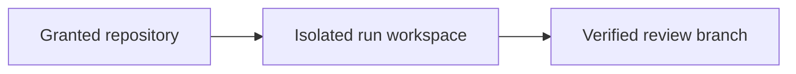

<!-- Copyright 2026 Firefly Software Foundation. SPDX-License-Identifier: Apache-2.0 -->
# Connect source-control applications

A source-control connection lets forge read granted repositories and publish reviewed changes through the provider's API. GitHub Apps, GitLab OAuth applications and Bitbucket OAuth consumers supply that authority. Your factory sign-in controls who may configure forge; it does not grant access to the provider account.

## Connect one repository

A factory administrator completes these steps in **Connections → Repositories**:

1. Select **GitHub App**, **GitLab OAuth application** or **Bitbucket OAuth consumer**. Use **Create application** to open the provider's registration instructions. Create and approve the application in the organization or workspace that owns the repository.
2. Supply the application fields described below and choose **Save application settings**. Saving those values records configuration; it does not create the provider application or establish a repository grant.
3. Install the GitHub App on the intended repositories. For GitLab or a Bitbucket authorization-code grant, choose **Authorize in…** and finish consent in the same browser. Bitbucket client credentials use the configured consumer and workspace instead.
4. Choose **Check access**. This makes a real provider request. A successful check describes the current grant, not a permanent permission.
5. Choose **Find granted repositories**, inspect the returned repository name and URL, then **Connect NAME**. forge checks discovery again and registers the selected remote repository ID with its provider URL and default branch. It does not accept a caller-substituted URL or credentials in this action.
6. Select that registered repository when defining a product or starting work. Enable signed conversation commands separately in [Repository workflow](repository-workflow.md); connecting an application alone does not enable webhook execution.

<figure class="forge-shot" markdown="1">

<figcaption>The Repositories step is the entry point for application access. This controlled Studio screenshot shows the setup stage, with no provider catalog populated; it is not evidence of a live installation or grant.</figcaption>
</figure>

## Understand the two directions

| Direction | Implemented behavior | What the result establishes |
| --- | --- | --- |
| Provider → factory | Discover granted repositories and clone their configured default branch when preparing a fresh run; a campaign can supply its frozen source commit. | The run's recorded source base, not a continuously synchronized workspace. |
| Provider conversation → factory | Accept an enabled, signed structured command from an exact trusted actor. | A retained delivery and its allowed action; ordinary discussion does not start work. |
| Factory → provider | Push verified source to the run branch and request a pull or merge request; optionally publish separate review-reference files. | A recorded publication outcome, not a merged default branch or deployment. |
| Factory → conversation | Post queued, stopped or terminal status and supported worker questions using the conversation's original identity. | Feedback about retained work; an uncertain reply remains unresolved until checked. |

These are explicit source and conversation flows. forge does not mirror every issue edit into a product definition, continuously merge remote changes into an active workspace, or merge its own pull requests. Resuming a run inspects its retained workspace. New upstream work and merge conflicts require a reviewed source decision; see [recovery](recovery.md) and [repository commands](repository-workflow.md).

<div class="forge-flow forge-flow--dependencies" role="region" aria-label="Source publication flow" aria-describedby="scm-publication-guide" tabindex="0" markdown="1">



</div>

<p class="forge-flow-caption" id="scm-publication-guide">Source enters an isolated run. Publication requires passing checks and current release authority; the provider still owns review and merge. On a narrow screen, focus the diagram and scroll horizontally.</p>

## GitHub App

[Register a GitHub App](https://docs.github.com/en/apps/creating-github-apps/registering-a-github-app/registering-a-github-app)
under the account that should own it. Request repository **Contents: read and
write** and **Pull requests: read and write**. Install it on the selected
repositories. Save its app ID, installation ID and unencrypted RSA private key
in forge. The optional app slug provides a direct installation link.

### Walk through registration

Start in your organization's **Settings → Developer settings → GitHub Apps →
New GitHub App**. Give the application a name that identifies its purpose and
set its homepage to your factory's documentation. For a local acceptance test,
use a separate test application and a repository containing fictional data.

<figure class="forge-shot" markdown="1">

<figcaption>Captured from GitHub during the local acceptance setup. The registration banner confirms that the application exists. Installation and a successful connection check are separate steps. Use your own application identifiers; the values shown belong to this test application.</figcaption>
</figure>

Configure these repository permissions before installing the application:

| Permission | Access | Purpose |
| --- | --- | --- |
| Contents | Read and write | Clone source and publish reviewed branches. |
| Pull requests | Read and write | Open pull requests and post feedback in pull-request conversations. |
| Issues | Read and write, when using issue conversations | Post status and questions back to the issue that requested the work. |
| Metadata | Read-only | Discover the repositories granted to the installation. GitHub marks this permission as mandatory. |

Organization and account permissions are not needed for this installation-token
flow. GitHub user authorization is separate from the factory's sign-in and from
the repository's signed conversation-command settings.

Complete setup in this order:

1. In **Credentials → Key pairs → New key**, generate an RSA private key. Keep
   the downloaded key out of source control, screenshots and shared support
   reports. Supply it only to forge's write-only private-key field. If the
   download is interrupted, check the browser's downloads and the application's
   existing key list before creating another key.
   [Verify the downloaded key](#verify-the-downloaded-key) before supplying it to forge.
2. Open **Install App**, select the intended account and choose **Only select
   repositories**. Select the test repository and inspect the permission summary
   before confirming the installation. Record its installation ID.
3. In forge, save the app ID, installation ID, private key and optional app slug.
   Choose **Check access**, then **Find granted repositories**. Check the returned
   repository name before connecting it.
4. Configure signed inbound commands using [Repository workflow](repository-workflow.md).
   A local forge server needs a reachable delivery route before GitHub can send
   webhooks to it. Registration and repository discovery do not establish webhook
   delivery. Keep the webhook inactive during a staged setup until its receiving
   route and signature secret are ready.

### Verify the downloaded key

In the GitHub App's **Credentials → Key pairs**, find the public SHA256 fingerprint for the key pair. On your own machine, run this in Bash or Zsh with the path to the downloaded PEM file:

```bash
set -o pipefail
openssl rsa -in "/path/to/downloaded-key.pem" -pubout -outform DER |
  openssl sha256 -binary |
  openssl base64
```

This fingerprints the public key's DER SubjectPublicKeyInfo bytes; it does not print the private key. Compare the base64 result with GitHub's displayed fingerprint. If any command fails or the values differ, stop and check the file, application and selected key pair. Do not retry authentication or generate another key to work around a mismatch. A matching fingerprint identifies the key pair; installation and repository access still require their own checks. See [GitHub's private-key verification instructions](https://docs.github.com/en/apps/creating-github-apps/authenticating-with-a-github-app/managing-private-keys-for-github-apps#verifying-private-keys).

<figure class="forge-shot" markdown="1">

<figcaption>After installation, GitHub shows the effective permissions and the selected repository. This acceptance application is restricted to one private repository containing fictional data. The image records the provider installation; a forge grant check and webhook delivery still need their own evidence.</figcaption>
</figure>

These captures record registration and installation. A complete acceptance
record also needs a real grant check, a confirmed inbound command and its
outbound feedback. Replace screenshots when the provider changes its screens
or the documented workflow changes; review every image for credentials before
publishing it.

forge signs a short-lived app JWT. Repository discovery uses an installation
token with metadata permission. Git execution and pull requests use a token
restricted to the selected repository ID, with the two write permissions above.
Tokens are refreshed before expiry. Organization approval, branch protections
and workflow-file permissions can still prevent an operation. See
[GitHub's installation-token contract](https://docs.github.com/en/apps/creating-github-apps/authenticating-with-a-github-app/generating-an-installation-access-token-for-a-github-app).

For GitHub Enterprise Server, set **Host** to its HTTPS origin. forge derives
`/api/v3` from that origin and rejects clone URLs or pagination links from another
host. App installation and permissions must exist on that same server.

## GitLab OAuth application

[Register an OAuth application](https://docs.gitlab.com/integration/oauth_provider/)
with the redirect URI displayed in forge:

```text
https://your-forge.example/api/v1/scm/connections/gitlab/callback
```

Use `api`, `read_repository` and `write_repository` scopes for merge requests and
Git access. Save the application ID and redirect URI; save its client secret
when the application is confidential. Select **Authorize** to complete the
provider's consent screen.

forge uses authorization code with PKCE, a browser-bound state that expires
after ten minutes, and server-side rotating refresh tokens. State can be used
once. Discovery requests non-archived projects where the authorized user is a
member with developer access or higher. GitLab OAuth follows the user's grants;
it does not provide GitHub's per-repository installation-token restriction.
Self-managed GitLab uses its configured HTTPS origin. See the
[GitLab OAuth API](https://docs.gitlab.com/api/oauth2/).

## Bitbucket OAuth consumer

Create an [OAuth consumer in the workspace](https://support.atlassian.com/bitbucket-cloud/docs/use-oauth-on-bitbucket-cloud/)
and enable `repository`, `repository:write`, `pullrequest` and `pullrequest:write`.
Save its client key, client secret and workspace slug. The default grant is
**client credentials**: forge obtains a short-lived token representing the
consumer's owner and lists repositories in the configured workspace.

For user consent, choose **authorization code**, register the forge callback
URI and select **Authorize**. This uses browser-bound, single-use state and
rotating refresh tokens. Client-credentials tokens are obtained again on expiry;
that grant does not require a refresh token.

API calls use bearer authentication at `api.bitbucket.org`. App passwords are
deprecated and are not used by this connection. See the current
[Bitbucket authentication contract](https://developer.atlassian.com/cloud/bitbucket/rest/intro/#authentication)
and [OAuth changes effective May 2026](https://community.developer.atlassian.com/t/oauth-2-0-and-api-authentication-changes-for-bitbucket-cloud/99003).

## Protect and revoke access

Private keys, client secrets and OAuth grants stay in `configuration/` under the
server's private data directory. Files have `0600` permissions and the directory
has `0700` permissions. API summaries return configured flags for secrets;
secret values cannot be read back. Blank secret fields preserve saved values.
Use the explicit clear action to remove them. Changing application settings
invalidates saved grants, cached tokens and pending authorization state.
Changing an OAuth host or client ID also requires an explicitly supplied client
secret or an explicit clear action. forge refuses to carry a confidential
client's saved secret to that new destination. A public GitLab client can clear
the old secret before starting a new authorization.

Before refreshing a rotating token, forge persists a dispatch marker in its
current private SCM grant storage. A timeout, invalid response or interrupted
process leaves that marker unresolved; subsequent requests cannot send the old
refresh token again, including after restart. The connection reports
**Needs authorization**. Complete a new provider consent flow to establish a
fresh grant. This recovery does not claim whether the previous provider request
succeeded. SCM storage remains owner-private configuration. The [connected-account OAuth lifecycle](connected-accounts.md) uses a separate policy, client and credential store; configuring it does not register an SCM application or move these grants into that store.

Token issuance and repository discovery also check that the application revision
did not change while a provider request was in flight. An obsolete response cannot
cache credentials or register a repository. Repeat the operation after saving the
current application configuration. Malformed credential or repository responses
fail closed; they do not mark an application as connected.

Git credentials are passed only to the clone or push process. They are not
written into repository URLs, `.git/config`, global Git configuration or generated
products. Coding and verification workers do not receive those credentials.
Provider errors omit response bodies that might contain sensitive data.

Revoke an installation or OAuth grant at the provider to remove its authority.
forge's next grant check fails if access is revoked. Clearing the local secret
removes forge's copy; it does not uninstall the provider's application. Existing
remote branches and pull requests remain.

## Connection API

All routes below use `/api/v1` and require current factory-administrator authority, except the two OAuth callback routes. Hosted clients authenticate through the configured OIDC identity; explicit local bootstrap uses its loopback operator credential. Callbacks require the saved one-use state and browser cookie. Factory credentials never appear in a redirect URL. See [identity and project access](identity.md).

| Method | Path | Result |
| --- | --- | --- |
| GET | `/scm/connections` | Application summaries and setup fields |
| PUT | `/scm/connections/{provider}` | Write-only settings and explicit secret clearing |
| POST | `/scm/connections/{provider}/test` | Live grant-test summary |
| GET | `/scm/connections/{provider}/repositories` | Repositories in current grants |
| POST | `/scm/connections/{provider}/repositories/connect` | Register a freshly discovered repository ID |
| POST | `/scm/connections/{provider}/authorize` | GitLab or Bitbucket browser authorization URL and private cookie |
| GET | `/scm/connections/{provider}/callback` | Complete GitLab or Bitbucket consent |

```json
{
  "values": {"app_id": "123", "installation_id": "456"},
  "clear_secrets": []
}
```

The connection request is `{"repository_id":"42"}`. It does not accept a URL
or credentials supplied by the caller.

## Publish a verified change

Studio runs begin with `publish: false`. After verification succeeds, **Publish
pull request** requests publication of the verified checkpoint to the run's branch and invokes the provider's pull-request API. An API-only server retains the publication request for its execution owner; an accepted request is not yet a remote pull request.
Operators can also use `forge publish RUN_ID` or explicitly request `publish:
true` when creating a run. Publication rechecks project release permission, the application revision, source/checkpoint evidence and any required review. A test-only run cannot publish an implementation branch. forge does not merge a pull request or deploy a product through this action. Project reviews and branch protections still apply.

If a publication intent has no confirmed outcome, inspect the retained run and the provider's branch and pull request before another action. A timeout does not establish that nothing was published. [Recovery](recovery.md) explains the separate publication and execution intents.

Generic Git, Azure DevOps and Gitea retain the manual repository path. HTTPS URLs
must not contain credentials. Configure an appropriate Git credential helper or
SSH agent for those sources. Their existing provider-specific publication settings
remain available; GitHub, GitLab and Bitbucket application connections provide
the managed grant flow described above.

Contract tests check request construction, state handling and failure boundaries.
Loopback HTTP acceptance runs a real forge API server and a provider fixture
server for GitHub Enterprise `/api/v3`, self-managed GitLab `/api/v4`, and
Bitbucket Cloud. It verifies operator authentication, GitHub JWT signatures,
GitLab PKCE and refresh rotation, bearer-authorized repository discovery, signed
or secret-token ingress, outbound conversation feedback, revocation, and receipt
reconciliation without duplicate comments. Test-only routing sends the configured
provider paths and Host headers to the local fixture; it does not test provider
DNS, TLS, organizational installation, or consent on a real provider account.
Live acceptance requires the real application registration, provider consent,
repository grant and successful remote operation for each account.

## Explicit SCM delegation

After a delegated `respond`, `status`, or `cancel` action completes, Forge retains
its result and schedules a comment in the same issue or pull-request conversation.
The comment includes the action result and delivery receipt reference. Answering
a worker question records the answer; it leaves the run paused and does not grant
permission to resume, publish, or merge.

Later status comments show the current run status separately from the original
action result. A recorded answer can still say that the run was paused when it
was accepted while the current status reports a subsequent failure. A cancellation
acknowledgment does not by itself prove that the worker has drained.

Forge records the outbound intent before contacting the provider. If delivery is
uncertain, the completed action and its original receipt remain available with
feedback marked `needs_reconciliation`. Processing the same receipt again does not
post another comment. An operator must check the provider outcome and record an
explicit reconciliation; an unknown delivery is never an invitation to retry it.

Signed comments identify a configured channel; they do not sign a user into Forge.
A factory administrator can explicitly map a verified provider account to an existing,
enabled Forge user for selected components and actions in one project and repository.
The mapping grants no project membership or global administrator privileges.

The first scoped adapters support answering a paused worker question, reading a specific
run's status, and requesting cancellation through the existing delivery-request runtime.
Answering leaves the run paused. It does not resume work. Cancellation is admission of a
request, not proof that the worker has drained. Other actions in a repository with SCM
delegation configured report setup required until their native authorization adapter is
available. Creating a new project from an unmapped provider account is separate work.

Use `GET /api/v1/projects/{project_id}/repositories/{repository_id}/scm-actor-bindings/candidates`
to select an already retained, verified account reference. This read does not contact the
provider. Submit the reviewed `version: 1` mapping to the same path without `/candidates`.
Include one durable request ID, the reviewed project-binding digest, the verified-reference
digest, the existing native user, explicit component IDs, allowed actions, and the previous
mapping digest for an update.
The webhook trust acknowledgment must be `true`: anyone holding that channel's webhook
credential can construct a sender claim. The mapping does not establish personal OAuth
authentication.

After a lost response, read `/scm-actor-bindings/requests/{request_id}` using the original
project, repository and request ID. A timeout, denial or missing receipt does not authorize
another write identity. Permission to return a receipt is checked after commit; denial
can therefore leave a committed mapping. The base GET lists current-head summaries with
an optional `cursor` and pages of at most 50 items, rather than a partial revision history.
Each item reports active, revoked, stale-project or stale-connection status. Active means
a saved mapping head; it does not establish current provider grants or native permissions.
Historical requests remain available through their exact request GET. Mapping revisions are immutable; limits are 100 bindings
per repository, 50 revisions per binding, 5,000 requests and 16 MiB of retained mapping
history. Each receipt envelope is limited to 64 KiB. Limits refuse rather than prune.

Connection or webhook-key rotation invalidates the mapping's pinned verification cut.
Review a fresh signed candidate and explicitly update the mapping. Legacy receipts remain
readable, but cannot be promoted into verification evidence. Legacy actor-label-only worker
responses are refused as `scm_authority_setup_required` before an action intent is recorded.
An uncertain outcome after an admitted action remains uncertain and is not replayed.

SCM worker answers carry `responding_actor` version 2 and a mapping/delivery reference.
Ordinary authenticated answers retain version 1; historical answers without attribution
retain their original bytes. A delegated answer cannot confirm a pending manual version-1
answer marker. Historical delegation is recorded evidence, not a statement that the
mapping remains active or that provider grants were freshly checked by the reader.

Provider verification follows the documented raw-body contracts:
[GitHub delivery signatures](https://docs.github.com/en/webhooks/using-webhooks/validating-webhook-deliveries),
[GitHub App issue-comment installations](https://docs.github.com/en/webhooks/webhook-events-and-payloads#issue_comment),
[GitLab signing tokens](https://docs.gitlab.com/user/project/integrations/webhooks/#signing-tokens),
and [Bitbucket Cloud signatures](https://support.atlassian.com/bitbucket-cloud/docs/manage-webhooks/).
New GitLab delegation requires its timestamped signing-token signature; the legacy shared
token remains supported for old ingress but does not qualify a new delegation candidate.
Local signed-fixture tests are separate from live provider installation acceptance.


## Opt-in same-run resume (V2)

V1 mappings still allow only `respond`, `status` and `cancel`. A separate V2 grant lets an explicitly mapped native user request continuation of the same answered, paused clarification. It grants no membership, provider login, publication, merge or handoff authority. Administrator configuration uses the API; this slice does not add Studio grant controls or SDK/CLI/MCP grant methods.

1. Review the current V1 receipt and its exact project/component cut. The mapping must be active, include `respond`, and identify an enabled native user. That user needs current project execution permission when requesting continuation.
2. As a current factory administrator, submit `SCMResumeGrantInputV2` to `POST /api/v1/projects/{project_id}/repositories/{repository_id}/scm-resume-grants`. Set `version: 2`, a fresh durable `request_id`, the expected previous V2 digest (null for the first grant), the project-binding digest, the exact V1 request ID and digest, selected component IDs, `allowed_actions: ["resume"]`, `active: true` and `acknowledge_same_run_resume: true`. The server derives the native user from V1. Replacing or revoking that V1 mapping invalidates the V2 grant.
3. Retain the request ID before sending. Recover a lost response through `/scm-resume-grants/requests/{request_id}` under the original project and repository. A timeout, 409 or 404 does not authorize a replacement request. The `/current/{binding_request_id}` read returns the retained grant head for that binding; its receipt alone does not establish current execution permission or provider grants. V2 resume uses this separate consent and does not require enabling the legacy `resume` channel command. Collaboration must still be enabled for the trusted actor. V2 status also requires the existing `status` command permission.
4. After the user answers the question, request its review cut with `/forge status {"version":2,"run_id":"RUN_ID","expected_grant_digest":"GRANT_DIGEST"}` through configured, verified SCM ingress. The result contains the exact question, answer, journal head and sealed development-plan references. Reads leave the run paused.
5. Explicitly send `/forge resume` with `version: 2`, the same `run_id` and `expected_grant_digest`, plus `expected_question_id`, `expected_response_digest` and `expected_cut_digest` from that review. These placeholders stand for the original canonical IDs and digests. The command accepts no agent, model, stack, automatic-retry, publication or handoff options. A changed question, answer, grant, source/configuration cut or journal head requires review before another explicit delivery.

The service checks current native identity, project permission, trusted SCM actor, active V1/V2 heads and the pinned connection. It checks the application's repository grant before acquiring transaction locks, then rechecks the retained local cut under those locks. Both the original execution identity and the delegated identity must still be registered and enabled. Remote revocation is not atomic with a local database transaction. `Journal.resume` separately revalidates the original execution actor and keeps that actor and its frozen execution configuration.

A successful continuation queues the original run and retains its native resume and completion records. It does not prove that the resumed work succeeded. Reprocessing that same delivery checks the recorded completion and current private-read authority before returning it; it cannot resume a later question. Unknown intents remain held for reconciliation. Outbound status feedback follows the existing durable intent and no-repost rules.

This first slice refuses any cancellation request, publication state, unfinished sandbox, unresolved external effect or contradictory plan. It requires an original plan with a matching journal reference, so a prior handoff without such a reference is unavailable here. The cut is bounded to 2,000 journal records, tasks and run-summary events per category. It admits at most 4 MiB of combined journal/task/plan evidence, a 1 MiB run snapshot and plan, and a 3-second statement timeout. Limits refuse instead of returning partial evidence. Consent history has separate V2 retention limits of 100 heads, 50 revisions per head, 5,000 requests and 16 MiB, with 64 KiB receipt envelopes.

Configured ingress remains a prerequisite. This adapter does not add authenticated provider polling, a local GitHub relay or an automatically configured webhook. Controlled host tests of the command and service do not establish live GitHub delivery or native database/worker acceptance.
