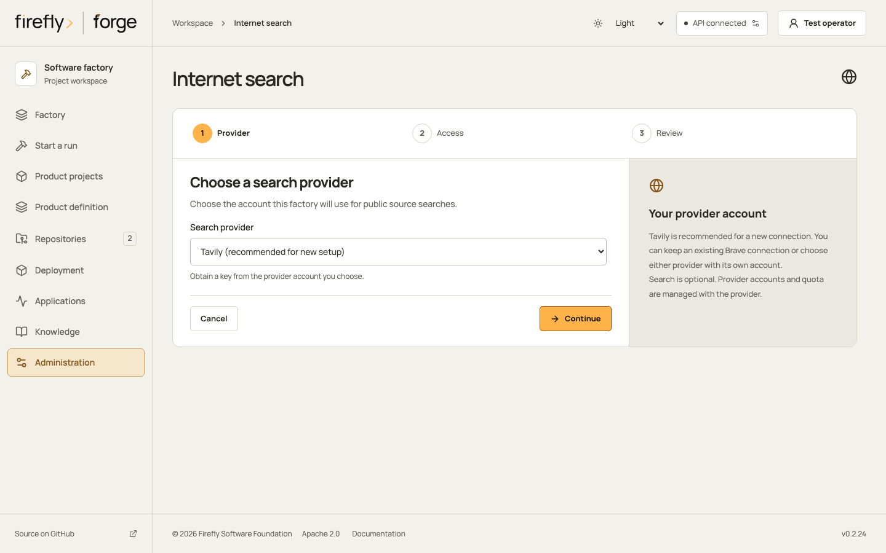
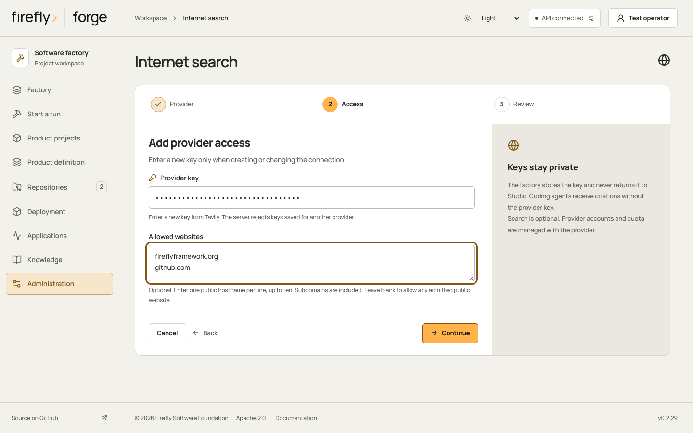
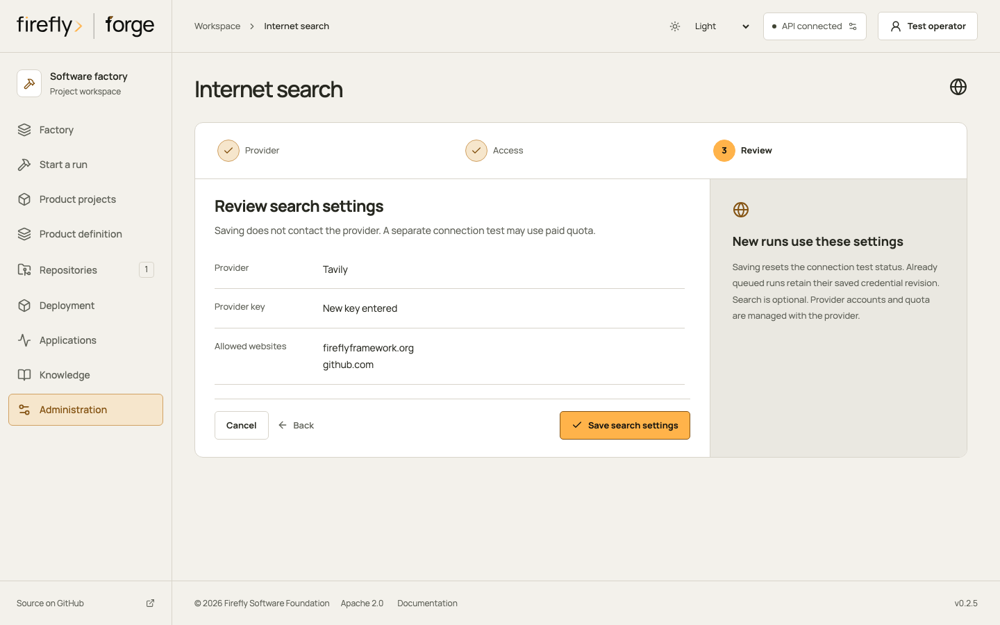
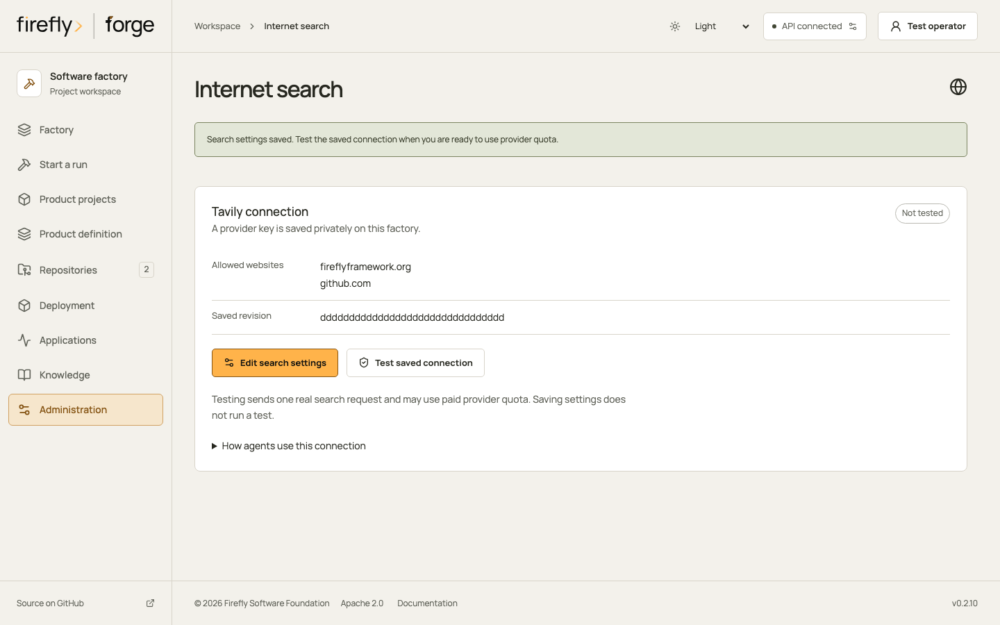
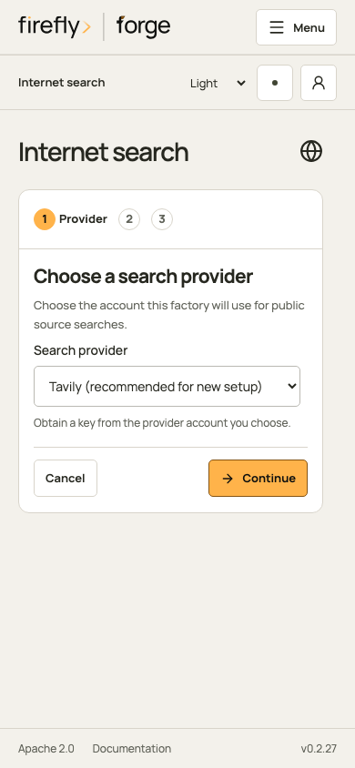
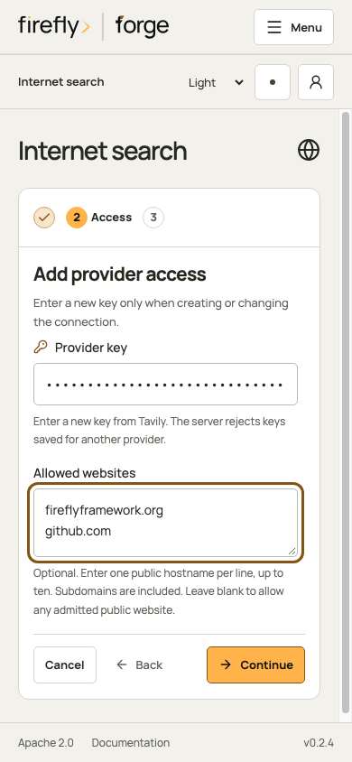
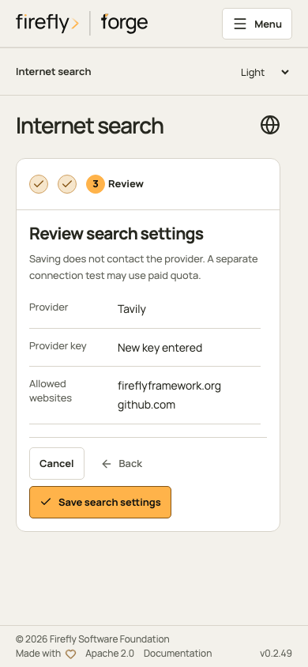
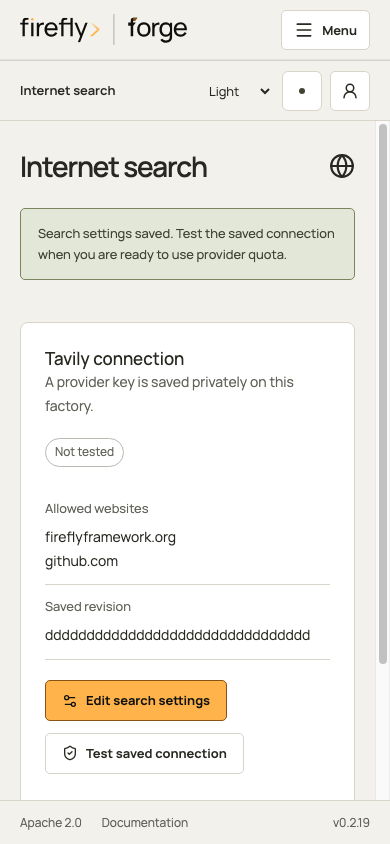

<!-- Copyright 2026 Firefly Software Foundation. SPDX-License-Identifier: Apache-2.0 -->
# Configure internet search

Use Tavily for a new search connection, or keep an existing Brave connection. Choose the provider explicitly when setting up Tavily. forge sends search requests from the control plane; the coding agent and project container receive citations without the provider key.

Search is optional. It requires an authorized provider account and may consume that account's paid allowance. Installing forge does not create an account or verify its quota.

## Connect through Studio

Open Administration, then Internet search. A factory administrator can edit this connection. Existing setups keep their saved provider, including Brave; only a setup without a saved revision starts with Tavily recommended.

These screenshots use controlled API fixtures. They show the form and saved state without contacting a provider or verifying an account. [Capture inventory and maintenance](console-tour.md#keep-captures-current) records their source and viewport.

<figure class="forge-shot" markdown="1">



<figcaption>Provider: this new fixture setup recommends Tavily. Choose the provider account you intend to use, then continue to Access. Changing a saved provider requires a new key.</figcaption>
</figure>

<details class="forge-gallery" markdown="1">
<summary>Follow access, review and the saved connection</summary>

<div class="forge-shot-grid" markdown="1">

<figure class="forge-shot" markdown="1">



<figcaption>Access: enter the selected provider's key and optional public hostnames. The fixture key is masked. On an existing connection, leave the key blank to keep it; the saved key is never returned to the page.</figcaption>
</figure>

<figure class="forge-shot" markdown="1">



<figcaption>Review: check the provider, key action and website restriction. Save search settings stores this configuration without making a search request. Cancel leaves the saved connection unchanged.</figcaption>
</figure>

<figure class="forge-shot" markdown="1">



<figcaption>Saved connection: the fixture reports a stored key and Not tested for this revision. Test saved connection sends a real request on your factory and may use paid quota. This tour does not press it.</figcaption>
</figure>

</div>
</details>

<details class="forge-gallery" markdown="1">
<summary>Configure search on a phone</summary>

<div class="forge-shot-grid" markdown="1">

<figure class="forge-shot forge-shot--phone" markdown="1">



<figcaption>Provider: select Tavily or Brave. Existing saved setups retain their provider; this fixture is a new connection. Continue opens the key and website fields.</figcaption>
</figure>

<figure class="forge-shot forge-shot--phone" markdown="1">



<figcaption>Access: enter a new key and optional hostnames, one per line. The phone uses its actual viewport and a masked fixture key. Continue validates the entries before opening Review.</figcaption>
</figure>

<figure class="forge-shot forge-shot--phone" markdown="1">



<figcaption>Review: inspect Tavily, the new key action and the two allowed websites. Save stores these settings; testing remains a separate action.</figcaption>
</figure>

<figure class="forge-shot forge-shot--phone" markdown="1">



<figcaption>Saved state: the fixture key is configured and its revision remains untested. Edit search settings changes the connection. Testing may consume quota and is never automatic.</figcaption>
</figure>

</div>
</details>

If Studio cannot confirm the save outcome, reload saved settings before repeating it. A rejected key is cleared from the form so you can enter a replacement. After an unsuccessful connection test, review provider usage before trying another request.

Removing the active key is an explicit choice under Access. It disables new searches and leaves historical keys available to already queued runs. Search still requires both the repository runner setting and the applicable role grant; saving this connection grants neither.

## Connect through the CLI

A factory administrator configures the connection. Project membership alone does not grant access to the search configuration, operator queries, connection tests or citation cache.

1. Obtain a key from the selected provider. Keep it in a regular file owned by the user running the CLI, outside the project and with permissions `0600`.
2. Configure Tavily through the authenticated factory connection:

    ```bash
    forge search configure \
      --provider tavily \
      --key-file /private/secrets/tavily.key \
      --domain fireflyframework.org \
      --domain github.com
    ```

3. Inspect the saved metadata with `forge search get`. `configured: true` confirms that a key is saved. `live_search_verified: false` means that the connection has not passed a test for this revision.
4. When you authorize a real provider request, run `forge search test`. A successful test requires at least one admitted citation. The test uses normal provider quota.
5. Enable `sandbox.internet_search` on the repository runner and grant `internet_search` to the applicable execution role before starting a run. See [agent tools](agent-tools.md) and [role grants](agent-roles.md).

Use `--provider brave` with a Brave key to select Brave. An initial configuration containing only a key retains the existing Brave behavior. Key rotation without a provider argument keeps the currently selected provider.

Switching providers requires a different key. forge rejects keys already saved for another provider, including historical revisions. A provider change never transfers the old provider's credential.

## Restrict sources

`--domain` accepts up to ten public ASCII hostnames, including subdomains. URLs, paths, wildcards, IP addresses and local hostnames are rejected. Names are normalized to lowercase. Each admitted result must match one of the hostnames or its subdomains; `evil-github.com` does not match `github.com`.

Update the restriction without replacing the key:

```bash
forge search configure --domain fireflyframework.org
```

Remove the restriction with `forge search configure --clear-domains`. An empty list allows citations from any admitted public HTTP or HTTPS hostname.

Tavily receives the restriction in its request and forge checks the returned hostnames again. Brave receives its normal query and count parameters; forge filters its results locally. Filtering can return fewer citations than requested. The broker does not issue extra requests to fill that gap or fetch the result pages.

## Frozen runs and citations

When a run enables search, forge freezes the selected provider, private credential revision and hostname restriction. Later configuration changes affect new runs. Already queued runs continue using their saved revision. Existing Brave snapshots retain their original public shape and revision files.

Every admitted result has a URL, bounded title and excerpt, and a stable `citation_id`. The private cache retains up to 1,000 citations. A result beyond that capacity still contains its source URL and reports `cached: false`. Read an existing citation through `forge search citation CITATION_ID` or `GET /api/v1/search/citations/{id}`.

Search excerpts are untrusted source material. They cannot change a role's permissions, approve a product decision or authorize a command. forge rejects known factory credentials in queries and omits reflected credentials from citations.

Clearing the active key with `forge search configure --clear-secret` disables new search use. Historical credential revisions remain available to frozen runs; this command does not erase their keys.

## Request limits and failures

| Limit | Bound |
| --- | --- |
| Query | 600 characters and 75 words |
| Results | 1 to 10 |
| Response body | 1 MB |
| Request duration | 15 seconds, including response streaming |
| Citation title / excerpt | 200 / 1,500 characters |
| Provider request identifier | 128 characters |

Tavily uses a fixed HTTPS POST endpoint with `search_depth: basic`, `topic: general` and usage reporting. Automatic parameter selection, generated answers, raw page content and images are disabled. Valid responses can include a bounded request identifier and a credit-usage receipt. Brave uses its fixed HTTPS GET endpoint and server authentication header. Both providers reject redirects.

The broker sends one request per invocation. It does not automatically retry, change providers or fall back to another credential revision. A timeout can occur after a provider charges for the request; review usage before requesting again.

The API returns HTTP `409` with a readable `detail` and sanitized `search_error` metadata:

```json
{
  "search_error": {
    "provider": "tavily",
    "kind": "quota",
    "status": 432
  }
}
```

| Kind | Action |
| --- | --- |
| `rate_limit` | Wait for the provider's request limit to reset. HTTP 429. |
| `quota` | Review the provider account's plan or spending limit. Tavily HTTP 432 or 433. |
| `authentication` | Check the selected key and account permissions. HTTP 401 or 403 from the provider. |
| `timeout` | Reconcile usage before retrying. No response was admitted. |
| `invalid_response` | Inspect the provider's availability or response contract. No partial citations are cached. |
| `provider` | Check provider availability. Includes rejected redirects and other HTTP errors. |

Provider error bodies are not included in these responses. A missing key, invalid input or oversized response also fails without returning admitted search evidence.

## API, Python and MCP

The same fields are available through `PUT /api/v1/search/configuration`: `provider`, write-only `api_key`, `clear_secret` and `include_domains`. Omitted fields preserve their current values. The endpoint is restricted to factory administrators.

The Python SDK exposes `ForgeClient.configure_search(provider="tavily", api_key=authorized_key, include_domains=["github.com"])`. `search_configuration()`, `test_search()`, `internet_search()` and `search_citation()` use the same authenticated routes as the CLI.

Forge's own MCP server exposes `configure_internet_search(provider="tavily", api_key_file="/private/secrets/tavily.key", include_domains=["github.com"])`. The key file belongs to the MCP host. Its schema accepts the file path rather than a raw key. `search_internet`, `test_internet_search` and `get_search_citation` delegate to the factory API. MCP access does not bypass factory authorization.

Search calls during implementation currently sit inside the implementation's execution intent. Separate intent and result receipts for each search invocation, provider-usage reconciliation after a process crash, and external MCP server connections are not implemented. See [capability limits](capabilities.md) for the factory's other execution boundaries.

Provider contracts: [Tavily Search API](https://docs.tavily.com/documentation/api-reference/endpoint/search), [Brave web search](https://api-dashboard.search.brave.com/api-reference/web/search/get).
