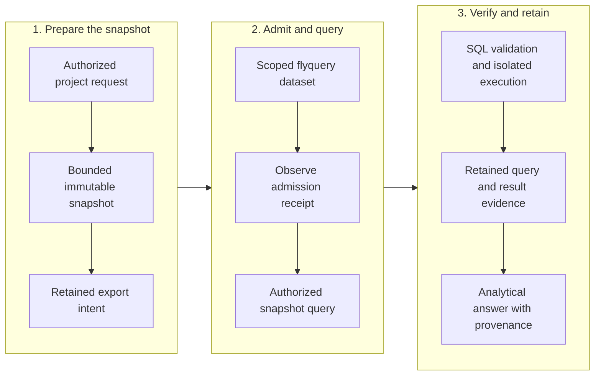

<!-- Copyright 2026 Firefly Software Foundation. SPDX-License-Identifier: Apache-2.0 -->
# Explore structured project data

[flyquery](https://github.com/fireflyframework/flyquery) manages structured datasets and can answer questions through its own query pipeline. forge's optional integration reads a project's catalog, individual tables and known schema objects. Open **Administration → Structured analytics** to configure the connection or inspect the project scope you can read.

[flycanon](https://github.com/fireflyframework/flycanon) remains the required service for cited framework guidance, project documents and canonical verified memory. forge PostgreSQL and the journal retain execution authority. flyquery's query history and proposed SQL examples have separate meanings: they cannot approve a procedure, mark a run verified or replace source/checkpoint receipts.

## What you can do now

| Operation | Available behavior |
| --- | --- |
| Configure a project | A current factory administrator saves one exact endpoint, tenant, workspace and dataset using a write-only scoped token. |
| Read the catalog | A current project reader requests up to 50 tables in one complete page. Incomplete or foreign-scope results are refused. |
| Inspect a table | Select a catalog table to read its reported identity, description and current snapshot reference. |
| Read a known schema object | Supply an exact object UUID from your data administrator. Its table and snapshot must match the selected scope. |
| Run queries or discover every field | Unavailable in this adapter. It does not generate SQL, call a model, export factory records or publish canonical memory. |

The native pyfly configuration service, controller and typed persistence retain configuration revisions and immutable receipts. Catalog reads use the released flyquery SDK's agent-token GET methods. The factory rechecks current identity, project access, configuration and private credentials after the remote read before returning its observation.

## Connect a project

Prepare an existing flyquery 26.10.4 service, tenant, workspace and dataset. The endpoint must be an HTTPS origin on port 443 with a normally trusted certificate. Custom ports and private CA configuration are not supported by this connection. A source installation enables the optional SDK with `uv sync --locked --extra analytics`; the factory does not install it from the wizard or provision a flyquery server.

1. Sign in as a factory administrator, open **Administration → Structured analytics**, select the project and choose **Set up Flyquery**.
2. In **Requirements**, confirm the service and optional SDK are available. Obtain a workspace-scoped agent token with `flyquery.schema:read` from your data administrator.
3. In **Connection**, enter the HTTPS origin, tenant, workspace UUID and dataset UUID. Enter the token for this save. The form never reloads a retained token.
4. In **Review**, check the exact scope and save. A saved configuration means the settings were committed; remote access has not yet been checked.
5. Choose **Read catalog**. Select a returned table to inspect it. For a schema-object read, enter the known object UUID under that table. Full field discovery and prepared-query results remain unavailable.

Project readers can inspect the bound scope without receiving its configuration token or administrator controls. A missing session, revoked access, foreign scope or failed read is reported as an error. It must not appear as an empty dataset.

### Change or disable a connection

Choose **Edit connection**, supply the full scope and enter a token explicitly. Saving compares the revision you read with the current revision. A conflicting revision requires reading the saved configuration again. Changing a connection clears earlier displayed catalog observations.

After an uncertain save, choose **Reload saved configuration** before another write. The token is cleared, and the original request may still settle. Reload is an explicit read; it does not prove that an earlier request was cancelled.

Each project permits 32 ordinary configuration changes. If revision 32 is enabled, **Disable connection** offers one final disable at revision 33 with the unchanged scope and an explicitly supplied token. That terminal binding cannot be edited or re-enabled. A connection already disabled at revision 32 has no further changes. Disabling uses local authority and persistence checks without importing the optional SDK or contacting flyquery.

### Read observations correctly

An observation records the configuration revision, scope, observation time and local response digest. A reported snapshot UUID identifies what the remote service returned; it is not a content hash or proof of an atomic, current data cut. Requests have a ten-second remote deadline, a three-second connection limit and a 256 KiB response bound. Changed credentials or authorization invalidate the result.

See the [HTTP and SDK contract](api.md#read-optional-structured-analytics) for exact routes, revision fields and supported read limits. The remaining sections describe the assessed upstream query pipeline and the additional work required before forge could export snapshots or execute analytical queries.

## Earlier assessment and released corrections

The assessed `QueryService` retrieves and reranks schema context, grounds the question, then either compiles declared semantic metrics or asks a generation agent for SQL. `AstClassifier` classifies the candidate, `ScopeGuard` checks its operation and dataset access, and `TableResolver` resolves registered Parquet snapshots. `DuckDBExecutor` runs the statement, with bounded critic attempts after execution errors. An explainer prepares the answer. The service retains query/results and may propose an example for later review.

Assessment of [revision `7b02792`](https://github.com/fireflyframework/flyquery/tree/7b0279258dce31d1718da44d58f729a15529c5b0) found two admission blockers:

| Component | Observed behavior | Required before forge use |
| --- | --- | --- |
| AST classification and scope guard | A `SELECT` using `read_csv_auto` produced no registered table references and passed with query-read scope and an empty dataset allowlist. Actual DuckDB execution read a synthetic, unregistered local file. | Reject external-file and network table functions, unknown references and unsupported AST forms before execution. Every data reference must resolve to an explicitly authorized snapshot. |
| DuckDB execution | A fresh in-process connection applies memory and thread settings and caps returned rows. The executor does not enforce the declared `default_statement_timeout_ms`. | Enforce real wall time and cancellation in an isolated process, with operating-system resource limits and confined snapshot access. |

Those findings describe the pinned assessment revision. Published [flyquery 26.10.2](https://github.com/fireflyframework/flyquery/releases/tag/v26.10.2) restricts the supported read path to authorized registered local snapshots. [26.10.3](https://github.com/fireflyframework/flyquery/releases/tag/v26.10.3) adds cooperative statement deadlines and cancellation, preserves source data during copy-on-write cleanup, and refuses late success. A statement deadline is a terminal execution outcome rather than an invitation for the critic to repair SQL.

A separate in-memory DuckDB connection still does not isolate the host filesystem or network. Cooperative cancellation is not an operating-system process kill. The proposed forge adapter must qualify confined snapshot access, resource limits, cancellation and all revised SQL through its actual authorized path before it can be enabled. The released SDK and executor proofs do not establish that adapter.

Source: [`QueryService`](https://github.com/fireflyframework/flyquery/blob/7b0279258dce31d1718da44d58f729a15529c5b0/src/flyquery/core/services/query/query_service.py), [`AstClassifier`](https://github.com/fireflyframework/flyquery/blob/7b0279258dce31d1718da44d58f729a15529c5b0/src/flyquery/core/services/execution/ast_classifier.py), [`ScopeGuard`](https://github.com/fireflyframework/flyquery/blob/7b0279258dce31d1718da44d58f729a15529c5b0/src/flyquery/core/services/execution/scope_guard.py), [`DuckDBExecutor`](https://github.com/fireflyframework/flyquery/blob/7b0279258dce31d1718da44d58f729a15529c5b0/src/flyquery/core/services/execution/duckdb_executor.py).

## Future snapshot and query boundaries

An operator would enable analytics for an explicit project and purpose after reviewing its data policy. The adapter would export a bounded, immutable snapshot from authorized factory records. It would exclude private settings, tokens, raw command logs, unrestricted source content and unrelated projects. Approved columns could include run identity, source tree, check identity, outcome, duration and verification time.

Each snapshot would retain its schema version, project and repository identities, source/checkpoint references, export time, content digest and retention policy. A flyquery dataset would belong to that exact project scope. A query would name its snapshot version so a later dataset update could not change the meaning of a retained answer. Combining repositories in one project would require an explicit authorized snapshot; registration in a `ProductProject` alone would not authorize aggregation.

Snapshot export and query execution would need these additional responsibilities:

| Responsibility | Required behavior |
| --- | --- |
| Analytics connection | Private endpoint, TLS trust and scoped service credential transport; no browser-supplied identity headers as authority. |
| Snapshot service | Current project authorization, approved column selection, immutable snapshot creation and retained export receipts. |
| Query service | Frozen snapshot/configuration references, bounded question, current dataset grants and cancellation. |
| Analytics controller | Typed request/response models, project read authorization and actual readiness/result evidence. |

The current registered analytics connection and read controller cover the bounded catalog path above. Snapshot export and query execution remain future work. They must follow the native knowledge pattern: inject private configuration and typed repositories, centralize transport, and keep authority checks in server code.

Follow the phases from left to right and the steps within each phase from top to bottom. Scroll horizontally on small screens; keyboard users can focus the diagram and use the arrow keys.

This is the proposed analytics sequence. Current flycanon retrieval and memory operate through the [implemented knowledge lifecycle](knowledge.md).

## Write-ahead effects and recovery

Snapshot upload and remote query admission would each need their own retained intent, stable request identity and observed receipt. Before either effect, an execution worker would recheck ownership and the requesting actor's project authority. A receipt would identify the exact remote tenant, workspace, dataset, snapshot, query and result digest that were observed.

A connection timeout after submission leaves an unknown outcome. Recovery would inspect the retained remote identity before another submission. It must preserve the original snapshot and configuration references, including after an endpoint or workspace setting changes. A local timeout cannot establish that a remote query stopped, and a request identity cannot establish server idempotency unless the selected route enforces it.

A read query can still create remote query history, result objects, example proposals or provider costs. Treat those effects explicitly in the admission policy and recovery contract. No analytics result should be automatically promoted into flycanon memory. Promotion would require reviewed source evidence, existing factory verification gates and separate flycanon admission/canonical receipts.

## Future query readiness

The implemented Studio setup binds an endpoint, tenant, workspace and dataset for catalog reads. Extending it to queries would require an immutable snapshot and bounded execution policy. A separate small scoped query would need to establish permitted snapshot retrieval and actual cancellation/resource behavior.

Saving settings must report configured state. Ready state would require retained evidence from the selected service and project scope. Authentication, snapshot admission, query execution and result provenance need separate visible outcomes. Updating configuration would affect newly admitted work; it must preserve queued snapshots and unresolved intents.

The **Knowledge** form configures flycanon; **Structured analytics** configures the separate optional read adapter. Use [knowledge setup](knowledge.md#set-up-knowledge-from-a-fresh-installation) for the required knowledge installation. Saving an analytics endpoint does not enable query execution.

## Checks before enabling an adapter

Use isolated test datasets and synthetic files for qualification. Required checks include:

1. The actual query path rejects file/network table functions, unknown tables, unsupported AST forms and attempts to escape the allowed dataset. Revalidate every critic-produced SQL revision.
2. Project and repository permissions are enforced at admission and execution, including revoked membership, expired grants and cross-project dataset identities.
3. Execution has observed wall-time cancellation, memory/CPU limits, bounded output and no access to factory storage, host sockets or ambient service credentials.
4. Snapshot admission is idempotent for its stable identity and content digest. Conflicting content is rejected; lost responses reconcile without duplicate uploads.
5. Restart and worker-ownership loss retain uncertain query/export outcomes. A result cannot be accepted under a different snapshot, source tree or configuration revision.
6. Answers expose query, SQL, snapshot, schema and result provenance. Aggregated analytics do not alter canonical memory, learning eligibility or delivery authority.
7. Retention, deletion and backup preserve or remove dataset objects together with their metadata and retained references.

Record source revision, executor configuration, test receipts and remaining provider/deployment acceptance separately. Passing SQL unit tests alone cannot establish an authorized forge integration or a production deployment.
