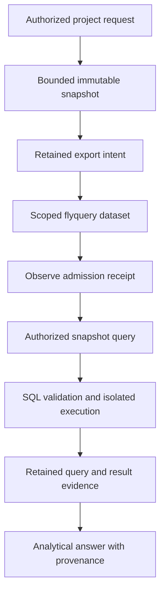

<!-- Copyright 2026 Firefly Software Foundation. SPDX-License-Identifier: Apache-2.0 -->
# Design structured project analytics

[flyquery](https://github.com/fireflyframework/flyquery) answers natural-language questions over structured datasets using schema retrieval, generated SQL and DuckDB execution. It could help inspect project check outcomes, procedure reuse, durations or failure categories. forge currently has no flyquery dependency, native adapter, managed deployment or configuration screen. The design below is a proposed integration, with explicit conditions for enabling it.

[flycanon](https://github.com/fireflyframework/flycanon) remains the required service for cited framework guidance, project documents and canonical verified memory. forge PostgreSQL and the journal retain execution authority. flyquery's query history and proposed SQL examples have separate meanings: they cannot approve a procedure, mark a run verified or replace source/checkpoint receipts.

## Assessed flyquery pipeline

The assessed `QueryService` retrieves and reranks schema context, grounds the question, then either compiles declared semantic metrics or asks a generation agent for SQL. `AstClassifier` classifies the candidate, `ScopeGuard` checks its operation and dataset access, and `TableResolver` resolves registered Parquet snapshots. `DuckDBExecutor` runs the statement, with bounded critic attempts after execution errors. An explainer prepares the answer. The service retains query/results and may propose an example for later review.

Assessment of [revision `7b02792`](https://github.com/fireflyframework/flyquery/tree/7b0279258dce31d1718da44d58f729a15529c5b0) found two admission blockers:

| Component | Observed behavior | Required before forge use |
| --- | --- | --- |
| AST classification and scope guard | A `SELECT` using `read_csv_auto` produced no registered table references and passed with query-read scope and an empty dataset allowlist. Actual DuckDB execution read a synthetic, unregistered local file. | Reject external-file and network table functions, unknown references and unsupported AST forms before execution. Every data reference must resolve to an explicitly authorized snapshot. |
| DuckDB execution | A fresh in-process connection applies memory and thread settings and caps returned rows. The executor does not enforce the declared `default_statement_timeout_ms`. | Enforce real wall time and cancellation in an isolated process, with operating-system resource limits and confined snapshot access. |

A separate in-memory DuckDB connection does not isolate the host filesystem or network. A row cap bounds the response, not the work needed to compute it. Keep the proposed forge integration disabled until those boundaries are repaired and tested through the actual query path, including critic-generated revisions.

Source: [`QueryService`](https://github.com/fireflyframework/flyquery/blob/7b0279258dce31d1718da44d58f729a15529c5b0/src/flyquery/core/services/query/query_service.py), [`AstClassifier`](https://github.com/fireflyframework/flyquery/blob/7b0279258dce31d1718da44d58f729a15529c5b0/src/flyquery/core/services/execution/ast_classifier.py), [`ScopeGuard`](https://github.com/fireflyframework/flyquery/blob/7b0279258dce31d1718da44d58f729a15529c5b0/src/flyquery/core/services/execution/scope_guard.py), [`DuckDBExecutor`](https://github.com/fireflyframework/flyquery/blob/7b0279258dce31d1718da44d58f729a15529c5b0/src/flyquery/core/services/execution/duckdb_executor.py).

## Proposed data and service boundaries

An operator would enable analytics for an explicit project and purpose after reviewing its data policy. The adapter would export a bounded, immutable snapshot from authorized factory records. It would exclude private settings, tokens, raw command logs, unrestricted source content and unrelated projects. Approved columns could include run identity, source tree, check identity, outcome, duration and verification time.

Each snapshot would retain its schema version, project and repository identities, source/checkpoint references, export time, content digest and retention policy. A flyquery dataset would belong to that exact project scope. A query would name its snapshot version so a later dataset update could not change the meaning of a retained answer. Combining repositories in one project would require an explicit authorized snapshot; registration in a `ProductProject` alone would not authorize aggregation.

The proposed native pyfly services would have these responsibilities:

| Proposed service | Responsibility |
| --- | --- |
| Analytics connection | Private endpoint, TLS trust and scoped service credential transport; no browser-supplied identity headers as authority. |
| Snapshot service | Current project authorization, approved column selection, immutable snapshot creation and retained export receipts. |
| Query service | Frozen snapshot/configuration references, bounded question, current dataset grants and cancellation. |
| Analytics controller | Typed request/response models, project read authorization and actual readiness/result evidence. |

These names describe responsibilities to implement. They are not registered beans in `ForgeBeans`. The adapter should follow the existing native knowledge pattern: inject private configuration and typed repositories, centralize transport, and keep authority checks in server code.

This is the proposed analytics sequence. Current flycanon retrieval and memory operate through the [implemented knowledge lifecycle](knowledge.md).

## Write-ahead effects and recovery

Snapshot upload and remote query admission would each need their own retained intent, stable request identity and observed receipt. Before either effect, an execution worker would recheck ownership and the requesting actor's project authority. A receipt would identify the exact remote tenant, workspace, dataset, snapshot, query and result digest that were observed.

A connection timeout after submission leaves an unknown outcome. Recovery would inspect the retained remote identity before another submission. It must preserve the original snapshot and configuration references, including after an endpoint or workspace setting changes. A local timeout cannot establish that a remote query stopped, and a request identity cannot establish server idempotency unless the selected route enforces it.

A read query can still create remote query history, result objects, example proposals or provider costs. Treat those effects explicitly in the admission policy and recovery contract. No analytics result should be automatically promoted into flycanon memory. Promotion would require reviewed source evidence, existing factory verification gates and separate flycanon admission/canonical receipts.

## Proposed setup and readiness

A future Studio setup flow should let an administrator select an authorized HTTPS endpoint, tenant, exact project dataset, immutable snapshot and bounded execution policy. Credentials would be write-only. Its service check would establish authentication; a separate small scoped query would establish permitted snapshot retrieval and actual cancellation/resource behavior.

Saving settings must report configured state. Ready state would require retained evidence from the selected service and project scope. Authentication, snapshot admission, query execution and result provenance need separate visible outcomes. Updating configuration would affect newly admitted work; it must preserve queued snapshots and unresolved intents.

The current **Knowledge** form configures flycanon only. Use [knowledge setup](knowledge.md#set-up-knowledge-from-a-fresh-installation) for the implemented installation. Adding an endpoint or environment variable cannot activate the proposed flyquery adapter.

## Checks before enabling an adapter

Use isolated test datasets and synthetic files for qualification. Required checks include:

1. The actual query path rejects file/network table functions, unknown tables, unsupported AST forms and attempts to escape the allowed dataset. Revalidate every critic-produced SQL revision.
2. Project and repository permissions are enforced at admission and execution, including revoked membership, expired grants and cross-project dataset identities.
3. Execution has observed wall-time cancellation, memory/CPU limits, bounded output and no access to factory storage, host sockets or ambient service credentials.
4. Snapshot admission is idempotent for its stable identity and content digest. Conflicting content is rejected; lost responses reconcile without duplicate uploads.
5. Restart and worker-ownership loss retain uncertain query/export outcomes. A result cannot be accepted under a different snapshot, source tree or configuration revision.
6. Answers expose query, SQL, snapshot, schema and result provenance. Aggregated analytics do not alter canonical memory, learning eligibility or delivery authority.
7. Retention, deletion and backup preserve or remove dataset objects together with their metadata and retained references.

Record source revision, executor configuration, test receipts and remaining provider/deployment acceptance separately. Passing SQL unit tests alone cannot establish an authorized forge integration or a production deployment.
